# Free Web Apps

Handy little web apps I build as a hobby and give away for free. Completely free, no ads, no sign-up, and most work offline. A new app is added every day. Each app lives in its own folder with a description and screenshots.

Made by [Muhammad Umar](https://umar8092.github.io/) ([portfolio](https://umar8092.github.io/)).

**All apps:** [umar8092.github.io/apps](https://umar8092.github.io/apps/)

###  [To-Do List](https://umar8092.github.io/apps/offlinetodo/)

A free online to-do list with no registration. Works offline and stays private on your device. Due dates, priorities, sort by due date, search, backup and share.

[**Open the app**](https://umar8092.github.io/apps/offlinetodo/) &middot; [Details and screenshots](offlinetodo/)

<a href="offlinetodo/">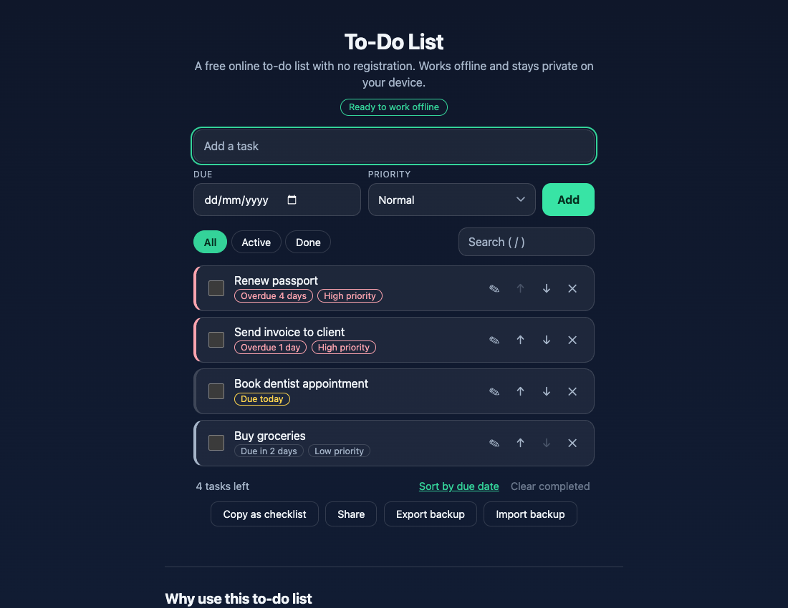</a>

### 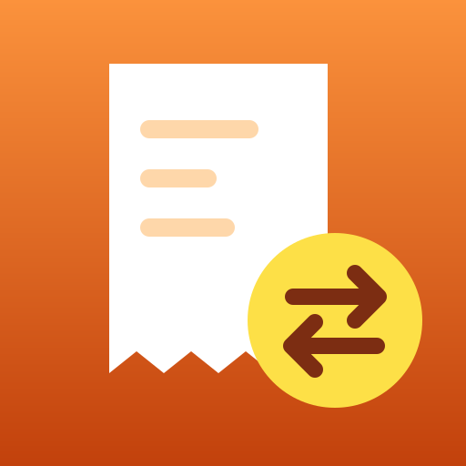 [Bill Splitter](https://umar8092.github.io/apps/bill-splitter/)

Split a bill and see exactly who owes who. Type what each person paid, get the payments between people, and email the summary. Also splits evenly or by order, with tip and tax.

[**Open the app**](https://umar8092.github.io/apps/bill-splitter/) &middot; [Details and screenshots](bill-splitter/)

<a href="bill-splitter/">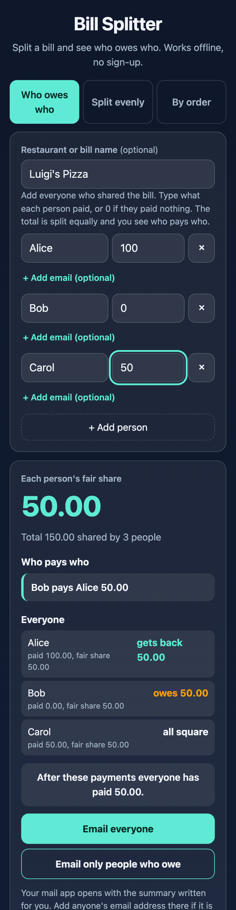</a>

###  [Sleep Cycle Calculator](https://umar8092.github.io/apps/sleepcycle/)

Find the best time to go to bed or wake up using 90-minute sleep cycles.

[**Open the app**](https://umar8092.github.io/apps/sleepcycle/) &middot; [Details and screenshots](sleepcycle/)

<a href="sleepcycle/">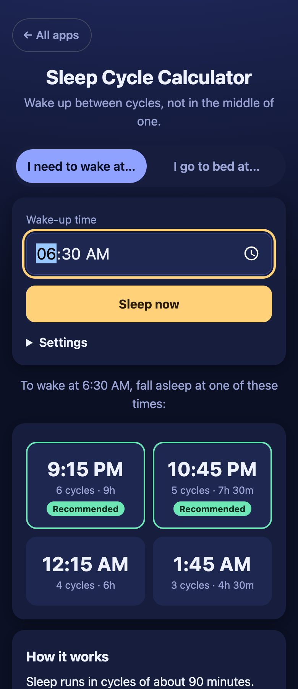</a>

### 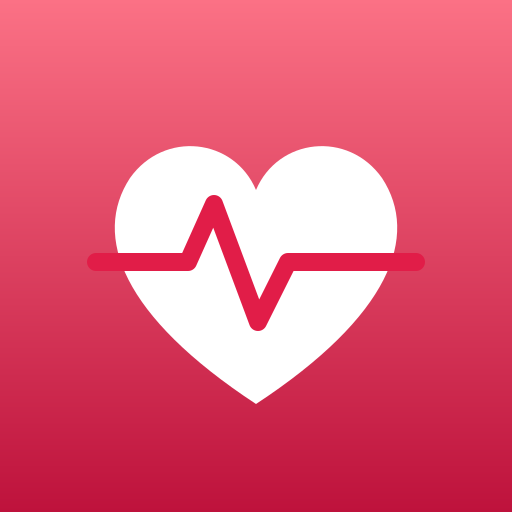 [Heartbeat Sound](https://umar8092.github.io/apps/sleepbeat/)

A calming heartbeat sound that loops all night, for sleep, babies and puppies. Keeps playing when the phone screen locks. Adjustable heart rate and sleep timer.

[**Open the app**](https://umar8092.github.io/apps/sleepbeat/) &middot; [Details and screenshots](sleepbeat/)

<a href="sleepbeat/">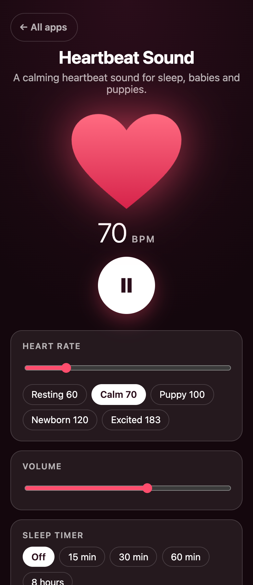</a>

### 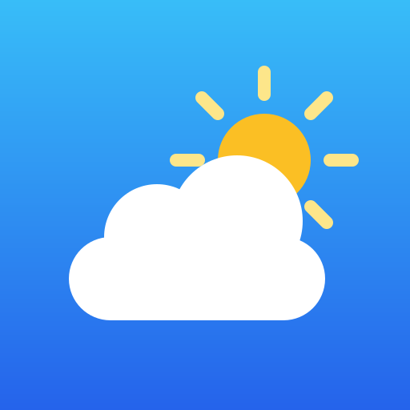 [Weather App](https://umar8092.github.io/apps/weather-app/)

Weather forecast for any city or your location, with advice (umbrella? what to wear?), hourly and 7-day forecasts. No sign-up and no API key.

[**Open the app**](https://umar8092.github.io/apps/weather-app/) &middot; [Details and screenshots](weather-app/)

<a href="weather-app/">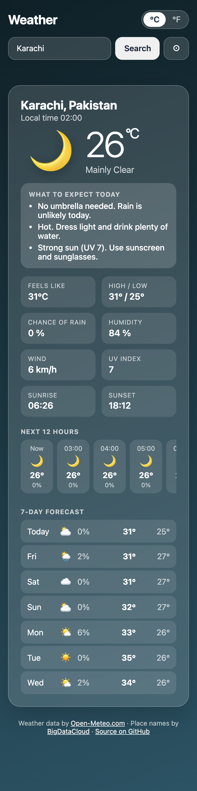</a>

### 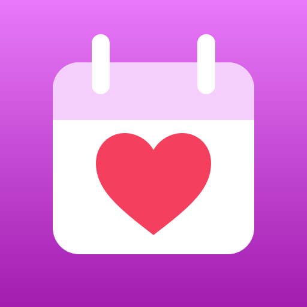 [Due Date Calculator](https://umar8092.github.io/apps/due-date-calculator/)

Find your pregnancy due date and how many weeks pregnant you are today from your last period, conception date, IVF transfer or scan. Key dates, email or copy the summary, add the due date to your calendar.

[**Open the app**](https://umar8092.github.io/apps/due-date-calculator/) &middot; [Details and screenshots](due-date-calculator/)

<a href="due-date-calculator/">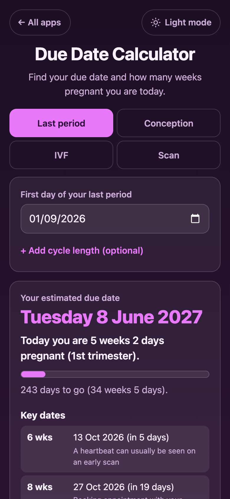</a>

### 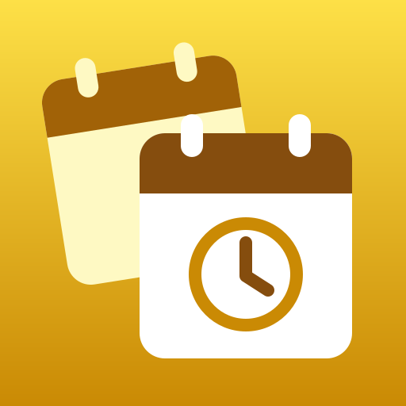 [Time Zone Meeting Planner](https://umar8092.github.io/apps/time-zone-meeting-planner/)

Find a meeting time that works across time zones, even when people work different hours (days, evenings or nights). Per-person working hours, custom length up to 3 hours, copy, email and calendar file.

[**Open the app**](https://umar8092.github.io/apps/time-zone-meeting-planner/) &middot; [Details and screenshots](time-zone-meeting-planner/)

<a href="time-zone-meeting-planner/">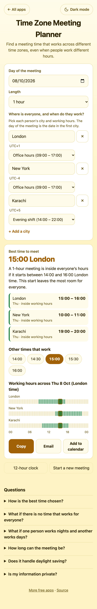</a>

### 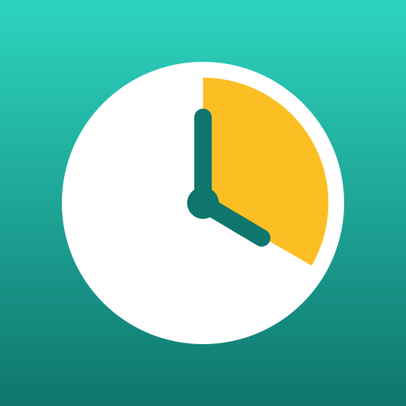 [Work Hours Calculator](https://umar8092.github.io/apps/work-hours-calculator/)

Weekly timesheet: type start, finish and break for each day and get total hours, overtime and pay. Night shifts past midnight work, and each day has its own break. Copy, email or print.

[**Open the app**](https://umar8092.github.io/apps/work-hours-calculator/) &middot; [Details and screenshots](work-hours-calculator/)

<a href="work-hours-calculator/">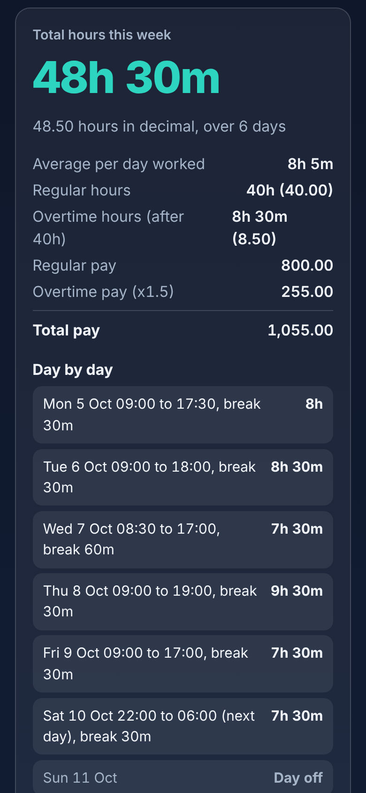</a>

### 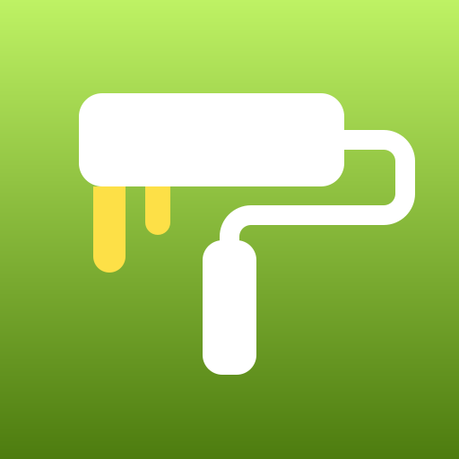 [Paint Calculator](https://umar8092.github.io/apps/paint-calculator/)

Find out how much paint to buy and which tins to pick. Every room has its own size, doors, windows, coats and colour, ceilings are listed separately, and you can email, copy or print the shopping list.

[**Open the app**](https://umar8092.github.io/apps/paint-calculator/) &middot; [Details and screenshots](paint-calculator/)

<a href="paint-calculator/">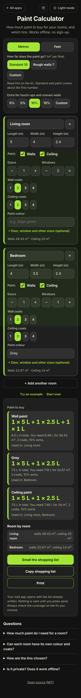</a>

### 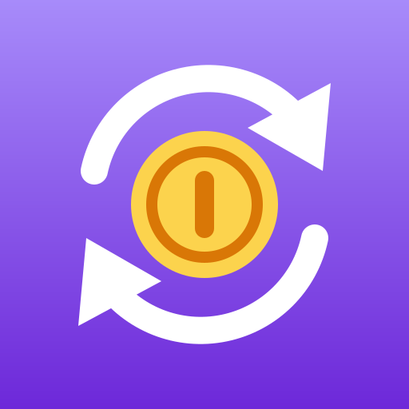 [Subscription Tracker](https://umar8092.github.io/apps/subscription-tracker/)

See what all your subscriptions cost per month and per year, what is due in the next 7 and 30 days, and when free trials end so you can cancel in time. Payment dates move forward by themselves. Calendar reminders, backup, copy and email. Private, no bank link.

[**Open the app**](https://umar8092.github.io/apps/subscription-tracker/) &middot; [Details and screenshots](subscription-tracker/)

<a href="subscription-tracker/">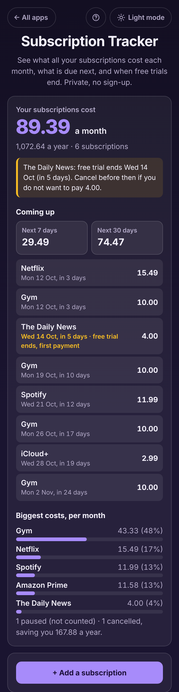</a>

### 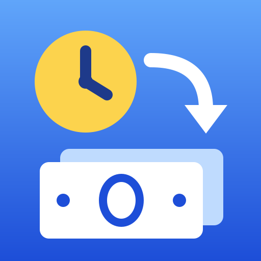 [Hourly to Salary Converter](https://umar8092.github.io/apps/hourly-to-salary-converter/)

Turn any pay into per hour, day, week, 2 weeks, month and year. Counts paid holiday, unpaid days off and overtime, and compares up to 4 job offers to show which really pays more, a year and per hour you actually work. Copy, email or print.

[**Open the app**](https://umar8092.github.io/apps/hourly-to-salary-converter/) &middot; [Details and screenshots](hourly-to-salary-converter/)

<a href="hourly-to-salary-converter/">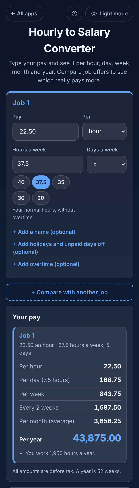</a>

### 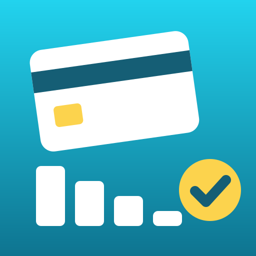 [Loan and Credit Card Payoff Planner](https://umar8092.github.io/apps/loan-and-credit-card-payoff-planner/)

Add your loans and credit cards and see the month you will be debt-free, the total interest, what to pay on each debt this month, and how much sooner you finish by paying a bit more. Compares highest interest first with smallest balance first, warns when a payment never pays a debt off, and shows what to pay to be debt-free in 1 to 5 years. Copy, email or print.

[**Open the app**](https://umar8092.github.io/apps/loan-and-credit-card-payoff-planner/) &middot; [Details and screenshots](loan-and-credit-card-payoff-planner/)

<a href="loan-and-credit-card-payoff-planner/">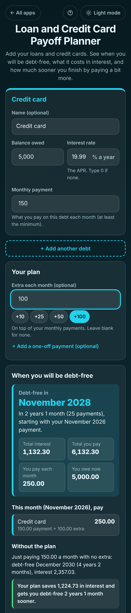</a>

### 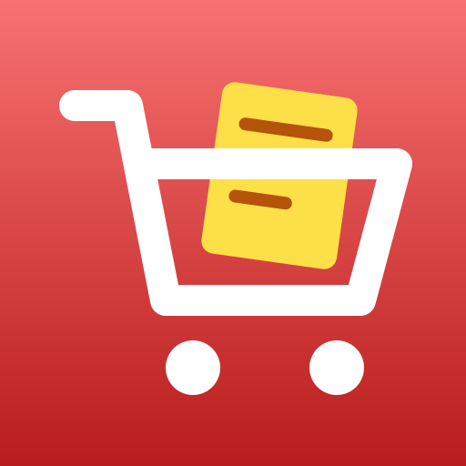 [Grocery List with Running Total](https://umar8092.github.io/apps/grocery-list-with-running-total/)

A grocery list with prices for staying on budget. Tick items off as they go in your trolley and see what you have spent, what is still to get, what the whole list costs and what is left of your budget, before you reach the till. Weights, items with no price yet, optional sales tax, paste a whole list, reuse it next week. Copy, email or print.

[**Open the app**](https://umar8092.github.io/apps/grocery-list-with-running-total/) &middot; [Details and screenshots](grocery-list-with-running-total/)

<a href="grocery-list-with-running-total/">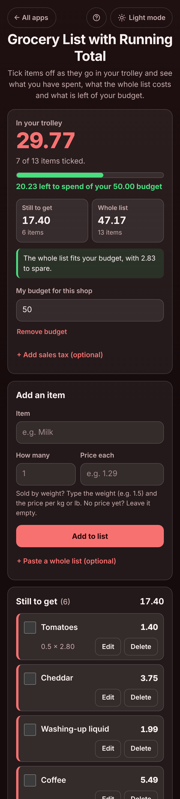</a>

### 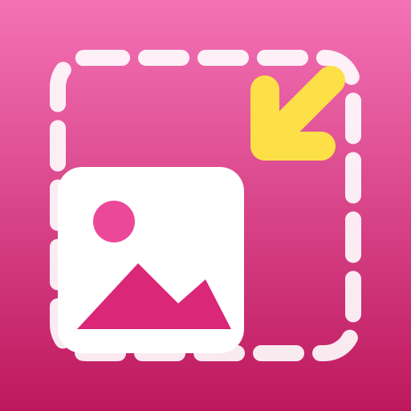 [Photo Size Reducer for Online Forms](https://umar8092.github.io/apps/photo-size-reducer-for-online-forms/)

Make a photo smaller than the size an online form allows, like 20 KB, 50 KB, 100 KB or 200 KB, right on your device: nothing is uploaded. Each photo has its own limit, with an optional minimum size ("between 20 KB and 50 KB") and exact pixels (600 × 600). Download or share the result.

[**Open the app**](https://umar8092.github.io/apps/photo-size-reducer-for-online-forms/) &middot; [Details and screenshots](photo-size-reducer-for-online-forms/)

<a href="photo-size-reducer-for-online-forms/">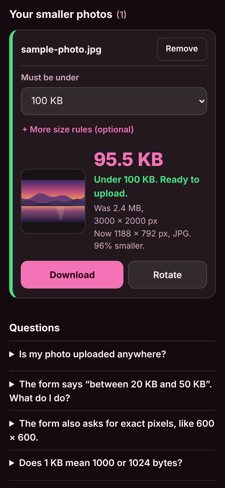</a>

### 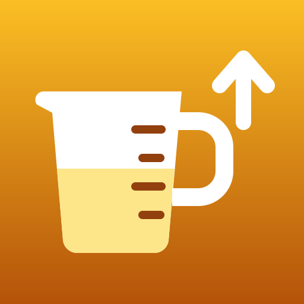 [Recipe Scaler and Unit Converter](https://umar8092.github.io/apps/recipe-scaler-and-unit-converter/)

Cook a recipe for more or fewer people. Paste the ingredients, type how many it makes and how many you want, and get every amount in easy kitchen measures (1⅓ cups, not 1.3125). Turns cups into grams or grams into cups, adds °C, °F and gas mark to oven temperatures, tells you what to do with part of an egg, and saves your recipes.

[**Open the app**](https://umar8092.github.io/apps/recipe-scaler-and-unit-converter/) &middot; [Details and screenshots](recipe-scaler-and-unit-converter/)

<a href="recipe-scaler-and-unit-converter/">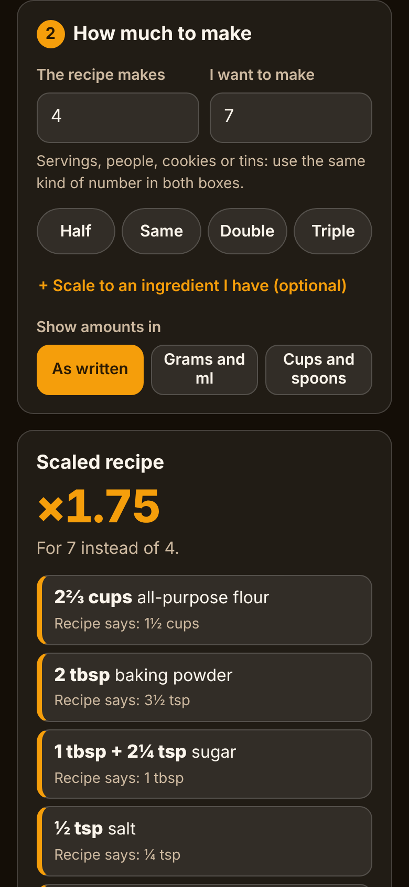</a>

### 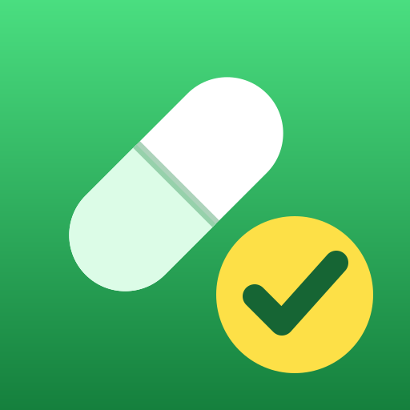 [Medication Tracker](https://umar8092.github.io/apps/medication-tracker/)

Never wonder "did I take my pill?" again. Tap Taken when you take a dose and see every set time for today as taken or not taken yet, what is due next, and, for medicines taken when needed, from what time the next dose is allowed. Warns about double doses, counts pills left, handles bedtime doses after midnight, courses with a last day and weekly medicines. History to show your doctor, calendar reminders, backup. Private, no sign-up, works offline.

[**Open the app**](https://umar8092.github.io/apps/medication-tracker/) &middot; [Details and screenshots](medication-tracker/)

<a href="medication-tracker/">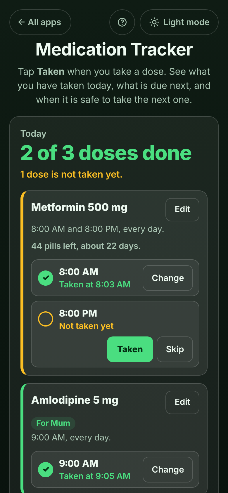</a>

### 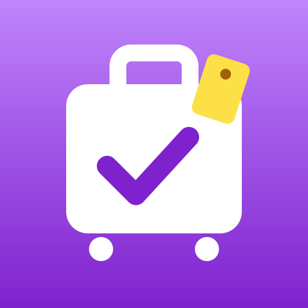 [Trip Packing Checklist](https://umar8092.github.io/apps/trip-packing-checklist/)

Never forget something on a trip again. Say who is going (adults, children, babies), how many nights, the weather and plans, and get a packing list with how many of each to pack, one list per person plus a shared list and jobs before you leave home. Tick things off as you pack, change the trip without losing your ticks, untick everything for the way home. Copy, email or print. Private, no sign-up, works offline.

[**Open the app**](https://umar8092.github.io/apps/trip-packing-checklist/) &middot; [Details and screenshots](trip-packing-checklist/)

<a href="trip-packing-checklist/">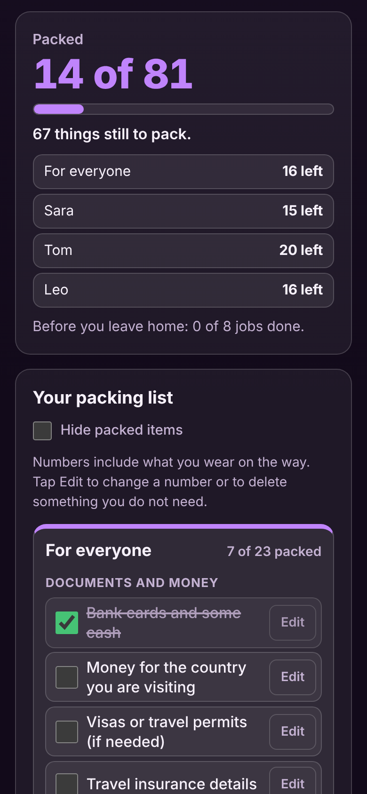</a>

### 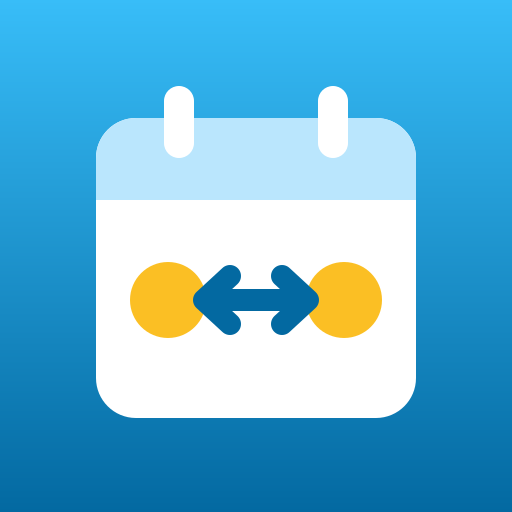 [Age and Date Difference Calculator](https://umar8092.github.io/apps/age-and-date-difference-calculator/)

Your exact age in years, months and days today or on any date (like the last date of a job form), the days and working days between two dates, or the date 90 days, 6 months or 10 working days away. Your own days off and holidays, month ends explained, and My dates for birthdays and deadlines with the days left. Private, no sign-up, works offline.

[**Open the app**](https://umar8092.github.io/apps/age-and-date-difference-calculator/) &middot; [Details and screenshots](age-and-date-difference-calculator/)

<a href="age-and-date-difference-calculator/">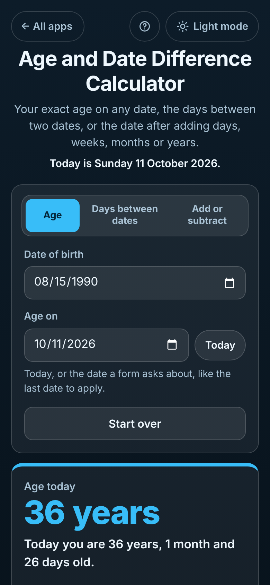</a>

###  [Signature Maker for Forms](https://umar8092.github.io/apps/signature-maker-for-forms/)

Sign on the screen or photograph your signature on paper, and get a clean signature file in the exact pixels and KB an online form asks for, like 140 × 60 px and 10 to 20 KB. Shadows and grey paper are cleaned away, black or blue ink, a see-through PNG for signing documents, and nothing is uploaded. Private, no sign-up, works offline.

[**Open the app**](https://umar8092.github.io/apps/signature-maker-for-forms/) &middot; [Details and screenshots](signature-maker-for-forms/)

<a href="signature-maker-for-forms/">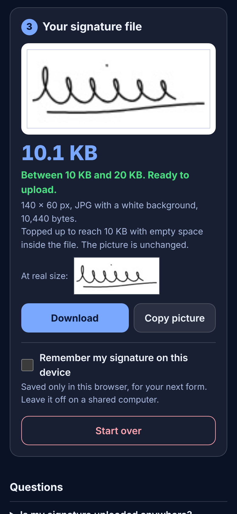</a>

### 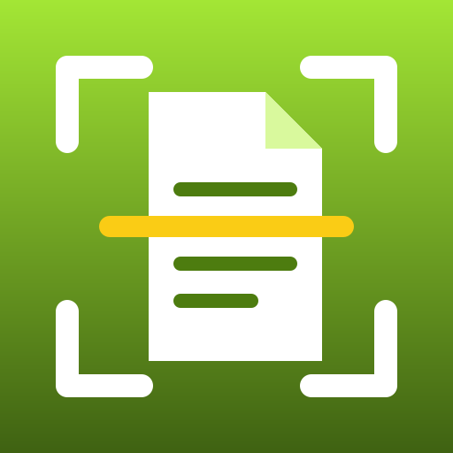 [Document Scanner to PDF](https://umar8092.github.io/apps/document-scanner-to-pdf/)

Turn photos of paper pages into one clean PDF. The app finds each page in the photo, cuts away the table and straightens it, makes the paper white and the text dark, lets you put the pages in order and saves one PDF under the size you need, like 2 MB for a form or 10 MB for email. A signed lease, an ID card front and back, receipts. Nothing is uploaded. Private, no sign-up, works offline.

[**Open the app**](https://umar8092.github.io/apps/document-scanner-to-pdf/) &middot; [Details and screenshots](document-scanner-to-pdf/)

<a href="document-scanner-to-pdf/">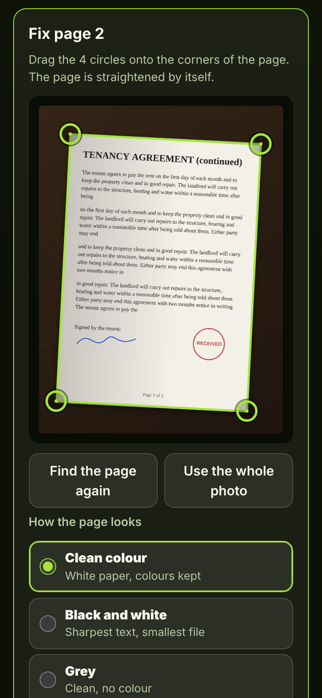</a>

### 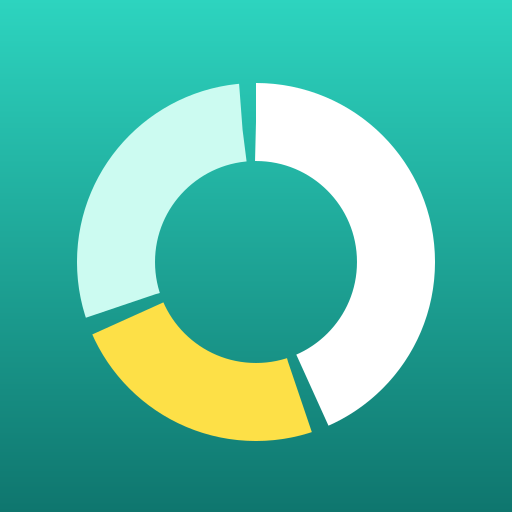 [Expense and Budget Tracker](https://umar8092.github.io/apps/expense-and-budget-tracker/)

Write down what you spend and give each category a monthly budget. See what is left to spend this month, how much that is per day, and a warning as soon as a category is nearly used or over. Refunds, receipts split across categories, months that run from payday to payday, earlier months, backup and restore. Copy, email or print the month. Private, no sign-up, no bank connection, works offline.

[**Open the app**](https://umar8092.github.io/apps/expense-and-budget-tracker/) &middot; [Details and screenshots](expense-and-budget-tracker/)

<a href="expense-and-budget-tracker/">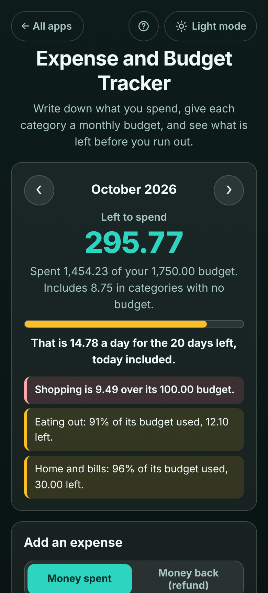</a>

### 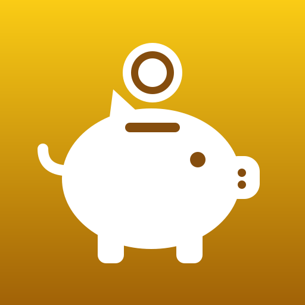 [Savings Goal Planner](https://umar8092.github.io/apps/savings-goal-planner/)

Saving for a trip, a deposit, a laptop or a rainy day? Add the goal and see exactly how much to save every month, every 2 weeks or every week to reach it by a date, or the date a set amount gets you there, with the exact number of payments and a smaller last one when it does not divide evenly. Several goals, each with its own settings, money in and out, optional interest. Copy, email or print the plan. Private, no sign-up, works offline.

[**Open the app**](https://umar8092.github.io/apps/savings-goal-planner/) &middot; [Details and screenshots](savings-goal-planner/)

<a href="savings-goal-planner/">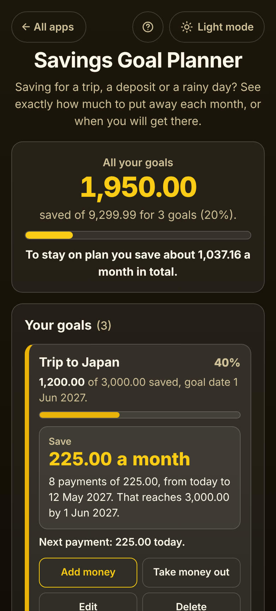</a>

### 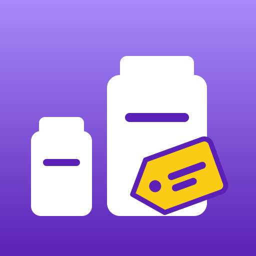 [Unit Price Calculator for Shopping](https://umar8092.github.io/apps/unit-price-calculator-for-shopping/)

In the shop and not sure which pack is cheaper? Type the price and size from each label, in grams, kilos, ounces, pounds, litres, fluid ounces or a number of items, and see the price per kg, litre or item of each, which one is cheapest, how much more the others cost in percent, and what the same amount would cost. Multipacks and "3 for 5" offers too. Private, no sign-up, works offline.

[**Open the app**](https://umar8092.github.io/apps/unit-price-calculator-for-shopping/) &middot; [Details and screenshots](unit-price-calculator-for-shopping/)

<a href="unit-price-calculator-for-shopping/">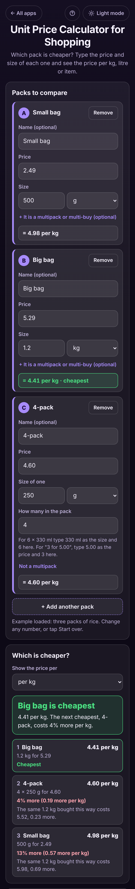</a>

### 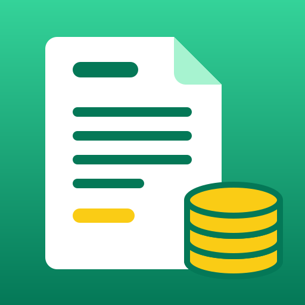 [Invoice Generator for Freelancers](https://umar8092.github.io/apps/invoice-generator-for-freelancers/)

Need to send an invoice today? Fill in your details, the client and what you are charging for (jobs, hours or products), add a discount, tax, VAT or GST (added on top or already in your prices) and any deposit already paid, and print the invoice or save it as a PDF. Invoice numbers count up by themselves, clients are remembered, and My invoices shows what is paid, due or overdue. No sign-up, no watermark, private, works offline.

[**Open the app**](https://umar8092.github.io/apps/invoice-generator-for-freelancers/) &middot; [Details and screenshots](invoice-generator-for-freelancers/)

<a href="invoice-generator-for-freelancers/">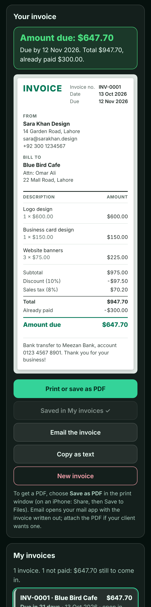</a>

### 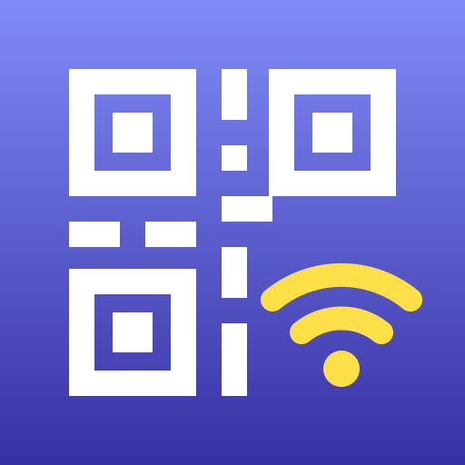 [QR Code Generator for Links and Wi-Fi](https://umar8092.github.io/apps/qr-code-generator-for-links-and-wi-fi/)

Need a QR code for your menu link, your guest Wi-Fi, a contact card, a phone number, a text message or an email? Type it and the code appears straight away. Download it as PNG or SVG, copy it, or print a card with the Wi-Fi name and password under it. The code never expires because nothing goes through a website, and you can save your codes to reprint later. No sign-up, private, works offline.

[**Open the app**](https://umar8092.github.io/apps/qr-code-generator-for-links-and-wi-fi/) &middot; [Details and screenshots](qr-code-generator-for-links-and-wi-fi/)

<a href="qr-code-generator-for-links-and-wi-fi/">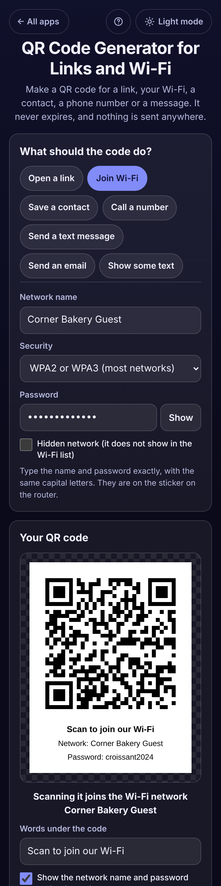</a>

### 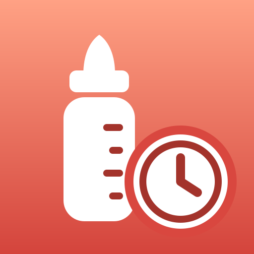 [Baby Feeding and Nappy Tracker](https://umar8092.github.io/apps/baby-feeding-and-nappy-tracker/)

A tap-to-log baby tracker for tired parents. Breast feed timer for each side, bottles in ml or oz, wet and dirty nappies and sleep. The top shows how long since the last feed and which side to offer next, and the day box adds up feeds, nappies and sleep for the doctor. Twins each get their own log. No sign-up, private, works offline.

[**Open the app**](https://umar8092.github.io/apps/baby-feeding-and-nappy-tracker/) &middot; [Details and screenshots](baby-feeding-and-nappy-tracker/)

<a href="baby-feeding-and-nappy-tracker/">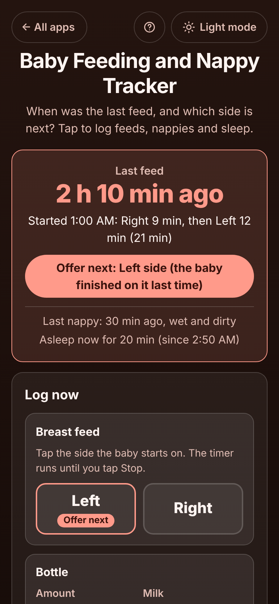</a>

### 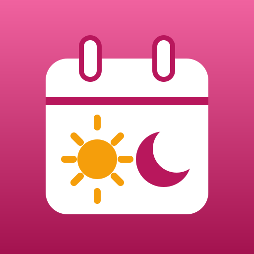 [Shift Work Calendar](https://umar8092.github.io/apps/shift-work-calendar/)

A calendar for rotating shift rotas: 4 on 4 off, days and nights, Pitman, DuPont, 24 on 48 off or your own pattern. See which shift you are on any date, whether you are at work right now, your next day off, and the days you and your partner are both off. Mark swaps and holidays, and add your shifts to your phone's calendar. No sign-up, private, works offline.

[**Open the app**](https://umar8092.github.io/apps/shift-work-calendar/) &middot; [Details and screenshots](shift-work-calendar/)

<a href="shift-work-calendar/"></a>

###  [Home Blood Pressure Log](https://umar8092.github.io/apps/home-blood-pressure-log/)

A log for home blood pressure readings. Type the two numbers from your monitor (and the pulse if you like) and see your average, your morning and evening averages, the highest and lowest reading and what the numbers mean, by the UK and Europe home guide or the US guide. Leave out the first day for a doctor's 7-day check, add your doctor's target, and print, email or download the list for your appointment. No sign-up, private, works offline.

[**Open the app**](https://umar8092.github.io/apps/home-blood-pressure-log/) &middot; [Details and screenshots](home-blood-pressure-log/)

<a href="home-blood-pressure-log/"></a>

###  [Daily Habit and Water Tracker](https://umar8092.github.io/apps/daily-habit-and-water-tracker/)

A habit tracker and water tracker. Tap to log each glass of water, your steps, reading or any habit, and see what is left for today, your streaks and a table of your week. Each habit has its own goal and days (every day, some days or 3 times a week), skipped days never break a streak, and there is a calendar reminder. No sign-up, private, works offline.

[**Open the app**](https://umar8092.github.io/apps/daily-habit-and-water-tracker/) &middot; [Details and screenshots](daily-habit-and-water-tracker/)

<a href="daily-habit-and-water-tracker/"></a>

###  [Money Lent and Borrowed Tracker](https://umar8092.github.io/apps/money-lent-and-borrowed-tracker/)

Write down money you lend to friends, family or colleagues, or borrow from them. Each person gets their own box saying what they still owe you or you owe them, with part repayments, pay-back-by dates and a polite reminder message to copy or share.

[**Open the app**](https://umar8092.github.io/apps/money-lent-and-borrowed-tracker/) &middot; [Details and screenshots](money-lent-and-borrowed-tracker/)

<a href="money-lent-and-borrowed-tracker/"></a>

###  [Prayer Times and Qibla Direction](https://umar8092.github.io/apps/prayer-times-and-qibla-direction/)

Today's Fajr, Sunrise, Dhuhr, Asr, Maghrib and Isha times for your city, with "Next: Asr at 4:28 pm, in 1 h 12 min", a month timetable to print, a calendar file with an alert at each prayer, and the Qibla direction with a phone compass. Karachi, Muslim World League, ISNA, Umm al-Qura and 10 more methods, Hanafi or standard Asr, minutes to match your mosque. No ads, works offline.

[**Open the app**](https://umar8092.github.io/apps/prayer-times-and-qibla-direction/) &middot; [Details and screenshots](prayer-times-and-qibla-direction/)

<a href="prayer-times-and-qibla-direction/"></a>

###  [Fuel Log and Car Running Cost Tracker](https://umar8092.github.io/apps/fuel-log-and-car-running-cost-tracker/)

Log each fill-up and car cost. See how far your car goes on its fuel per tank (km/L, L/100 km or mpg), whether it is getting worse, the fuel cost and the all-in running cost per km or mile, and what you spent this month and this year. Part fills, missed fill-ups, trip meters, several cars, CSV export. No ads, works offline.

[**Open the app**](https://umar8092.github.io/apps/fuel-log-and-car-running-cost-tracker/) &middot; [Details and screenshots](fuel-log-and-car-running-cost-tracker/)

<a href="fuel-log-and-car-running-cost-tracker/"></a>

###  [Study Planner and Exam Countdown](https://umar8092.github.io/apps/study-planner-and-exam-countdown/)

For students with exams coming up. Add each exam and its topics (paste them from your syllabus) and see how many days are left to each exam and exactly what to study today. The day-by-day plan spreads the topics evenly, earliest exam first, keeps revision days before each exam and moves topics around your days off. No ads, works offline.

[**Open the app**](https://umar8092.github.io/apps/study-planner-and-exam-countdown/) &middot; [Details and screenshots](study-planner-and-exam-countdown/)

<a href="study-planner-and-exam-countdown/"></a>

###  [Weekly Meal Planner with Shopping List](https://umar8092.github.io/apps/weekly-meal-planner-with-shopping-list/)

Plan the week's meals, each for its own number of people, and get one shopping list with every ingredient added up and sorted by aisle. Tick off in the shop, copy, email or print. Works offline.

[**Open the app**](https://umar8092.github.io/apps/weekly-meal-planner-with-shopping-list/) &middot; [Details and screenshots](weekly-meal-planner-with-shopping-list/)

<a href="weekly-meal-planner-with-shopping-list/"></a>

###  [Chore Rota for Households](https://umar8092.github.io/apps/chore-rota-for-households/)

A fair weekly chore rota for flatmates and families that rotates by itself. Heavy jobs count as more work, away weeks and swaps are handled, tick jobs done, copy it to the group chat or print it for the fridge.

[**Open the app**](https://umar8092.github.io/apps/chore-rota-for-households/) &middot; [Details and screenshots](chore-rota-for-households/)

<a href="chore-rota-for-households/"></a>

###  [Warranty and Return Deadline Tracker](https://umar8092.github.io/apps/warranty-and-return-deadline-tracker/)

See the last day to return each thing you bought and when its warranty ends, most urgent first. Delivery dates, extended warranties, receipt photos kept on your device, calendar reminders and a copy-ready summary for a claim.

[**Open the app**](https://umar8092.github.io/apps/warranty-and-return-deadline-tracker/) &middot; [Details and screenshots](warranty-and-return-deadline-tracker/)

<a href="warranty-and-return-deadline-tracker/"></a>

###  [Time Tracker for Freelancers](https://umar8092.github.io/apps/time-tracker-for-freelancers/)

One tap starts a timer for a client, or add time afterwards. See the hours and money per client this week or month, each client with its own rate, currency and rounding, copy them as invoice lines, mark them as billed and download a spreadsheet.

[**Open the app**](https://umar8092.github.io/apps/time-tracker-for-freelancers/) &middot; [Details and screenshots](time-tracker-for-freelancers/)

<a href="time-tracker-for-freelancers/"></a>

###  [Contraction Timer for Labour](https://umar8092.github.io/apps/contraction-timer-for-labour/)

Tap when a contraction starts and when it ends. See how long each lasts, how far apart they are, and a plain answer when your 5-1-1 rule (or the one your midwife gave you) is reached. Note when waters break, fix a missed tap, and copy or email the log for your midwife.

[**Open the app**](https://umar8092.github.io/apps/contraction-timer-for-labour/) &middot; [Details and screenshots](contraction-timer-for-labour/)

<a href="contraction-timer-for-labour/"></a>

###  [Net Worth Tracker](https://umar8092.github.io/apps/net-worth-tracker/)

Paying off debt or building savings and want one number that shows progress? List what you own (bank, savings, pension, home, car) and what you owe (mortgage, loans, cards), each in its own box. Once a month change the balances that moved; the rest carry over. See your net worth, how much it went up or down since last time and since you started, which accounts moved, and a line over time. Copy, email, print, spreadsheet and backup file. No bank login, private, works offline.

[**Open the app**](https://umar8092.github.io/apps/net-worth-tracker/) &middot; [Details and screenshots](net-worth-tracker/)

<a href="net-worth-tracker/"></a>

###  [Period and Ovulation Calendar](https://umar8092.github.io/apps/period-and-ovulation-calendar/)

Want to know when your next period is due without giving your data to a company? Tap the day each period starts. See the next expected period with your usual range, your likely fertile days and ovulation day, which day of your cycle it is, and "Period is 3 days late" when it is. Log symptoms and notes, add the next periods to your calendar, copy or print a summary for a doctor, pause while pregnant or breastfeeding. No account, private, works offline.

[**Open the app**](https://umar8092.github.io/apps/period-and-ovulation-calendar/) &middot; [Details and screenshots](period-and-ovulation-calendar/)

<a href="period-and-ovulation-calendar/"></a>

###  [Spaced Repetition Flashcards for Exams](https://umar8092.github.io/apps/spaced-repetition-flashcards-for-exams/)

Got an exam or a language to learn? Paste your notes as flashcards ("der Hund - the dog", or two columns from a spreadsheet) and study only the cards due today. Tap Again, Hard, Good or Easy and each card comes back just before you would forget it. Add your exam date: no card is put off past the day before, and the app tells you if all new cards will be started in time and how many a day you need. Several decks, each with its own settings, reverse cards, days-in-a-row streak, copy, email, CSV and print. No account, private, works offline.

[**Open the app**](https://umar8092.github.io/apps/spaced-repetition-flashcards-for-exams/) &middot; [Details and screenshots](spaced-repetition-flashcards-for-exams/)

<a href="spaced-repetition-flashcards-for-exams/"></a>

###  [Schengen and Visa Stay Day Counter](https://umar8092.github.io/apps/schengen-and-visa-stay-day-counter/)

Add your trips and see how many of your 90 days you have used in the last 180, the real last day you can stay if you enter today or on any day you plan, when your days start coming back and when a full 90 days is possible again. Trips still going on, planned trips, other rules and travellers, calendar reminders.

[**Open the app**](https://umar8092.github.io/apps/schengen-and-visa-stay-day-counter/) &middot; [Details and screenshots](schengen-and-visa-stay-day-counter/)

<a href="schengen-and-visa-stay-day-counter/"></a>

###  [Weight Tracker with Goal Date](https://umar8092.github.io/apps/weight-tracker-with-goal-date/)

Losing (or gaining) weight and want to know if it is really working? Log your weight in kg, lb or stone and lb. The app shows your 7-day average, which hides the daily water swings, the change this week and since you started, your pace over the last 4 weeks, your BMI and a chart, and answers the real question: "at this pace you reach 75 kg around 25 Jan 2027". Add a date to reach it by and see the weekly change you need and whether you are early or late. Two weigh-ins a day, typos caught, several people, copy, email, CSV, print and backup. No account, private, works offline.

[**Open the app**](https://umar8092.github.io/apps/weight-tracker-with-goal-date/) &middot; [Details and screenshots](weight-tracker-with-goal-date/)

<a href="weight-tracker-with-goal-date/"></a>

###  [Workout Log for the Gym](https://umar8092.github.io/apps/workout-log-for-the-gym/)

Can't remember what you lifted last time? Start Push, Pull, Legs (or your own plan) and every exercise shows "Last time, Mon 12 Oct: 60 kg: 8, 8, 7 reps" with the boxes already filled in, so logging a set is one tap. A rest timer counts down after each set (and survives the phone locking), a "New best" note appears when you beat yourself, and the finish screen shows the time, sets, total lifted and new bests. Weight and reps, bodyweight moves with optional extra weight, and timed holds like planks; kg or lb; warm-up sets; progress chart per exercise; history with edit, copy and undo; backup and CSV. No account, private, works offline in a gym basement.

[**Open the app**](https://umar8092.github.io/apps/workout-log-for-the-gym/) &middot; [Details and screenshots](workout-log-for-the-gym/)

###  [Pomodoro Focus Timer for Study and Work](https://umar8092.github.io/apps/pomodoro-focus-timer-for-study-and-work/)

Keep drifting to your phone while studying or working from home? Pick a task, press Start focus and work on only that for 25 minutes (or 50, 90 or your own length). A bell rings, you take a 5-minute break, and after every 4 blocks a longer one. The app logs real focus time per task, so the day ends with "1 h 52 min of focus, Thesis chapter 2: 1 h 27 min", plus a 7-day chart, a daily goal and a streak. Blocks stopped early can be counted or not, paste a whole task list, copy or email the summary. It keeps the right time when the phone locks. No account, private, works offline.

[**Open the app**](https://umar8092.github.io/apps/pomodoro-focus-timer-for-study-and-work/) &middot; [Details and screenshots](pomodoro-focus-timer-for-study-and-work/)

###  [Multiple Kitchen Timers for Cooking](https://umar8092.github.io/apps/multiple-kitchen-timers-for-cooking/)

Run a timer for each dish at once (rice, pasta, oven), each with its own name, sorted by which ends first. The alarm and the tab title say which dish is done. Pause, +1 min, restart, change, saved timers for eggs, tea and rice. Keeps time through reloads, keeps the screen on, works offline.

[**Open the app**](https://umar8092.github.io/apps/multiple-kitchen-timers-for-cooking/) &middot; [Details and screenshots](multiple-kitchen-timers-for-cooking/)

<a href="multiple-kitchen-timers-for-cooking/"></a>

###  [Food and Medicine Expiry Tracker](https://umar8092.github.io/apps/food-and-medicine-expiry-tracker/)

Stop finding expired medicine when someone is ill, or throwing away food you forgot. Add what is in the fridge, freezer, cupboard or medicine box with its use by, best before or expiry date, and see "Use first: Milk, use by tomorrow" and what has expired, soonest first. Month-and-year-only dates, packs that keep 3 days once opened, Used up and Thrown away with undo, calendar reminders, a printable list and a shopping list of what ran out. No account, private, works offline.

[**Open the app**](https://umar8092.github.io/apps/food-and-medicine-expiry-tracker/) &middot; [Details and screenshots](food-and-medicine-expiry-tracker/)

<a href="food-and-medicine-expiry-tracker/"></a>

###  [Pocket Money and Chores Tracker for Kids](https://umar8092.github.io/apps/pocket-money-and-chores-tracker-for-kids/)

See how much each child has from pocket money and paid chores, and what they are saving for. Each child has their own pocket money, payday and chores. Paydays add the money by themselves; print a chore chart for the fridge.

[**Open the app**](https://umar8092.github.io/apps/pocket-money-and-chores-tracker-for-kids/) &middot; [Details and screenshots](pocket-money-and-chores-tracker-for-kids/)

<a href="pocket-money-and-chores-tracker-for-kids/"></a>

###  [Interval Workout Timer for HIIT and Circuits](https://umar8092.github.io/apps/interval-workout-timer-for-hiit-and-circuits/)

Working out at home or in the park without a coach? Set the work and rest times, rounds, sets, warm-up and cool-down (or tap Tabata, 30/30, Circuit, EMOM or Stretching) and see "Total 18:00, ends at 7:18 PM" before you start. Then one big countdown, green for work and blue for rest, shows the move ("Lunges, round 3 of 4"), the time left and what is next, with a beep at each step and 3-2-1 before it ends. Named moves with their own times, pause, skip, back, saved workouts and a log of workouts done. Keeps time when the phone locks, private, works offline.

[**Open the app**](https://umar8092.github.io/apps/interval-workout-timer-for-hiit-and-circuits/) &middot; [Details and screenshots](interval-workout-timer-for-hiit-and-circuits/)

<a href="interval-workout-timer-for-hiit-and-circuits/"></a>

###  [Blood Sugar Log for Diabetes](https://umar8092.github.io/apps/blood-sugar-log-for-diabetes/)

Checking your sugar at home and your doctor asks "what have your readings been?" Type each number from your meter (mg/dL or mmol/L, or HI and LO) and tap when you took it: fasting, before or after a meal, bedtime. See "47% in target", "Fasting average 129 mg/dL, 3 of 7 above target", your lows and very high readings with what to do, a chart, and print a log book table, email or copy it for your doctor. Pregnancy targets or your doctor's own, more than one person, private, works offline.

[**Open the app**](https://umar8092.github.io/apps/blood-sugar-log-for-diabetes/) &middot; [Details and screenshots](blood-sugar-log-for-diabetes/)

<a href="blood-sugar-log-for-diabetes/"></a>

###  [Mood and Sleep Journal](https://umar8092.github.io/apps/mood-and-sleep-journal/)

Feeling low or anxious some days and want to see what helps? Once a day tap a face for your mood, type how long you slept and tick what happened (exercise, time outside, work stress, caffeine, your own tags). See a calendar coloured by mood and "Exercise: 4.2 with, 2.9 without", your mood after short and long nights, and print or copy it for your doctor or therapist with your notes left out. Private on your device, works offline.

[**Open the app**](https://umar8092.github.io/apps/mood-and-sleep-journal/) &middot; [Details and screenshots](mood-and-sleep-journal/)

<a href="mood-and-sleep-journal/"></a>

###  [Plant Watering Schedule for Houseplants](https://umar8092.github.io/apps/plant-watering-schedule-for-houseplants/)

Stop drowning some plants and forgetting others. Add each plant with how often it needs water and when you last watered it, and see "2 plants need water today: Basil (1 day late), Monstera". Tap Watered, Still wet or I watered all. Each plant can have its own winter number and plant food schedule, and when you go away the app makes a day-by-day list for the plant-sitter ("Thu 29 Oct: Basil, Fern"). No account, private, works offline.

[**Open the app**](https://umar8092.github.io/apps/plant-watering-schedule-for-houseplants/) &middot; [Details and screenshots](plant-watering-schedule-for-houseplants/)

<a href="plant-watering-schedule-for-houseplants/"></a>

###  [Job Application Tracker for Job Seekers](https://umar8092.github.io/apps/job-application-tracker-for-job-seekers/)

Sent 40 applications and lost track? Add each job and see "Follow up today: Acme Ltd (applied 10 days ago, no reply)", your coming interviews with calendar reminders, adverts that close soon and "This week: 5 of 10 applications". Move each job through Applied, Heard back, Interview and Offer, and copy or print a dated job search record for the job centre. No account, private, works offline.

[**Open the app**](https://umar8092.github.io/apps/job-application-tracker-for-job-seekers/) &middot; [Details and screenshots](job-application-tracker-for-job-seekers/)

<a href="job-application-tracker-for-job-seekers/"></a>

###  [Class Timetable for Students and Teachers](https://umar8092.github.io/apps/class-timetable-for-students-and-teachers/)

Stop checking a photo of your timetable. Add each subject once with its days, times and rooms, and see "Now: English, Room 5, until 10:30, 20 min left. Next: Chemistry at 10:50, Lab B4, bring lab coat", plus today with the free gaps, tomorrow with what to pack, and the whole week to copy or print. Week A and Week B, holidays, and a calendar file for the term. No account, private, works offline.

[**Open the app**](https://umar8092.github.io/apps/class-timetable-for-students-and-teachers/) &middot; [Details and screenshots](class-timetable-for-students-and-teachers/)

<a href="class-timetable-for-students-and-teachers/"></a>

###  [Document Expiry Tracker for the Family](https://umar8092.github.io/apps/document-expiry-tracker-for-the-family/)

Never find out at the airport that a passport has expired. Each person's passport, ID card, visa, driving licence and car or health insurance in their own box, with "Aisha: Passport expires Wed 3 Mar 2027 (4 months left)" at the top, the day to start renewing everything else, a warning when a passport has under 6 months left, and a travel check for your trip dates. Calendar reminders, numbers hidden until tapped, private, works offline.

[**Open the app**](https://umar8092.github.io/apps/document-expiry-tracker-for-the-family/) &middot; [Details and screenshots](document-expiry-tracker-for-the-family/)

<a href="document-expiry-tracker-for-the-family/"></a>

###  [Class Attendance Tracker for Students](https://umar8092.github.io/apps/class-attendance-tracker-for-students/)

Can I skip Physics on Friday? Each subject in its own box with classes held and attended (typed from the portal, then one tap on Present, Absent or Cancelled after each class) and its own rule (75% by default, or 80%, 85%, any percent). It answers "Maths: 30 of 34 (88.2%). You can miss 6 classes", "Physics: do not miss the next class, it would drop you to 72.0%" or "Chemistry: attend the next 10 classes in a row to get back to 75%", and with the classes left this term whether you can still finish above the line. Exact whole-class maths that never rounds 74.9% up, labs that count as 2 or 3, Undo, new term, backup, private, works offline.

[**Open the app**](https://umar8092.github.io/apps/class-attendance-tracker-for-students/) &middot; [Details and screenshots](class-attendance-tracker-for-students/)

<a href="class-attendance-tracker-for-students/"></a>

###  [Emergency Medical Info Lock Screen and Wallet Card](https://umar8092.github.io/apps/emergency-medical-info-lock-screen-and-wallet-card/)

If you collapse, your phone is locked. Type your allergies (with how bad), conditions, medicines and doses, blood group and who to call, and get a lock screen picture sized exactly for your phone ("IN CASE OF EMERGENCY: Fatima Khan, 68. Penicillin: life-threatening. Warfarin 5 mg. Call Bilal (Son) +44 7700 900123"), a printable folding wallet card, and the text for your phone's Medical ID. The biggest text that fits, and it tells you exactly what was left off. Cards for the whole family, labels in a second language for travel, private, works offline.

[**Open the app**](https://umar8092.github.io/apps/emergency-medical-info-lock-screen-and-wallet-card/) &middot; [Details and screenshots](emergency-medical-info-lock-screen-and-wallet-card/)

<a href="emergency-medical-info-lock-screen-and-wallet-card/"></a>

###  [Committee and ROSCA Tracker for Savings Groups](https://umar8092.github.io/apps/committee-and-rosca-tracker-for-savings-groups/)

Run a committee, BC, kameti or ROSCA savings group: add the members and their shares, set the turn order or draw it at random, tick who has paid each round and see who takes the pot, who still owes and when each member's turn comes, with a WhatsApp-ready reminder.

[**Open the app**](https://umar8092.github.io/apps/committee-and-rosca-tracker-for-savings-groups/) &middot; [Details and screenshots](committee-and-rosca-tracker-for-savings-groups/)

<a href="committee-and-rosca-tracker-for-savings-groups/"></a>

###  [Milk and Daily Delivery Log with Monthly Bill](https://umar8092.github.io/apps/milk-and-daily-delivery-log-with-monthly-bill/)

Log milk, a newspaper, water cans or bread delivered to your door: tap the days it did not come or came in a different amount and see the month's bill like the seller works it out ("26 litres × 220 = 5,720; 11 litres × 230 = 2,530; Not delivered: 5 Oct and 12 Oct; To pay: 8,250"), with price changes from a date, holidays, payments carried to the next month and a WhatsApp-ready bill.

[**Open the app**](https://umar8092.github.io/apps/milk-and-daily-delivery-log-with-monthly-bill/) &middot; [Details and screenshots](milk-and-daily-delivery-log-with-monthly-bill/)

<a href="milk-and-daily-delivery-log-with-monthly-bill/"></a>

###  [Electricity, Gas and Water Meter Reading Log](https://umar8092.github.io/apps/electricity-gas-and-water-meter-reading-log/)

Type the number on your electricity, gas or water meter every week or so and see what the bill will be before it arrives ("Used so far this bill period: 148 units; by 5 Nov, at this rate: about 328 units, bill about 5,609.71; to stay under 200 units: use at most 3.1 units a day"), with price steps (slabs), a fixed charge and tax, meter changes and past bill periods against last year.

[**Open the app**](https://umar8092.github.io/apps/electricity-gas-and-water-meter-reading-log/) &middot; [Details and screenshots](electricity-gas-and-water-meter-reading-log/)

<a href="electricity-gas-and-water-meter-reading-log/"></a>

###  [Birthday and Anniversary Reminder List](https://umar8092.github.io/apps/birthday-and-anniversary-reminder-list/)

Add family and friends' birthdays and wedding anniversaries (the year is optional) and see who is next ("Mum turns 66 today", "Sara turns 31 on Sat 24 Oct (in 4 days)", "Hina turned 36 on Sat 17 Oct (3 days ago)"), with yearly reminders for your phone's calendar, 29 February handled, a pasted list or phone contacts import, gift ideas and a tick for who you have wished.

[**Open the app**](https://umar8092.github.io/apps/birthday-and-anniversary-reminder-list/) &middot; [Details and screenshots](birthday-and-anniversary-reminder-list/)

<a href="birthday-and-anniversary-reminder-list/"></a>

###  [Reading Log and Book Goal Tracker](https://umar8092.github.io/apps/reading-log-and-book-goal-tracker/)

Log the page you stopped on and see the pages a day to finish a book on time ("To finish by Fri 23 Oct read 46 pages a day from tomorrow (3 days)"), when you will finish at your pace, your reading streak and a 30-day chart, and whether you are on track for your yearly goal ("21 of 24 books finished in 2026, 2 books ahead of schedule"). Paper books, ebooks in percent and audiobooks by time listened or time left, several books at once, Want to read, history with undo and backup.

[**Open the app**](https://umar8092.github.io/apps/reading-log-and-book-goal-tracker/) &middot; [Details and screenshots](reading-log-and-book-goal-tracker/)

<a href="reading-log-and-book-goal-tracker/"></a>

###  [Quran Reading Planner and Khatam Tracker](https://umar8092.github.io/apps/quran-reading-planner-and-khatam-tracker/)

Pick a finish date (such as the last day of Ramadan) or a number of pages a day, log the page where you stopped, and see what to read today ("Read 22 pages today: up to page 183"), how far behind or ahead of your plan you are (missed pages are spread over the days left), the 30 juz done and your khatams. Works with the 604-page Madani copy, Indo-Pak copies (548, 610, 848 pages) or any page count. A group khatam shares the 30 juz between family members, each in their own box, with ticks and a list to copy for WhatsApp.

[**Open the app**](https://umar8092.github.io/apps/quran-reading-planner-and-khatam-tracker/) &middot; [Details and screenshots](quran-reading-planner-and-khatam-tracker/)

<a href="quran-reading-planner-and-khatam-tracker/"></a>

###  [Rent Payment Log and Receipts for Landlords and Tenants](https://umar8092.github.io/apps/rent-payment-log-and-receipts-for-landlords-and-tenants/)

Record each rent payment, full, part, late or in advance, and see who has paid up to which month and what is owed ("Owes 15,000 for October 2026, 16 days late", "Paid up to September 2026", "Next: November rent 32,000 due on Thu 5 Nov"). Each tenancy in its own box, rent changes from a month, move-in and move-out part months by days, deposits, a printable rent receipt with the amount in words and the rent still owed, a yearly statement, and a "this month" total for every tenancy. Works for tenants who want proof of rent paid too.

[**Open the app**](https://umar8092.github.io/apps/rent-payment-log-and-receipts-for-landlords-and-tenants/) &middot; [Details and screenshots](rent-payment-log-and-receipts-for-landlords-and-tenants/)

<a href="rent-payment-log-and-receipts-for-landlords-and-tenants/"></a>

###  [Qaza Prayer and Fast Tracker](https://umar8092.github.io/apps/qaza-prayer-and-fast-tracker/)

Work out how many qaza (missed) prayers you owe from the first and last day you missed ("15 Mar 2008 to 31 Dec 2019: 4,309 of each prayer"), or type the numbers, then tap +1 under Fajr, Dhuhr, Asr, Maghrib, Isha and Witr as you make each one up. See how many are left ("25,632 prayers left") and the day you finish at your daily goal ("At 2 days of prayers a day you finish around Thu 26 Aug 2032"), your real pace and streak. Missed Ramadan fasts with their own count, several people on one phone, Witr optional, days to leave out typed by you. The app counts; it gives no rulings.

[**Open the app**](https://umar8092.github.io/apps/qaza-prayer-and-fast-tracker/) &middot; [Details and screenshots](qaza-prayer-and-fast-tracker/)

<a href="qaza-prayer-and-fast-tracker/"></a>

###  [Baby and Child Growth Chart](https://umar8092.github.io/apps/baby-and-child-growth-chart/)

Type the weight, length or height and head size from each check-up and see what the numbers mean: "Weight 7.4 kg at 6 months: the 25th percentile. About 25 in 100 boys of the same age weigh less." A growth chart with the WHO 3rd, 15th, 50th, 85th and 97th percentile lines, the corrected age for babies born early, and a plain "ask your doctor" note below the 3rd, above the 97th or when growth crosses two lines. WHO Child Growth Standards built in (birth to 5 years, works offline), kg and cm or lb, oz and inches, each child in their own box, a table to copy for the doctor. Not medical advice.

[**Open the app**](https://umar8092.github.io/apps/baby-and-child-growth-chart/) &middot; [Details and screenshots](baby-and-child-growth-chart/)

<a href="baby-and-child-growth-chart/"></a>

###  [Lab Test Results Tracker](https://umar8092.github.io/apps/lab-test-results-tracker/)

Type the results from each blood or lab test report with the normal range printed next to them, and see the answer a new doctor asks for: "HbA1c 6.4 % on 12 Oct 2026, down 0.7 from 7.1 % on 3 Apr 2026. Above the range (4.0–5.6)." Results outside the range in red and listed first, a chart per test with the normal range shaded, mg/dL and mmol/L (and other lab units) converted, a range kept for each result because labs differ, each family member in their own tab, and a one-page summary to print, email or copy for the doctor. Not medical advice.

[**Open the app**](https://umar8092.github.io/apps/lab-test-results-tracker/) &middot; [Details and screenshots](lab-test-results-tracker/)

<a href="lab-test-results-tracker/"></a>

###  [School Fee and Tuition Payment Tracker for Parents](https://umar8092.github.io/apps/school-fee-and-tuition-payment-tracker-for-parents/)

Every child's school fee, tuition, van and academy fees in one place, each child in their own box. Tick a fee paid (with a photo of the school's receipt kept on the phone) and see the answers a parent is asked: "Owes 4,000 for October 2026, 11 days late", "Paid up to September 2026", what is due in the next 7 days for the whole family, and the year's fees per child. Monthly, termly (every 3, 4 or 6 months), yearly and one-off fees, part payments and two months at once, fee rises from a month, holiday months with no van fee, and a statement to print or copy for the school.

[**Open the app**](https://umar8092.github.io/apps/school-fee-and-tuition-payment-tracker-for-parents/) &middot; [Details and screenshots](school-fee-and-tuition-payment-tracker-for-parents/)

<a href="school-fee-and-tuition-payment-tracker-for-parents/"></a>

###  [CGPA and Semester GPA Planner for University Students](https://umar8092.github.io/apps/cgpa-and-semester-gpa-planner-for-university-students/)

For university students. Add each semester's courses with credit hours and grades to see every semester GPA and your CGPA, and find out what GPA you need in the credit hours left to reach a target CGPA such as 3.00. What-if grades for this semester, retaken courses, 4.0, 10-point, 5.0 or your own grading scale. Private, works offline.

[**Open the app**](https://umar8092.github.io/apps/cgpa-and-semester-gpa-planner-for-university-students/) &middot; [Details and screenshots](cgpa-and-semester-gpa-planner-for-university-students/)

<a href="cgpa-and-semester-gpa-planner-for-university-students/"></a>


###  [Household Help Attendance and Salary Tracker](https://umar8092.github.io/apps/household-help-attendance-and-salary-tracker/)

For a family with a maid, cook, driver or nanny paid by the month. Tap the days off, half days and extra days, add advances and Eid bonuses, and see exactly what to pay: "Monthly pay 30,000 − 2½ unpaid days (2,500) + 1 extra day (1,000) − advance 5,000 = To pay: 23,500". Paid leave that can carry over, joining or leaving mid-month, advances taken back over months, overtime, part payments and a pay slip to copy or print. Private, works offline.

[**Open the app**](https://umar8092.github.io/apps/household-help-attendance-and-salary-tracker/) &middot; [Details and screenshots](household-help-attendance-and-salary-tracker/)

<a href="household-help-attendance-and-salary-tracker/"></a>

###  [Intermittent Fasting Timer with History](https://umar8092.github.io/apps/intermittent-fasting-timer-with-history/)

For anyone doing 16:8, 18:6, 20:4 or OMAD (one meal a day) fasting. Tap Start fast when you finish your last meal (or type when you finished eating) and see "Fasting 14 h 30 min. Eat at 12:00 today, 1 h 30 min left" on a ring that fills up. End fast saves it with its length and whether the goal was met, then shows your eating window ("Start your next fast by 20:10"). The last 7 days show fasts, goals met, average, longest and streak. Midnight crossings, forgotten starts and ends, edit, delete and undo, backup and CSV. Private, works offline.

[**Open the app**](https://umar8092.github.io/apps/intermittent-fasting-timer-with-history/) &middot; [Details and screenshots](intermittent-fasting-timer-with-history/)

<a href="intermittent-fasting-timer-with-history/"></a>

###  [Wedding Gift Register and Guest List](https://umar8092.github.io/apps/wedding-gift-register-and-guest-list/)

For a family hosting a wedding, aqiqah or other event. Write down the cash envelopes and gifts (salami, neota, shagun) each family gives, and what you give at theirs. See "Received 3,45,000 from 112 families" and, when invited, "Ahmed Khan gave you 5,000 at Sara's wedding; you gave them 3,000". Gifts in kind, same names in two cities, and a guest list with headcount. Private, works offline.

[**Open the app**](https://umar8092.github.io/apps/wedding-gift-register-and-guest-list/) &middot; [Details and screenshots](wedding-gift-register-and-guest-list/)

<a href="wedding-gift-register-and-guest-list/"></a>

###  [Daily Cash Book for Small Shops](https://umar8092.github.io/apps/daily-cash-book-for-small-shops/)

For a small shop, tuck shop or home business. Write down the day's cash sales, stock bought, expenses and money the owner takes; at closing count the drawer and see "Cash should be 18,450. You counted 18,200: 250 short". Opening cash carries from yesterday, card and mobile sales kept apart, notes and coins counter, week and month totals by expense for the accountant. Private, works offline.

[**Open the app**](https://umar8092.github.io/apps/daily-cash-book-for-small-shops/) &middot; [Details and screenshots](daily-cash-book-for-small-shops/)

<a href="daily-cash-book-for-small-shops/"></a>

###  [Shared House Expenses for Roommates](https://umar8092.github.io/apps/shared-house-expenses-for-roommates/)

For flatmates, roommates and hostel room-mates who share rent, bills and groceries. Add each cost with who paid and who shares it (equally, by shares for the big room, or exact amounts) and see "Omar pays Ali 12,600". Mark as paid, monthly totals by bill, someone away or moving out, no daily limit. Private, works offline.

[**Open the app**](https://umar8092.github.io/apps/shared-house-expenses-for-roommates/) &middot; [Details and screenshots](shared-house-expenses-for-roommates/)

<a href="shared-house-expenses-for-roommates/"></a>

###  [Car and Motorbike Service Reminder](https://umar8092.github.io/apps/car-and-motorbike-service-reminder/)

For car and motorbike owners. Set each service (engine oil, filters, brakes, tyres, chain, token tax, insurance) to every so many km or miles or months, whichever comes first, type the odometer now and then and see "Engine oil: due in 640 km or by 10 Dec", what is overdue and a list for the mechanic. Service costs, calendar reminders. Private, works offline.

[**Open the app**](https://umar8092.github.io/apps/car-and-motorbike-service-reminder/) &middot; [Details and screenshots](car-and-motorbike-service-reminder/)

<a href="car-and-motorbike-service-reminder/"></a>

###  [Tasbeeh Counter with Daily Dhikr Targets](https://umar8092.github.io/apps/tasbeeh-counter-with-daily-dhikr-targets/)

Tap to count your dhikr with a daily target for each one ("Istighfar: 64 of 100 today, 36 to go", 1,000 durood only on Fridays). The tasbeeh after prayer moves from 33 SubhanAllah to Alhamdulillah and Allahu Akbar by itself and counts rounds; a big family goal such as 1,25,000 Ayat-e-Karima shows each person's share and how many a day are left. Streaks, last 7 days, dark full screen. Private, works offline.

[**Open the app**](https://umar8092.github.io/apps/tasbeeh-counter-with-daily-dhikr-targets/) &middot; [Details and screenshots](tasbeeh-counter-with-daily-dhikr-targets/)

<a href="tasbeeh-counter-with-daily-dhikr-targets/"></a>

###  [Tuition Fee and Attendance Register for Tutors](https://umar8092.github.io/apps/tuition-fee-and-attendance-register-for-tutors/)

For home tutors and small academies. Each student has their own class days and fee (monthly or per class); tap who is absent and record full, part or advance payments. See "Still to collect: 14,600 from 4 students", "Ali: attended 11 of 13 classes, 5,000 late", unpaid fees carried to next month, part-month fees for a student who joined on the 15th, and a reminder or receipt message for the parent. Private, works offline.

[**Open the app**](https://umar8092.github.io/apps/tuition-fee-and-attendance-register-for-tutors/) &middot; [Details and screenshots](tuition-fee-and-attendance-register-for-tutors/)

<a href="tuition-fee-and-attendance-register-for-tutors/"></a>

###  [Exam Result and Report Card Tracker for Parents](https://umar8092.github.io/apps/exam-result-and-report-card-tracker-for-parents/)

For parents of school children. Each child has their own subjects; add every test and report card as marks out of any total (25, 50, 100), a grade, or absent. See "Maths: 62% in Term 2, down from 74% in Term 1", what needs attention, the best and most improved subjects, each test's overall percentage and position, a chart over time, and a summary to copy for a tutor. Private, works offline.

[**Open the app**](https://umar8092.github.io/apps/exam-result-and-report-card-tracker-for-parents/) &middot; [Details and screenshots](exam-result-and-report-card-tracker-for-parents/)

<a href="exam-result-and-report-card-tracker-for-parents/"></a>

###  [Screen Time Allowance Timer for Kids](https://umar8092.github.io/apps/screen-time-allowance-timer-for-kids/)

For parents. Each child has their own daily screen time for school days and for weekends and holidays. Tap Start when they pick up the tablet, TV or games and Stop when they finish, and see "Ali: 25 min left today", a warning 5 minutes before, "Time is up" and how far over, bonus minutes for chores, and the past 7 days. Keeps counting with the phone locked. Private, works offline.

[**Open the app**](https://umar8092.github.io/apps/screen-time-allowance-timer-for-kids/) &middot; [Details and screenshots](screen-time-allowance-timer-for-kids/)

<a href="screen-time-allowance-timer-for-kids/"></a>

###  [Symptom and Pain Diary for Doctor Visits](https://umar8092.github.io/apps/symptom-and-pain-diary-for-doctor-visits/)

A diary for migraine, headaches, back pain, stomach pain or any problem that comes and goes. Log each episode in a few taps (when, how bad, possible triggers, what you took and whether it helped) and see how many days a month you had it compared with the month before, the average pain, how long it usually lasts, which medicine helped how often and the most common triggers, with a calendar. Print, email or download it for your doctor. Each symptom keeps its own diary. No sign-up, private, works offline.

[**Open the app**](https://umar8092.github.io/apps/symptom-and-pain-diary-for-doctor-visits/) &middot; [Details and screenshots](symptom-and-pain-diary-for-doctor-visits/)

<a href="symptom-and-pain-diary-for-doctor-visits/"></a>

###  [Replacement Reminder for Filters and Toothbrushes](https://umar8092.github.io/apps/replacement-reminder-for-filters-and-toothbrushes/)

Never sure when the water filter, the toothbrushes or the contact lenses were last changed? Add each thing with its own "replace every" time and last date and see "2 things to replace now: Water filter jug cartridge (11 days late), AC filter" and "Next: Toothbrush (Ali), Mon 2 Nov". Add a box for each family member in one go, tap Replaced today, pause what you are not using, and copy a shopping list ("Toothbrush x 4") or add the due dates to your calendar. No account, private, works offline.

[**Open the app**](https://umar8092.github.io/apps/replacement-reminder-for-filters-and-toothbrushes/) &middot; [Details and screenshots](replacement-reminder-for-filters-and-toothbrushes/)

<a href="replacement-reminder-for-filters-and-toothbrushes/"></a>

###  [Office Days Tracker for Hybrid Work](https://umar8092.github.io/apps/office-days-tracker-for-hybrid-work/)

Your employer asks for 3 office days a week, 8 a month or 60% of working days a quarter? Set the rule, tap each day as Office, Home, Half day, Work trip, Leave, Sick or Public holiday, and see "1 more office day needed this week, 2 working days left: Thu 22 Oct, Fri 23 Oct" and "Q4: 2 of 2 finished weeks met". Leave and holidays lower the target, planned days show as planned, and you can copy, email or download your days for HR. No account, private, works offline.

[**Open the app**](https://umar8092.github.io/apps/office-days-tracker-for-hybrid-work/) &middot; [Details and screenshots](office-days-tracker-for-hybrid-work/)

<a href="office-days-tracker-for-hybrid-work/"></a>

###  [Parking Spot Saver and Meter Timer](https://umar8092.github.io/apps/parking-spot-saver-and-meter-timer/)

Parked on level B2 and paid for 2 hours? Type the level, row or bay, add a photo of the sign and your location, pick how long you paid for, and see "22 min left, paid until 3:40 PM". The box turns amber 10 minutes before and red when the time runs out, +15 min, +30 min and +1 hour add time, a calendar reminder rings even when the phone is locked, and Walk back in Maps or "How far is my car?" (about 200 m to the north) leads you back. Several cars, no account, private, works offline.

[**Open the app**](https://umar8092.github.io/apps/parking-spot-saver-and-meter-timer/) &middot; [Details and screenshots](parking-spot-saver-and-meter-timer/)

<a href="parking-spot-saver-and-meter-timer/"></a>

###  [Leave Balance Tracker for Employees](https://umar8092.github.io/apps/leave-balance-tracker-for-employees/)

Get 20 days of annual leave, 8 casual and 10 sick days a year? Set your allowances, what carries over and when your leave year starts, add each leave with half days, and see "Annual leave: 6.5 days left. Book 1.5 days more by 31 Dec 2026 or lose them". Weekends and public holidays inside a leave are not counted, leave over the year end is split, part-year leave after joining and leave built up each month are worked out, and before you add a leave it says how many days it takes and what will be left. Copy, email or download your leave for HR. No account, private, works offline.

[**Open the app**](https://umar8092.github.io/apps/leave-balance-tracker-for-employees/) &middot; [Details and screenshots](leave-balance-tracker-for-employees/)

<a href="leave-balance-tracker-for-employees/"></a>

###  [Lent and Borrowed Items Tracker](https://umar8092.github.io/apps/lent-and-borrowed-items-tracker/)

Lent a book to a cousin or a drill to a neighbour and cannot remember who has it? Add what, who and when, with an optional give-back date (1 week, 2 weeks, 1 month or any date), photo and note, and see "Novel: with Hina, 15 days late" and "Cake tin: give back to Aunt Sara by Fri 30 Oct". Most urgent first, a polite reminder message to copy, share or email, Got it back with undo, a history per person, search, backup. No account, private, works offline.

[**Open the app**](https://umar8092.github.io/apps/lent-and-borrowed-items-tracker/) &middot; [Details and screenshots](lent-and-borrowed-items-tracker/)

<a href="lent-and-borrowed-items-tracker/"></a>

###  [Laundry and Dry-Cleaning Clothes Count Log](https://umar8092.github.io/apps/laundry-and-dry-cleaning-clothes-count-log/)

Give clothes to the laundry, dhobi or dry cleaner and never sure everything came back? Count the pieces of each kind with the price remembered per shop, tick them off as they come back, and see "2 pieces still with the laundry (5 days): Shirt × 2" and "Bill 1,240, paid 1,000, to pay 240". Lost or damaged pieces, express charges, part payments, two or more shops, the month's total per shop, copy the list for the shop, backup. No account, private, works offline.

[**Open the app**](https://umar8092.github.io/apps/laundry-and-dry-cleaning-clothes-count-log/) &middot; [Details and screenshots](laundry-and-dry-cleaning-clothes-count-log/)

<a href="laundry-and-dry-cleaning-clothes-count-log/"></a>

###  [Pet Care Log and Reminders](https://umar8092.github.io/apps/pet-care-log-and-reminders/)

Forgot when the cat was last wormed, or whether the dog's flea treatment is due? Each pet gets its own box with its own reminders for flea treatment, worming, vaccines, nail trims or anything else (days, weeks, months, years, or just once for an appointment), and the app says "Milo: Worming, 6 days late" and "Next: Flea treatment, Thu 29 Oct (in 4 days)". Done today with undo, Fed now with the times fed today, weight in kg or lb with the change since last time, vet visits with costs per month, year and pet, a care sheet to copy or email to the pet sitter, calendar file, archive, backup. No account, private, works offline.

[**Open the app**](https://umar8092.github.io/apps/pet-care-log-and-reminders/) &middot; [Details and screenshots](pet-care-log-and-reminders/)

<a href="pet-care-log-and-reminders/"></a>

## Adding an app

Create `<name>/index.html` (with its own `favicon.svg`, `icons/`, `screenshots/` and `README.md`). The hub page finds new folders by itself. Also append `{"slug","name","description"}` to `apps.json` as a fallback.

Made by [Muhammad Umar](https://github.com/umar8092). Each app is MIT licensed.

## Visitor counting

Every app page and the hub load [GoatCounter](https://www.goatcounter.com) (cookie-free) to count visits: the page, the visitor's country, device and browser, and where they came from. Nothing you type into an app is ever sent anywhere. New apps must include the snippet (`scripts/check-app.js` checks for it):

```html
<script data-goatcounter="https://umar8092.goatcounter.com/count" async src="//gc.zgo.at/count.js"></script>
```
