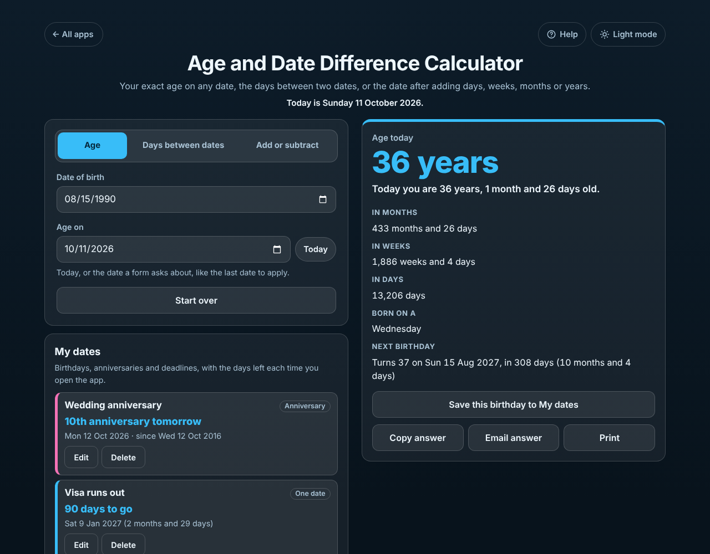

# Age and Date Difference Calculator

A free **age calculator and date calculator** in one. Find your **exact age in years, months and days** today or on any date (like the last date of a job application), count the **days and working days between two dates**, or find the date **90 days, 6 months or 10 working days** from any day. Save birthdays, anniversaries and deadlines under **My dates** to see the days left every time you open it. Works offline, no sign-up, no ads, and everything stays on your device.

**Live demo:** [umar8092.github.io/apps/age-and-date-difference-calculator](https://umar8092.github.io/apps/age-and-date-difference-calculator/)

| Desktop | On a phone |
|---|---|
|  |  |

## The situation it solves

Ayesha is filling in a job application on Sunday 11 October 2026. The form says applicants must be under 25 **on 1 January 2027**. She types her date of birth, 20 January 2002, and changes **Age on** to 1 January 2027. The app answers:

- **On Fri 1 Jan 2027 the age is 24 years, 11 months and 12 days old.** She can apply.

The same afternoon she has three more date questions, all in the same app:

- **Age today** (born 15 August 1990): **36 years, 1 month and 26 days**; 433 months and 26 days; 1,886 weeks and 4 days; 13,206 days; born on a Wednesday; **turns 37 on Sun 15 Aug 2027, in 308 days**.
- **Days between dates**, 1 June to 1 November 2026: **153 days**, which is 5 months, or 21 weeks and 6 days, with **110 working days**. The answer says it counted Mon 1 Jun to Sat 31 Oct; tick **Count the end date too** and it is 154 days.
- **Add or subtract**: her visa allows 90 days from today. **90 days after Sun 11 Oct 2026 is Sat 9 Jan 2027.** She taps **Save to My dates**, names it "Visa runs out", and from now on My dates says **90 days to go**, then 89, then 88.

More worked answers:

- **1 month after 31 January 2026 is Sat 28 February 2026**, and the app says *31 February 2026 does not exist, so this is the last day of February*.
- **5 working days after Friday 9 October 2026 is Friday 16 October** (the start day is not counted). With Monday 12 October as a holiday it is Monday 19 October.
- **Friday and Saturday weekend:** Sunday 4 to Saturday 10 October, both counted, is 5 working days (Sunday to Thursday).
- **Born on 29 February 2004:** with the *28 February* rule she turns 22 on 28 February 2026; with the *1 March* rule she is still 21 that day and her birthday is tomorrow.
- **Saved dates:** Mum born 14 March 1966 shows *Turns 61 in 154 days*; a wedding on 12 October 2016 shows *10th anniversary tomorrow*; a date that has passed shows *42 days ago*.

## Features

- **Help button.** Tap **Help** at the top for a short how-to written for this app, and tap **All apps** to go back to the list.
- **Age.** Exact age in years, months and days, also in months, weeks and days, the weekday you were born, and the next birthday with the days left. Change **Age on** for the age on any date. A 28 February or 1 March choice for people born on 29 February.
- **Days between dates.** Days, months and days, weeks and days, and working days. You choose whether the end date counts, and the answer always shows the first and last day counted. Dates the other way round still work.
- **Add or subtract.** Days, weeks, months, years or working days, with quick picks (7, 30, 90 days, 6 months, 1 year, 10 working days). Month ends are handled and explained.
- **Your own working week.** Pick your days off (Saturday and Sunday, Friday and Saturday, or any days) and add holidays.
- **My dates.** Birthdays and anniversaries every year, and one-off dates like deadlines, exams and trips. Each sits in its own box with the days left, soonest first. Edit, delete with **Undo**.
- **Copy, email or print** the answer (email opens your mail app with no address needed).
- **Start over** with **Undo**. Everything you type is kept for next time.
- **Exact.** Whole calendar days only, so time zones and summer time never move a result. Dates from the year 1000 to 9999. At midnight the page moves on to the new day by itself.
- **Private.** Everything stays in this browser on this device. Your data is never sent anywhere.
- **Works offline and installable.** Phone friendly, with a two-column layout on laptops.
- **Back to all apps.** A "← All apps" button at the top of the page.
- **Light and dark mode switch.** It follows your device until you choose, and remembers your choice in every app.

## Run it yourself

No build step and no dependencies.

```bash
git clone https://github.com/umar8092/apps.git
```

Then open `age-and-date-difference-calculator/index.html` in your browser.

Offline mode and install need the files served over `https` or `localhost` (for example `python3 -m http.server`).

## How it works

- `core.js` holds the date maths, with no page code. Every date is a whole day number, so the answers never depend on the time of day. Months are added by keeping the day of the month and using the last day of the month when that day does not exist. Ages count whole years, then whole months, then the days left.
- `script.js` builds the page. Everything you type is added as plain text, never as HTML.
- `sw.js` saves the app on your device for offline use (network first, so updates show straight away).
- Run the checks with `node tests.js` (or open `test.html`), and the full page test with `node ui-test.js`.

## License

[MIT](LICENSE). Free to use, copy, modify and share. Made by [Muhammad Umar](https://github.com/umar8092).
