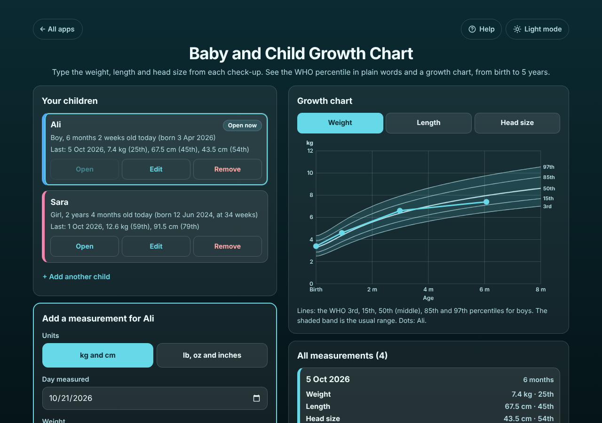

# Baby and Child Growth Chart

A free **baby and child growth chart with WHO percentiles**, from birth to 5 years. Type the weight, the length or height and the head size from each check-up (in kg and cm, or lb, oz and inches) and it tells you what the numbers mean in plain words: *"Weight 7.4 kg: the 25th percentile. About 25 in 100 boys of the same age weigh less."* A chart shows the WHO 3rd, 15th, 50th, 85th and 97th percentile lines with your child's dots. Babies born before 37 weeks get the **corrected age** until 2 years. It says plainly when to ask a doctor: below the 3rd, above the 97th, or when weight or length has crossed two chart lines since the last check-up. The WHO Child Growth Standards are built in, so it works offline. Each child has their own box. No sign-up, no ads, private on your device. Not medical advice.

**Live demo:** [umar8092.github.io/apps/baby-and-child-growth-chart](https://umar8092.github.io/apps/baby-and-child-growth-chart/)

| Desktop | On a phone |
|---|---|
|  |  |

## The situation it solves

Ali's mother leaves the 6-month check-up on **5 Oct 2026** with three numbers on a card: **7.4 kg, 67.5 cm, head 43.5 cm**. The nurse said "fine", but last time he seemed bigger, and she wants to know what the numbers mean.

She adds **Ali, Boy, born 3 Apr 2026**, then types each check-up from the card: birth (3.4 kg, 50.5 cm, head 34.5 cm), 1 May (4.6 kg, 55 cm), 3 Jul (6.6 kg, 63.5 cm, head 41 cm) and 5 Oct. The app says:

- **Ali on 5 Oct 2026, 6 months**
- **Weight 7.4 kg: the 25th percentile.** About 25 in 100 boys of the same age weigh less. *Last time (3 Jul 2026): 6.6 kg, the 62nd percentile.*
- **Length 67.5 cm: the 45th percentile.** About 45 in 100 boys of the same age are shorter.
- **Head size 43.5 cm: the 54th percentile.** About 54 in 100 boys of the same age have a smaller head.
- *The usual range is the 3rd to the 97th percentile.*

The weight went from the 62nd to the 25th, which crosses only one chart line (the 50th), so there is no warning. If he had weighed 6.9 kg, the app would say: **"Weight has gone from the 62nd percentile to the 10th percentile since 3 Jul 2026, crossing 2 chart lines. Ask your doctor to check."**

(The percentiles were checked against the WHO tables for every single day of age: for example 7.4 kg at 185 days for a boy is 25.2%.)

His sister **Sara** was born at **34 weeks** (6 weeks early). On 20 Oct 2026 she is 2 months 1 week old, so the chart uses her **corrected age of 4 weeks 1 day**: 3.3 kg is the 5th percentile. A weight from before her due date is kept but not given a percentile, because the WHO chart starts at the due date. After 5 years the app keeps the numbers and says the WHO 0 to 5 chart stops.

**Copy the table for the doctor** gives:

```
Ali (boy, born 3 Apr 2026)
WHO Child Growth Standards percentiles

3 Apr 2026, newborn (day of birth): Weight 3.4 kg (54th percentile), Length 50.5 cm (63rd percentile), Head size 34.5 cm (51st percentile)
...
5 Oct 2026, 6 months: Weight 7.4 kg (25th percentile), Length 67.5 cm (45th percentile), Head size 43.5 cm (54th percentile)
```

## Features

- **Help button.** Tap **Help** at the top for a short how-to written for this app, and tap **All apps** to go back to the list.
- **WHO percentiles for weight, length or height, and head size**, birth to 5 years, with the official WHO method (including the WHO rule for weights far from usual). In plain words: "About 25 in 100 boys of the same age weigh less", and what it was last time.
- **Growth chart** with the 3rd, 15th, 50th, 85th and 97th percentile lines, the usual range shaded, and your child's dots. Tabs for Weight, Length and Head size, also with the arrow keys.
- **When to ask a doctor:** below the 3rd, above the 97th, crossing two chart lines since the last time, and a "check the number" note for values far from usual.
- **Corrected age** for babies born before 37 weeks, until 2 years. Under 2 years the box says **Length (lying down)**, from 2 years **Height (standing)**.
- **kg and cm, or lb, oz and inches.** Switch at any time; what you typed is converted. A comma works as the decimal point.
- **Each child in their own box** (twins too), with Open, Edit and Remove (Undo).
- **Every measurement** listed with age and percentiles, with **Result**, **Edit** and **Delete** (Undo). Days before birth or in the future are refused, and impossible numbers are caught.
- **Copy the table for the doctor**, **Email the table** (works with no address typed), **Save a backup file**, **Restore a backup**, **Delete everything** with Undo.
- **Private.** Your data is never sent anywhere; it stays in this browser on this device.
- **Works offline and installable.** The WHO tables are inside the app. Phone friendly, with a two-column layout on laptops.
- **Back to all apps.** A "← All apps" button at the top of the page.
- **Light and dark mode switch.** It follows your device until you choose, and remembers your choice in every app.

## Run it yourself

No build step and no dependencies.

```bash
git clone https://github.com/umar8092/apps.git
```

Then open `baby-and-child-growth-chart/index.html` in your browser.

Offline mode and install need the files served over `https` or `localhost` (for example `python3 -m http.server`).

## How it works

- `who-data.js` holds the WHO Child Growth Standards (2006) L, M and S values by age in days, from the [WHO anthro package](https://github.com/WorldHealthOrganization/anthro): every day to 91 days, then every 7 days (plus the switch from length to height at 2 years). Values in between are worked out in a straight line; they match the full daily tables to within 0.03%.
- `core.js` is the logic: z = ((value ÷ M)^L − 1) ÷ (L × S), then the percentile from the normal curve. Weights beyond 3 SD use the WHO rule. Corrected age = real age − (40 − weeks at birth) × 7 days, until 730 days. Weights are stored in kg and lengths in cm.
- `script.js` builds the page and draws the chart as SVG. Names are added as plain text, never as HTML.
- `sw.js` saves the app on your device for offline use (network first, so you always get the newest version when online).
- Run the logic checks with `node tests.js` (or open `test.html`); their expected percentiles were worked out separately from the full daily WHO tables. The full page test is `node ui-test.js` (needs Playwright).

## License

[MIT](LICENSE). Free to use, copy, modify and share. Made by [Muhammad Umar](https://github.com/umar8092). Growth standards: World Health Organization, WHO Child Growth Standards (2006). Not medical advice.
