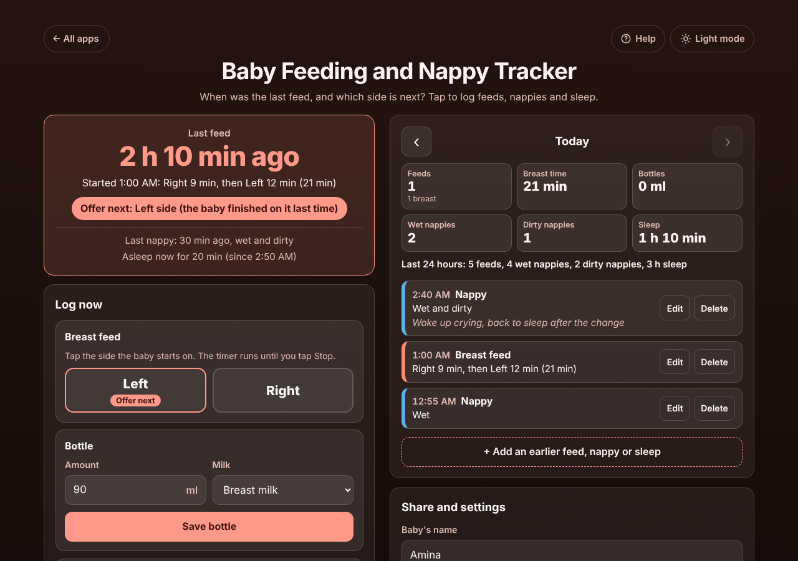

# Baby Feeding and Nappy Tracker

A free **baby feeding, nappy (diaper) and sleep log for tired parents**. One tap starts a breast feed timer on the left or right side, saves a bottle, a wet or dirty nappy, or a nap. The top of the screen answers the 3 a.m. questions straight away: **how long since the last feed, and which side to offer next**. The day box adds up feeds, breast time, bottles, wet and dirty nappies and sleep, for the midwife, health visitor or doctor. Twins each get their own log. No sign-up, no ads, private on your phone, works offline.

**Live demo:** [umar8092.github.io/apps/baby-feeding-and-nappy-tracker](https://umar8092.github.io/apps/baby-feeding-and-nappy-tracker/)

| Desktop | On a phone |
|---|---|
|  |  |

## The situation it solves

It is 3:10 a.m. and the baby is crying again. Was the last feed an hour ago or three? Which side was it? A parent opens the app and reads, in big letters:

- **Last feed: 2 h 10 min ago.** Started 1:00 AM: Right 9 min, then Left 12 min (21 min).
- **Offer next: Left side** (the baby finished on it last time).
- Last nappy: 30 min ago, wet and dirty. Asleep now for 20 min.

They tap **Left**, the timer runs, they tap **Switch to right** halfway and **Stop and save feed** at the end. A feed that used only one side (say Right 5 min) makes the app suggest the *other* side next time.

At the check-up the health visitor asks "how many wet nappies in the last 24 hours?" The day box answers: *Last 24 hours: 5 feeds, 4 wet nappies, 2 dirty nappies, 3 h sleep.*

Worked examples from the tests:

- Left 12 min, switch, Right 3 min, **Pause** 4 min, **Resume** Right 5 min, Stop: saved as *Left 12 min, then Right 8 min (20 min)*; the pause is not counted. Two hours later the top says **2 h 24 min ago** (counted from the start of the feed, the way midwives count).
- Bottles of 90 ml and 60.5 ml: **Bottles 150.5 ml**. Switched to oz, 120 ml + 60.5 ml shows **6.1 oz**.
- A sleep from 10:00 PM to 12:30 AM counts **2 h** on the first day and **30 min** on the next.

## Features

- **Help button.** Tap **Help** at the top for a short how-to written for this app, and tap **All apps** to go back to the list.
- **Breast feed timer for each side.** Left or Right to start, Switch, Pause and Resume, Stop and save, Discard. It keeps running when the phone locks or the page is closed, and warns when a timer has run for over 90 minutes (forgot to stop).
- **Which side next**, worked out from the last breast feed and shown on the side button as *Offer next*.
- **Bottles** in ml or oz (typed amounts kept exactly, comma decimals accepted), formula or breast milk; the last amount is filled in for next time.
- **One-tap nappies:** Wet, Dirty, Wet + dirty.
- **Sleep timer:** Baby fell asleep / Baby woke up.
- **Day totals:** feeds, breast time, bottles, wet and dirty nappies, sleep (split at midnight), average time between feeds, and the **last 24 hours**. Arrows go back to earlier days.
- **Fix mistakes:** Edit any entry (time, minutes per side, amount, nappy, note), Delete with Undo, and **+ Add an earlier feed, nappy or sleep** for something you forgot. Every save has Undo.
- **Twins:** **+ Add another baby (twins)**; each baby has its own name, log, timers and totals, and both can feed at once.
- **Share:** Copy day, Email day (opens your mail app with no address needed), Print day.
- **Backup file** and restore (checked before loading, with Undo), and Delete the whole log with Undo.
- **Private and offline.** Everything stays in this browser on this device. Installable.
- **Back to all apps.** A "← All apps" button at the top of the page.
- **Light and dark mode switch.** Dark by default at night-friendly brightness; it remembers your choice in every app.

Not medical advice: it is a log to help you remember and to show your midwife, health visitor or doctor.

## Run it yourself

No build step and no dependencies.

```bash
git clone https://github.com/umar8092/apps.git
```

Then open `baby-feeding-and-nappy-tracker/index.html` in your browser.

Offline mode and install need the files served over `https` or `localhost` (for example `python3 -m http.server`).

## How it works

- `core.js` is the logic with no page code: the feed timer (segments per side, pauses), which side next, day and 24-hour totals (sleep split at midnight, days built from the phone's calendar so clock changes never shift them), amount parsing, and checking every saved or restored entry.
- `script.js` builds the page. Names and notes are added as plain text, never as HTML. Times are saved as timestamps, so a running timer survives a reload.
- `sw.js` keeps a copy for offline use. It is network first: online you always get the newest version.
- Tests: `node tests.js` checks the logic (also in `test.html`), and `node ui-test.js` drives the real page in headless Chromium through the night scenario, edits, undo, twins, backup, midnight, odd inputs and small screens.

## License

MIT, see [LICENSE](LICENSE).
