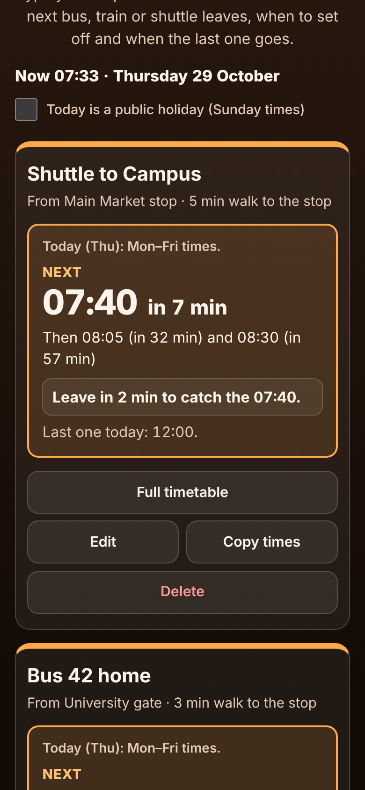

# Bus and Train Timetable for My Stops

A free **personal bus and train timetable** for commuters and students whose bus, train, tram or school, university or work shuttle runs to a printed timetable, and who are tired of squinting at a photo of it on the platform. Type or paste the departure times for **your** stop once and the app answers the only question that matters in the morning: **when is the next one, how many minutes away is it, and when must I leave?** It also tells you when the **last one tonight** goes. Weekday, Saturday, Sunday and public holiday times, buses every N minutes, buses after midnight, and summer or school-holiday timetables between dates are all handled. No account, no ads, and it works offline, underground too.

**Live demo:** [umar8092.github.io/apps/bus-and-train-timetable-for-my-stops](https://umar8092.github.io/apps/bus-and-train-timetable-for-my-stops/)

| Desktop | On a phone |
|---|---|
|  |  |

## The situation it solves

Sana is a university student. The free university shuttle leaves the **Main Market stop** at **07:15, 07:40, 08:05, 08:30, 09:00, 10:30 and 12:00** on weekdays and at **08:00, 10:00 and 12:00** on Saturday; there is none on Sunday. The timetable is a sheet pinned at the stop, there is no app, and it takes her **5 minutes** to walk there. Coming home she takes **Bus 42**, every 20 minutes from 06:00 to 22:00 plus late buses at 22:40, 23:20 and 00:10.

She adds **Shuttle to Campus**, taps **Weekdays, Saturday, Sunday**, pastes the weekday column into the first set, types `8:00am, 10am, 12pm` in the Saturday set, leaves Sunday empty (the editor says *No departures on Sun.*) and picks **5 min** under **Walk to the stop**.

On Thursday at **07:33** her box says:

- **Next 07:40, in 7 min**
- *Then 08:05 (in 32 min) and 08:30 (in 57 min)*
- **Leave in 2 min to catch the 07:40.**
- *Last one today: 12:00.*

At **07:37** the 07:40 is still 3 minutes away but she needs 5, so it says: *The 07:40 is too soon to reach with your 5 min walk. Leave in 23 min to catch the 08:05.* After the 12:00 has gone it says *That was the last one today* and shows **Next · Tomorrow 07:15**; on Saturday afternoon it jumps to **Mon 2 Nov 07:15**.

For the way home she adds **Bus 42 home** with **+ Add times every N minutes** (From 06:00, To 22:00, Every 20) and types `22:40 23:20 00:10` after it. The 00:10 is counted as the night before, like on the printed timetable, so the box says **Last one today: 00:10 (after midnight)**, and on Friday at 00:05 it still shows the Thursday-night 00:10 as *in 5 min*.

Other cases it handles:

- **Pasted text**: `Bus 42 to City (Mon-Fri): 06:00 06:30* 07:00` reads three times and skips the words, footnote marks and route number. `7:15pm`, `7pm`, `19.15`, `7h15` and a column of `0715 0740` all work. A year or a date such as `12.11.2026` is not mistaken for a time.
- **Impossible times** such as `25:70` are shown in red (*Cannot be a time: 25:70. Fix or delete it.*) and the stop is not saved until they are fixed. Blank names, no times, no days ticked, a walk of 500 or −3 minutes, and **Every 0 minutes** are refused with a message beside the field.
- **A public holiday**: tick **Today is a public holiday (Sunday times)** or add the dates under **Public holidays**. Those days run the Sunday times; a stop with no Sunday times says *Today is a public holiday: no departures* and shows the next working day's first one.
- **Summer or school-holiday timetables**: a set of times with **+ Only between dates (optional)** replaces the normal times on its days between those dates (both dates included), then the normal times come back by themselves. *Until must be on or after From* if the dates are the wrong way round.
- **Two sets ticking the same day** combine their times, and the editor says so. A day in no set has no departures, and the box shows the first one on the next day it runs.
- **A long wait** shows *in 22 h 08 min* or *in 1 day 20 h*, without far-away "leave in" advice. Countdowns use real minutes, so a clock change for summer time is counted right.
- **Copy times** copies `Shuttle to Campus (from Main Market stop) / Mon–Fri: 07:15 07:40 … / Sat: 08:00 10:00 12:00 / No service: Sun` to send to a friend or your child. **Delete**, **Restore a backup** and **Delete everything** all have **Undo**.
- Very long names wrap inside their box, typed HTML is shown as plain text, broken saved data starts fresh instead of crashing, and if the browser blocks saving a red warning says so.

## Features

- **Help button** at the top with a short how-to, **All apps** to go back to the list of apps, and a **Light mode / Dark mode** switch.
- **Each stop or direction in its own box**: name, the stop where you get on (optional), your walk to the stop, and its own departure times.
- **Next departure in big type** with the minutes left, the two after it, **when to leave** for your walk, and the **last one today**.
- **Full timetable** for today with gone times crossed out and the next one marked, and a day picker for the next week.
- **Days and dates**: presets for *Same times every day* and *Weekdays, Saturday, Sunday*, any days you tick (Friday–Saturday weekends too), **every N minutes**, after-midnight times, **only between dates**, and **public holidays** on Sunday times.
- **Edit**, **Move up**, **Copy times**, **Delete** with **Undo**, **Save a backup file** and **Restore a backup**.
- **Try it with an example timetable** to see how it works before typing your own.
- **Private, works offline and installable.** Phone and desktop layouts, keyboard and screen-reader friendly.

## Run it yourself

No build step and no dependencies.

```bash
git clone https://github.com/umar8092/apps.git
```

Then open `bus-and-train-timetable-for-my-stops/index.html` in your browser. Offline mode and install need the files served over `https` or `localhost` (for example `python3 -m http.server`).

## How it works

- `core.js` holds the rules with no page code: reading times out of typed or pasted text (24-hour, am/pm, after midnight), every N minutes, which set of times runs on a date (holidays run the Sunday times, dated sets replace the normal ones), the next departures from now across days, the minutes left, the departure you can still catch on foot, and checking saved or restored data.
- `script.js` builds the page. Times are minutes from the start of a service day, so 24:10 is the 00:10 bus that belongs to the night before. The countdown refreshes every minute using this device's clock and time zone. Everything is saved in this browser's storage under `bus-and-train-timetable-for-my-stops.state`; what you type is shown as plain text, never as HTML.
- `sw.js` saves the app for offline use (network first, so updates always arrive).
- Checks: `node tests.js` for the rules (also `test.html` in a browser; try `TZ=Europe/London node tests.js` for summer time), and `node ui-test.js` from the repo root drives the real page in headless Chromium with a fixed clock: the situation above, mistakes, holidays, dates, undo, backup, corrupt storage, every screen size and both themes (pass `https://umar8092.github.io/apps` to test the live site). `node shots.js` makes the screenshots.

## License

[MIT](LICENSE). Free to use, copy, modify and share. Made by [Muhammad Umar](https://github.com/umar8092).
