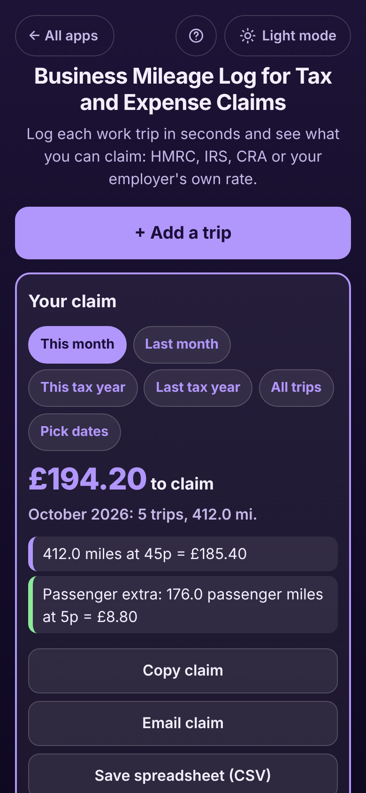

# Business Mileage Log for Tax and Expense Claims

A free **business mileage log** for anyone who drives their own car, van, motorbike or bicycle for work: the **self-employed** (plumbers, electricians, cleaners, photographers, consultants), **sales reps, home carers, nurses and estate agents** who claim mileage from their employer. Log each trip in seconds (date, from, to, what it was for, miles or km, there and back, odometer readings, passengers) and see **what you can claim** this month, last month or this tax year. Built-in official rates: **UK HMRC** 45p a mile for the first 10,000 business miles in the tax year then 25p, plus 5p per passenger (motorcycle 24p, bicycle 20p); **US IRS** business rate, including the **2026 change from 72.5¢ to 76¢ on 1 July**; **Canada CRA** 73¢ a km for the first 5,000 km then 67¢; or **your employer's own rate**, which can change from a date. Copy, email, print or save a spreadsheet for your claim. Works offline, no sign-up, no ads.

**Live demo:** [umar8092.github.io/apps/business-mileage-log-for-tax-and-expense-claims](https://umar8092.github.io/apps/business-mileage-log-for-tax-and-expense-claims/)

| Desktop | On a phone |
|---|---|
|  |  |

## The situation it solves

Sarah is a **self-employed plumber in Leeds**. She drives her own car to customers, to the plumbing merchant and to training. HMRC lets her claim **45p a mile** for the first **10,000 business miles** in the tax year (6 April to 5 April) and **25p** after that, plus **5p a mile** for a business passenger. She used to scribble trips on receipts and guess at the end of the year, which loses money and would not stand up to a check.

In **October 2026** she logs five trips:

| Date | Trip | What for | Distance |
|---|---|---|---|
| Thu 1 Oct | Home ⇄ Smith Ltd, Leeds | Boiler repair | 24 miles each way, there and back = **48.0** |
| Mon 5 Oct | Home → City Plumbing supplies | Parts for the Smith job | **18.5** |
| Mon 12 Oct | Home ⇄ Mrs Green, Otley | New radiator fitted | 31 each way = **62.0** |
| Tue 20 Oct | Home → New build site, York | First fix, 3 flats | **107.5** |
| Fri 23 Oct | Home ⇄ Training centre, Manchester | Gas safety course, apprentice came along | 88 each way = **176.0**, 1 passenger |

On **Mon 26 Oct** the app answers:

- **£194.20 to claim. October 2026: 5 trips, 412.0 mi.**
- **412.0 miles at 45p = £185.40**
- **Passenger extra: 176.0 passenger miles at 5p = £8.80**
- **Tax year 2026-27 so far: 2,860.8 miles, £1,296.16. 7,139.2 miles left at 45p before the rate drops to 25p (limit 10,000 miles, resets on 6 Apr 2027).**

Each trip has its own box, for example **Fri 23 Oct, £88.00, Home ⇄ Training centre, Manchester, 88.0 mi each way, there and back = 176.0 mi at 45p, plus 1 passenger at 5p.**

**Crossing the 10,000 miles.** In a busy year Sarah has **9,970 miles** logged by October. Her next trip is **48 miles**. The app splits it: **Adds £18.00 to your claim for 48.0 mi: 30.0 mi at 45p and 18.0 mi at 25p, because this trip passes the 10,000-mile yearly limit** (£13.50 + £4.50). From 6 April the count starts at 0 again and trips are back at 45p.

**In the US**, Mike, a real estate agent, chooses **US: IRS business standard rate**. A 100-mile trip on **30 June 2026** is **$72.50** (72.5¢) and the same trip on **1 July 2026** is **$76.00** (76¢), because the IRS raised the rate mid-year. **In Canada**, the CRA allowance is 73¢ a km up to 5,000 km in 2026, then 67¢: a 20 km trip after 4,990 km is 10 km at 73¢ + 10 km at 67¢ = **$14.00**.

**Copy claim** gives a ready-to-send claim:

```
Mileage claim: October 2026
Name: Sarah Khan
5 trips, 412.0 mi
Rate: UK: HMRC car or van
412.0 miles at 45p = £185.40
Passenger extra: 176.0 passenger miles at 5p = £8.80
Total to claim: £194.20

Trips:
Thu 1 Oct 2026 · Home ⇄ Smith Ltd, Leeds · Boiler repair · 48.0 mi · £21.60
Mon 5 Oct 2026 · Home → City Plumbing supplies · Parts for the Smith job · 18.5 mi · £8.33
...
```

How it counts: distances are kept in tenths of a mile or km and rates in thousandths (72.5¢ = 0.725), so every trip's amount is exact. The total is the exact sum rounded to the penny or cent once, the same as miles × rate: 18.5 miles at 45p is £8.325, shown on its own as £8.33. Trips are added up in date order within each tax year, so a trip added later with an earlier date moves the 10,000-mile split to the right trip. Vehicles on the same HMRC or CRA rate share the yearly limit, as HMRC counts cars and vans together.

## Features

- **Help button.** Tap **Help** at the top for a short how-to written for this app, and tap **All apps** to go back to the list. A **Light mode / Dark mode** switch sits beside them.
- **Set up once:** name the vehicle (My car, Van, Motorbike, Bicycle or your own) and choose the rate: **UK HMRC car or van, motorcycle or bicycle**, **US IRS business rate** (2023 to 2026, with the 1 July 2026 change), **Canada CRA allowance rate** (2024 to 2026), or **your employer's or your own rate** in miles or km, with an optional lower rate after a yearly limit, an optional passenger extra, and a tax or claim year from 1 Jan, 6 Apr, 1 Apr, 1 Jul or 1 Oct.
- **Add a trip in seconds:** date (Today, Yesterday or any past date), From and To with suggestions from past trips, what it was for, the distance, **There and back**, or **odometer readings** at the start and end. **Business passengers** only appear when the rate pays for them.
- **Same as a past trip?** One tap fills in a route you drive often; **Repeat today** on any trip does the same.
- **A preview before saving:** "Adds £21.60 to your claim: 48.0 mi at 45p."
- **Your claim** for **This month, Last month, This tax year, Last tax year, All trips or Pick dates**, with the miles at each rate and the passenger extra.
- **This tax year so far:** miles and money, a bar towards the 10,000-mile (or 5,000-km) limit, how much is left at the higher rate and when the count resets.
- **Each trip in its own bordered box** with the amount, the route, the purpose, how the distance was worked out and any split across the limit, grouped by month with month totals.
- **A rate change that does not rewrite history:** edit your own rate and choose **Only trips from a date**; older trips keep the old rate.
- **Two or more vehicles**, each with its own rate (a car on HMRC and a motorbike on your employer's rate per km).
- **Copy claim, Email claim** (no address needed), **Save spreadsheet (CSV)** for Excel, Numbers or Google Sheets, and **Print**. An optional name is added to the claim.
- Gentle checks: a trip with no purpose is flagged (tax offices ask for it), a future date or an odometer going down is refused, a rate like 45 instead of 0.45 is questioned.
- **Undo** after adding, editing or deleting a trip, deleting a vehicle or deleting everything.
- Optional **currency symbol** (none, £, $, €, C$, A$, ₹, Rs and more), remembered; choosing a UK, US or Canada rate sets it the first time.
- **Save a backup file**, **Restore a backup**, **Delete everything**. Damaged or blocked saved data is handled with a clear message.
- **Private.** Everything stays in this browser on this device; your data is never sent anywhere.
- **Works offline and installable.**
- **Back to all apps.** A "← All apps" button at the top of the page.

This is a record-keeping tool, not tax advice. Check the current rate with your tax office or employer.

## Run it yourself

```
git clone https://github.com/umar8092/apps.git
```

Then open `business-mileage-log-for-tax-and-expense-claims/index.html` in a browser. No build step, no dependencies.

## How it works

- `core.js` holds the rates, the tax-year dates, the threshold split, the totals, the claim text and the CSV, and can be tested on its own: `node tests.js` (or open `test.html`).
- `script.js` draws the page from that logic. User-typed text is shown with `textContent`.
- `ui-test.js` drives the real page with Playwright: the main situation, every edge case, 11 screen widths in dark and light, the Help window, and the screenshots (`node ui-test.js --shots`).
- Saved data lives in `localStorage` under keys starting with `business-mileage-log-for-tax-and-expense-claims.`.
- `sw.js` is a network-first service worker: online you always get the newest version, offline the saved copy.
- Rate sources: HMRC approved mileage allowance payments; IRS Notice 2026-10 and Announcement 2026-11 (76¢ from 1 July 2026); Department of Finance Canada automobile allowance rates.

## License

[MIT](LICENSE)
