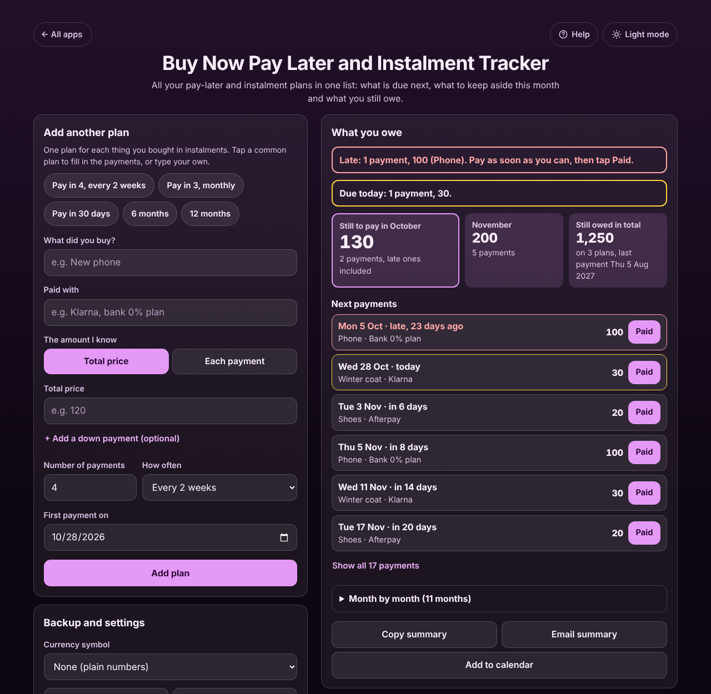
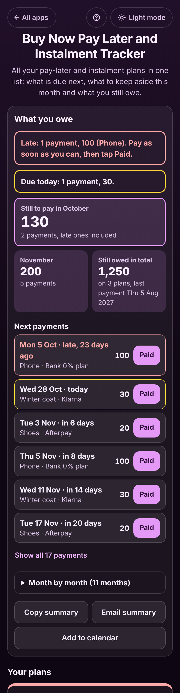

# Buy Now Pay Later and Instalment Tracker

A free **tracker for buy now pay later and instalment plans from any provider**. Add each thing you bought in instalments (Klarna, Afterpay, Clearpay, Affirm, Zip, PayPal Pay in 4, Tabby, Tamara, a credit card or bank 0% plan, or a shop's monthly plan) and see in one place what is due next, what is still to pay this month and next month, what you still owe in total and which payments are late. Tap **Paid** after each payment. No sign-up, no ads, no connection to your bank, and it works offline.

**Live app:** [umar8092.github.io/apps/buy-now-pay-later-and-instalment-tracker](https://umar8092.github.io/apps/buy-now-pay-later-and-instalment-tracker/)

| Desktop | On a phone |
|---|---|
|  |  |

## The situation it solves

Sara split three things into instalments: a **winter coat on Klarna** (120 in 4 payments every 2 weeks, the first at checkout on 14 Oct), a **phone on her bank's 0% plan** (1,200 in 12 monthly payments from 5 Sep) and **shoes on Afterpay** (80 in 4, from 20 Oct). Each provider has its own app, and none of them shows her the whole picture. She forgot the phone payment of 5 October.

On Wednesday 28 October she opens the tracker and sees:

- **Late: 1 payment, 100 (Phone).** Pay as soon as you can, then tap Paid.
- **Due today: 1 payment, 30** (the coat).
- **Still to pay in October: 130** (2 payments, late ones included): the money to keep in her account until the month ends.
- **November: 200** (5 payments: 30 + 30 on the coat, 100 on the phone, 20 + 20 on the shoes).
- **Still owed in total: 1,250 on 3 plans, last payment Thu 5 Aug 2027** (coat 90, phone 1,100, shoes 60).
- **Next payments** from all plans by date, each with a **Paid** button.

Odd amounts are split exactly: **100 in 3 payments is 33.34, then 33.33 and 33.33**, and **1,000 in 7 is 5 payments of 142.86 then 2 of 142.85**, adding up to the cent. Monthly payments stay on the same day; a plan started on **31 January** pays on **28 February** and back on **31 March**.

When Sara returns the shoes, **Returned it** cancels the 60 still to pay and shows **Refunds to expect: 20**, what she had already paid. When she pays the coat off early with a 5 discount, **Paid off early** records the 55 she really paid.

## Features

- **Help button.** Tap **Help** at the top for a how-to written for this app, and **← All apps** to go back to the list.
- **Any provider, one list.** Each plan sits in its own box with what you still owe, the payments made, a progress bar and the next payment or the late one in red.
- **Common plans in one tap:** Pay in 4 every 2 weeks, Pay in 3 monthly, Pay in 30 days, 6 months and 12 months. Or set your own: 1 to 60 payments, every week, every 2 weeks, every month or every few days.
- **Total price or each payment.** Type the price to have it split with the odd cents on the first payments, or the amount of each payment. Optional **down payment** paid at checkout.
- **Adding a plan already under way.** Payments due on or before today are marked paid when **I have already paid** is ticked.
- **What you owe:** late payments, due today, still to pay this month (late ones included), next month, still owed in total with the date of the last payment, the next payments and **month by month**.
- **Every payment editable:** **Paid**, **Not paid**, **Edit** (date, amount, the day you paid) and delete.
- **Returned it** (cancels the rest and tracks the refund until **Refund received**), **Paid off early** (with a discount), **Change amount owed** (part refund or interest, shared over the payments left) and **+ Add a fee** (late fees).
- **Copy summary**, **Email summary** (opens your mail app, no address needed) and **Add to calendar** (a calendar file with every payment still to pay and a reminder the day before).
- **Undo** after every change, delete and restore.
- **Currency symbol** of your choice (or none), remembered.
- **Backup file** to move to another phone, and **Delete everything**.
- **Private.** Everything stays in your browser. It never connects to your bank or provider, and your data is never sent anywhere.
- **Works offline and installable.** Light and dark mode switch next to the back button, remembered across all apps. Laptop layout with the form on the left and your plans on the right.

## Run it yourself

No build step and no dependencies.

```bash
git clone https://github.com/umar8092/apps.git
```

Then open `buy-now-pay-later-and-instalment-tracker/index.html` in your browser.

Offline mode and install need the files served over `https` or `localhost` (for example `python3 -m http.server`).

## How it works

- `core.js` is the maths and the words, with no page code. Money is whole cents and dates are whole days, so totals are exact. `schedule()` makes the payments, `analyse()` works out one plan, `summary()` adds up all plans, and `ics()` writes the calendar file.
- `script.js` builds the page. Names are added as plain text, never as HTML. Plans are saved in this browser's storage under `buy-now-pay-later-and-instalment-tracker.state`.
- `sw.js` saves the app on your device for offline use (network first, so updates show at once).
- Run the logic checks with `node tests.js` (or open `test.html`), and the page checks with `node buy-now-pay-later-and-instalment-tracker/ui-test.js` from the repo root while `python3 -m http.server 8765` runs there.

## License

[MIT](LICENSE). Free to use, copy, modify and share. Made by [Muhammad Umar](https://github.com/umar8092).
