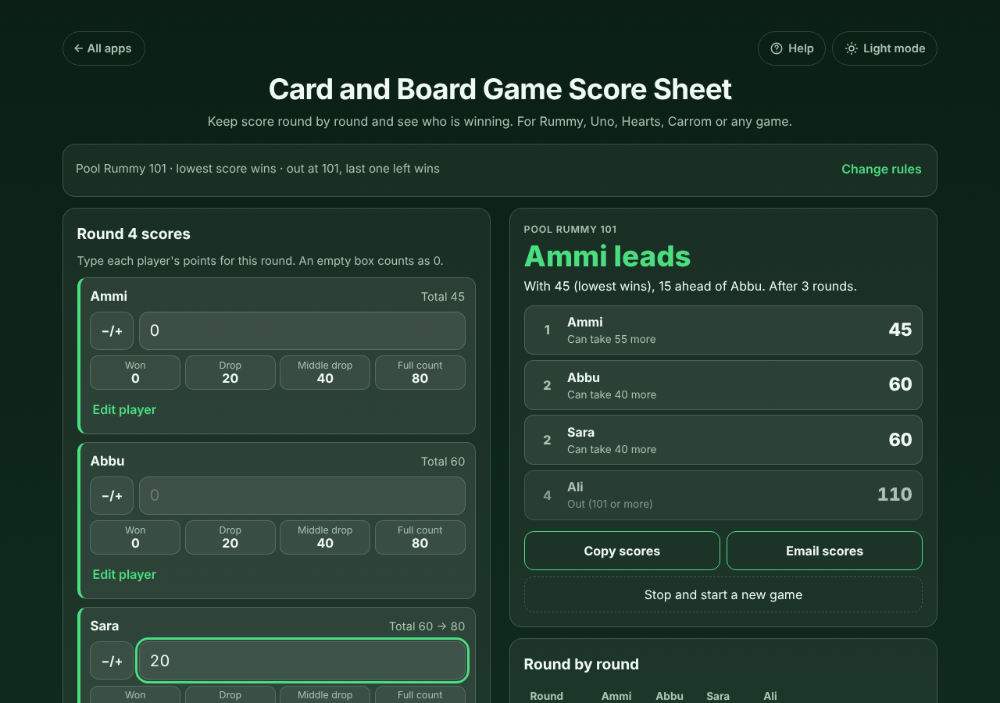
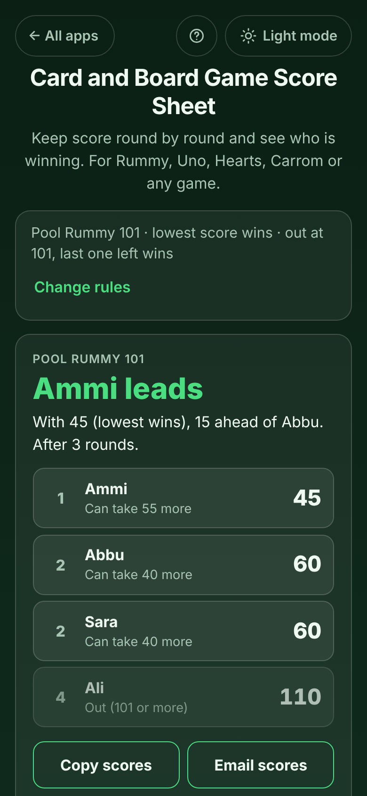

# Card and Board Game Score Sheet

A free **score sheet for card and board games** with family and friends. Type each round's points and see the running totals, who is ahead and by how much, who is out in Pool Rummy 101, and who won. Ready-made rules for Pool Rummy 101 and 201, Rummy, Gin Rummy, Uno, Hearts, Spades, Carrom and Scrabble, or set your own: highest or lowest score wins, and the game ends when you stop, when someone reaches a score, when players are knocked out at a score, or after a set number of rounds. Works offline, no sign-up, no ads.

**Live demo:** [umar8092.github.io/apps/card-and-board-game-score-sheet](https://umar8092.github.io/apps/card-and-board-game-score-sheet/)

| Desktop | On a phone |
|---|---|
|  |  |

## The situation it solves

A family plays Pool Rummy 101 on a Friday night: Ammi, Abbu, Sara and Ali. Usually someone keeps score on a scrap of paper that gets added up wrong or lost, and there is an argument about who is out. With this app, after each deal you type each player's points (or tap **Won 0**, **Drop 20**, **Middle drop 40**, **Full count 80**):

| Round | Ammi | Abbu | Sara | Ali |
|---|---|---|---|---|
| 1 | 0 | 20 | 40 | 80 |
| 2 | 20 | 0 | 20 | 30 |
| 3 | 25 | 40 | 0 | out |

The app answers in plain words:

- After round 2: **Ali is out with 110** (101 or more). Ammi and Abbu are level on 20, and Sara **can take 40 more** before she is out.
- After round 3: **Ammi leads with 45 (lowest wins), 15 ahead of Abbu.**
- Ali can tap **Rejoin at 60** to come back with the highest score of the players still in, if your table allows it.
- When everyone but one player has reached 101, it names the winner, for example **"Abbu wins! Last player in, with 30."** If the last players all go out in the same deal, the lowest of them wins.

Other games work the same way. In **Uno, first to 500** each player sees "120 to reach 500", and the game ends after the round in which someone reaches 500. In **Hearts** the game ends when someone reaches 100 and the lowest total wins. In **Scrabble** you play as long as you like and tap **End game now**. If two players are level at the end it says **"Tie: Ammi and Abbu"** and offers **Play a tie-break round**.

## Features

- **Help button.** Tap **Help** at the top for a short how-to written for this app, and tap **All apps** to go back to the list.
- **Every player in their own box**, with a big number box, a **−/+** button for negative points (phone keypads often have no minus key), and a preview of the new total ("Total 60 → 80") before you save.
- **Quick buttons** for Pool Rummy: Won, Drop, Middle drop and Full count (20/40/80 in 101, 25/50/80 in 201).
- **Standings after every round**: who leads and by how much, each player's total and rank, how many more points each player can take before they are out, or how many they need to reach the target.
- **Fix mistakes**: Undo after saving or deleting a round, Edit any past round, Delete a round.
- **Real game nights**: add a late player (starting at 0, the highest or lowest score, or a score you type), rename a player, mark someone **Left the table** so they do not count for the win, remove a player, and **Rejoin** in Pool Rummy.
- **Your house rules**: change the target or who wins at any time with **Change rules**; changed games are named "(house rules)".
- **End of the game**: winner screen, ties with a tie-break round, **Keep playing** past the target, **Copy scores** and **Email scores** (your mail app opens with the result written, no address needed), **Play again, same players**.
- **Past games** keeps every result and counts wins per player ("Wins so far: Abbu 3, Sara 2").
- **Saved as you type.** A locked phone or closed tab loses nothing, even a half-typed round.
- **Private.** Your data is never sent anywhere. **Works offline and installable.**
- **Back to all apps.** A "← All apps" button at the top of the page.
- **Light and dark mode switch.** It follows your device until you choose, and remembers your choice in every app.

## Run it yourself

No build step and no dependencies.

```bash
git clone https://github.com/umar8092/apps.git
```

Then open `card-and-board-game-score-sheet/index.html` in your browser.

Offline mode and install need the files served over `https` or `localhost` (for example `python3 -m http.server`).

## How it works

- `core.js` is the scoring, with no page code. Scores are whole numbers, so totals are always exact. `status()` replays the rounds in order to work out totals, who went out in which round, the ranking and the winner.
- `script.js` builds the page. Names are added as plain text, never as HTML. Everything is saved in your browser's local storage under keys starting with `card-and-board-game-score-sheet.`; saved data is checked before use, and anything broken is ignored.
- `sw.js` saves the app on your device for offline use. It always fetches the newest files when you are online.
- Run the checks with `node tests.js` (scoring) and `node ui-test.js` from the repo root (the page), or open `test.html` in a browser. `shots.js` makes the screenshots.

## License

[MIT](LICENSE). Free to use, copy, modify and share. Made by [Muhammad Umar](https://github.com/umar8092).
