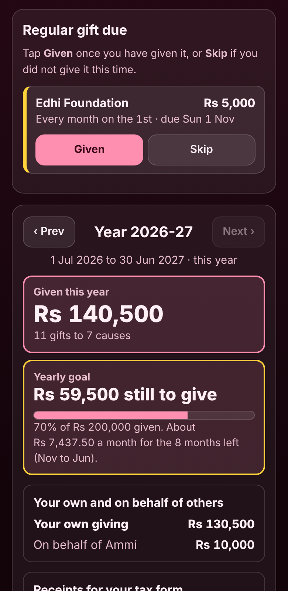

# Charity and Donation Log with Yearly Total

A free **log of what you give**: zakat, sadqa, fitrana, a church tithe, a temple or gurdwara offering, a donation to a charity, or cash and food for someone in need. Add each gift in a few seconds (to whom, how much, the kind, how you paid and whether you have the **receipt**), set up gifts you give **every week, month or year**, and see **how much you gave this year**, by kind and by cause, **which receipts you still need for your tax form**, how close you are to your **yearly giving goal**, and how much is left on a **promise you are paying in parts**. Your year can start in January, 1 April (India), 6 April (UK, for Gift Aid) or 1 July (Pakistan, Australia). No sign-up, no ads, and it works offline.

**Live app:** [umar8092.github.io/apps/charity-and-donation-log-with-yearly-total](https://umar8092.github.io/apps/charity-and-donation-log-with-yearly-total/)

| Desktop | On a phone |
|---|---|
|  |  |

## The situation it solves

Ayesha lives in Karachi. She sends Rs 5,000 to Edhi Foundation on the 1st of every month, pays zakat to a neighbour's family and to Shaukat Khanum Hospital, pays zakat for her mother too, gives to the masjid and to The Citizens Foundation, and helped with a ration drive at the office. In April her accountant asks which donations have a receipt for the tax credit, and she has no idea how much she gave or which receipts she never got. She would like to give Rs 2,00,000 a year, and she promised the masjid Rs 30,000 for its building fund, paid bit by bit.

She sets **Your currency symbol** to Rs, **Your year runs** to 1 July to 30 June (guessed from her time zone) and a **yearly giving goal** of 200,000, then adds her gifts:

| Date | Given to | Amount | Kind | How | Receipt |
|---|---|---|---|---|---|
| 1 Jul, then **every month** | Edhi Foundation | 5,000 | Sadqa | Bank transfer | Receipt kept |
| 3 Jul | Ration drive at the office | 8,000 | Help to someone in need | Goods or food | Not needed |
| 7 Aug | Masjid Al-Noor | 10,000 | General donation | Bank transfer | **Still to get** |
| 20 Aug | Neighbour's family | 25,000 | Zakat | Cash | Not needed |
| 12 Sep | Shaukat Khanum Hospital | 50,000 | Zakat | Cheque | Receipt kept |
| 28 Sep | The Citizens Foundation | 15,000 | General donation | Card or online | **Still to get** |
| 5 Oct | Al-Khidmat Foundation, **on behalf of Ammi** | 10,000 | Zakat | Bank transfer | **Still to get** |
| 16 Oct | masjid al-noor | 2,500 | Sadqa | Cash | Not needed |

She also added the Rs 2,400 fitrana she gave the masjid on 19 March, which belongs to last year (2025-26). The monthly gift to Edhi was added on 1 July; the app then asked her to confirm 1 August, 1 September and 1 October, and she tapped **Given** each time. She also adds a promise: **Rs 30,000 to Masjid Al-Noor, promised on 1 August**. On Sunday 1 November 2026 the app shows:

- **Regular gift due: Edhi Foundation Rs 5,000, every month on the 1st, due Sun 1 Nov** with **Given** and **Skip**. Nothing is counted until she confirms it, so a missed month never inflates her total.
- **Given this year (2026-27, 1 Jul 2026 to 30 Jun 2027): Rs 140,500, 11 gifts to 7 causes.** The two spellings of the masjid count as one cause.
- **Your own giving Rs 130,500, on behalf of Ammi Rs 10,000.**
- **Yearly goal: Rs 59,500 still to give.** 70% of Rs 200,000 given, about **Rs 7,437.50 a month for the 8 months left (Nov to Jun)**: 59,500 ÷ 8 = 7,437.50.
- **Receipts for your tax form:** receipt kept 5 gifts **Rs 70,000** (4 × 5,000 Edhi + 50,000 Shaukat Khanum), **still to get 3 gifts Rs 35,000**, not needed 3 gifts Rs 35,500, and **Ask for these receipts: Masjid Al-Noor Rs 10,000 on 7 Aug, The Citizens Foundation Rs 15,000 on 28 Sep, Al-Khidmat Foundation Rs 10,000 on 5 Oct.**
- **By kind:** Zakat Rs 85,000, General donation Rs 25,000, Sadqa Rs 22,500, Help to someone in need Rs 8,000.
- **By cause:** Shaukat Khanum Hospital Rs 50,000, Neighbour's family Rs 25,000, Edhi Foundation (4 gifts) Rs 20,000, The Citizens Foundation Rs 15,000, Masjid Al-Noor (2 gifts) Rs 12,500, Al-Khidmat Foundation Rs 10,000, Ration drive Rs 8,000.
- **Promise to Masjid Al-Noor: Rs 17,500 left.** Paid Rs 12,500 in 2 gifts since 1 August (a fitrana she gave the masjid in March is not counted).

When the receipt from The Citizens Foundation arrives she taps **Got the receipt**. In April she taps **Save list for tax form** for a CSV file of the year that opens in Excel or Google Sheets, or **Email summary** to send it to her accountant.

## Features

- **Help button.** Tap **Help** at the top for a how-to written for this app, and **← All apps** to go back to the list.
- **Add a gift in seconds:** to whom (names you used before are suggested and fill in their usual kind, payment and receipt), amount, date, kind of giving (General donation, Zakat, Sadqa, Fitrana, Tithe or church offering, Temple or gurdwara offering, Help to someone in need, or your own such as "Qurbani share"), how you paid (Cash, Bank transfer, Card or online, Cheque, Goods or food) and the receipt (**Receipt kept**, **Still to get**, **Not needed**).
- **Optional extras** behind small buttons: **on behalf of** someone (shown apart from your own giving) and a **note** such as a receipt number.
- **Regular gifts** every week, month or year. Each one that is due waits for **Given** or **Skip**; **Mark all as given** for several. **Change amount** for the gifts still to come, **Stop** a plan and keep the gifts already added. A gift on the 31st falls on the last day of shorter months.
- **Your year:** the total, how many gifts and causes, your own giving and on behalf of others, the **yearly goal** with what is left and how much a month, **receipts for your tax form** with the ones still to get by name, by kind, by cause, how you paid, and **month by month** bars. **‹ Prev** and **Next ›** move between years.
- **Promises paid in parts:** every gift to the same name from the day of the promise counts; shows what is paid and what is left.
- **Gifts** list with **Find a gift**, **Got the receipt**, **Edit** and **Delete**, and **Undo** after every change.
- **Copy summary**, **Email summary** (opens your mail app, no address needed) and **Save list for tax form** (CSV).
- **Currency symbol** of your choice (or none, plain numbers), remembered. Gave in another currency? Type what it came to in your money and keep the original in the note.
- **Backup file** to move to another phone, **Restore a backup**, and **Delete everything** (with Undo).
- **Private.** Everything stays in your browser and your data is never sent anywhere. It records what you gave; it does not work out how much zakat you owe or which gifts your tax office accepts.
- **Works offline and installable.** Light and dark mode switch next to the back button, remembered across all apps. Laptop layout with the form on the left and your year on the right.

## Run it yourself

No build step and no dependencies.

```bash
git clone https://github.com/umar8092/apps.git
```

Then open `charity-and-donation-log-with-yearly-total/index.html` in your browser.

Offline mode and install need the files served over `https` or `localhost` (for example `python3 -m http.server`).

## How it works

- `core.js` is the maths and the words, with no page code. Money is kept in whole cents, so every total is exact. `yearOf()` finds the year a day belongs to for each year start, `yearStats()` adds up a year (by kind, cause, payment, receipt and month), `goalStats()` works out what is left and how much a month (rounded up to the cent), `pledgeStats()` follows a promise, `occ()` and `duesOf()` find the dates of regular gifts that still need confirming, and `csv()` writes the list for the tax form.
- `script.js` builds the page. Names and notes are added as plain text, never as HTML. Everything is saved in this browser's storage under `charity-and-donation-log-with-yearly-total.state`; saved or restored data is checked and cleaned before use.
- `sw.js` saves the app on your device for offline use (network first, so updates show at once).
- Run the logic checks with `node tests.js` (or open `test.html`), and the page checks with `node charity-and-donation-log-with-yearly-total/ui-test.js` from the repo root while `python3 -m http.server 8765` runs there.

## License

[MIT](LICENSE). Free to use, copy, modify and share. Made by [Muhammad Umar](https://github.com/umar8092).
