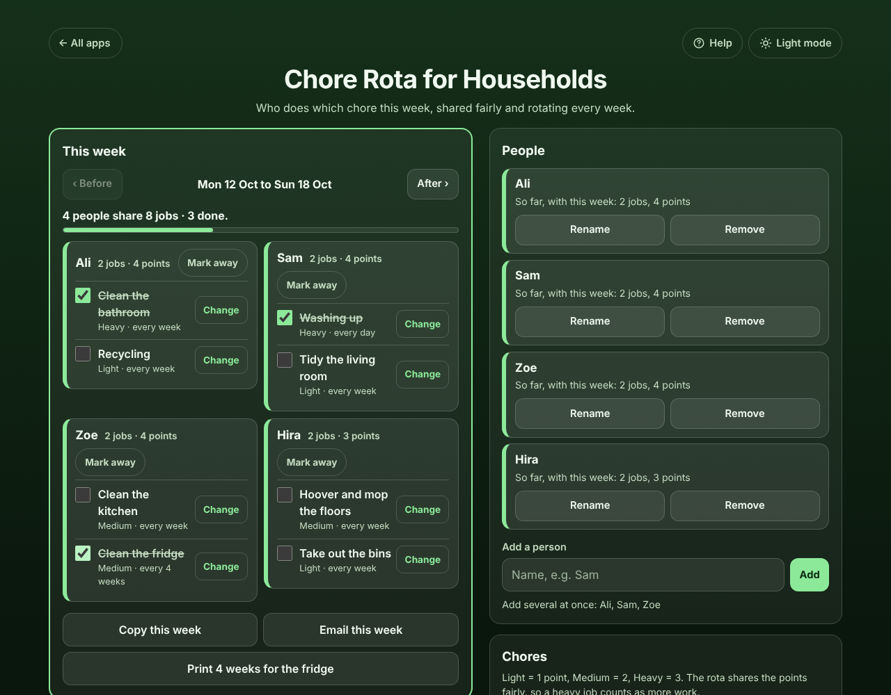

# Chore Rota for Households

A free **chore rota for flatmates and families** that is fair and rotates by itself. Add the people who share the house and the chores, say how often each chore is done and how much work it is (Light, Medium or Heavy), and see **who does what this week**, each person in their own box. Next week the jobs move on, so nobody is stuck with the bathroom. Mark someone away, swap a job, tick jobs done, copy the week into the group chat or print 4 weeks for the fridge. Works offline, no sign-up, no ads.

**Live demo:** [umar8092.github.io/apps/chore-rota-for-households](https://umar8092.github.io/apps/chore-rota-for-households/)

| Desktop | On a phone |
|---|---|
|  |  |

## The situation it solves

Ali, Sam, Zoe and Hira share a flat and keep arguing about who cleaned the bathroom last. They have 8 chores: cleaning the bathroom and the washing up every day (Heavy), cleaning the kitchen and hoovering (Medium), the bins, recycling and tidying the living room (Light), and cleaning the fridge every 4 weeks (Medium). Hira is away next week.

They type the four names, tap **Add 8 example chores**, and the app answers for the week of Mon 12 Oct:

- **Ali:** Clean the bathroom, Recycling (2 jobs, 4 points)
- **Sam:** Washing up, Tidy the living room (4 points)
- **Zoe:** Clean the kitchen, Clean the fridge (4 points)
- **Hira:** Hoover and mop the floors, Take out the bins (3 points)

Next week Hira taps **Mark away**, and her jobs go to the others: *Ali: Clean the kitchen, Hoover and mop the floors · Sam: Clean the bathroom, Take out the bins · Zoe: Washing up, Recycling, Tidy the living room · Hira: away*. When she is back she gets a normal share (Clean the bathroom and Take out the bins, 4 points), not extra to make up for the holiday.

With 4 people and 4 chores of the same work, everyone does every chore exactly once every 4 weeks. With heavier and lighter chores, everyone ends up with the same points: in the tests, 4 people with chores worth 2, 3, 2 and 1 points each have **16 points after 8 weeks**, and nobody cleans the bathroom two weeks running.

## Features

- **Help button.** Tap **Help** at the top for a short how-to written for this app, and tap **All apps** to go back to the list.
- **Fair by points.** Light = 1, Medium = 2, Heavy = 3. Each week the jobs, heaviest first, go to whoever has done the fewest points so far, and nobody gets the same job twice in a row when someone else can take it.
- **Each person in their own box** with their jobs, points and a **Mark away** button. Each chore says how much work it is and how often.
- **How often:** every day (one person for the whole week, such as washing up), every week, every 2 weeks, every 4 weeks, or every 1 to 12 weeks.
- **Only some people can do it (optional):** for example only the adults clean the oven. Hidden until you need it.
- **Away weeks.** Their jobs go to the people at home, and away weeks are not owed back. If everyone who can do a job is away, it shows under **Nobody free**.
- **Swaps.** **Change** gives a job to someone else for one week, marked "swapped, rota said Zoe", with **Back to the rota**. The rota evens it out in later weeks.
- **Tick jobs done**, with "3 done" and a progress bar, and a note on Monday about last week's jobs that were not ticked.
- **Coming weeks** for the next 4 weeks, and **Before** / **After** to plan holidays ahead.
- **Copy**, **Share** or **Email this week** for the group chat (email works with no address typed), and **Print 4 weeks for the fridge** with boxes to tick.
- **Add several people at once** ("Ali, Sam, Zoe"), **Add 8 example chores**, rename, edit and remove with **Undo**. Changes never rewrite past weeks.
- **Weeks start on** any day, **Start the rota again from this week**, **backup file and restore**, **Delete everything** with Undo. Damaged or blocked saved data is handled with a clear message.
- **Private.** The names and chores stay in this browser on this device; your data is never sent anywhere.
- **Works offline and installable.**
- **Back to all apps.** A "← All apps" button at the top of the page.
- **Light and dark mode switch.** It follows your device until you choose, and remembers your choice in every app.

## Run it yourself

No build step and no dependencies.

```bash
git clone https://github.com/umar8092/apps.git
```

Then open `chore-rota-for-households/index.html` in your browser.

Offline mode and install need the files served over `https` or `localhost` (for example `python3 -m http.server`).

## How it works

- `core.js` is the logic, with no page code. The rota is worked out week by week from the week it started. Each person has a balance: the points of the jobs they did minus their fair share of each week's points while they were home. The next job goes to the lowest balance, with a penalty for repeating last time's job, then to whoever did that job least, then to the next person in line. Weeks are calendar dates, so time zones and summer time never move a job.
- Before a person or chore is added, changed or removed, the weeks already gone are saved as they were shown, so the change only affects this week and later.
- `script.js` builds the page. Names and chores are added as plain text, never as HTML.
- `sw.js` saves the app on your device for offline use (network first, so updates show at once).
- Run the logic checks with `node tests.js` (or open `test.html`), and the full page test with `node ui-test.js` (needs Playwright).

## License

[MIT](LICENSE). Free to use, copy, modify and share. Made by [Muhammad Umar](https://github.com/umar8092).
