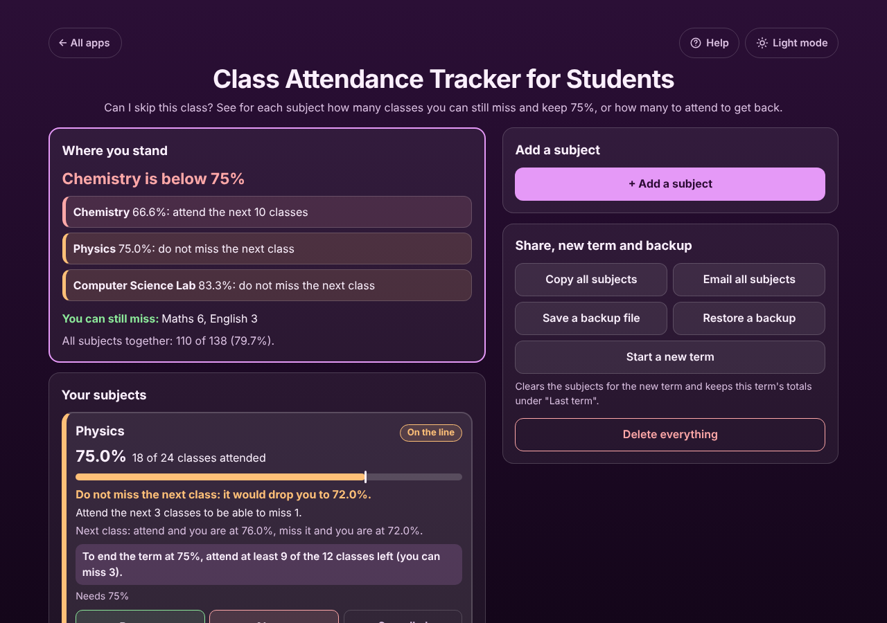

# Class Attendance Tracker for Students

A free **class attendance tracker for college and university students** that answers "Can I skip this class?". Add each subject with the classes held and attended so far, tap **Present**, **Absent** or **Cancelled** after each class, and every subject tells you exactly how many classes you can still miss and stay at 75% (or 80%, 85%, any rule your college uses), or how many classes in a row you must attend to get back. Add the classes left this term and it also tells you whether you can still finish above the line. No sign-up, no ads, private on your device, works offline.

**Live demo:** [umar8092.github.io/apps/class-attendance-tracker-for-students](https://umar8092.github.io/apps/class-attendance-tracker-for-students/)

| Desktop | On a phone |
|---|---|
|  |  |

## The situation it solves

Ayesha is in her second year. Her university bars students from the final exam in any subject below 75% attendance. It is Thursday night and she wants to know if she can skip Friday's classes. Her portal shows:

| Subject | Held | Attended | Classes left |
|---|---|---|---|
| Physics | 24 | 18 | 12 |
| Maths | 34 | 30 | |
| Chemistry | 30 | 20 | 8 |

The app answers in plain words:

- **Physics: 75.0%. Do not miss the next class: it would drop you to 72.0%.** Attend the next 3 classes to be able to miss 1. To end the term at 75%, attend at least 9 of the 12 classes left (you can miss 3).
- **Maths: 88.2%. You can miss 6 classes and stay at 75% or above.** (30 of 40 is exactly 75%.)
- **Chemistry: 66.6%. Attend the next 10 classes in a row to get back to 75%.** (30 of 40 is 75%.) Even if you attend all 8 classes left, you end the term at 73.6%, below 75%, so it is time to talk to the college about medical leave or extra classes.
- At the top, "Where you stand" says **Chemistry is below 75%**, lists the subjects to worry about first, and "You can still miss: Maths 6".

The maths uses whole classes and never rounds up: 2,999 of 4,000 is 74.975%, shown as 74.9% and counted as below 75%.

## Features

- **Each subject in its own box** with its own rule (60% to 90%, or any percent such as 66.67%), a bar with the line marked, and a green, orange or red edge: Safe, On the line, Below.
- **One tap after each class**: Present, Absent or Cancelled (cancelled classes are noted but not counted). **Undo** fixes a wrong tap. "Last marked" shows the last five taps with the day.
- **Next class**: your percent if you attend or miss the next one.
- **Classes left this term** (optional): how many of them you must attend to finish above the line, or that it is no longer possible.
- **Labs that count as 2 or 3 classes** (optional).
- **Edit or fix totals** to match the portal at any time; delete a subject with Undo.
- **Copy** one subject, or **Copy all subjects** and **Email all subjects** (works without typing an address) to share with a parent.
- **Start a new term** keeps the old totals under "Last term", with Undo. **Save a backup file** and **Restore a backup** move everything to a new phone. **Delete everything** with Undo.
- **Help button.** Tap **Help** at the top for a short how-to written for this app, and tap **All apps** to go back to the list.
- **Light and dark mode switch.** It follows your device until you choose, and remembers your choice in every app.
- **Private.** Your subjects stay in this browser on this device. Your data is never sent anywhere.
- **Works offline and installable**, and looks right on phones, tablets and laptops.

## Run it yourself

No build step and no dependencies.

```bash
git clone https://github.com/umar8092/apps.git
```

Then open `class-attendance-tracker-for-students/index.html` in your browser.

Offline mode and install need the files served over `https` or `localhost` (for example `python3 -m http.server`).

## How it works

- `core.js` is the maths, with no page code. A rule is kept in hundredths of a percent (75% = 7500) and "attended / held is at least 75%" is checked as `attended × 10000 ≥ 7500 × held`, so there is no rounding at all. "You can miss" is the largest number of missed classes that keeps that true; "attend the next" is the smallest number of attended classes that makes it true again.
- `script.js` builds the page. Subject names are added as plain text, never as HTML.
- `sw.js` saves the app on your device for offline use (network first, so updates show straight away).
- Run the checks with `node tests.js` (or open `test.html`) and `node ui-test.js` for the full page test with Playwright.

## License

[MIT](LICENSE). Free to use, copy, modify and share. Made by [Muhammad Umar](https://github.com/umar8092).
