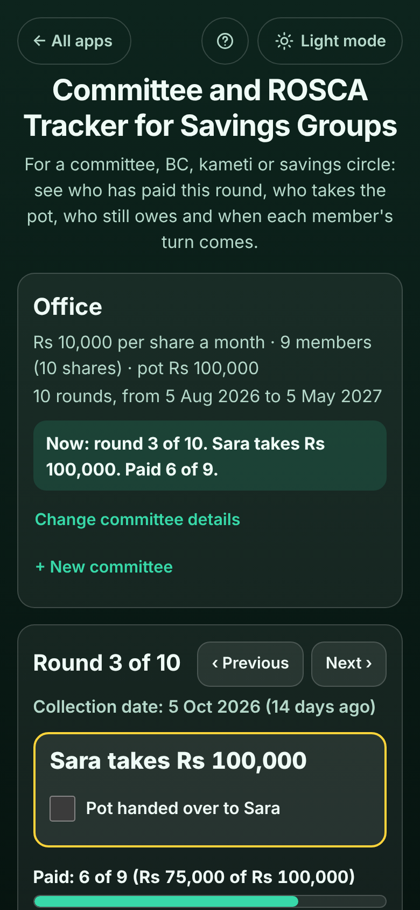

# Committee and ROSCA Tracker for Savings Groups

A free tracker for a **committee, BC, kameti or ROSCA** (also called a savings circle, susu, tanda or chit): a group where everyone pays the same amount every month and one member takes the whole pot each month, in turn. Set the amount, the first collection date and how often, add the members (a member can have **2 shares**: pays double, takes the pot twice), set the turn order or **draw it at random**, then tick who has paid each round. The app answers the organiser's questions in plain words: **"Sara takes Rs 100,000"**, **"Paid: 6 of 9"**, **"Still to pay: Ali, Sara, Hina"**, and each member's: **"Takes the pot: round 4 (5 Nov 2026)"** and **"Owes Rs 15,000 now"**. Copy a ready-made reminder for the WhatsApp group, or send one member their own. No sign-up, no ads, private on your device, works offline.

**Live demo:** [umar8092.github.io/apps/committee-and-rosca-tracker-for-savings-groups](https://umar8092.github.io/apps/committee-and-rosca-tracker-for-savings-groups/)

| Desktop | On a phone |
|---|---|
|  |  |

## The situation it solves

Sana organises a committee at her office: **9 members, Rs 10,000 a month each**, collected on the 5th, starting 5 August 2026. Imran wants **2 shares** (he pays 20,000 a month and takes the pot twice), so there are **10 shares, 10 rounds, and a pot of Rs 100,000** every month until May 2027. Ali took the pot in August, Bilal in September. It is now 19 October, and Sana keeps being asked "who has paid?", "whose turn is it?" and "when is my turn?". Her notebook has crossings-out, and Hina paid only half this month.

With the app, Sana ticks each payment as it comes in. The page then says:

- **Now: round 3 of 10. Sara takes Rs 100,000. Paid 6 of 9.**
- **Paid: 6 of 9 (Rs 75,000 of Rs 100,000).** Still to pay: **Ali Rs 10,000, Sara Rs 10,000, Hina Rs 5,000 (Rs 25,000 in all)**.
- Hina's box: **Takes the pot: round 4 (5 Nov 2026)**. **Owes Rs 15,000 now (round 2; round 3, part paid).**
- Imran's box: **Takes the pot: round 9 (5 Apr 2027), round 10 (5 May 2027)**. **Paid up: 3 of 10 rounds paid.**

She taps **Copy reminder** (or **Send on WhatsApp**) and pastes this in the group:

> Office: Round 3 of 10 (October 2026)
> Sara takes the pot of Rs 100,000 this round.
> Paid: 6 of 9 (Rs 75,000 of Rs 100,000).
>
> Still to pay:
> - Ali: Rs 10,000
> - Sara: Rs 10,000
> - Hina: Rs 5,000 (paid Rs 5,000 of Rs 10,000)
>
> It was due on 5 Oct 2026. Please pay as soon as you can. Thank you!

When Sara has the money, Sana ticks **Pot handed over to Sara**, and that turn is fixed.

Worked examples from the tests (all checked by hand):

- 9 members, one with 2 shares, 10,000 each: 10 shares, so **10 rounds** and a **pot of 100,000** (10 × 10,000).
- A member with 2 shares pays **20,000** a round; paying 20,000 is "paid in full", 10,000 is a part payment.
- Hina missed round 2 (10,000) and paid 5,000 of round 3: she **owes 15,000 now**.
- Monthly from 31 January: 28 February (29 in a leap year), then 31 March, never drifting to the 28th.
- Weekly from 5 August: round 3 is 19 August; every 2 weeks: 2 September.
- Before the first collection date nothing is owed yet, and the top says **Starts on 5 Nov 2026 (in 17 days)**.
- A random draw only shuffles rounds whose pot has not been handed over; **Undo** brings back the old order.
- Amounts can be typed as `10000`, `10,000`, `1,00,000`, `12.50` or `Rs 5000`. A minus sign, `0`, words or more than 100,000,000 gets a clear message. All amounts are whole cents, so totals are exact.

## Features

- **Help button** at the top with a how-to for this app, **All apps** to go back to the list, and a **Light / Dark** switch.
- **Committee details:** name, what each member pays per round, how often (every month, every 2 weeks, every week) and the first collection date; the top box shows the pot, the number of rounds, the first and last dates and what is happening now. **+ New committee** if you are in more than one, with a picker to switch.
- **Members**, each in their own box with a coloured edge (green paid up, red owes): what they pay, when they take the pot (or took it), what they owe now and what they have paid in. **Shares** 1 to 5. **+ Add phone number (optional)** so their reminder opens WhatsApp straight to them. **Edit** (Escape cancels) and **Delete** with **Undo**; a member who already took the pot cannot be deleted, rename them if someone took their place.
- **Each round:** who takes the pot, **Paid: 6 of 9** with a progress bar, who still has to pay, and a box per member with **Paid in full**, **Part payment** (and the rest stays owed) and **Mark as not paid**. **Previous** / **Next** to move between rounds and tick early payments. **Pot handed over** fixes that turn.
- **Turn order:** every round with its date and who takes it; move turns with the arrows or **Draw the order at random** (the date of the draw is kept), with **Undo**.
- **Reminders:** **Copy reminder**, **Send on WhatsApp**, **Share** (on phones) and **Email** (no address needed) for the group; **Reminder** in a member's box for just them.
- **Copy the full summary**, **Print or save as PDF** (a sheet with a tick for every payment and the turn order), **Save a backup file** and **Restore a backup** (checked, with Undo; on a new phone the first screen offers **Restore a backup file**), **Currency symbol** (none, Rs, ₹, $, €, £, ৳, ₦, KSh and more, remembered), **Delete this committee** with Undo.
- Private: no account and your data is never sent anywhere. Works offline once loaded, and can be installed on the home screen.

## Run it yourself

```
git clone https://github.com/umar8092/apps.git
```

Then open `committee-and-rosca-tracker-for-savings-groups/index.html` in a browser. No build step and no dependencies.

Tests: `node committee-and-rosca-tracker-for-savings-groups/tests.js` checks the maths and the wording (or open `test.html`), and `node committee-and-rosca-tracker-for-savings-groups/ui-test.js` drives the page in headless Chromium (needs Playwright).

## How it works

Plain HTML, CSS and JavaScript. The maths lives in `core.js`. Each share is one turn, so the number of rounds is the number of shares and the pot is the amount times all shares. Every member pays every round, including the one who takes the pot. Payments are stored per round and per member in whole cents, and a member "owes now" for every round whose collection date has come and is not fully paid. Round dates are calendar days counted from the first collection date (same day each month, or the last day of a shorter month). When shares change, new turns go to the end and removed ones come off the latest turn not yet handed over; handed-over rounds never move. Everything is saved in this browser's `localStorage` and checked when loaded or restored; a network-first service worker keeps the app working offline.

## License

MIT, see [LICENSE](LICENSE).
