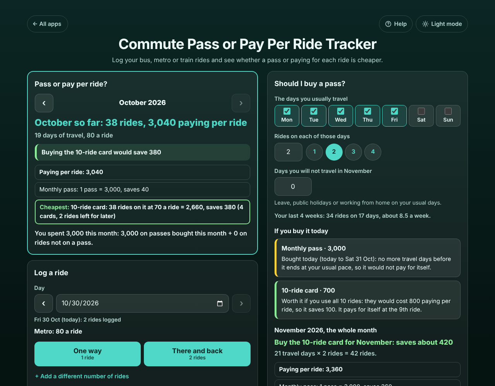
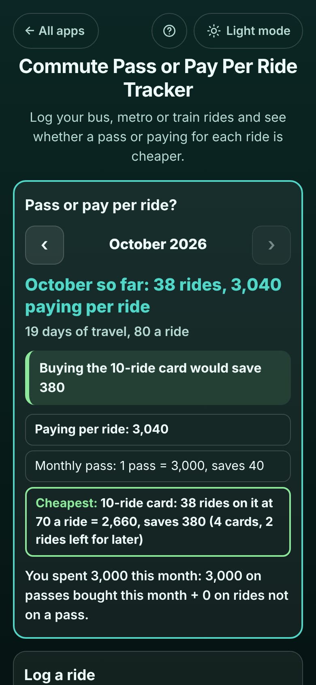

# Commute Pass or Pay Per Ride Tracker

A free **ride log for bus, metro and train commuters that tells you whether a pass is worth it**. Tap "There and back" each day you travel and see whether a weekly or monthly pass, a 30-day pass or a 10-ride card would have been cheaper than paying for each ride, whether the pass you bought is paying for itself yet, and which one to buy for next month at your usual pace. Works offline, no sign-up, no ads. No currency is forced on you, so it works in any country.

**Live demo:** [umar8092.github.io/apps/commute-pass-or-pay-per-ride-tracker](https://umar8092.github.io/apps/commute-pass-or-pay-per-ride-tracker/)

| Desktop | On a phone |
|---|---|
|  |  |

## The situation it solves

Ayesha takes the metro to the office and back. One ride is 80 and the monthly pass is 3,000. Some months she has leave, public holidays or works from home, so she never knows whether the pass is really cheaper. She sets the fare and the pass once, then taps **There and back** each day she travels. In October she travelled on 19 days:

- **October: 38 rides, 3,040 paying per ride.**
- **The Monthly pass would have saved 40** (38 × 80 = 3,040 against 3,000).
- She adds the 10-ride card her metro sells for 700. That is 70 a ride, so **buying the 10-ride card would have saved 380**: 38 rides × 70 = 2,660 (4 cards, 2 rides left on the last card for later).
- With a 7-day pass of 450 that starts on any day, the app finds the best start days by itself: **4 passes + 320 paid per ride = 2,120, saves 920.**

Looking ahead on Fri 30 Oct with her usual Monday to Friday, 2 rides a day:

- **A 30-day pass of 3,000 bought today** covers 30 Oct to 28 Nov: about 42 rides, 3,360 paying per ride, so it saves about 360 and pays for itself at 38 rides, around Wed 25 Nov.
- **November, the whole month:** 21 travel days × 2 rides = 42 rides, 3,360 paying per ride. With 3 days of leave it is 36 rides, and the answer changes with it.

When she buys a pass she taps **I bought this pass**. "Passes you bought" then says, for example, "1 Oct to 31 Oct (12 days left, today included): 24 rides so far, worth 1,920 paying per ride. 1,080 more in rides to pay for itself: about 14 more rides at 80 by Sat 31 Oct", and at the end "Worth it: paying per ride would have cost 3,040, so it saved 40".

## Features

- **Help button.** Tap **Help** at the top for a short how-to written for this app, and tap **All apps** to go back to the list.
- **One-tap logging.** **One way** (1 ride) or **There and back** (2 rides) for today or any past day, **+ Add a different number of rides**, and **Undo** after every change.
- **Every kind of pass.** 7 days or 30 days from the day you start, a calendar month (1st to last day), any other number of days, or a card with a number of rides. Each pass in its own box with its own price and length.
- **Several fares.** Peak and off-peak, a second route, a student fare: each fare in its own box, and each pass says which fares it covers.
- **Fare rises.** Each ride keeps the price it had when you logged it; change the fare and only new rides use it. **Edit** fixes an older ride.
- **Month by month.** How many rides, what they cost paying per ride, what each pass would have cost and which was cheapest. Earlier months with the arrows.
- **Should I buy a pass?** Tick the days you usually travel, the rides on each day and the days you will not travel next month, and see if each pass is worth buying today and which is cheapest for next month.
- **Passes you bought.** Whether each pass or card has paid for itself, rides left on a card, and what you really spent each month. A lost card bought again counts both prices but every ride once.
- **Fill in several days** for rides you did not log, without doubling days that already have rides.
- **Share.** Copy or email the month (no address needed), download every ride as CSV, or print the month.
- **Currency symbol** (optional, remembered). Plain numbers by default.
- **Backup and restore** to move to a new phone. **Delete everything** with Undo.
- **Private.** Your data is never sent anywhere. It stays in your browser on your device.
- **Works offline and installable.** Handy underground with no signal.
- **Back to all apps.** A "← All apps" button at the top of the page.
- **Light and dark mode switch.** It follows your device until you choose, and remembers your choice in every app.

## Run it yourself

No build step and no dependencies.

```bash
git clone https://github.com/umar8092/apps.git
```

Then open `commute-pass-or-pay-per-ride-tracker/index.html` in your browser.

Offline mode and install need the files served over `https` or `localhost` (for example `python3 -m http.server`).

## How it works

- `core.js` is the logic, with no page code. All money is whole cents, so totals are exact.
  - For a pass that lasts a number of days, it finds the cheapest mix of passes and single fares for the month's rides by trying a pass on each travel day (dynamic programming), so a 7-day pass is started on the best days.
  - A calendar month pass is bought only for months where it costs less than the rides it covers.
  - A ride card's unused rides stay on the card, so a ride on it costs the card price divided by its rides; rides go on the card only when their fare costs more than that.
  - Passes you bought cover the rides in their dates (a card: its number of rides from the day you bought it); a pass bought first uses rides first.
- `script.js` builds the page. Names are added as plain text, never as HTML.
- `sw.js` saves the app on your device for offline use (network first, so you always get the newest version when online).
- Run the checks with `node tests.js` (or open `test.html`), and the full page test with `node ui-test.js` (needs Playwright).

## License

[MIT](LICENSE). Free to use, copy, modify and share. Made by [Muhammad Umar](https://github.com/umar8092).
