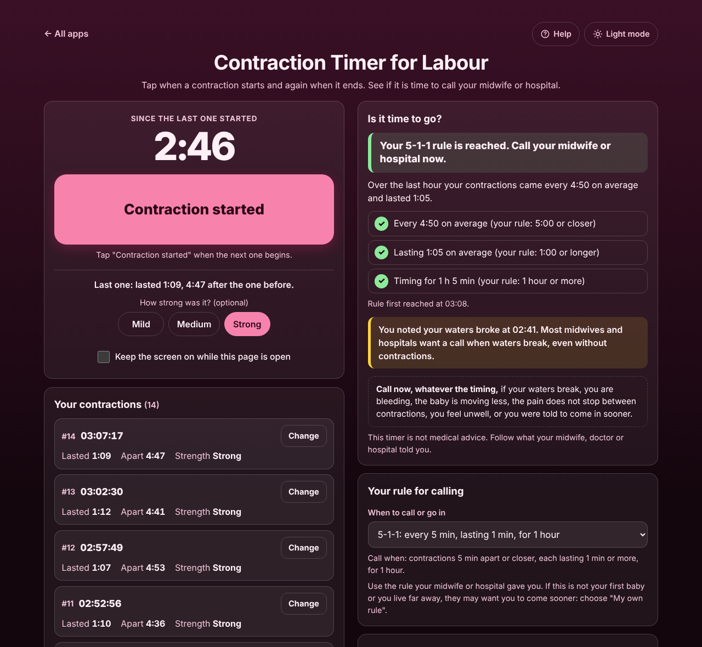

# Contraction Timer for Labour

A free **contraction timer that tells you when it is time to call the hospital**. Tap when a contraction starts and again when it ends. It shows how long each one lasted, how far apart they are, and answers in plain words when your 5-1-1 rule (or the rule your midwife gave you) is reached. Note when your waters break, fix a missed tap, and copy or email the log for your midwife. No sign-up, no ads, private on your device, works offline.

**Live app:** [umar8092.github.io/apps/contraction-timer-for-labour](https://umar8092.github.io/apps/contraction-timer-for-labour/)

| Desktop | On a phone |
|---|---|
|  |  |

## The situation it solves

It is 2 a.m., you are 39 weeks pregnant and the tightenings are getting stronger. The hospital said: "Call us when contractions are 5 minutes apart, lasting a minute, for an hour." Your partner is half asleep and nobody wants to do sums with a stopwatch.

You tap **Contraction started** when one begins and **Contraction ended** when it stops. After a few, the app answers:

- Contractions every 5:00 from 03:00, each lasting 1:02. At 03:56 it says **Not yet. Keep timing.** and why: *you have timed 56 min of the 1 hour needed.*
- At 04:01, after the 03:00 to 04:00 hour, it says **Your 5-1-1 rule is reached. Call your midwife or hospital now.** with three ticks: *Every 5:00 on average*, *Lasting 1:02 on average*, *Timing for 1 hour*, and *Rule first reached at 04:01.*
- Every 4:30 on the same night meets 5-1-1 but **not** 4-1-1 (*they are further apart than 4:00*).
- If no contraction comes for twice the rule's gap (10 minutes for 5-1-1) it says **Your contractions have slowed down or stopped.**

When you call, tap **Copy the log** and read it out, or **Email the log**: every contraction with its start time, length, gap and strength, notes such as *WATERS BROKE: clear fluid*, and the time the rule was first reached.

## Features

- **One big button.** *Contraction started* / *Contraction ended*. Between contractions the clock shows the time since the last one started, so you can see the next one coming.
- **Plain answer.** *Is it time to go?* compares the averages over the last hour with your rule, with a tick or cross for each part, and says what is still missing.
- **Your own rule.** 5-1-1, 4-1-1, 3-1-1, or *My own rule* (1 to 15 minutes apart, 20 to 180 seconds long, for 10 to 240 minutes). Remembered.
- **Mistakes are easy to fix.** A double tap under 5 seconds is not saved. *Forgot to tap when it ended?* lets you type the real length (and the app asks by itself after 10 minutes). *Change* fixes the start, length or strength of any contraction, *+ Add one I missed* adds one afterwards, and every delete has *Undo*.
- **Notes.** Waters broke, called the hospital, left for hospital, bleeding or anything else, with the time. A waters note shows a reminder to call.
- **Strength.** Optional *Mild*, *Medium* or *Strong* for each contraction.
- **Safe wording.** It always lists when to call straight away whatever the timing, and says it is not medical advice.
- **Keep the screen on** while timing (on phones that allow it).
- **Nothing lost.** The log and a contraction being timed survive closing the page, a locked phone or a reload. Yesterday's false alarm (more than 30 minutes before) starts a new stretch and does not count toward today's hour.
- **Help button.** Tap **Help** at the top for a short how-to written for this app, and **← All apps** to go back to the list.
- **Light and dark mode switch.** It follows your device until you choose, and remembers your choice in every app.
- **Private.** Everything stays in this browser on this device. Your data is never sent anywhere. Works offline and can be installed to the home screen.

## Run it yourself

No build step and no dependencies.

```bash
git clone https://github.com/umar8092/apps.git
```

Then open `contraction-timer-for-labour/index.html` in your browser.

Offline mode and install need the files served over `https` or `localhost` (for example `python3 -m http.server`).

## How it works

- `core.js` is the timing maths, with no page code. Times are milliseconds and lengths whole seconds. "Apart" is from the start of one contraction to the start of the next, the way midwives count. `evaluate()` takes the contractions that started in the last hour (or your own length), averages the gaps and lengths, and checks you have been timing that long without a break of more than 30 minutes. `firstMet()` finds the first moment the rule was reached.
- `script.js` builds the page. Notes are shown as plain text, never as HTML.
- `sw.js` saves the app on your device for offline use (network first, so updates arrive straight away).
- Checks: `node contraction-timer-for-labour/tests.js` (the maths, or open `test.html`), `node contraction-timer-for-labour/ui-test.js` (drives the real page with Playwright), `node scripts/check-app.js contraction-timer-for-labour` (shared checks). `shots.js` makes the screenshots.

## License

[MIT](LICENSE). Free to use, copy, modify and share. Made by [Muhammad Umar](https://github.com/umar8092).
