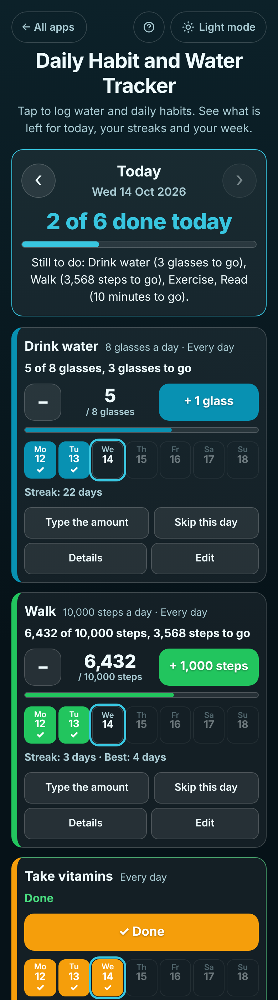

# Daily Habit and Water Tracker

A free **habit tracker and water tracker for anyone building a daily routine**: drinking enough water, walking 10,000 steps, reading, taking vitamins, exercising 3 times a week or keeping coffee under 2 cups. Tap once each time and the app shows **what is left for today** ("5 of 8 glasses, 3 glasses to go"), how many of today's habits are done, your **streak**, a **this week** table and a 12-week history. Each habit has its own goal and its own days: every day, only some days (Mon, Wed, Fri) or a number of times a week. Skipped days (ill, travelling) never break a streak. No sign-up, no ads, private on your device, works offline.

**Live demo:** [umar8092.github.io/apps/daily-habit-and-water-tracker](https://umar8092.github.io/apps/daily-habit-and-water-tracker/)

| Desktop | On a phone |
|---|---|
|  |  |

## The situation it solves

Aisha wants to drink 8 glasses of water a day, walk 10,000 steps, read 20 minutes on weekdays, take her vitamins, exercise 3 times a week and keep coffee to 2 cups. By the evening she can never remember how much water she has had or whether she took the vitamins, and paper habit charts end up lost.

With the app she taps **+ 1 glass** after each glass and **Mark as done** after the vitamins. On Wednesday evening the top of the screen answers her question:

- **2 of 6 done today**
- *Still to do: Drink water (3 glasses to go), Walk (3,568 steps to go), Exercise, Read (10 minutes to go).*
- Drink water: **5 of 8 glasses, 3 glasses to go**, *Streak: 22 days*. Coffee: **1 of 2 cups, 1 cup left**. Exercise: **1 of 3 times** this week.

Worked examples from the tests (all checked by hand):

- Water goal 8, started Thu 8 Oct: 8, 8, 5, 8, 8, 9 glasses, and 3 so far on Wed 14 Oct. Saturday's 5 broke the run, so the streak is **3 days** (Sun to Tue); today is not counted until 8 is reached, and then it is **4**. Last 30 days: **5 of 6** planned days (today left out until done).
- Mark Saturday as **Skip this day** (ill) and the streak becomes **5 days**: skipped days never break it and are left out of the percentage.
- Gym on Mon, Wed, Fri: Tuesday is *Not planned for this day* and never breaks the streak; a workout on a Saturday shows as done but does not add to it.
- Exercise 3 times a week: Mon, Wed and Sat last week is a **met week**; only Monday so far this week shows **1 of 3 times** and does not break anything until the week is over. A habit started on a Saturday only needs **2** that week (only 2 days were left).
- Coffee, no more than 2 cups: 1 cup today shows *1 of 2 cups, 1 cup left*; a 4th cup shows *4 cups, 2 cups over the limit* in red. A day with no coffee counts as kept.
- Goal raised from 8 to 10 glasses on 12 Oct: 8 glasses on 11 Oct still counts as done, 8 on 12 Oct does not, unless **Use the new goal and days for earlier days too** is ticked.

## Features

- **Help button** at the top with a how-to for this app, **All apps** to go back to the list, and a **Light / Dark** switch.
- **Three kinds of habit:** *Tick it off when done*, *Count up to a goal* (glasses, cups, ml, oz, minutes, pages, steps, km, miles, times or your own word, with how much each + tap adds, such as 250 ml) and *Keep under a limit*.
- **12 quick picks** (Drink water in glasses or ml, Walk 10,000 steps, Read 20 minutes, Exercise 3 times a week, Take vitamins, Meditate, Stretch, Floss teeth, No sugar, In bed by 11 pm, Coffee no more than 2) that fill the form for you to change.
- **Its own days for each habit:** every day, only some days, or a number of times a week on any days. Weeks start on Monday or Sunday (Sunday by default on US phones).
- **One tap to log** with **Undo** after every change; **Type the amount** for exact numbers like 6,432 steps (10,000 and 10.000 are both read as ten thousand).
- **Today at the top:** how many of today's habits are done and what is still to do.
- **Earlier days:** ‹ and › or tap a day in a habit's week strip to fix yesterday; **Back to today**. **Started on** fills in days before you added the habit.
- **Skip this day** for illness or travel without breaking the streak.
- **Streaks** (days, or weeks for times-a-week habits), best streak, last 30 days in %, days done in total and a **12-week grid** in **Details**.
- **This week** table with a row for each habit; **Copy**, **Email** (no address needed) and **Print** the week.
- **Calendar reminder:** choose a time and download a repeating reminder (.ics) that follows the habit's days.
- **Edit** (changes count from today so old days keep their goal), **Move up / Move down**, **Delete** with Undo.
- **Backup file** and **Restore** (checked, with Undo), **Delete all habits** with Undo.
- Calendar-day maths, so changing time zones never moves what you logged, and the app moves to the new day at midnight on its own.
- Private: no account and your data is never sent anywhere. Works offline once loaded, and can be installed on the home screen.

## Run it yourself

```
git clone https://github.com/umar8092/apps.git
```

Then open `daily-habit-and-water-tracker/index.html` in a browser. No build step and no dependencies.

Tests: `node daily-habit-and-water-tracker/tests.js` checks the streaks, weeks and checks (or open `test.html`), and `node daily-habit-and-water-tracker/ui-test.js` drives the page in headless Chromium at 11 widths (needs Playwright). `shots.js` makes the screenshots from `seed.js`.

## How it works

Plain HTML, CSS and JavaScript. The logic lives in `core.js`. Every day is a calendar date string (`2026-10-14`) worked out with UTC maths, so summer time and time zones never shift a day. Each habit keeps a list of settings with the day they started, so a new goal only applies from the day it changed. A day is *done*, *missed*, *skipped* or *not planned*; streaks count done days and ignore skipped and not-planned ones, and times-a-week habits count weeks whose target is met. Everything is saved in this browser's `localStorage`; a network-first service worker keeps the app working offline.

## License

MIT, see [LICENSE](LICENSE).
