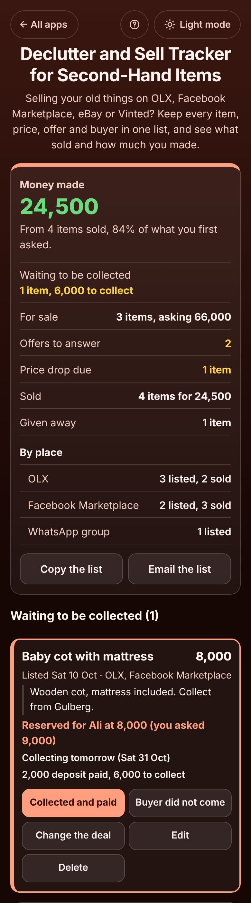

# Declutter and Sell Tracker for Second-Hand Items

A free **tracker for selling your used things** on OLX, Facebook Marketplace, eBay, Vinted, Gumtree, a WhatsApp group or to friends. Each item gets its own box with its asking price, the sites it is listed on, every offer, and the buyer who reserved it with the price agreed, the collection day and any deposit. When they pay and take it, tap **Collected and paid**; if they never come, tap **Buyer did not come** and it goes back on sale. At the top you see **Money made**, what share of your asking prices you got, what is still for sale and the money still to collect. No sign-up, no ads, private on your device, and it works offline.

**Live app:** [umar8092.github.io/apps/declutter-and-sell-tracker-for-second-hand-items](https://umar8092.github.io/apps/declutter-and-sell-tracker-for-second-hand-items/)

| Desktop | On a phone |
|---|---|
|  |  |

## The situation it solves

Ayesha is moving flat at the end of November and is selling what will not fit. By **Friday 30 October** she has a dozen things on OLX and Facebook Marketplace, messages from six buyers, and has already forgotten who offered what for the sofa.

In the app:

- **Baby cot with mattress**, asking 9,000 on OLX and Facebook Marketplace. Ali offered 7,500; they agreed **8,000** and he paid a **2,000** deposit. The card says **"Reserved for Ali at 8,000 (you asked 9,000). Collecting tomorrow (Sat 31 Oct). 2,000 deposit paid, 6,000 to collect."** On Saturday she taps **Collected and paid**. If Ali had not come, **Buyer did not come** asks whether she gave the deposit back or kept it, puts the cot back on sale and notes "Ali did not come".
- **Sofa set**, first 28,000, now 25,000 (**"Was 28,000, now 25,000"**). Lowest she will take: 22,000. Offers: Sara 23,000 and Hamza 20,000, which is marked **"Below your lowest price (22,000)"**. Each offer has **Accept** and **Decline**.
- **Treadmill**, 35,000 on Facebook Marketplace since 8 October with no offers: **"Price drop due: same price for 22 days and no offers."** **Change price** offers **10% less: 31,500** in one tap.
- Already sold: the microwave (5,500, asked 6,000), the dining table (12,000, first asked 15,000), and the study table and chair **sold together for 7,000**. The bundle is split by their asking prices of 5,000 and 3,000, so it counts as **4,375 and 2,625**. Winter clothes went to the Edhi centre as **Given away**.

At the top: **Money made 24,500. From 4 items sold, 84% of what you first asked** (24,500 of 29,000). Then **Waiting to be collected: 1 item, 6,000 to collect**, **For sale: 3 items, asking 66,000**, **Offers to answer: 2**, **Price drop due: 1 item**, and **By place**: OLX 3 listed, 2 sold; Facebook Marketplace 2 listed, 3 sold.

When something sells, the app reminds her to **take the ad down** on every site it was listed on. **Copy ad text** copies "For sale: Sofa set (3 seater), 25,000" plus the description, ready to paste into a new listing. **Email the list** sends her husband the whole picture.

Swaps are handled too: **+ Swapped it for something** records "swapped for Child car seat" plus any money. Swaps and items with no asking price are left out of the % figure, so the % is never misleading.

## Features

- **One box per item** with a photo (kept small on the device), the asking price and its history, the lowest price you will take (only you see it), the date listed, ad text and every site it is on, including your own places such as "school group".
- **Offers** with Accept and Decline, marked when below your lowest price.
- **Reserved items** with the buyer, price agreed, collection day, deposit and money still to collect. Late collections are flagged: "Collection day was yesterday. Did they come?"
- **Buyer did not come** puts the item back on sale, keeps a note, and asks about the deposit. Kept deposits count as money made.
- **Sold, swapped, sold together, given away or kept**, each with **Put back on sale**. Bundles are split to the cent.
- **Price drop due** after 14 days at the same price with no offers, with 10% and 20% quick drops.
- **Totals**: money made, % of asking, for sale, to collect, offers to answer and a by-place count.
- **Copy the list**, **Email the list** (works with no address typed) and **Copy ad text**.
- **Currency symbol** of your choice (or plain numbers), remembered.
- **Undo** after every change, including delete and Delete everything.
- **Backup file** to move to a new phone, and **Restore a backup**.
- **Help button** at the top with step-by-step instructions, and the **"All apps"** back button.
- **Private.** Everything stays in your browser. Your data is never sent anywhere.
- **Works offline and installable.** Light and dark mode switch next to the back button, remembered across all apps. Laptop layout with adding on the left and the totals and lists on the right.

## Run it yourself

No build step and no dependencies.

```bash
git clone https://github.com/umar8092/apps.git
```

Then open `declutter-and-sell-tracker-for-second-hand-items/index.html` in your browser.

Offline mode and install need the files served over `https` or `localhost` (for example `python3 -m http.server`).

## How it works

- `core.js` is the money, the dates and the words, with no page code. Money is whole cents, so totals are exact. `split()` shares a bundle price by asking prices to the cent, `reserve()`, `noShow()`, `sell()`, `sellBundle()`, `giveAway()` and `relist()` change an item, `dropDue()` decides when a price drop is due, and `summary()` adds up the totals.
- `script.js` builds the page. Names and notes are added as plain text, never as HTML. Photos are shrunk to 360 pixels and saved as small JPEGs. Everything is saved in this browser's storage under `declutter-and-sell-tracker-for-second-hand-items.state`, and saved or restored data is checked before use.
- `sw.js` keeps a copy of the app for offline use. It is network first, so you always get the newest version when online.
- Tests: `node tests.js` (the maths and words) and `node ui-test.js` (drives the real page in headless Chromium at many screen sizes).

## License

[MIT](LICENSE)
