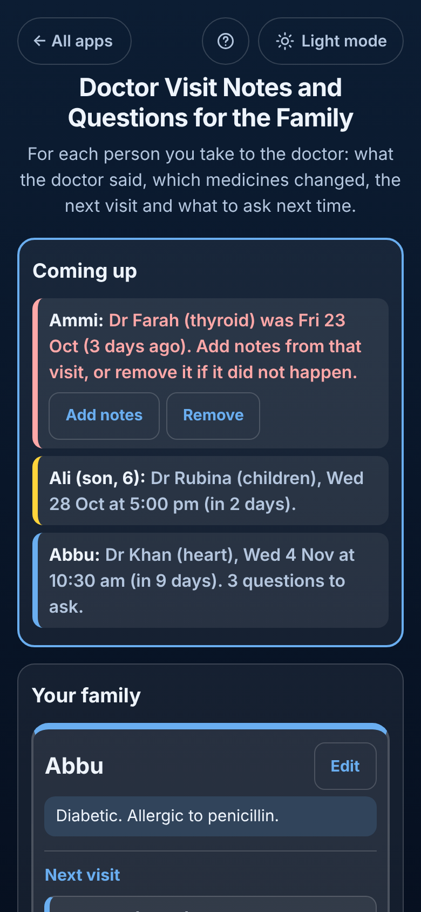

# Doctor Visit Notes and Questions for the Family

Free **doctor visit notes** for everyone you take to the doctor: **an elderly parent, a child or yourself**. Each person sits in their **own box** with their **health notes** (allergies, blood group), their **questions for next time**, their **next appointments**, the **medicines they are on now** and **every visit**, newest first. After a visit, write **what the doctor said**, the **medicines started, changed or stopped**, the **tests ordered** and the **next visit**. The app works out the **current medicine list** from those changes, shows **what is coming up** with how many questions you have, keeps an appointment at the top until you add its notes, and gives you a **printable or emailable history for a new doctor**. Works offline, no sign-up, no ads.

**Live demo:** [umar8092.github.io/apps/doctor-visit-notes-and-questions-for-the-family](https://umar8092.github.io/apps/doctor-visit-notes-and-questions-for-the-family/)

| Desktop | On a phone |
|---|---|
|  |  |

## The situation it solves

Ayesha takes three people to the doctor: her father **Abbu** (diabetic, allergic to penicillin) who sees **Dr Khan (heart)** and **Dr Sana (eyes)**, her mother **Ammi** who sees **Dr Farah (thyroid)**, and her son **Ali**, 6, who sees **Dr Rubina (children)**. In the waiting room she cannot remember which tablet Dr Khan lowered last time, and in the doctor's room she forgets the questions she meant to ask.

What she wrote down:

- **Tue 15 Sep, Dr Khan:** started **Amlodipine 5 mg once a day** and **Aspirin 75 mg after lunch**.
- **Wed 21 Oct, Dr Khan:** "Swelling in the feet is from amlodipine." **Dose changed Amlodipine 2.5 mg once a day; Stopped Aspirin; Started Atorvastatin 10 mg at night.** Tests: ECG and kidney test, fasting. Next visit **Wed 4 Nov at 10:30**. She ticked her question "Is the swelling in his feet from the new tablet?" as asked.
- Since then she added three questions for Abbu, like "Can he fast in Ramadan with these tablets?"

On **Mon 26 Oct 2026** the app answers:

- **Coming up:**
  - **Ammi: Dr Farah (thyroid) was Fri 23 Oct (3 days ago). Add notes from that visit, or remove it if it did not happen.** (in red, first)
  - **Ali (son, 6): Dr Rubina (children), Wed 28 Oct at 5:00 pm (in 2 days).**
  - **Abbu: Dr Khan (heart), Wed 4 Nov at 10:30 am (in 9 days). 3 questions to ask.**
- **Abbu's medicines now (from your notes):** **Amlodipine 2.5 mg once a day** (dose changed Wed 21 Oct, Dr Khan (heart)) and **Atorvastatin 10 mg at night** (started Wed 21 Oct). Aspirin is gone because it was stopped.
- At the visit on 4 Nov she taps **Add notes from this visit**: the doctor and date are filled in and Abbu's open questions are listed to tick. Saving says **"The appointment on Wed 4 Nov is done."** and the next visit she picked (**In 3 months**) becomes the new appointment.
- For a new doctor she taps **Print** (or **Copy** or **Email**) and gets:

```
Abbu: doctor visits and medicines
Written Mon 26 Oct 2026

About Abbu: Diabetic. Allergic to penicillin.

Medicines now (from these notes):
- Amlodipine 2.5 mg once a day (dose changed Wed 21 Oct 2026, Dr Khan (heart))
- Atorvastatin 10 mg at night (started Wed 21 Oct 2026, Dr Khan (heart))

Next visits:
- Dr Khan (heart), Wed 4 Nov 2026 at 10:30 am

Questions for next time:
- Can he fast in Ramadan with these tablets?
- Is it safe to walk 30 minutes a day?
- Should the ECG be repeated?

Visits, newest first (3):

Wed 21 Oct 2026, Dr Khan (heart)
What the doctor said: Swelling in the feet is from amlodipine. ...
Medicines: Dose changed Amlodipine 2.5 mg once a day; Stopped Aspirin; Started Atorvastatin 10 mg at night
Tests: ECG and kidney test, fasting
...
```

## Features

- **One box per person**, each with their own health notes, questions, appointments, medicines and visits. Add, rename or delete a person (with Undo).
- **Questions for next time:** type one, or paste a list (one question per line, bullets and numbers removed). **Mark asked** at the doctor, or tick them in the visit notes. **Asked before** keeps them with the date; **Ask again** brings one back.
- **Visit notes:** date (Today, Yesterday or any past date), doctor or clinic (remembered for next time), what the doctor said (long pasted text is fine), and optional **why you went**, **tests ordered** and **next visit** (In 1 week, 2 weeks, 1, 3 or 6 months, or any date, with an optional time).
- **Medicine changes** in their own boxes: **Started**, **Dose changed** (an empty dose keeps the old one) or **Stopped**. **Medicines now** is worked out from them in date order.
- **Appointments:** added on their own or from a visit's next visit. **Coming up** at the top lists them all, missed write-ups first in red, then the soonest. A visit with the same doctor from 3 days before to 14 days after an appointment closes it, even when you add it from the box. **Calendar** saves a file with a reminder the day before (and 2 hours before when the time is known) with the questions in it.
- **All visits** newest first, each with **Edit** to change or delete it.
- **Find a past visit:** search all people's notes for a doctor, a medicine or any words.
- **Print, Copy, Email** a person's full history for a new doctor or a family member. The email button works without typing an address.
- **Save a backup file**, **Restore a backup**, **Delete everything** with Undo. Damaged or blocked saved data is handled with a clear message.
- **Help button** at the top explains every button in plain words.
- **Private.** Everything stays in this browser on this device; your data is never sent anywhere.
- **Works offline and installable.**
- **Back to all apps.** A "← All apps" button at the top of the page.
- **Light and dark mode switch.** It follows your device until you choose, and remembers your choice in every app.

The app only knows what you write. Always check medicines with the doctor or the pharmacy label.

## Run it yourself

No build step and no dependencies.

```bash
git clone https://github.com/umar8092/apps.git
```

Then open `doctor-visit-notes-and-questions-for-the-family/index.html` in your browser.

Offline mode and install work best with the files served over `https` or `localhost` (for example `python3 -m http.server`).

## How it works

- `core.js` is the logic, with no page code. Dates are calendar dates (`2026-10-26`) and times are clock times (`10:30`), so time zones and summer time never move them. It works out the medicines now, what is coming up and in what order, which appointment a visit belongs to, the search, the history text and the calendar file, reads every form with plain error messages, and checks every saved or restored value.
- `script.js` builds the page. Names, notes and questions are added as plain text, never as HTML. Everything is saved in `localStorage` on the device.
- `sw.js` saves the app on your device for offline use (network first, so updates show at once).
- Run the logic checks with `node tests.js` (or open `test.html`), and the full page test with `node ui-test.js` (needs Playwright). The page test fixes the time to Mon 26 Oct 2026, 3:30 pm, and checks the exact answers above.

## License

[MIT](LICENSE). Free to use, copy, modify and share. Made by [Muhammad Umar](https://github.com/umar8092).
