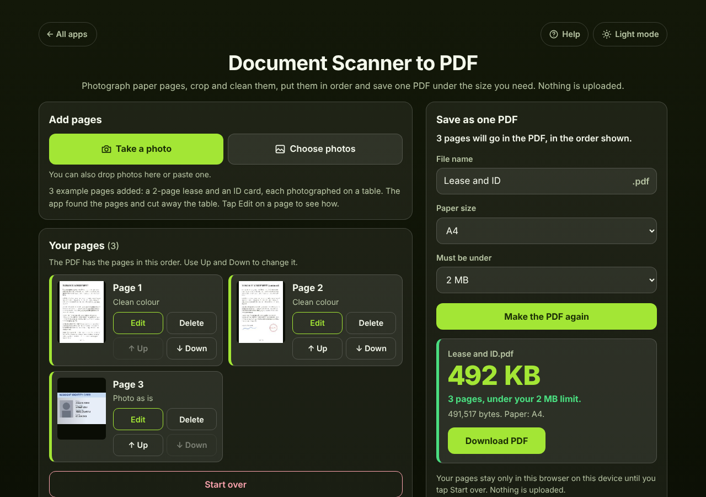

# Document Scanner to PDF

A free **document scanner in your browser** for anyone who has to send paper pages as one PDF: a signed lease, an ID card front and back, receipts for an expense claim, school forms. Take a photo of each page (or choose photos you already have), and the app **finds the page, cuts away the table and straightens it**, makes the paper **white and the text dark**, lets you **put the pages in order**, and saves **one PDF under the size you need**, like 2 MB for an upload form or 10 MB for email. Nothing is uploaded: it all happens on your device. No account, no ads, no watermark. Works offline.

**Live demo:** [umar8092.github.io/apps/document-scanner-to-pdf](https://umar8092.github.io/apps/document-scanner-to-pdf/)

| Desktop | On a phone |
|---|---|
|  |  |

## The situation it solves

Ayesha's new landlord emails: "Please send the signed lease (2 pages) and your ID card, front side, as **one PDF, under 2 MB**." She has no scanner, and her phone photos show the wooden table, the pages are crooked and greyish, and three separate 4 MB photos are far too big.

1. She taps **Take a photo** for each page. The app finds the light page on the darker table and opens **Fix page** with four circles on its corners; she checks them and taps **Done**.
2. The lease pages stay **Clean colour** (white paper, the blue signature and the red stamp keep their colour). The ID card side has a photo on it, so she picks **Photo as is** for that page.
3. Under **Your pages** the order is lease page 1, lease page 2, ID card. (**Up** and **Down** would change it.)
4. She types **Lease and ID** as the File name, picks **Must be under: 2 MB** and taps **Make the PDF**.

The app answers: **Lease and ID.pdf, 492 KB. 3 pages, under your 2 MB limit.** A4 pages (US Letter in the US), the lease straight and white, the card on its own landscape page. She taps **Download PDF** (or **Share** on a phone) and attaches it.

What happens in other cases:

- **A tight limit.** Nine photographed pages come to 801,156 bytes at full quality. With **Other size… 0.48 MB** the app lowers the quality and then the size step by step and answers: *9 pages, under your 0.48 MB limit*, followed by how much it had to shrink the pictures (for example "pictures at 85% size and 55% quality").
- **An impossible limit.** The same nine pages under **0.1 MB**: *9 pages, still over your 0.1 MB limit. This is as small as it can get and stay readable. Delete a page, pick Black and white for text pages, or make two PDFs.* The smallest version can still be downloaded.
- **The page was not found** (a white page on a white bed, or a photo of a screen): the whole photo is used and the app says *drag the circles onto its corners*; the page is marked "whole photo, set the corners" in the list.
- **A photo on its side:** **Turn left** / **Turn right**. Landscape pages (a receipt, an ID card) get a landscape PDF page.
- **1 MB means 1,000,000 bytes** here, the smaller of the two meanings, so a PDF under "2 MB" also passes forms that count 1 MB as 1,048,576 bytes. Sizes are rounded up when shown, so 9,999,999 bytes shows as 10.00 MB, never as under it.
- **Wrong files** each get a plain message: a PDF ("already a PDF"), a Word file or text ("not a photo"), an empty or damaged file, an iPhone HEIC photo in a browser that cannot open it (open the page in Safari or use a JPG). More than 60 pages: the extra photos are not added, and it says how many.
- **Reload, or the phone closes the tab while you take the next photo:** the pages, their order, corners, looks, the file name and the size limit are still there. **Start over** removes them, with **Undo**.

## Features

- **Help button** at the top for a short how-to, **All apps** to go back to the list of apps, and a **Light mode / Dark mode** switch.
- **Take a photo** opens the camera; **Choose photos** picks one or many. On a computer, drop photos on the page or paste one.
- **Finds the page** by itself and **straightens it** from the 4 corners (a photo taken at an angle comes out rectangular). Drag the circles to fix it, with a **zoomed view** of the corner under your finger; corners cannot be dragged across each other. Arrow keys move a focused corner (Shift for bigger steps). **Find the page again** and **Use the whole photo**.
- **Each page has its own look:** **Clean colour** (removes shadows, white paper, colours kept), **Black and white** (sharpest text, smallest file), **Grey**, or **Photo as is**. **Use this look on all pages** (with Undo) also sets it for new pages.
- **Turn left / Turn right** per page, with a preview of the finished page.
- **Each page in its own box** with a thumbnail, **Edit**, **Delete** (with Undo), **Up** and **Down**.
- **One PDF** with a **File name** you choose (or scan and today's date), **Paper size** A4, US Letter or **Same shape as each page**, and **Must be under** 1, 2, 5, 10, 20, 25 MB or any size you type.
- Shows the **size**, the **page count** and **whether it is under your limit**, and what it had to do to get there. **Download PDF** and **Share**.
- **Try with example pages** to see it work before using your own documents.
- **Private:** nothing is uploaded, pages are kept only in this browser until you tap Start over. **Works offline** and can be installed. Phone and desktop layouts, keyboard and screen-reader friendly.

## Run it yourself

No build step and no dependencies.

```bash
git clone https://github.com/umar8092/apps.git
```

Then open `document-scanner-to-pdf/index.html` in your browser. Offline mode, install and saving pages need the files served over `https` or `localhost` (for example `python3 -m http.server`).

## How it works

- `core.js` is the maths, with no page code: finding the page (a light shape on a darker background, its four corners), straightening it with a perspective transform, the looks (the paper brightness is measured across the page so shadows are removed, then the levels are stretched), turning, where each picture goes on A4 or Letter, and a small PDF writer that puts one JPEG per page into a standard PDF 1.4 file.
- `script.js` builds the page. Photos are kept at most 2400 pixels on the long side, finished pages at most 2000 (about 170 dpi on A4). To fit a size limit it tries lower JPEG quality first and then smaller pictures, and stops at the first that fits. Pages are saved in this browser's IndexedDB (`document-scanner-to-pdf`), settings in localStorage under `document-scanner-to-pdf.settings`. Everything you type is shown as plain text.
- `sw.js` saves the app for offline use (network first, so updates always arrive).
- Checks: `node tests.js` for the maths (also `test.html` in a browser), `node ui-test.js` drives the real page in headless Chromium and opens the PDFs it makes with `pdfinfo` and `pdftoppm` (add `--base https://umar8092.github.io/apps` to test the live site).

## License

[MIT](LICENSE). Free to use, copy, modify and share. Made by [Muhammad Umar](https://github.com/umar8092).
