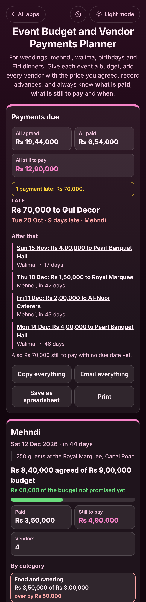

# Event Budget and Vendor Payments Planner

A free **budget and vendor payments planner for weddings, mehndi, barat, walima, birthdays and Eid dinners**. Give each event its own budget, add every vendor (hall, caterer, decorator, photographer, tailor, makeup artist) with the price you agreed, or a price per guest times the guests, record the advances you paid, and set when the rest is due. The app tells you what is paid, what is still to pay, when each payment is due, which payments are late and which categories are over budget. Price changes, cancellations and refunds are kept. No sign-up, no ads, private on your device, and it works offline.

**Live app:** [umar8092.github.io/apps/event-budget-and-vendor-payments-planner](https://umar8092.github.io/apps/event-budget-and-vendor-payments-planner/)

| Desktop | On a phone |
|---|---|
|  |  |

## The situation it solves

Sara's family is organising her mehndi on **Saturday 12 December** and the walima two days later. The hall, the caterer, the decorator and the photographer all took an advance, and every few days someone asks "how much have we paid the caterer?" or "when is the hall's balance due?". The answers are spread over WhatsApp chats, receipts and her father's memory.

With the app, she adds the **Mehndi** with a budget of **9 lakh** (typed as `9 lakh`, `900000` or `9,00,000`) and four vendors:

| Vendor | Agreed | Advance paid | Due |
|---|---|---|---|
| Royal Marquee (venue) | 2,50,000 | 1,00,000 on 1 Sep | 1,50,000 on Thu 10 Dec |
| Al-Noor Caterers (food) | 250 guests × 1,400 = 3,50,000 | 1,50,000 on 5 Sep | 2,00,000 on Fri 11 Dec |
| Gul Decor (decor) | 1,20,000 | 50,000 on 1 Oct | 70,000 on Tue 20 Oct |
| Lens Studio (photo) | 1,20,000 | 50,000 on 2 Oct | no date yet |

On **Thursday 29 October** she opens it and sees:

- **Mehndi: Rs 8,40,000 agreed of Rs 9,00,000 budget, Rs 60,000 of the budget not promised yet. Paid Rs 3,50,000, still to pay Rs 4,90,000.**
- **Payments due:** "Late: Rs 70,000 to Gul Decor, Tue 20 Oct, 9 days late", then "Thu 10 Dec: Rs 1,50,000 to Royal Marquee, in 42 days" and the caterer on 11 Dec, plus "Also Rs 70,000 still to pay with no due date yet" (the photographer).
- **By category:** "Food and catering Rs 3,50,000 of Rs 3,00,000, **over by Rs 50,000**", because the caterer's price per head went up from 1,300 to 1,400 ("Price changed on Thu 15 Oct from Rs 3,25,000 to Rs 3,50,000").

She pays the decorator, taps **Paid it** on the late due date, and the box says **Fully paid**. When the DJ for the walima cancels after taking Rs 10,000 and giving Rs 6,000 back, **Cancel booking** shows **Money lost: Rs 4,000**, which still counts in the walima's total. **Copy summary** puts the whole mehndi in the family WhatsApp group, and **Save as spreadsheet** gives a CSV of every payment and due date.

The sums are exact: every amount is kept in whole cents, so `agreed = paid + still to pay` always holds for each vendor that is not overpaid.

## Features

- **Help button.** Tap **Help** at the top for a how-to written for this app, and **← All apps** to go back to the list. **Light and dark mode** switch next to it, remembered across all apps.
- **Each event in its own box**: name, date, total budget, note, and how much of the budget is agreed, paid and still to pay, with a paid bar. Quick picks for Wedding, Mehndi, Barat, Walima, Engagement, Birthday party, Eid dinner and Aqiqah.
- **Each vendor in its own box**: category (venue, food, decor, photo, clothes, makeup and mehndi artist, jewellery, gifts, music, transport, cards, cake, or your own), **one agreed price or price per guest × guests**, phone and note, advances, payments and refunds.
- **Due dates**: one or several per vendor (instalments). **Paid it** records the payment and takes it off; a payment you record is taken off the next due date unless you untick it. Late payments show in red.
- **Payments due** across all events, late ones first, with totals for all events and what still has no due date.
- **Budget per category** (optional) shows which categories are over.
- **Price changes kept** ("Price changed on ... from ... to ..."), **cancellations** with refunds and money lost, **Book again**, and **Copy to event** for a vendor that serves two events.
- **Copy summary**, **Email summary** (opens your mail app, no address needed), **Copy everything**, **Email everything**, **Save as spreadsheet** (CSV) and **Print**.
- **Amounts typed your way:** 250000, 2,50,000, 250,000.50, 2.5 lakh, 50k or 1.2 crore. **Currency symbol** of your choice (or none) and **1,234,567 or 12,34,567** number style, both remembered.
- **Undo** after every change, **backup file** to move to another phone, and **Delete everything**.
- **Private.** Everything stays in your browser. Your data is never sent anywhere.
- **Works offline and installable.** Laptop layout with adding and settings on the left and the payments and events on the right.

## Run it yourself

No build step and no dependencies.

```bash
git clone https://github.com/umar8092/apps.git
```

Then open `event-budget-and-vendor-payments-planner/index.html` in your browser.

Offline mode and install need the files served over `https` or `localhost` (for example `python3 -m http.server`).

## How it works

- `core.js` is the money, dates and words, with no page code. Money is whole cents and dates are whole days, so totals are exact. `vStats()` works out a vendor's agreed price, paid (less refunds), still to pay, overpaid amount and due dates; `eStats()` adds up an event and its categories; `upcoming()` lists every due payment soonest first; `eventText()`, `allText()` and `csv()` write the summaries.
- `script.js` builds the page. Names and notes are added as plain text, never as HTML. Everything is saved in this browser's storage under `event-budget-and-vendor-payments-planner.state`, and saved or restored data is checked before use (bad amounts, dates and refunds bigger than what was paid are dropped).
- `sw.js` keeps a copy of the app for offline use. It is network first, so you always get the newest version when online.
- Tests: `node tests.js` (the maths and words, 94 checks) and `node ui-test.js` (drives the real page in headless Chromium at 11 screen sizes in light and dark, 308 checks).

## License

MIT. See [LICENSE](LICENSE).
