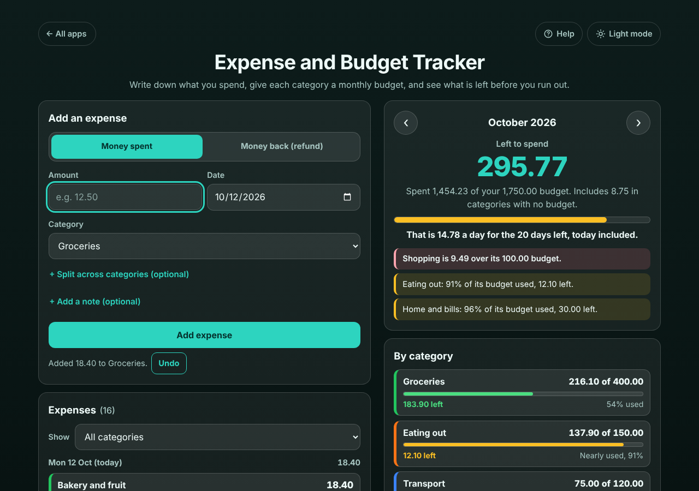

# Expense and Budget Tracker

A free **expense tracker with a monthly budget for each category**, for anyone who gets to the end of the month and wonders where the money went. Each time you pay for something, add it in a few seconds: the amount, the date and the category. Give each category a monthly budget (Groceries 400, Eating out 150, ...) and the app shows **what is left to spend this month**, **how much that is per day** for the days left, each category with a green, yellow or red bar, and a **warning as soon as a category is nearly used or over**. Refunds, split receipts and payday-to-payday months are handled. Private on your device: no account, no bank connection, no ads. Works offline.

**Live demo:** [umar8092.github.io/apps/expense-and-budget-tracker](https://umar8092.github.io/apps/expense-and-budget-tracker/)

| Desktop | On a phone |
|---|---|
|  |  |

## The situation it solves

It is Monday 12 October. You set these monthly budgets once: Groceries 400, Eating out 150, Transport 120, Home and bills 900, Shopping 100 and Fun 80 (**total 1,750.00**). Health has no budget. So far this month you have added:

| Date | What | Category | Amount |
|---|---|---|---|
| 1 Oct | Rent | Home and bills | 850.00 |
| 2 Oct | Supermarket | Groceries | 62.35 |
| 3 Oct | Bus pass | Transport | 45.00 |
| 4 Oct | Pizza night | Eating out | 38.50 |
| 5 Oct | Big shop (one receipt, split) | Groceries 64.20 + Home and bills 20.00 | 84.20 |
| 6 Oct | Cinema | Fun | 24.00 |
| 7 Oct | Birthday dinner | Eating out | 56.80 |
| 8 Oct | Shoes | Shopping | 49.99 |
| 9 Oct | Jacket | Shopping | 74.50 |
| 9 Oct | Returned T-shirt (money back) | Shopping | -15.00 |
| 9 Oct | Fuel | Transport | 30.00 |
| 10 Oct | Supermarket | Groceries | 71.15 |
| 10 Oct | Pharmacy | Health | 8.75 |
| 11 Oct | Takeaway | Eating out | 42.60 |
| 11 Oct | Concert ticket | Fun | 12.99 |
| 12 Oct | Bakery and fruit | Groceries | 18.40 |

The app says:

- **Left to spend: 295.77.** Spent 1,454.23 of your 1,750.00 budget. Includes 8.75 in categories with no budget.
- **That is 14.78 a day for the 20 days left, today included** (295.77 ÷ 20 = 14.7885, rounded down so you never overspend).
- **Shopping is 9.49 over its 100.00 budget** (49.99 + 74.50 − 15.00 = 109.49).
- **Eating out: 91% of its budget used, 12.10 left** (38.50 + 56.80 + 42.60 = 137.90).
- **Home and bills: 96% of its budget used, 30.00 left** (850.00 + the 20.00 part of the split receipt).
- By category: Groceries 216.10 of 400.00 (183.90 left), Transport 75.00 of 120.00 (45.00 left), Fun 36.99 of 80.00 (43.01 left), Health 8.75 (no budget).

Add 20.00 more for Fun the same day and the message right under the button says **Fun has 13.01 left of its 80.00 budget (83% used)**; one more 20.00 and it says **Fun is now 6.99 over its 80.00 budget**, in red, with Undo.

Paid on the 25th? Set **My month starts on day** to 25 and the same screen becomes **25 Sep – 24 Oct 2026**, with 13 days left to payday, and expenses from 25 September count in it.

Other cases it handles: a receipt split across categories (leave one part empty and it gets the rest; the app says exactly how much is still to assign or how much too much the parts are), refunds (taken off the category, shown in green), the arrows to look at earlier months (**This month is over. You finished 1,750.00 under budget.**) and future ones, expenses dated in another month (the message says which month), a category deleted (its expenses move to Other, with Undo), renaming a category (a duplicate or empty name is refused), a budget of 0, a blank budget (no limit), amounts typed or pasted as `12,50`, `$1,299.00` or `1.299,00 €`, and a 0, negative, huge or word amount or a missing date (each refused with a plain message). Midnight while the app is open moves today's date and the month on. Very long notes are cut to 80 characters and wrap in their box. A damaged backup file is refused or its broken lines left out (and counted), corrupt saved data is cleaned up, and if the browser blocks storage the app still works and says it is not saving. Money is kept in whole cents and dates as calendar dates, so totals are exact and time zones never move a spend to another day.

## Features

- **Help button.** Tap **Help** at the top for a short how-to, and **All apps** to go back to the list of apps. **Light mode / Dark mode** switch.
- **Add an expense in seconds:** amount, date (today filled in), category, and Enter. **+ Add a note (optional)** for what it was.
- **Money spent / Money back (refund)** switch for refunds.
- **+ Split across categories (optional):** one receipt, several categories, each part in its own box; one empty part gets the rest.
- **Left to spend** this month, what you spent of your whole budget, and **how much per day** for the days left.
- **By category:** each category in its own box with a bar, what is left or how much over, and green / yellow (80% or more) / red (over).
- **Warnings** at the top and right after you add an expense that takes a category past 80% or over.
- **Expenses list** grouped by day with day totals, newest first, **Show** one category only, **Edit** (Escape cancels) and **Delete** with **Undo** in place.
- **Categories and monthly budgets:** rename, add your own, delete (expenses move to Other, with Undo), empty budget = no limit. The same budgets apply every month.
- **My month starts on day** 1 to 28, to budget from payday to payday.
- **Earlier and later months** with the arrows, and **Back to this month**.
- **Currency symbol** (none, $, €, £, ₹, Rs, ¥, ₩, ₦, ₱, R, kr, CHF, AED, SAR, RM), remembered. Plain numbers by default.
- **Copy**, **Email** (opens your mail app with the month's summary and no address needed) and **Print** the month.
- **Save a backup file** and **Restore from a backup** (with Undo), and **Delete everything** (with Undo).
- **Try an example month** to see how it works before typing anything.
- **Private, works offline and installable.** Phone and desktop layouts. Works with a keyboard (Enter adds, Escape cancels an edit) and a screen reader.

## Run it yourself

No build step and no dependencies.

```bash
git clone https://github.com/umar8092/apps.git
```

Then open `expense-and-budget-tracker/index.html` in your browser. Offline mode and install need the files served over `https` or `localhost` (for example `python3 -m http.server`).

## How it works

- `core.js` is the maths, with no page code. Money is whole cents; dates are plain calendar dates (`2026-10-12`) turned into day numbers in UTC, so a time zone or daylight-saving change never moves an expense to another day or month. A budget month runs from the chosen start day to the day before it next month.
- `script.js` builds the page. Everything you type is added as plain text, never as HTML. Your data is saved in this browser's storage under `expense-and-budget-tracker.state`, and every saved or restored value is checked before it is used.
- `sw.js` saves the app for offline use (network first, so updates always arrive).
- Checks: `node tests.js` for the maths (also `test.html` in a browser), `node ui-test.js` drives the real page in headless Chromium with the clock fixed at 12 October 2026 (add `--base https://umar8092.github.io/apps` to test the live site).

## License

[MIT](LICENSE). Free to use, copy, modify and share. Made by [Muhammad Umar](https://github.com/umar8092).
