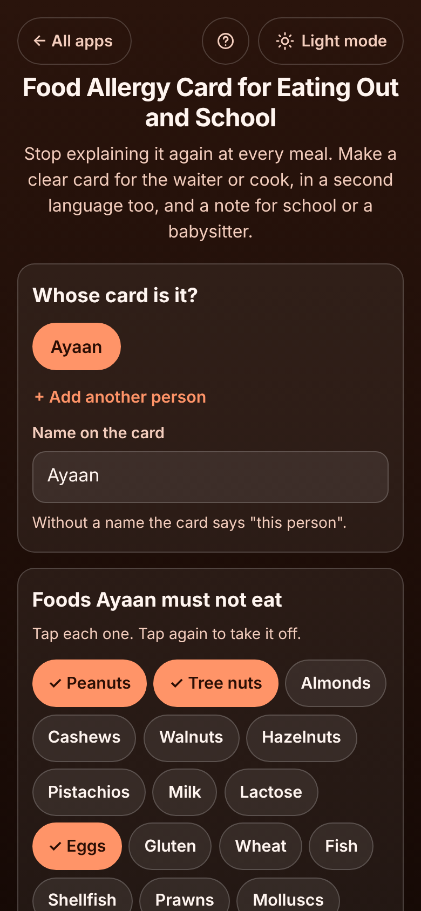

# Food Allergy Card for Eating Out and School

A free maker for a **food allergy card** for parents of a child with a nut, egg or milk allergy, and for adults with coeliac disease or a serious allergy, who are tired of explaining it again at every restaurant, school canteen, birthday party or babysitter. Tap the foods they must not eat, mark which are **dangerous even as a trace**, and get a clear card for the waiter or cook in **English plus a second language** (Spanish, French, German, Italian, Portuguese, Turkish, Arabic, Urdu, Hindi or Chinese, all written by hand), shown **full screen** on the phone or **printed** with a folding wallet card, plus a ready **note for school** with the adrenaline pen, what to do and who to call. Several family members, no sign-up, private on your device, works offline.

**Live demo:** [umar8092.github.io/apps/food-allergy-card-for-eating-out-and-school](https://umar8092.github.io/apps/food-allergy-card-for-eating-out-and-school/)

| Desktop | On a phone |
|---|---|
|  |  |

## The situation it solves

Sara's son Ayaan (7) is allergic to peanuts and all tree nuts (a crumb is dangerous), to kiwi, and reacts to eggs in normal amounts. He carries an EpiPen in the front pocket of his red school bag. The family is going to Spain, and every restaurant visit means explaining it again in broken Spanish, and every party means a long phone call with the host.

She types "Ayaan", taps **Peanuts**, **Tree nuts** and **Eggs**, types "kiwi" in **Something else**, sets Eggs to **Must not eat it**, ticks the adrenaline pen with where it is kept and her own number, and picks **Spanish** as the second language. The app asks her how to write "Kiwi" in Spanish (it is the same). The card now says:

```
Please read: food allergy

Ayaan must not eat even a trace of:
• Peanuts
• Tree nuts (almonds, cashews, walnuts, hazelnuts, pistachios)
• Kiwi

Ayaan must not eat:
• Eggs

Please check every ingredient, sauce and garnish. Use clean pans, boards and utensils, and do not fry in shared oil. Food that "may contain" these is not safe.
If you are not sure, please tell me. Thank you!

In an emergency:
Ayaan carries an adrenaline pen (EpiPen). Please use it and call an ambulance.
Where it is: Front pocket of the red school bag
Call: Mum (Sara) +92 300 1234567
```

…and the same in Spanish underneath: **"Ayaan no puede comer ni siquiera trazas de: Cacahuetes (maní), Frutos secos de cáscara (…), Kiwi · Ayaan no puede comer: Huevos"**. In the restaurant she taps **Show it full screen** and hands the phone to the waiter; the Spanish card opens first. **Print the cards** gives a big card for the kitchen and a wallet card with English on the front and Spanish on the back. For a party she taps **Email the note**: the note for the host lists the foods, that "may contain" foods are not safe, where the pen is and who to call.

Edge cases handled (each checked in the tests): no name ("this person must not eat…", in every language), only foods that matter in normal amounts (no cross-contact sentence), a food typed by hand with no translation (shown as typed, with a reminder to add how to write it), a pasted list such as "peanuts, sesame, kiwi (raw, not cooked)" (known foods become translated ones, brackets stay together, duplicates are skipped), the 30-food limit, Arabic and Urdu cards right to left, a phone number that is not a number, several people, delete and remove with Undo, and damaged saved data or a wrong backup file.

## Features

- 22 foods to tap: the 14 allergens food law asks restaurants to know about (peanuts, tree nuts, milk, eggs, gluten, fish, shellfish, molluscs, sesame, soy, mustard, celery, lupin, sulphites) plus single nuts, lactose, wheat and prawns, and any food you type or paste.
- Each food in its own box with **Even a trace is dangerous** or **Must not eat it**; the card lists the dangerous ones first, in red.
- Ten second languages, written by hand; Arabic and Urdu read right to left. Your own foods can have their own translation.
- **Show it full screen** to hand the phone over, with a language switch.
- **Print the cards**: a big card per language for the kitchen and a folding wallet card; the text shrinks to fit and warns if it cannot.
- **Copy** or **Email** the card text to send to a restaurant, hotel or airline before you go.
- **Note for school, a babysitter or a party host**, with what to do in a reaction, other medicine, safe foods and who to call: copy, email or print.
- Several family members, **Save a backup file** / **Restore a backup**, delete with Undo.
- **Help button** at the top with a how-to for this app, **All apps** to go back to the list, and a **Light / Dark** switch.
- No sign-up, no ads, your data is never sent anywhere, works offline once opened.

## Run it yourself

```
git clone https://github.com/umar8092/apps.git
```

Then open `food-allergy-card-for-eating-out-and-school/index.html` in a browser. To test: `node food-allergy-card-for-eating-out-and-school/tests.js` (logic) and `node food-allergy-card-for-eating-out-and-school/ui-test.js` from the repo root (the page, in headless Chromium).

## How it works

Plain HTML, CSS and JavaScript with no libraries. `core.js` holds the foods, the card sentences in each language and the text of the card and the note. Everything is saved in your browser's local storage under keys starting with `food-allergy-card-for-eating-out-and-school.`, checked when loaded and when restored. A network-first service worker keeps a copy for offline use. The card does not replace asking: always ask, and check labels yourself; it is not medical advice.

## License

MIT, see [LICENSE](LICENSE).
