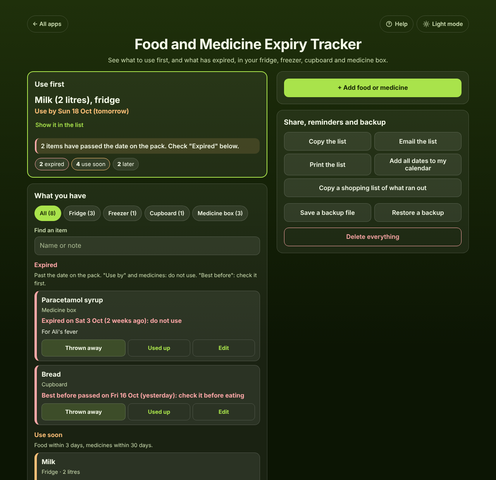

# Food and Medicine Expiry Tracker

A free **food and medicine expiry tracker** for the whole household. Add what is in your fridge, freezer, cupboard or medicine box with the **use by**, **best before** or **expiry date** on the pack, and the app shows **what to use first** and **what has already expired**, soonest first. It understands packs that print only a month and a year, and packs that keep only a few days once opened. Add the dates to your calendar, print the list for the fridge door, and copy a shopping list of what ran out. Works offline, no sign-up, no ads.

**Live demo:** [umar8092.github.io/apps/food-and-medicine-expiry-tracker](https://umar8092.github.io/apps/food-and-medicine-expiry-tracker/)

| Desktop | On a phone |
|---|---|
|  |  |

## The situation it solves

Ayesha has two children and does a big shop every Saturday. Yoghurt and chicken go off at the back of the fridge, and last month her son had a fever at night and the paracetamol syrup in the medicine box turned out to have expired. On Saturday 17 October 2026 she unpacks the shopping and adds each thing as she puts it away (the form stays open, with the same place, for the next one):

- Milk, 2 litres, fridge, use by 18 Oct
- Yoghurt, fridge, use by 20 Oct
- Chicken, freezer, use by 15 Jan 2027
- Pasta sauce, fridge, best before 1 Mar 2027, opened on 15 Oct, "once opened use within 5 days"
- Bread, cupboard, best before 16 Oct
- Paracetamol syrup, medicine box, expiry 3 Oct
- Eye drops, medicine box, the box only says EXP 03/2027
- Cough syrup, medicine box, expiry 10 Nov

The app answers:

- **Use first:** Milk (2 litres), fridge. **Use by Sun 18 Oct (tomorrow)**.
- **2 items have passed the date on the pack.**
- **Expired:** Paracetamol syrup, **Expired on Sat 3 Oct (2 weeks ago): do not use**. Bread, **Best before passed on Fri 16 Oct (yesterday): check it before eating**.
- **Use soon:** Milk (tomorrow), Pasta sauce **Use by Tue 20 Oct (in 3 days), 5 days after opening**, Yoghurt (in 3 days), Cough syrup **Expires Tue 10 Nov (in 3 weeks)**, so she can buy a new one before she needs it.
- **Later:** Chicken, Use by Fri 15 Jan 2027 (in 2 months). Eye drops, **Expires end of Mar 2027 (in 5 months)**.

She throws the bread away and taps **Thrown away**, finishes the milk on Sunday and taps **Used up**. **Copy a shopping list of what ran out** then gives "Bread, Milk". When she buys bread again she taps **Add again**, which fills in the name and the place.

How the dates are counted: a date with only a month and a year lasts until the last day of that month (EXP 03/2027 = 31 March 2027). Once opened, the days are added to the opening day (opened 15 Oct, 5 days = use by 20 Oct), and the earlier of that date and the pack date counts. "Use soon" means 3 days or less for food, 30 days or less for medicines.

## Features

- **Help button.** Tap **Help** at the top for a short how-to written for this app, and tap **All apps** to go back to the list.
- **Use first** at the top: the next thing to use, how long is left, how many items have expired, and counts of Expired, Use soon and Later.
- **Each item in its own box**, grouped into **Expired** (red), **Use soon** (orange) and **Later**, each sorted by date, soonest first.
- **Three kinds of dates:** **Use by** (do not eat after it), **Best before** (check it first) and **Expiry date** for medicines (do not use). The Medicine box picks Expiry date by itself.
- **Full date** or **Month and year only** (counted to the end of the month).
- **No date printed?** Buttons for Today, In 3 days, In 1 week, In 1 month and In 3 months, for bread, leftovers and the freezer.
- **Opened it? (optional):** the opening day and how long it keeps once open (1 day to 3 months, 28 days for many eye drops, or any number of days). **Opened** on an item adds this later.
- **Quantity and a note (optional).**
- **Fast entry while unpacking:** after **Add to my list** the form stays open with the same place and kind of date. A preview line shows the date that counts before you save.
- **Places:** Fridge, Freezer, Cupboard, Medicine box, Other. Tap a place above the list to see only that place. **Find an item** once you have 8 or more.
- **Used up** and **Thrown away** with **Undo**, **Put back**, **Add again**, **Edit**, **Delete** with Undo. The summary counts what you used up and threw away in the last 30 days.
- **Copy a shopping list of what ran out:** what you used up or threw away in the last 30 days and do not have again, A to Z.
- **Calendar** on each item and **Add all dates to my calendar**: all-day events with reminders at 9 am the day before and on the day for food, and 30 and 7 days before for medicines.
- **Copy the list**, **Email the list** (works without typing an address first) and **Print the list** for the fridge door.
- **Save a backup file** and **Restore a backup**, **Delete everything** with Undo. Damaged or blocked saved data is handled with a clear message.
- **Private.** Your list stays in this browser on this device; your data is never sent anywhere.
- **Works offline and installable.** The days left update by themselves every day.
- **Back to all apps.** A "← All apps" button at the top of the page.
- **Light and dark mode switch.** It follows your device until you choose, and remembers your choice in every app.

This app is a reminder, not food safety or medical advice. When in doubt, throw it out or ask a pharmacist.

## Run it yourself

No build step and no dependencies.

```bash
git clone https://github.com/umar8092/apps.git
```

Then open `food-and-medicine-expiry-tracker/index.html` in your browser.

Offline mode and install work best with the files served over `https` or `localhost` (for example `python3 -m http.server`).

## How it works

- `core.js` is the logic, with no page code. Dates are calendar dates (`2026-10-18`), so time zones and summer time never move a date. It works out the date that counts (pack date, end of the month, or days after opening), the words such as "tomorrow" and "2 weeks ago", sorts the list into groups, writes the copy text, the shopping list and the calendar file, reads the form with plain error messages, and checks every saved or restored value.
- `script.js` builds the page. Names and notes are added as plain text, never as HTML. The list is saved in `localStorage` on the device.
- `sw.js` saves the app on your device for offline use (network first, so updates show at once).
- Run the logic checks with `node tests.js` (or open `test.html`), and the full page test with `node ui-test.js` (needs Playwright). The page test fixes "today" to Sat 17 Oct 2026 and checks the exact answers above.

## License

[MIT](LICENSE). Free to use, copy, modify and share. Made by [Muhammad Umar](https://github.com/umar8092).
