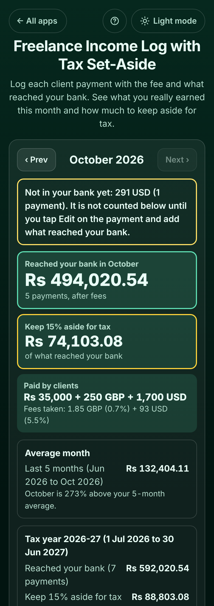

# Freelance Income Log with Tax Set-Aside

A free **income log for freelancers, tutors and remote workers** who are paid by several clients, often in dollars, pounds or euros through Payoneer, Wise, PayPal or Upwork. Each time a client pays, add it in a few seconds: who paid, how much and in which currency, the **fee taken** (as an amount or a %), and **what reached your bank** in your own money (or the exchange rate, or "not in my bank yet" if it is still in your Payoneer or Wise balance). The app shows **what you really earned this month** after fees and exchange, **how much to keep aside for tax**, your **average month**, your **best client**, and the total for your **tax year** (January, 1 April, 6 April or 1 July start) with what you have already put aside. No sign-up, no ads, no connection to your bank or accounts, and it works offline.

**Live app:** [umar8092.github.io/apps/freelance-income-log-with-tax-set-aside](https://umar8092.github.io/apps/freelance-income-log-with-tax-set-aside/)

| Desktop | On a phone |
|---|---|
|  |  |

## The situation it solves

Bilal is a freelance designer in Lahore. He is paid in dollars on Upwork, by a US agency through Payoneer, by a UK client through Wise, and in rupees by a local school. Each platform takes a fee, the exchange rate changes every time he withdraws, and some money sits in his Payoneer balance for weeks. At the end of the month he cannot say what he really earned, and at tax time he has not kept anything aside. His accountant told him to keep **15%** aside; Pakistan's tax year runs **1 July to 30 June**.

He sets **Your currency symbol** to Rs, **Keep aside for tax** to 15% and **Your tax year** to 1 July to 30 June, then adds his payments:

| Date | Client | Paid by client | Fee | What reached the bank |
|---|---|---|---|---|
| 15 Jun | Maple and Co | 200 GBP | none | Rs 70,000 (typed) |
| 12 Sep | Northwind Studio (Upwork) | 500 USD | 10% = 50 USD | rate 280: 450 × 280 = **Rs 126,000** |
| 20 Sep | Northwind Studio | 100 USD **taken back** (refund) | none | rate 280: **-Rs 28,000** |
| 2 Oct | Northwind Studio (Upwork) | 600 USD | 10% = 60 USD | rate 279.20: 540 × 279.20 = **Rs 150,768** |
| 14 Oct | Brightline Media (Payoneer) | 800 USD | 24 USD | **Rs 216,040** (typed; the app shows the rate he got: 278.40) |
| 20 Oct | Maple and Co (Wise) | 250 GBP | 1.85 GBP | rate 371.60: 248.15 × 371.60 = **Rs 92,212.54** |
| 25 Oct | Local school | Rs 35,000 | none | **Rs 35,000** |
| 27 Oct | Brightline Media (Payoneer) | 300 USD | 9 USD | **not in my bank yet** |

He has also moved Rs 30,000 to a savings account for tax on 30 Sep. On Wednesday 28 October 2026 the app shows:

- **Reached your bank in October: Rs 494,020.54** (5 payments, after fees): 150,768 + 216,040 + 92,212.54 + 35,000.
- **Keep 15% aside for tax: Rs 74,103.08** (15% of 494,020.54 = 74,103.081).
- **Paid by clients: Rs 35,000 + 250 GBP + 1,700 USD**, **fees taken: 1.85 GBP (0.7%) + 93 USD (5.5%)**.
- **Not in your bank yet: 291 USD (1 payment)**, shown apart so it never inflates the bank total. When he withdraws it, he taps **Edit** and types what arrived.
- **Average month: Rs 132,404.11** over the 5 months since his first payment (Jun to Oct: 70,000 + 0 + 0 + 98,000 + 494,020.54 = 662,020.54 ÷ 5). **October is 273% above your 5-month average.**
- **Tax year 2026-27 (1 Jul 2026 to 30 Jun 2027):** reached your bank **Rs 592,020.54** (September 98,000 after the refund + October), keep 15% aside **Rs 88,803.08**, put aside so far **Rs 30,000**, **still to put aside Rs 58,803.08**. The June payment belongs to the previous tax year.
- **Your clients**, best paying first: **Northwind Studio Rs 248,768** (42% of his income this tax year), Brightline Media Rs 216,040 (plus 1 payment not in the bank yet), Maple and Co Rs 92,212.54, Local school Rs 35,000.

He taps **Save list for accountant** for a CSV file of the whole tax year that opens in Excel or Google Sheets, and **Email summary** to send October to his accountant.

## Features

- **Help button.** Tap **Help** at the top for a how-to written for this app, and **← All apps** to go back to the list.
- **Add a payment in seconds:** the client, the date, the amount and its currency (33 currencies, or your own), the fee as an amount or a % (such as Upwork's 10%), and what reached your bank: **Amount in my bank**, **Exchange rate**, or **Not in my bank yet**. A preview shows what you get before you save.
- **Each client remembers** its usual currency and fee, so the next payment is quicker.
- **Refunds and chargebacks** ("Money taken back") are taken off the month and the tax to keep aside.
- **The month:** what reached your bank, tax to keep aside, what clients paid and the fees in each currency (with the fee as a share), payments not in your bank yet, **‹ Prev** and **Next ›** months.
- **Average month** over the last 6 and 12 months (or since your first payment), and how this month compares.
- **Tax year** total with your % to keep aside, **money you have put aside** and what is **still to put aside**. Tax years starting 1 January, 1 April, 6 April (UK) or 1 July (Pakistan, Australia), guessed from your time zone, any % up to 60.
- **Your clients**, each in their own box, best paying first, with their share of your income, fees, payments not in the bank yet and the last payment. **Add a payment**, **Rename**, **Delete client**.
- **Edit** and **Delete** every payment, and **Undo** after every change.
- **Copy summary**, **Email summary** (opens your mail app, no address needed) and **Save list for accountant** (a CSV of the tax year).
- **Last 12 months** of income as bars.
- **Currency symbol** of your choice (or none), remembered.
- **Backup file** to move to another phone, and **Delete everything**.
- **Private.** Everything stays in your browser. It never connects to Payoneer, Wise, PayPal, Upwork or your bank, and your data is never sent anywhere. Not tax advice: ask an accountant what % to keep.
- **Works offline and installable.** Light and dark mode switch next to the back button, remembered across all apps. Laptop layout with the form on the left and your month on the right.

## Run it yourself

No build step and no dependencies.

```bash
git clone https://github.com/umar8092/apps.git
```

Then open `freelance-income-log-with-tax-set-aside/index.html` in your browser.

Offline mode and install need the files served over `https` or `localhost` (for example `python3 -m http.server`).

## How it works

- `core.js` is the maths and the words, with no page code. Money is kept in whole cents and exchange rates as whole millionths, and multiplications use exact big-number maths, so every total is exact to the cent. `homeOf()` works out what one payment put in your bank, `stats()` adds up a month or a tax year, `average()` the average month, `taxStats()` the tax year with what is still to put aside, `clientStats()` ranks the clients, and `csv()` writes the list for your accountant.
- `script.js` builds the page. Names and notes are added as plain text, never as HTML. Everything is saved in this browser's storage under `freelance-income-log-with-tax-set-aside.state`.
- `sw.js` saves the app on your device for offline use (network first, so updates show at once).
- Run the logic checks with `node tests.js` (or open `test.html`), and the page checks with `node freelance-income-log-with-tax-set-aside/ui-test.js` from the repo root while `python3 -m http.server 8765` runs there.

## License

[MIT](LICENSE). Free to use, copy, modify and share. Made by [Muhammad Umar](https://github.com/umar8092).
