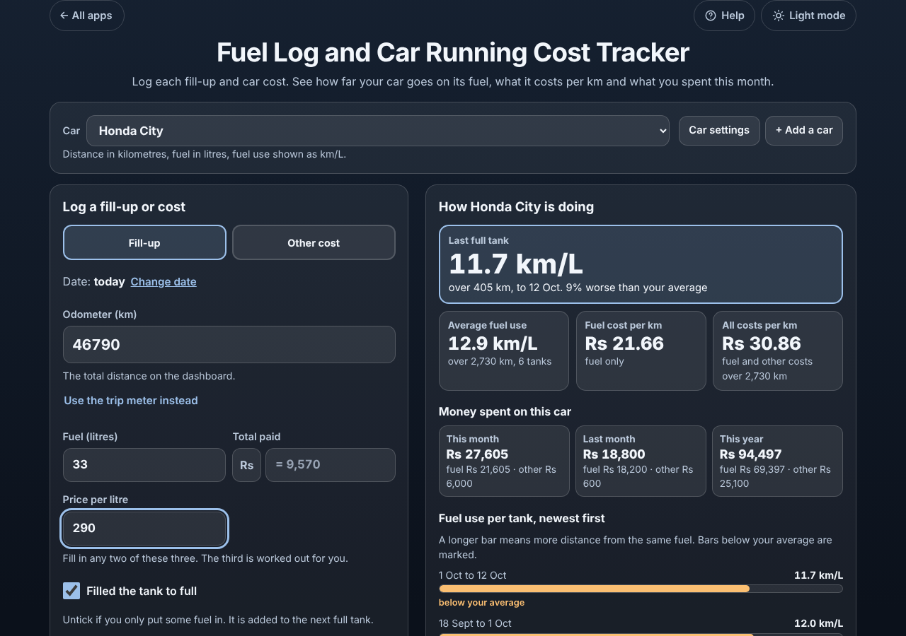
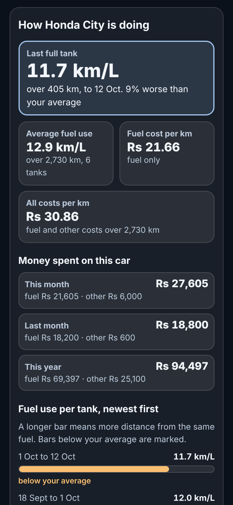

# Fuel Log and Car Running Cost Tracker

A free **fuel log for drivers** that tells you how far your car really goes on its fuel and what it costs you. Log each fill-up (odometer, fuel, what you paid) and other car costs (service, tyres, insurance). The app shows the fuel use of every tank in km/L, L/100 km or mpg, whether it is getting worse, the fuel cost and the all-in running cost per km or mile, and what you spent this month and this year. One or several cars, each with its own units. No ads, no sign-up, private on your device, works offline.

**Live demo:** [umar8092.github.io/apps/fuel-log-and-car-running-cost-tracker](https://umar8092.github.io/apps/fuel-log-and-car-running-cost-tracker/)

| Desktop | On a phone |
|---|---|
|  |  |

## The situation it solves

Ahmed drives a Honda City. Petrol keeps getting dearer and the car feels thirstier, but he has no idea what it actually does per litre or what the car costs him each month. At the pump he opens the app and types three numbers:

| Date | Odometer | Fuel | Paid | Full tank? |
|---|---|---|---|---|
| 1 Sep | 45,000 km | 30 L | Rs 8,400 | yes |
| 10 Sep | 45,200 km | 15 L | Rs 4,200 | no, a part fill |
| 18 Sep | 45,455 km | (worked out: 20 L) | Rs 5,600 at Rs 280 per litre | yes |
| 1 Oct | 45,935 km | 40 L | Rs 11,600 | yes |
| 5 Oct | Service | | Rs 6,000 | |

The app answers in plain words:

- **This tank: 12.0 km/L over 480 km** (40 L from 18 Sep to 1 Oct), **4% worse than your average**.
- The first tank: 455 km on 15 + 20 = 35 L = **13.0 km/L** (the part fill is counted in the next full tank).
- **Average fuel use: 12.5 km/L** over 935 km (935 ÷ 75 L).
- **Fuel cost per km: Rs 22.89** (Rs 21,400 of fuel ÷ 935 km).
- **All costs per km: Rs 29.30** (fuel after the first fill-up plus the service: Rs 27,400 ÷ 935 km).
- **This month: Rs 17,600** (fuel Rs 11,600, other Rs 6,000). Last month Rs 18,200. This year Rs 35,800.

He only knew he paid Rs 5,000 at Rs 280 per litre? Type those two and the fuel (17.857 L) is worked out. Forgot to log a fill-up? Tick *I forgot to log a fill-up before this one* and that one tank is skipped instead of showing a wrong number. Typed 45,000 instead of 46,000? An odometer lower than the last fill-up is refused, and an odd result such as 200 km/L is flagged before saving.

## Features

- **Help button.** Tap **Help** at the top for a short how-to written for this app, and tap **All apps** to go back to the list.
- **Fill-ups in seconds.** Odometer, then any two of fuel, total paid and price per litre; the third is worked out. *Filled the tank to full* is ticked by default; untick it for a part fill.
- **Preview before saving.** The box above *Save fill-up* shows what the tank comes to, such as "This tank: 12.0 km/L over 480 km (4% worse than your average)".
- **Correct "full to full" maths.** Part fills are added to the next full tank; a missed fill-up skips that tank; the first full tank is the starting point.
- **Odometer or trip meter.** If you reset the trip meter at every fill-up, tap *Use the trip meter instead*.
- **Other costs.** Service, repair, tyres, insurance, tax and registration, parking and tolls, car wash, loan or lease payment, other.
- **Results.** Last full tank, average fuel use, fuel cost per km or mile, all costs per km or mile, money spent this month, last month and this year, and a bar for each tank so you can see if it is getting worse.
- **Each car its own settings.** Kilometres or miles, litres or US or UK gallons, fuel use as km/L, L/100 km, mpg (US), mpg (UK) or miles per litre. Changing units never changes what you logged.
- **Several cars.** *+ Add a car* for a second car or a motorbike; pick the car at the top.
- **Log.** Every fill-up and cost in its own box, newest first, with *Edit* and *Delete* (with *Undo*).
- **Share.** *Copy the summary*, *Email the summary* (no address needed first), *Print or save as PDF*, *Download for a spreadsheet (CSV)* for business mileage claims.
- **Currency symbol** of your choice (none, Rs, $, €, £, ₹ and more), remembered.
- **Backup.** *Save a backup file* and *Restore a backup*, with *Undo*. *Delete everything* also has *Undo*.
- **Private.** Everything stays in this browser on this device. Your data is never sent anywhere.
- **Works offline and installable.** Add it to your home screen.
- **Back to all apps.** A "← All apps" button at the top of the page.
- **Light and dark mode switch.** It follows your device until you choose, and remembers your choice in every app.

## Run it yourself

No build step and no dependencies.

```bash
git clone https://github.com/umar8092/apps.git
```

Then open `fuel-log-and-car-running-cost-tracker/index.html` in your browser.

Offline mode and install need the files served over `https` or `localhost` (for example `python3 -m http.server`).

## How it works

- `core.js` is the maths and the words, with no page code. Money is whole cents, fuel is thousandths of a litre or gallon and distances are tenths, each saved with the unit it was typed in, so results never drift. Fuel use is the distance between two full tanks divided by all the fuel put in after the first of them.
- `script.js` builds the page. Names and notes are added as plain text, never as HTML.
- `sw.js` saves the app on your device for offline use (network first, so you always get the newest version when online).
- Run the checks with `node tests.js` (or open `test.html`) for the maths and `node ui-test.js` to drive the page in headless Chromium.

## License

[MIT](LICENSE). Free to use, copy, modify and share. Made by [Muhammad Umar](https://github.com/umar8092).
