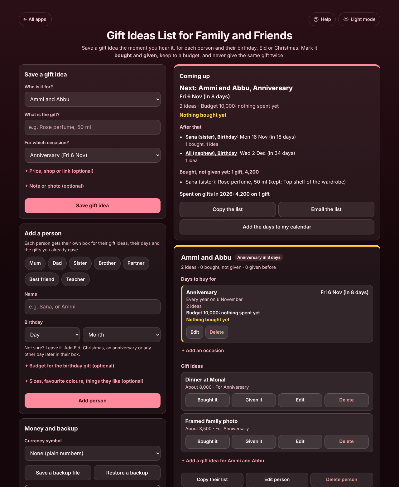
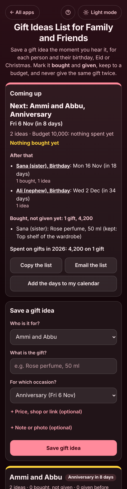

# Gift Ideas List for Family and Friends

A free **gift ideas list for the people you buy for**. Give each person their own box with their birthday, Eid, Christmas, anniversary or any other day and an optional budget. Save a gift idea in seconds the moment you hear a hint, with a rough price, the shop, a link or a photo. Tap **Bought it** and **Given it**, see what is coming up and how much budget is left, and keep a list of what you already gave, so you never give the same gift twice. No sign-up, no ads, private on your device, and it works offline.

**Live app:** [umar8092.github.io/apps/gift-ideas-list-for-family-and-friends](https://umar8092.github.io/apps/gift-ideas-list-for-family-and-friends/)

| Desktop | On a phone |
|---|---|
|  |  |

## The situation it solves

In March, Hina hears her sister Sana say she loves a friend's rose perfume. In June Sana mentions a book she never finished. By Sana's birthday in November, Hina has forgotten both, and last year she already gave her a perfume.

With the app, Hina adds **Sana** with her birthday (**16 November**) and a budget of **6,000**, and saves each hint the moment she hears it: "Rose perfume, 50 ml, 4,500, from Dolmen Mall". On **Thursday 29 October** she opens it and sees:

- **Coming up:** "Next: Ammi and Abbu, Anniversary, Fri 6 Nov (in 8 days). 2 ideas, budget 10,000: nothing spent yet. **Nothing bought yet**." After that: "Sana (sister), Birthday: Mon 16 Nov (in 18 days), 1 bought, 1 idea" and "Ali (nephew), Birthday: Wed 2 Dec (in 34 days)".
- In Sana's box: **4,200 spent of 6,000: 1,800 left** (she bought the perfume for 4,200, not the 4,500 she expected), **Kept: Top shelf of the wardrobe**, and her sizes and favourite colours.
- **"Heads up: you gave Sana (sister) "Perfume" for Birthday 2025."** next to the new perfume idea, so she can pick the dupatta instead.
- **Bought, not given yet: 1 gift, 4,200** and **Spent on gifts in 2026: 4,200 on 1 gift**.

On the birthday she taps **Given it**. The perfume moves to **Already given** with "Birthday 2026", and on 17 November the birthday rolls on to **Tue 16 Nov 2027 (in 364 days)** with the budget starting again. A gift given a few days early still counts against this year's budget; last year's gift does not.

Eid and Diwali fall on a different day each year, so they are added as **One time** with this year's date; once the day has passed the box says "Was on Wed 10 Mar, tap Edit to pick the next date". A birthday on 29 February is shown on 28 February in other years.

## Features

- **Help button.** Tap **Help** at the top for a how-to written for this app, and **← All apps** to go back to the list.
- **Each person in their own box** with their days, their sizes and likes, the gifts bought and not given yet, the gift ideas and the gifts already given (with the occasion and year).
- **Any occasion:** Birthday, Anniversary, Eid ul-Fitr, Eid ul-Adha, Christmas (25 Dec filled in), Diwali, Mother's Day, Father's Day, Valentine's Day, Wedding, Graduation, New baby or your own. Every year on the same day, one time, or no date yet.
- **A budget for each occasion**, with what is spent and what is left, or how much is over budget. Only bought and given gifts count, not ideas.
- **Save an idea in seconds:** who, what, which occasion. Optional rough price, shop, web link (shown as text, opened only on tap), note and photo (made small and kept on the device).
- **Bought it** (price paid, day, where it is hidden), **Given it** (day and occasion), **Edit** (including putting a gift back to an idea), **Also save it for** another person (a gift for a couple), and **Delete**, with **Undo** after every change.
- **A warning before you repeat a gift** you gave that person before.
- **Coming up:** the next day to buy for, the days after it (next 60 days, at least 3), "Nothing bought yet" when a day is 2 weeks away or less, the gifts bought and waiting, and what you spent on gifts this year.
- **Copy the list**, **Email the list** (opens your mail app, no address needed), **Copy their list** for one person, and **Add the days to my calendar** (a calendar file, yearly days repeating, a reminder a week before each).
- **Currency symbol** of your choice (or none), remembered.
- **Backup file** to move to another phone, and **Delete everything**, with Undo.
- **Private.** Everything stays in your browser, so the person cannot see their surprise. Your data is never sent anywhere.
- **Works offline and installable.** Light and dark mode switch next to the back button, remembered across all apps. Laptop layout with the forms on the left and coming up and the people on the right.

## Run it yourself

No build step and no dependencies.

```bash
git clone https://github.com/umar8092/apps.git
```

Then open `gift-ideas-list-for-family-and-friends/index.html` in your browser.

Offline mode and install need the files served over `https` or `localhost` (for example `python3 -m http.server`).

## How it works

- `core.js` is the dates, the money and the words, with no page code. Money is whole cents and dates are whole days, so totals are exact. `next()` finds the coming day of an occasion, `occStats()` adds up what is bought and given for it since it last came round, `upcoming()` lists the days ahead, `givenBefore()` finds a gift given before, and `ics()` writes the calendar file.
- `script.js` builds the page. Names, ideas and notes are added as plain text, never as HTML, and links are kept only if they are plain `http` or `https` addresses. Everything is saved in this browser's storage under `gift-ideas-list-for-family-and-friends.state`, and saved or restored data is checked before use.
- `sw.js` keeps a copy of the app for offline use. It is network first, so you always get the newest version when online.
- Tests: `node tests.js` (the maths and words) and `node ui-test.js` (drives the real page in headless Chromium at many screen sizes).

## License

[MIT](LICENSE)
