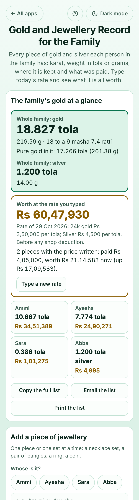

# Gold and Jewellery Record for the Family

A free record of **the gold and silver jewellery each person in a family has**, for households in Pakistan, India, Bangladesh, the Gulf and anywhere gold is kept for weddings, gifts and savings. Add each necklace set, bangle, ring or coin with whose it is, its karat and its weight in **tola, tola-masha-ratti, grams or troy ounces** (stones taken off), where it is kept and what was paid. Type today's gold rate and the app answers in plain words: **"Ayesha: 7.774 tola of gold, worth Rs 24,90,271"** and **"Whole family: 18.827 tola of gold, 17.266 tola pure, worth Rs 60,47,930"**. Sold and given pieces stay in the history. No sign-up, no ads, private on your device (photos too), works offline.

**Live demo:** [umar8092.github.io/apps/gold-and-jewellery-record-for-the-family](https://umar8092.github.io/apps/gold-and-jewellery-record-for-the-family/)

| Desktop | On a phone |
|---|---|
| ![Gold and Jewellery Record on a laptop: the Add a piece of jewellery form with person chips Ammi, Ayesha, Sara and Abba and Today's gold rate on the left; on the right The family's gold at a glance says Whole family: gold 18.827 tola, 219.59 g, 18 tola 9 masha 7.4 ratti, pure gold 17.266 tola, silver 1.200 tola, worth Rs 60,47,930 at 3,50,000 per tola of 24k, with a tile for each person, and Ammi's box with her wedding necklace set of 5.500 tola after 0.500 tola of stones, worth Rs 17,64,583, up Rs 15,79,583 on the Rs 1,85,000 paid in 2001](screenshots/desktop.png) |  |

## The situation it solves

Ammi in Lahore looks after the family's gold: her own wedding necklace set and bangles, a gold coin bought in 2024, her daughter Ayesha's wedding set, bangles and ring, Sara's earrings from Nani and Abba's silver ring. Some of it is at home, most of it in the bank locker. Before Ayesha's wedding, a locker visit, a zakat calculation or a family talk about selling, she needs to know: **how much gold does each person have, what is it worth today, and what is where?** Nobody remembers the weights, the receipts say "4 tola 2 masha", and the gold rate changes every day.

She adds each piece once and types the rate from the market, **3,50,000 per tola of 24k** (and 4,500 for silver):

| Person | Piece | Purity | Weight | Worth |
|---|---|---|---|---|
| Ammi | Wedding necklace set (paid 1,85,000 in 2001) | 22k | 6 tola, 0.5 tola stones | **17,64,583** (5.5 tola × 22/24 × 3,50,000) |
| Ammi | 6 bangles | 22k | 4 tola 2 masha | **13,36,806** |
| Ammi | Gold coin (paid 2,20,000 in 2024) | 24k | 1 tola | **3,50,000** |
| Ayesha | Wedding set | 22k | 5 tola | **16,04,167** |
| Ayesha | Bangles | 22k | 2 tola 6 masha | **8,02,083** |
| Ayesha | Engagement ring | 21k | 3.2 g | **84,021** |
| Sara | Earrings | 18k | 4.5 g | **1,01,275** |
| Abba | Silver ring | 925 | 1.2 tola | **4,995** |

The app now says:

- **Whole family: gold 18.827 tola** (219.59 g · 18 tola 9 masha 7.4 ratti). **Pure gold in it: 17.266 tola.** Silver 1.200 tola.
- **Worth Rs 60,47,930** at the rate of 29 Oct 2026, before any shop deduction.
- **Ammi 10.667 tola, Rs 34,51,389 · Ayesha 7.774 tola, Rs 24,90,271 · Sara 0.386 tola, Rs 1,01,275 · Abba 1.200 tola silver, Rs 4,995.**
- **2 pieces with the price written: paid Rs 4,05,000, worth Rs 21,14,583 now (up Rs 17,09,583).**
- **Bank locker: 4 pieces** with a checklist to tick off at the bank.

When the wedding set is given to Sara, she taps **Given** and picks Sara: it moves to Sara's box with the line "Given by Ayesha to Sara on …". When a chain is sold, **Sold** keeps the date and what the shop paid in **Sold and given away**. When next week's rate is typed, the summary says how much the family's gold went up or down since.

Worked examples from the tests (all checked by hand):

- 1 tola = 11.6638038 g = 12 masha = 96 ratti; 2 tola 6 masha = 2.500 tola = 29.16 g.
- 2.5 tola of 22k at 3,50,000 per tola of 24k = 2.5 × 22/24 × 3,50,000 = **8,02,083**; at a jeweller's own 22k rate of 3,20,000 = **8,00,000**.
- 10 g of 21k at AED 498.25 per gram = 4,359.69, shown as **AED 4,360**; 1 troy ounce of 18k at 4,000 an ounce = **3,000**.
- 10 tola of sterling silver (925) at 4,500 per tola = **41,625**.
- A 3 tola ring with 0.5 tola of stones counts **2.500 tola** of gold.

## Features

- **Help button** at the top with a how-to for this app, **All apps** to go back to the list, and a **Light / Dark** switch.
- **Add a piece of jewellery**: **Whose is it?** (tap a name already in the list), **What is it?**, **Metal and purity** (24k, 22k, 21k, 18k, 14k gold with their 999/916/875/750/585 stamps, any other karat, fine or sterling silver or any other purity), **Weighed in** tola, tola-masha-ratti, grams or troy ounces with a live line showing the same weight in every unit, **+ It has stones, pearls or beads** to take their weight off, an optional **Where is it kept?**, and **+ Add what was paid, the date, a note or a photo**. The person stays filled in, so a whole set of pieces is quick to enter.
- **Today's gold rate**: per tola, per 10 grams, per gram or per troy ounce; other karats are worked out from the 24k rate, or from your jeweller's own **22k, 21k or 18k** rates if you type them; an optional **silver rate**. The app never looks the rate up, so it works offline and never shows a wrong rate.
- **The family's gold at a glance**: total gold in tola and grams and tola-masha-ratti, the pure gold in it, silver, what it is worth, how much it went up or down since the last rate, a warning when the rate is over 7 days old, what was paid against today's value, and a tile for each person. **Copy the full list**, **Email the list** (works with no recipient typed) and **Print the list**.
- **Each person's jewellery**: a bordered box per person with their totals and each piece in its own box (karat, weight, stones, where kept, worth, paid and the gain), **Copy their list**, **Rename**, **+ Add a piece for them**; on each piece **Edit**, **Sold**, **Given** (to someone in the family, a new person, or outside the family) and **Delete**. Tap a photo to see it bigger.
- **Where it is kept**: pieces grouped by place with **Copy the checklist** for a locker visit or a move.
- **Sold and given away**: the history with dates, what the shop paid and **I still have it** to bring a piece back.
- **Undo** after every change, **Show weights in** tola or grams first, **Currency symbol** (none, Rs, ₹, ৳, AED, SAR, $, €, £ and more, remembered), **How to write big numbers** (1,234,567 or 12,34,567), **Save the list as a spreadsheet (CSV)**, **Save a backup file** (with photos), **Restore a backup**, **Delete everything**.
- Installable, works offline, and your data is never sent anywhere.

## Run it yourself

```
git clone https://github.com/umar8092/apps.git
```

Then open `gold-and-jewellery-record-for-the-family/index.html` in a browser. To test: `node gold-and-jewellery-record-for-the-family/tests.js` (logic) and `node gold-and-jewellery-record-for-the-family/ui-test.js` from the repo root (the page, in headless Chromium).

## How it works

Plain HTML, CSS and JavaScript with no libraries. `core.js` holds the maths: weights are kept in whole micrograms (1 tola is exactly 180 troy grains, 11.6638038 g) and money in whole cents, and values are worked out with whole numbers (BigInt) and rounded half up to a whole amount, so each person's total is exactly the sum of their pieces. Everything is saved in your browser's local storage under keys starting with `gold-and-jewellery-record-for-the-family.`, checked when loaded and when restored; photos are shrunk and kept in the browser's IndexedDB on this device. A network-first service worker keeps a copy for offline use.

## License

MIT, see [LICENSE](LICENSE).
