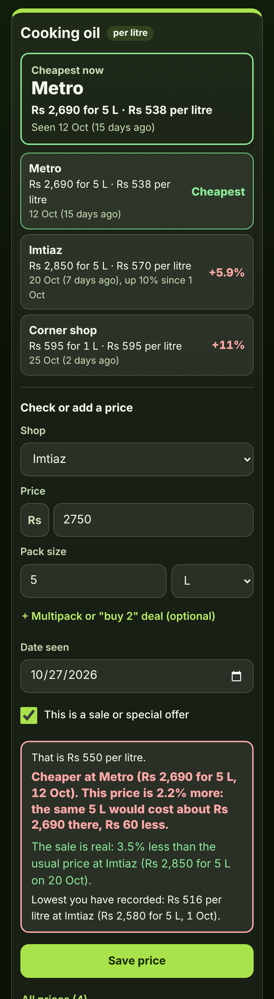

# Grocery Price Book for Comparing Shops

A free price book for anyone who buys the same groceries every week at two or three places (a supermarket, the corner shop, a wholesale market) and can never remember where cooking oil, rice, eggs or nappies were cheapest, or whether a "sale" is really cheaper. Add the things you buy often, note the price whenever you see one, and the app turns every pack size into a fair **price per kg, litre, item or dozen**. Each item shows **"Cheapest now: Metro, Rs 2,690 for 5 L · Rs 538 per litre"** and every shop's newest price, cheapest first. In the shop, type the price in front of you and it answers at once: **"Cheaper at Metro: the same 5 L would cost about Rs 2,690 there, Rs 60 less"** or **"The sale is real: 3.5% less than the usual price at Imtiaz"**. A **Where to buy what** list tells you which shop to buy each item at. No sign-up, no ads, private on your device, works offline (even in a shop with no signal).

**Live demo:** [umar8092.github.io/apps/grocery-price-book-for-comparing-shops](https://umar8092.github.io/apps/grocery-price-book-for-comparing-shops/)

| Desktop | On a phone |
|---|---|
|  |  |

## The situation it solves

Sana does the family shopping in Lahore. She buys most things at **Metro** (wholesale), some at **Imtiaz** (supermarket) and the rest at the **corner shop**. Prices keep rising, packs come in different sizes, and every week there is a "sale" sign that may or may not be a deal. It is Tuesday 27 October and she is standing in Imtiaz in front of a **5 L tin of cooking oil marked down to Rs 2,750**.

Over the last weeks she noted: cooking oil **Rs 2,580 for 5 L at Imtiaz on 1 Oct**, **Rs 2,690 for 5 L at Metro on 12 Oct**, **Rs 2,850 for 5 L at Imtiaz on 20 Oct** and **Rs 595 for 1 L at the corner shop on 25 Oct**. The Cooking oil box says:

- **Cheapest now: Metro.** Rs 2,690 for 5 L · Rs 538 per litre, seen 12 Oct (15 days ago).
- **Imtiaz** Rs 2,850 for 5 L · Rs 570 per litre, **+5.9%**, up 10% since 1 Oct.
- **Corner shop** Rs 595 for 1 L · Rs 595 per litre, **+11%**.

She types **2750**, pack **5 L**, ticks **This is a sale or special offer**, and the box turns red:

- That is **Rs 550 per litre**.
- **Cheaper at Metro (Rs 2,690 for 5 L, 12 Oct). This price is 2.2% more: the same 5 L would cost about Rs 2,690 there, Rs 60 less.**
- **The sale is real: 3.5% less than the usual price at Imtiaz (Rs 2,850 for 5 L on 20 Oct).**
- Lowest you have recorded: Rs 516 per litre at Imtiaz (Rs 2,580 for 5 L, 1 Oct).

So she knows the sale is genuine but Metro is still Rs 60 cheaper, and decides with real numbers.

Worked examples from the tests (all checked by hand):

- 2,690 ÷ 5 L = **538 per litre**; 595 ÷ 1 L = **595 per litre**, so the 5 L tin is cheaper although it costs more at the till. (570 − 538) ÷ 538 = **5.9%**; (595 − 538) ÷ 538 = 10.6%, shown as **11%**.
- The sale: 2,750 ÷ 5 = **550 per litre**, (550 − 538) ÷ 538 = **2.2% more** than Metro; 5 L at Metro's 538 = **2,690**, so **60 less** there. Against the last non-sale price at Imtiaz: (550 − 570) ÷ 570 = **3.5% less**, so the sale is real.
- A "sale" of **600 for 1 L** at the corner shop, where it was 595 before, is **0.8% more**: "This "sale" is not cheaper".
- **2,500 for 5 L** would be the cheapest: 500 per litre, **7.1% less than Metro**, "You save Rs 190 on 5 L".
- **6 × 500 ml for 1,800** = 3 L = **600 per litre**. **2 × 1 L for 1,000** (a "buy 2" deal) = **500 per litre**.
- Eggs: a tray of **30 for 930** = 31 each = **372 per dozen**, cheaper than **12 for 380** at the corner shop.
- Tea compared per 100 g: **250 g for 720 = 288 per 100 g**; **475 g for 1,350 = 284.21 per 100 g**. A **1 lb pack for 4.54 = 10.01 per kg**.
- Which price counts: each shop's newest one (latest date, or the one typed last on the same day). A price typed today for an earlier date does not replace a newer one. A price older than 90 days is marked **may have changed**.
- Prices can be typed as `2690`, `2,690`, `2,689.50`, `2.689,50`, `1,00,000` or `Rs 2690`; pack sizes as `5`, `1.5`, `500 g` or `1.5L` (the unit is picked for you). A minus sign, zero, words, more than 2 decimals, a future date, a weight for a liquid item, half a pack or a duplicate item name each get a clear message.

## Features

- **Help button** at the top with a how-to for this app, **All apps** to go back to the list, and a **Light / Dark** switch.
- **Each item in its own box**, with quick picks (Cooking oil, Rice, Flour, Sugar, Milk, Eggs, Tea, Nappies, Washing powder) or any name, and **Compare prices** per kg, per 100 g, per lb, per litre, per 100 ml, per item or per dozen.
- **Check or add a price**: the **Shop** (the one used last is picked; **+ New shop...** adds one), **Price**, **Pack size** in g, kg, lb, oz, ml, L, fl oz, US gallons, items or dozens, **+ Multipack or "buy 2" deal (optional)**, **Date seen** and **This is a sale or special offer**.
- **An instant answer while you type**: the price per kg, litre or item, whether another shop is cheaper and by how much for this pack, how it compares with the last price at this shop (or with the usual price for a sale), and the lowest price you have ever noted.
- **Cheapest now** and every shop's newest price, cheapest first, with how much dearer each one is, how it changed since that shop's price before, and old prices marked.
- **Where to buy what**: the items that are cheapest at each shop, with ties and "only one shop checked" marked, plus **Copy list** and **Email list** (no address needed).
- **All prices** per item with **Edit** and **Delete** (with **Undo**); **Change item**, **Delete item**; **Your shops** with **Rename** and **Delete**; **Find an item** once you have 4 or more.
- **Currency symbol** (none, Rs, ₹, $, €, £ and more, remembered), **Save a backup file**, **Restore a backup** (checked, with Undo), **Delete everything** with Undo.
- Private: no account and your data is never sent anywhere. Works offline once loaded, and can be installed on the home screen.

## Run it yourself

```
git clone https://github.com/umar8092/apps.git
```

Then open `grocery-price-book-for-comparing-shops/index.html` in a browser. No build step and no dependencies.

Tests: `node grocery-price-book-for-comparing-shops/tests.js` checks the maths and the wording (or open `test.html`), and `node grocery-price-book-for-comparing-shops/ui-test.js` drives the page in headless Chromium at 11 screen widths in dark and light (needs Playwright and a local server in the repo root, for example `python3 -m http.server 8765`).

## How it works

Plain HTML, CSS and JavaScript. The maths lives in `core.js`. Money is kept in whole cents and pack sizes in thousandths (1.5 kg = 1500), so what is saved is exact. Every pack is converted to grams, millilitres or items (1 lb = 453.59237 g, 1 US fl oz = 29.5735 ml, 1 dozen = 12), and its price divided by that amount gives the price per kg, litre, item or dozen used for comparing. For each item, each shop's newest price counts; the cheapest of those is the answer. A typed price is compared with the cheapest other shop (the same amount at that shop's price per unit, rounded to the cent) and with the same shop's previous price, or for a sale with its last price that was not a sale. Everything is saved in this browser's `localStorage` and checked when loaded or restored; a network-first service worker keeps the app working offline.

## License

MIT, see [LICENSE](LICENSE).
