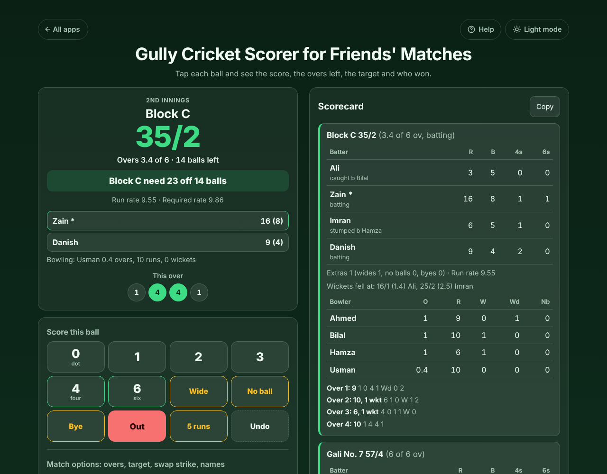
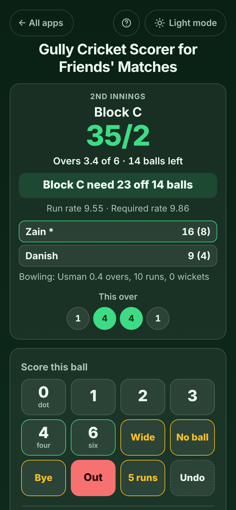

# Gully Cricket Scorer for Friends' Matches

A free **cricket scorer for tape-ball, street and gully matches** with friends. Set the overs and the players for each team, then tap one button for every ball: 0, 1, 2, 3, 4, 6, Wide, No ball, Bye or Out. The app keeps the score, the overs and the balls of this over, tells the chasing team exactly what they need ("Block C need 23 off 14 balls"), says who won and by how much, and gives you a scorecard to paste into the group chat. Your own house rules for wides and no balls, uneven teams, undo for any ball, a super over for a tie, and, if you want them, each batter's runs and each bowler's overs. Works offline in the park, no sign-up, no ads.

**Live demo:** [umar8092.github.io/apps/gully-cricket-scorer-for-friends-matches](https://umar8092.github.io/apps/gully-cricket-scorer-for-friends-matches/)

| Desktop | On a phone |
|---|---|
|  |  |

## The situation it solves

Twelve friends play a 6-over tape-ball match in the street on a Saturday evening: **Gali No. 7** against **Block C**, six players a side. Usually someone keeps the score in their head or in a notes app, and it always ends in an argument about how many overs are left or what the target was. With this app one person taps each ball.

- **Gali No. 7 bat first** and make **57/4 in 6 overs**. Their first over was `1 4 0 Wd 2 1 0`: the wide gives 1 run and is bowled again, so that over had 7 balls and made 9 runs.
- The innings ends by itself after 6 overs and the app says **"Block C need 58 to win"**.
- After 3.4 overs Block C are **35/2** and the top card says **"Block C need 23 off 14 balls"**, with **Run rate 9.55 · Required rate 9.86** (23 runs × 6 ÷ 14 balls).
- Block C finish on **53/4** and the result reads **"Gali No. 7 won by 4 runs"**. Had they got to 58 with 4 wickets down, it would read **"Block C won by 1 wicket (3 balls left)"**: six players means a team is all out at 5 wickets.
- If the scores are level it says **"Match tied: both teams scored 57"** and offers **Play a super over** (1 over, 2 wickets, the team that batted second bats first) or **Finish as a tie**.
- Tap **Copy scorecard** and paste it into WhatsApp: both totals, extras, and with **Each player too** every batter's runs and balls and every bowler's figures (`Bilal 1-10-1`).

## Features

- **Help button.** Tap **Help** at the top for a short how-to written for this app, and tap **All apps** to go back to the list. **Light/Dark mode** switch at the top.
- **One tap per ball**: big buttons for 0, 1, 2, 3, 4 and 6, **5 runs** for overthrows, **Wide**, **No ball** and **Bye** (then tap the runs they ran or hit) and **Out** (Bowled, Caught, Run out, Stumped, LBW, Hit wicket, Other; for a run out pick who and the runs completed).
- **Undo** takes back the last ball or choice; keep tapping to go further back, even into the first innings.
- **The score in plain words**: runs/wickets, "Overs 3.4 of 6 · 14 balls left", this over's balls as coloured dots, run rate, and in the chase "need 23 off 14 balls" with the required rate.
- **House rules**: a wide or a no ball gives 1 run or none, and is bowled again or counts as a ball; when only one batter is left the team is all out, or the last batter bats alone.
- **Uneven teams**: each team has its own number of players (2 to 15) and is all out at its own number of wickets.
- **Team score only** (quickest) or **Each player too**: tap the openers and the bowler, ends change by themselves on 1 and 3 runs and after every over, each batter's runs, balls, fours and sixes, each bowler's overs, runs, wickets, wides and no balls. **Swap strike**, **Retire batter** (not out, can bat again later) and **Someone bats again** for uneven teams.
- **Rain or a change of plan**: change the overs for this innings, type a new target for the chase, fix team or player names, or **End this innings now**, all under **Match options**.
- **Scorecard** for every innings with over-by-over runs, extras and when the wickets fell. **Copy scorecard** and **Share** (on phones that support it).
- **Past matches** keeps your recent results. **Start a new match** keeps the teams and rules ready to change, with Undo.
- **Saved as you tap**: a locked phone or closed page loses nothing, and the screen stays on while you score (where the browser allows it). Your data is never sent anywhere. Works offline once opened, and can be installed to the home screen.

## Run it yourself

```
git clone https://github.com/umar8092/apps.git
```

Then open `gully-cricket-scorer-for-friends-matches/index.html` in your browser. No build step, no server needed (the offline mode needs it served over http, for example by GitHub Pages).

## How it works

Plain HTML, CSS and JavaScript. The match is stored as the list of things that happened in each innings (each ball, each new batter and bowler), and every number on screen (score, overs, rates, target, each player's figures, the result) is worked out again from that list by `core.js`, so Undo simply removes the last item and can never leave the totals out of step. Legal balls are counted as whole balls, so overs like 3.4 are exact. `tests.js` (run `node tests.js`, or open `test.html`) checks the engine against hand-worked matches: wides and no balls under each house rule, all out and last man stands, wins by runs and by wickets, ties and super overs, rain-shortened overs and targets, strike changes, run outs at either end, retired batters and corrupt saved data. `ui-test.js` drives the page itself in a headless browser. The page is saved for offline use by a network-first service worker (`sw.js`).

## License

MIT, see [LICENSE](LICENSE).
