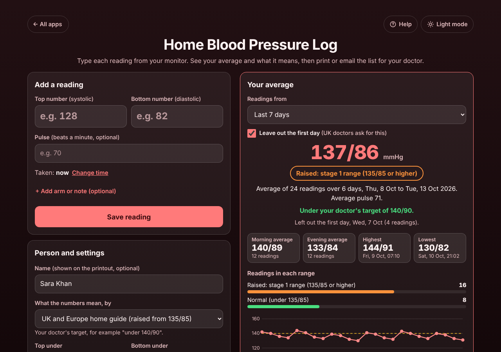

# Home Blood Pressure Log

A free **blood pressure log for people checking their blood pressure at home**, for example when a doctor says "measure it morning and evening for a week and bring me the average". Type the two numbers from your monitor (the pulse too, if you like) and the app shows **your average**, your morning and evening averages, the highest and lowest reading and **what the numbers mean in plain words**, by the UK and Europe home guide (NICE, ESH) or the US guide (American Heart Association). Tick **Leave out the first day** for a doctor's 7-day check, add your doctor's target, and **print, email or download** the list for your appointment. No sign-up, no ads, private on your device, works offline.

**Live demo:** [umar8092.github.io/apps/home-blood-pressure-log](https://umar8092.github.io/apps/home-blood-pressure-log/)

| Desktop | On a phone |
|---|---|
|  |  |

## The situation it solves

Sara's blood pressure was 148/94 at the surgery. The doctor gives her a home monitor and says: *"Two readings a minute apart, every morning and evening, for 7 days. Leave out the first day and bring me the average."* A paper diary and a calculator make that a chore and easy to get wrong.

With the app, after each reading Sara types **138** and **87** (or pastes `138/87/72`) and taps **Save reading**; the message says straight away *"Saved 138/87 at 07:12: Raised: stage 1 range (135/85 or higher)"*. After a week the top of the screen answers the doctor's question:

- **137/86 mmHg: Raised: stage 1 range (135/85 or higher)**
- Average of 24 readings over 6 days, Thu, 8 Oct to Tue, 13 Oct 2026. Average pulse 71.
- Left out the first day, Wed, 7 Oct (4 readings).
- Morning average **140/89**, evening average **133/84**, highest **144/91** (Fri, 9 Oct, 07:10), lowest **130/82**.

She taps **Print or save as PDF** for a one-page summary and table, or **Email** to send it to the surgery (the mail app opens with no address needed).

Worked examples from the tests (all checked by hand):

- The week above: the 24 top numbers add up to 3283, 3283 / 24 = 136.79, shown as **137**; the bottom numbers add up to 2073, 2073 / 24 = 86.38, shown as **86**. With the first day included it is **138/87** from 28 readings.
- Morning: 1684 / 12 = 140.33 and 1064 / 12 = 88.67, so **140/89**. Evening: 1599 / 12 = 133.25 and 1009 / 12 = 84.08, so **133/84**.
- 120/80 and 121/81 average to 120.5/80.5, which rounds up to **121/81**.
- A reading at 00:30 on Wednesday counts as **Tuesday evening**.
- 185/122 shows *"Very high (180/120 or higher)"* with what to do: call emergency services if there are symptoms such as chest pain, otherwise rest 5 minutes, measure again and contact the doctor today.
- Typing 1200 instead of 120 says *"1200 is too high for the top number. Did you mean 120?"*; typing the numbers the wrong way round offers **Swap the two numbers**.

## Features

- **Help button** at the top with a how-to for this app, **All apps** to go back to the list, and a **Light / Dark** switch.
- **Quick entry:** two big boxes, Enter saves, and `128/82` or `128/82/70` typed or pasted is split into the boxes for you. Pulse, arm and note are optional (**+ Add pulse (optional)** stays open once used). **Change time** logs a reading you forgot (future times are refused).
- **Your average** for the last 7, 14, 30 or 90 days, all readings, or dates you choose, with **Leave out the first day**, morning and evening averages, highest and lowest, how many readings fall in each range and a chart with the "raised" line or your target.
- **Two guides:** UK and Europe home guide (normal under 135/85, stage 1 from 135/85, stage 2 from 150/95, very high from 180/120) or US guide, AHA (normal under 120/80, elevated 120 to 129, stage 1 130 to 139 or 80 to 89, stage 2 from 140/90, severe over 180 or over 120). Under 90/60 is shown as low.
- **Your doctor's target** (for example under 140/90): says whether the average is under it.
- **Clear checks:** blank boxes, letters, decimals, impossible numbers (with a "did you mean" guess), top lower than bottom, double taps.
- **Readings list** by day, morning and evening, with the average of each sitting; **Edit** (Escape cancels) and **Delete** with **Undo**.
- **Share with your doctor:** Print or save as PDF (one page: summary and table), Email, Copy as text, Download spreadsheet (CSV for Excel, Numbers or Google Sheets).
- **More than one person** on one device, each with their own readings, guide and target.
- **Backup file** and **Restore** (checked, with Undo), **Delete all readings** with Undo.
- Private: no account and your data is never sent anywhere. Works offline once loaded, and can be installed on the home screen.

Not medical advice: follow your doctor's advice and targets.

## Run it yourself

```
git clone https://github.com/umar8092/apps.git
```

Then open `home-blood-pressure-log/index.html` in a browser. No build step and no dependencies.

Tests: `node home-blood-pressure-log/tests.js` checks the maths (or open `test.html`), and `node home-blood-pressure-log/ui-test.js` drives the page in headless Chromium (needs Playwright).

## How it works

Plain HTML, CSS and JavaScript. The maths lives in `core.js`: each reading is stored with the wall-clock time it was taken (`2026-10-13T07:10`), so time zones and summer time never move a reading to another day. Morning is 4:00 to 11:59, evening 12:00 to 3:59 the next night. Averages use whole-number maths and round half up. Readings are saved in this browser's `localStorage`; a network-first service worker keeps the app working offline.

## License

MIT, see [LICENSE](LICENSE).
