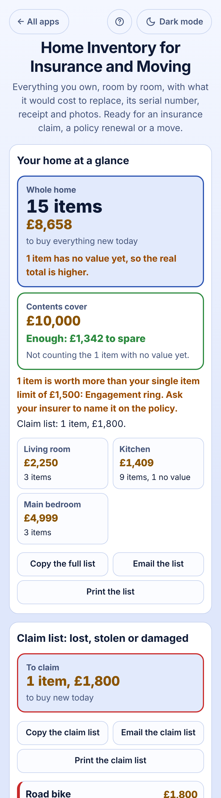

# Home Inventory for Insurance and Moving

A free list of **everything you own, room by room**, for anyone with home contents insurance, a rented flat or a move coming up. Add each thing with what it would cost to **buy new today**, and for the valuable ones the brand and model, serial number, date bought, price paid, where the receipt is, and a photo of it and of the receipt. The app answers in plain words: **"Whole home: 16 items, £10,458 to buy everything new today"**, **"Contents cover £10,000: £458 short"** and **"2 items are worth more than your single item limit of £1,500: Engagement ring, Road bike"**. After a burglary, fire or flood, mark things **Lost, stolen or damaged** and the **claim list** is ready to send to your insurer. No sign-up, no ads, private on your device (photos too), works offline.

**Live demo:** [umar8092.github.io/apps/home-inventory-for-insurance-and-moving](https://umar8092.github.io/apps/home-inventory-for-insurance-and-moving/)

| Desktop | On a phone |
|---|---|
| ![Home Inventory on a laptop: the Add an item form with room chips and the insurance cover of £10,000 with a single item limit of £1,500 on the left; on the right Your home at a glance says Whole home 15 items, £8,658 to buy everything new today, 1 item has no value yet, Contents cover £10,000, Enough: £1,342 to spare, 1 item is worth more than the single item limit: Engagement ring, Claim list: 1 item, £1,800, tiles for the Living room £2,250, Kitchen £1,409 and Main bedroom £4,999, and the Living room box with the 55-inch TV, its serial number, date bought and receipt](screenshots/desktop.png) |  |

## The situation it solves

Sara and Imran rent a two-bedroom flat. The insurance renewal asks "how much cover do you need for your contents?" and they guess £10,000. Nobody has a list: if the flat were burgled tonight they could not say what was taken, what it cost or where the receipts are, and their policy pays at most £1,500 for any one item unless it is named.

They walk round the flat once with the phone and add what is there:

| Room | Item | Value to buy new |
|---|---|---|
| Living room | 55-inch TV (Samsung QE55Q60, serial 0B7G3CPW401234, bought 12 Mar 2023, paid £799, receipt: email from Currys) | £650 |
| Living room | Sofa · Books | £1,200 · £400 |
| Kitchen | Fridge freezer · Dining chairs × 6 at £85 · Dining table · Microwave | £549 · **£510** · £350 · no value yet |
| Main bedroom | Engagement ring · Laptop (MacBook Air, serial C02XG0FDH7JY) · Clothes | £2,400 · £1,099 · £1,500 |
| Hall | Road bike (serial WTU123K4567) | £1,800 |

The app now says:

- **Whole home: 16 items, £10,458** to buy everything new today; **1 item has no value yet**, so the real total is higher.
- **Contents cover £10,000: £458 short.** Ask your insurer to raise it to at least £10,458.
- **2 items are worth more than your single item limit of £1,500: Engagement ring, Road bike.** Ask your insurer to name them. The ring's box adds "Add the serial number or receipt".
- **Living room £2,250 · Kitchen £1,409 (9 items, 1 no value) · Main bedroom £4,999 · Hall £1,800.**

A week later the bike is stolen from the hall. They tap **Gone**, pick **Lost, stolen or damaged**, the date and "police report 4471". The bike moves to the **Claim list: 1 item, £1,800**, and **Copy the claim list** gives:

```
Road bike, serial WTU123K4567, value £1,800, Hall, 20 Oct 2026: Taken from the hall, police report 4471
```

The home total drops to £8,658 and the cover now reads **Enough: £1,342 to spare**. When they move house, each room's **Copy the checklist** gives `[ ] Fridge freezer`, `[ ] Dining chairs × 6`… to tick off while packing and unpacking.

Worked examples from the tests (all checked by hand):

- 6 dining chairs at £85 each = **£510**; the kitchen is 549 + 510 + 350 = **£1,409** with the microwave not counted until it has a value.
- Rooms always add up to the whole home: 2,250 + 1,409 + 4,999 + 1,800 = **£10,458**; against £10,000 cover that is **£458 short**.
- Clothes at exactly £1,500 are **not** over a £1,500 limit; the ring at £2,400 is.
- A TV bought on 12 Mar 2023 is **3 years 7 months old** on 29 Oct 2026.

## Features

- **Help button** at the top with a how-to for this app, **All apps** to go back to the list, and a **Light / Dark** switch.
- **Add an item**: **Which room is it in?** (tap a room or type your own; each room gets its own box), **What is it?**, **How many?** (6 chairs is one item; the line under it shows "6 × £85 = £510 for all 6"), **Value, to buy it new** (leave it empty if unsure), and **+ Add brand, serial number, date bought, receipt or photos**: brand and model, serial number, date bought, price paid, where the receipt is, a note, a photo of the item and a photo of the receipt. The room stays filled in so a whole room is quick to add, and adding the same thing twice in a room is pointed out.
- **Your insurance cover (optional)**: the contents cover and the single item limit from your policy.
- **Your home at a glance**: how many items and what they would cost new, how many have no value yet, whether the cover is enough or how much short, items over the single item limit, the claim total and a tile per room. **Copy the full list**, **Email the list** (works with no recipient typed) and **Print the list**.
- **Room by room**: a bordered box per room with its total, **+ Add an item here**, **Copy the checklist** (for packing and unpacking), **Rename**, **Hide the items**, and each item in its own box with **Edit**, **Move** (to another room or a new one), **Gone** and **Delete**. **Find an item** searches names, brands, serial numbers and notes. Tap a photo to see it bigger.
- **Most valuable items**: the top ten and every item over the limit, with what proof is missing (serial number, receipt, photo).
- **Claim list: lost, stolen or damaged** with the total, **Copy**, **Email** and **Print the claim list**; **Sold, given or thrown away** keeps the history; **I still have it** brings an item back.
- **Undo** after every change, **Currency symbol** (none, £, $, €, Rs, ₹, AED and more, remembered), **How to write big numbers** (1,234,567 or 12,34,567), **Save the list as a spreadsheet (CSV)**, **Save a backup file** (with photos), **Restore a backup**, **Delete everything**.
- Installable, works offline, and your data is never sent anywhere.

## Run it yourself

```
git clone https://github.com/umar8092/apps.git
```

Then open `home-inventory-for-insurance-and-moving/index.html` in a browser. To test: `node home-inventory-for-insurance-and-moving/tests.js` (logic) and `node home-inventory-for-insurance-and-moving/ui-test.js` from the repo root (the page, in headless Chromium).

## How it works

Plain HTML, CSS and JavaScript with no libraries. `core.js` holds the sums: money is kept in whole cents, so every room total and the whole home's total are exact sums of whole numbers. Everything is saved in your browser's local storage under keys starting with `home-inventory-for-insurance-and-moving.`, checked when loaded and when restored; photos are shrunk and kept in the browser's IndexedDB on this device. A network-first service worker keeps a copy for offline use.

## License

MIT, see [LICENSE](LICENSE).
