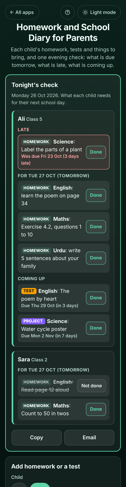

# Homework and School Diary for Parents

A free **homework diary for parents** with one, two or three children at school. Each child sits in their **own box** with their **class**, their **subjects**, their **own school days** (Mon to Fri, Mon to Sat, Sun to Thu or any days) and their **holidays**. Write down each child's **homework, tests, projects and reminders** (bring the PE kit, sign the trip form, pay the fee) in a few taps, or **paste the teacher's WhatsApp message** and every line becomes its own item. Every evening **Tonight's check** answers the question parents ask at 9 pm: **what does each child have due on their next school day, what is late, and which tests are coming up?** Copy, share or email it to the other parent. Works offline, no sign-up, no ads.

**Live demo:** [umar8092.github.io/apps/homework-and-school-diary-for-parents](https://umar8092.github.io/apps/homework-and-school-diary-for-parents/)

| Desktop | On a phone |
|---|---|
|  |  |

## The situation it solves

Ayesha has two children. **Ali** is in **Class 5** (school Monday to Friday) and **Sara** is in **Class 2** at a school that also opens on **Saturday**. Ali's class teacher posts the homework in the parents' WhatsApp group; Sara's comes in her paper diary. At 9 pm on **Monday 26 Oct 2026** Ayesha cannot remember who has what, and on Thursday morning Ali says "I have an English test today".

What she wrote down:

- She pasted the teacher's message for Ali, due **Tomorrow**:
  ```
  English: learn the poem on page 34
  Maths: Exercise 4.2, questions 1 to 10
  Urdu: write 5 sentences about your family
  ```
  The app offered **"Add each line as its own item (3 items)"**, with English, Maths and Urdu as the subjects.
- Ali: **Test**, English, "The poem by heart", Thu 29 Oct. **Project**, Science, "Water cycle poster", Mon 2 Nov. And a Science homework from last **Friday 23 Oct** that was never ticked.
- Sara: **Reminder**, PE, "Bring the PE kit", **every Wednesday**. Homework for tomorrow: English "Read page 12 aloud" and Maths "Count to 50 in twos", both ticked **Done**.

**Tonight's check** answers:

- **Ali, Class 5**
  - **Late:** Science: Label the parts of a plant. **Was due Fri 23 Oct (3 days late)**, with **Done** and, in his box, **Move to Tue 27 Oct**.
  - **For Tue 27 Oct (tomorrow):** English: learn the poem on page 34; Maths: Exercise 4.2, questions 1 to 10; Urdu: write 5 sentences about your family.
  - **Coming up:** English test: The poem by heart, **Thu 29 Oct (in 3 days)**; Science project: Water cycle poster, **Mon 2 Nov (in 7 days)**.
- **Sara, Class 2**
  - **For Tue 27 Oct (tomorrow):** both items ticked. **All done for Tue 27 Oct.**
  - On **Tuesday** evening her check shows **PE reminder: Bring the PE kit** for Wednesday, every week, without it ever piling up as late.

On **Friday** evening Ali's check is for **Monday** and Sara's for **Saturday**, because each child has their own school days. Before the winter break (Mon 21 Dec to Fri 1 Jan) it says **"No school: Winter break until Fri 1 Jan. Back on Mon 4 Jan."**

**Copy** (or **Share**, or **Email** with no address needed) gives:

```
Homework and tests, Monday 26 Oct 2026

Ali (Class 5)
- LATE, was due Fri 23 Oct: Science homework: Label the parts of a plant
For Tue 27 Oct (tomorrow):
- English homework: learn the poem on page 34
- Maths homework: Exercise 4.2, questions 1 to 10
- Urdu homework: write 5 sentences about your family
Coming up:
- English test: The poem by heart, Thu 29 Oct (in 3 days)
- Science project: Water cycle poster, Mon 2 Nov (in 7 days)

Sara (Class 2)
For Tue 27 Oct (tomorrow):
- [done] English homework: Read page 12 aloud
- [done] Maths homework: Count to 50 in twos
```

## Features

- **One box per child**, each with their own **school days** (presets Mon to Fri, Mon to Sat, Sun to Thu, or tick any days), **holidays and breaks**, **class or school** and **subjects** (tap common ones or add your own). Edit or delete a child (with Undo).
- **Tonight's check** per child: **Late** (in red, with how many days), **Due today, not ticked**, **everything for their next school day** (Monday on a Friday, skipping holidays), and **tests and projects** in the week after it. **"All done for Tue 27 Oct"** when nothing is left.
- **Add homework or a test**: pick the child and the kind (**Homework, Test, Project, Reminder**), tap a subject, write what to do, and pick **Today, Tomorrow, Next school day, In 1 week** or any date. The line under the date says which day it is, and warns when it is not a school day or has already passed.
- **Paste the teacher's message**: several lines become several items, and the word before a colon becomes the subject.
- **+ Repeat every week (optional)** for weekly spelling tests, PE kit or Quran class. Weekly items never pile up as late.
- In each child's box: **Done**, **Edit**, **Delete**, **Move to** the next school day for late work, **Every week** list, and **Done recently** with **Not done**.
- **Week at a glance**: every child's items day by day, **Previous / Next** week, **Copy this week**.
- **Copy, Share and Email** the evening check for the other parent or a grandparent (email works with no address typed).
- **Undo** after every change, **backup file** and **restore**, **Delete everything** (with Undo).
- A **Help** button in the top bar explains every button, the **← All apps** button goes back to the app list, and a **Light / Dark mode** switch (it follows your device until you choose).
- Laptop layout with the evening check and children on the left and the add form and week on the right; one comfortable column on phones.
- **Private:** everything stays in your browser on this device; your data is never sent anywhere. Installable and **works offline**.

## Run it yourself

```
git clone https://github.com/umar8092/apps.git
```

Then open `homework-and-school-diary-for-parents/index.html` in a browser. No build step and no dependencies. To run the checks: `node homework-and-school-diary-for-parents/tests.js` (logic) and `node homework-and-school-diary-for-parents/ui-test.js` (the page in headless Chromium, needs Playwright).

## How it works

- Plain HTML, CSS and JavaScript. `core.js` holds the logic (dates, next school day, the evening check, weekly repeats, pasting, the copy text and checking saved data) and `script.js` draws the page.
- Dates are stored as `YYYY-MM-DD` in your own calendar and counted in whole days, so a clock change or time zone never moves a due date.
- The next school day is the first day after today that is one of that child's ticked school days and not inside one of their holidays.
- Homework that is not ticked stays open and shows as late until you tick it or move it. A weekly item is one entry with a list of the dates it was ticked, so it never piles up.
- The diary is saved in `localStorage` under keys starting with `homework-and-school-diary-for-parents.`; anything broken or edited by hand is checked and dropped on load. A network-first service worker keeps the app working offline and always serves the newest version when online.

## License

MIT, see [LICENSE](LICENSE).
