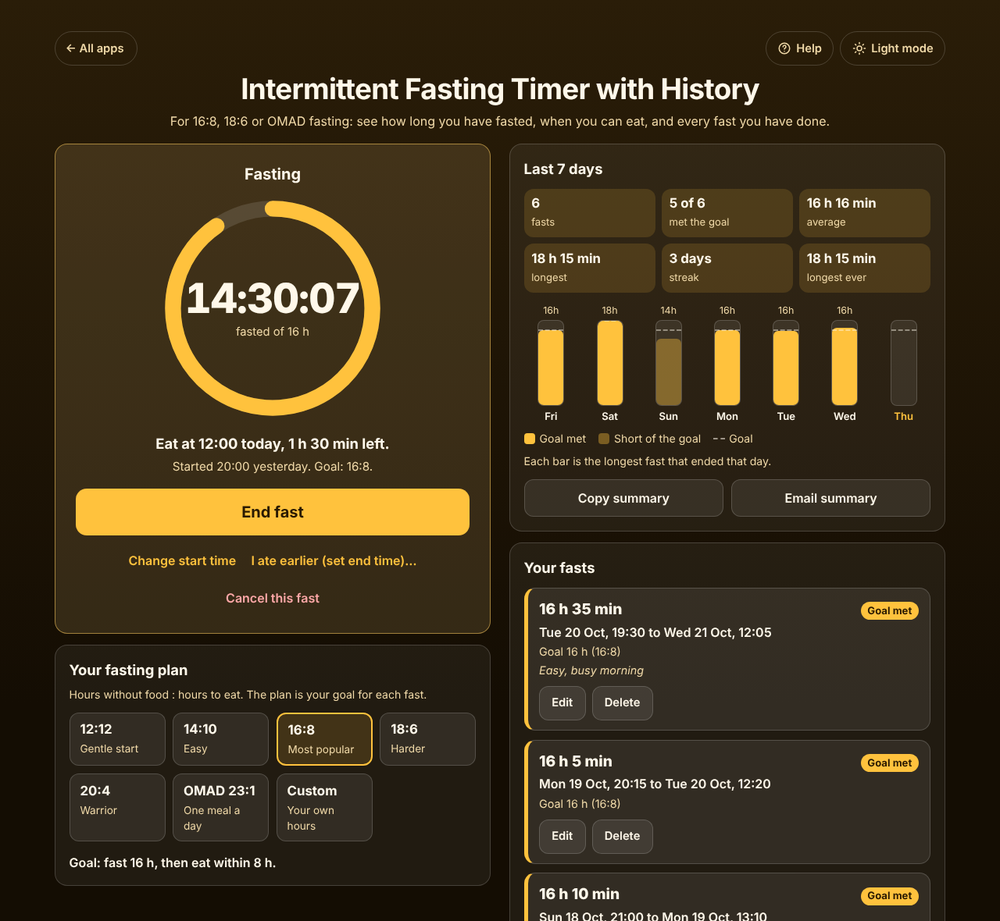

# Intermittent Fasting Timer with History

A free **intermittent fasting timer that answers "how long have I fasted, and when can I eat?"** Pick a plan (16:8, 14:10, 18:6, 20:4, OMAD or your own goal), tap **Start fast now** after your last meal, and a ring fills up while the big clock counts your fast. When you eat, **End fast** saves it with its length and whether you met your goal, and the app shows your eating window. The last 7 days show how many fasts you did, goals met, your average and longest fast, and your streak. No sign-up, no ads, no paywall on history. Your data stays on your device and the app works offline.

**Live demo:** [umar8092.github.io/apps/intermittent-fasting-timer-with-history](https://umar8092.github.io/apps/intermittent-fasting-timer-with-history/)

| Desktop | On a phone |
|---|---|
|  |  |

## The situation it solves

Sara does 16:8 fasting. She finished dinner at **20:00** last night and opens the app at **10:30** the next morning. It says, in plain words:

- **Fasting, 14:30:07 fasted of 16 h.** The ring is 90% full.
- **Eat at 12:00 today, 1 h 30 min left.** *Started 20:00 yesterday. Goal: 16:8.*

At 12:10 she taps **End fast**:

- **Saved: 16 h 10 min, goal met.** (Undo is there if she tapped by mistake.)
- The timer switches to **Eating window open: Start your next fast by 20:10 today, 8 h left to eat** (16:8 leaves 8 hours to eat).

On a busy day she stops at 08:00 after 12 hours. The fast is still saved, as **12 h, 4 h short** of the 16 h goal, and it does not count towards her streak.

Her week in **Last 7 days**: *6 fasts, 5 of 6 met the goal, average 16 h 16 min, longest 18 h 15 min, streak 3 days*, with a bar for each day and a dashed line for the goal.

Forgot to tap Start? **I finished eating earlier** takes the real time of the last meal. Forgot to end it? **I ate earlier (set end time)** sets when the fast really ended.

## Features

- **Help button.** Tap **Help** at the top for a short how-to written for this app, and tap **All apps** to go back to the list.
- **One-tap timer** with a progress ring, time fasted, the time you can eat and the time left. When the goal is reached it says **Goal reached! You can eat** and counts the extra time.
- **Plans:** 12:12, 14:10, 16:8, 18:6, 20:4, OMAD 23:1, or **Custom** from 1 to 168 hours (for example a 36-hour fast). Changing the plan during a fast changes that fast's goal.
- **Eating window** after each fast: when to start the next fast and how long is left to eat. Fasts of 24 hours or more have none.
- **Forgot to start or end?** Set the time you finished eating, change the start time, set the end time, or cancel a fast. Every change has **Undo**.
- **Your fasts:** each fast in its own box with its start, end, length, goal and an optional note. **Edit** (times, goal, note) and **Delete** with Undo, and **+ Add a fast I did not time**. The app stops overlapping fasts and impossible times.
- **Last 7 days:** fasts, goals met, average, longest, streak, longest ever, and a bar chart.
- **Copy summary** and **Email summary** (opens your mail app with the report; you choose who to send it to).
- **Beep and vibrate**, and an optional notification, when you can eat (while the page is open).
- **24-hour or 12-hour clock.**
- **Backup and restore** (a JSON file), **CSV download** for a spreadsheet, and **Delete all fasts** with Undo.
- **Keeps the right time** when the phone locks or the page closes, across midnight, clock changes and time zones, because it saves when the fast started, not a running counter.
- **Private.** Your data is never sent anywhere. No account.
- **Works offline and installable.** Phone, tablet and desktop layouts.
- **Back to all apps.** A "← All apps" button at the top of the page.
- **Light and dark mode switch.** It follows your device until you choose, and remembers your choice in every app.

Not medical advice: if you are pregnant, diabetic, take medicine or have had an eating disorder, ask your doctor before fasting.

## Run it yourself

No build step and no dependencies.

```bash
git clone https://github.com/umar8092/apps.git
```

Then open `intermittent-fasting-timer-with-history/index.html` in your browser.

Offline mode and install need the files served over `https` or `localhost` (for example `python3 -m http.server`).

## How it works

- `core.js` is the logic, with no page code. A fast is a start and an end time in milliseconds, so its length is real time passed, across midnight, clock changes and time zones. Lengths are counted in whole minutes, the same minutes the page shows, so "goal met" always matches what you see (15 h 59 min does not meet 16 h).
- `script.js` builds the page. Notes are added as plain text, never as HTML. Saved and restored data is checked before use, and bad entries are left out.
- `sw.js` saves the app on your device for offline use (network first, so updates show at once).
- Run the logic checks with `node tests.js`, or open `test.html` in a browser. `ui-test.js` drives the real page in headless Chromium, and `shots.js` makes the screenshots.

## License

[MIT](LICENSE). Free to use, copy, modify and share. Made by [Muhammad Umar](https://github.com/umar8092).
