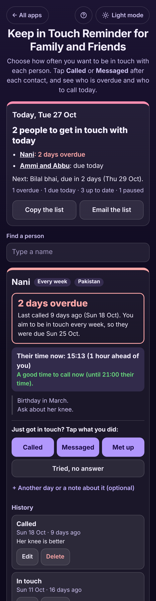

# Keep in Touch Reminder for Family and Friends

A free reminder for anyone who means to call their grandmother every week, their parents every few days and an old friend once a month, but lets the weeks slip by. Add each person once with **how often you want to be in touch**, then tap **Called**, **Messaged** or **Met up** after each contact. The app answers in plain words: **"Nani: 2 days overdue, last called 9 days ago"**, **"Ammi and Abbu: due today"**, **"Ahmed: due in 4 days"**, with the most overdue person at the top. For family abroad it shows **the time where they are now** and whether it is a good time to call: **"Not a good time to call. Good from 09:00 their time, 17:00 your time (in 2 h 47 min)"**. It never reads your contacts or makes calls. No sign-up, no ads, private on your device, works offline.

**Live demo:** [umar8092.github.io/apps/keep-in-touch-reminder-for-family-and-friends](https://umar8092.github.io/apps/keep-in-touch-reminder-for-family-and-friends/)

| Desktop | On a phone |
|---|---|
|  |  |

## The situation it solves

Sara lives in Dubai. Her grandmother (Nani) and her parents are in Pakistan, her brother Bilal is in Toronto and her university friend Ahmed is in London. She wants to call Nani every week, message her parents every 3 days and catch up with Ahmed every month, but between work and the children she loses track and then feels guilty. It is Tuesday 27 October, 14:13 in Dubai.

She added each person once and logged her last calls: Nani **called Sun 18 Oct**, her parents **messaged Sat 24 Oct**, Bilal **called Thu 22 Oct** (and **tried, no answer** on Mon 26 Oct), Ahmed **in touch 1 Oct**, her friend Zara with no contact yet, and her aunt (Khala) **paused** while she is staying with them. The app now says:

- **Today, Tue 27 Oct: 3 people to get in touch with today.** Nani: 2 days overdue. Ammi and Abbu: due today. Zara: no contact logged yet. Next: Bilal bhai, due in 2 days (Thu 29 Oct).
- **Nani: 2 days overdue.** Last called 9 days ago (Sun 18 Oct). You aim to be in touch every week, so they were due Sun 25 Oct. **Their time now: 15:13 (1 hour ahead of you). A good time to call now (until 21:00 their time).**
- **Bilal bhai: due in 2 days.** You tried yesterday, no answer. **Their time now: 06:13 (8 hours behind you). Not a good time to call. Good from 09:00 their time, 17:00 your time (in 2 h 47 min).**
- **Ahmed: due in 4 days (Sat 31 Oct).** Their time now: 10:13 (4 hours behind you); good from 18:00 their time, 22:00 your time.

So she calls Nani now, sends her parents a message, and calls her brother after 17:00. She taps **Called** in Nani's box and it says **"Called Nani today. Next due Tue 3 Nov."**

Worked examples from the tests (all checked by hand):

- Every week, last called 18 Oct: 18 Oct + 7 days = **due 25 Oct**; on 27 Oct that is **2 days overdue**, and the next day **3 days overdue**.
- Every 3 days, last messaged 24 Oct: **due 27 Oct, due today**. Every month (30 days) from 1 Oct: **due 31 Oct, due in 4 days**. Every 365 days from 27 Oct 2025: **due today**.
- **Tried, no answer** does not reset the clock: Bilal stays due on 29 Oct. A message on the same day as a try clears the try line.
- Two contacts on one day count once; an older contact added later does not move the last contact.
- **Paused** people go to the end and are not counted. **Resume** on a day they would have been overdue makes them **due that day**, not weeks late.
- Time zones: Dubai 14:13 is **15:13 in Pakistan (1 hour ahead)**, **10:13 in London** (UK clocks went back on 25 Oct, so 4 hours behind) and **06:13 in Toronto** (Canada changes on 1 Nov, so still 8 hours behind). India is 1 hour 30 min ahead.
- Good times **09:00 to 21:00** at 06:13 their time: starts in **2 h 47 min**. A night-shift window **22:00 to 06:00** crosses midnight: 23:00 and 05:59 are good, 06:00 is not.
- Every how many days: `10` or `10 days` are fine; blank, `0`, `-3`, `2.5`, `366` or words each get a clear message. A future day, the same From and To time, or a second person with the same name are refused with a message.

## Features

- **Help button** at the top with a how-to for this app, **All apps** to go back to the list, and a **Light / Dark** switch.
- **Each person in their own box**: quick picks for **Parents**, **Grandparents**, **Brother or sister**, **Close friend** and **Old friend**, any name (a couple or family can share one box), **How often do you want to be in touch?** (every day to every 6 months, or any number of days from 1 to 365) and **When were you last in touch?** (Today, Yesterday, a day you pick, or Not sure).
- **+ Their time zone and good times to call (optional)**: each person's own time zone and their own good hours (daytime, 10:00 to 20:00, evenings, or any times, including night shifts across midnight). The box shows their time now, how far ahead or behind you they are, and when the next good time starts in your time. The clock updates by itself.
- **+ Add a note (optional)**: a birthday month, what to ask about; line breaks kept.
- **Called**, **Messaged**, **Met up** and **Tried, no answer** in every box, with **+ Another day or a note about it (optional)** for a contact on an earlier day and what you talked about.
- **Today** card: who to get in touch with today, the most overdue first, who is next, and counts of overdue, due today, up to date and paused. **Copy the list** and **Email the list** (no address needed).
- **History** per person with **Edit** and **Delete** (with **Undo**), **Show all**, and **Last 30 days** counts of calls, messages and meet-ups.
- **Add next due day to calendar** (a calendar file with a 09:00 reminder), **Pause reminders** / **Resume**, **Edit person**, **Delete person** with Undo, **Find a person** when the list grows.
- **Save a backup file** and **Restore a backup** (checked, with Undo), **Delete everything** with Undo.
- Private: no account, it never reads your contacts, and your data is never sent anywhere. Works offline once loaded, and can be installed on the home screen.

## Run it yourself

```
git clone https://github.com/umar8092/apps.git
```

Then open `keep-in-touch-reminder-for-family-and-friends/index.html` in a browser. No build step and no dependencies.

Tests: `TZ=Asia/Dubai node keep-in-touch-reminder-for-family-and-friends/tests.js` checks the maths and the wording (or open `test.html`), and `node keep-in-touch-reminder-for-family-and-friends/ui-test.js` drives the page in headless Chromium at 11 screen widths in dark and light (needs Playwright and a local server in the repo root, for example `python3 -m http.server 8765`).

## How it works

Plain HTML, CSS and JavaScript. The logic lives in `core.js`. Days are whole calendar days on your device. A person is due on the day of their last real contact (a call, message, meet-up or the day you typed when adding them) plus how often you chose; "Tried, no answer" is kept in the history but does not count. A person with no contact yet is due today. The boxes are sorted by due day, so the most overdue come first and paused people last. Their time is read from your browser's own time zone data (`Intl.DateTimeFormat`), so daylight saving changes are handled; a good-times window may cross midnight. Everything is saved in this browser's `localStorage` and checked when loaded or restored; a network-first service worker keeps the app working offline.

## License

MIT, see [LICENSE](LICENSE).
