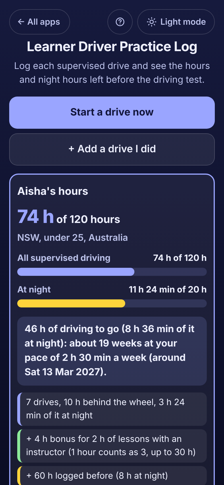

# Learner Driver Practice Log

A free **learner driver logbook** for learners and the **parents or supervisors** who sit beside them. Log each practice drive in seconds (date, start and finish time, supervisor, roads and conditions, skills practised) and see **how many supervised hours and night hours are done and how many are left** for your rule: **120 hours with 20 at night** in New South Wales and Victoria, **100 with 10** in Queensland and the ACT, **75 with 15** in South Australia, **80 with 15** in Tasmania, **50 with 5** in Western Australia, **50 with 10** in California, Florida and most US states, **50 with 15** in New York, **65 with 10 at night and 5 in bad weather** in Pennsylvania, **30 with 10** in Texas, or **your own goal** where there is no minimum (UK, Ireland, New Zealand, Pakistan, India and more). **Night time is worked out from sunset and sunrise** for your town on the date of each drive, **instructor lessons count 3 for 1** where the rule allows, and a **skills checklist** shows what still needs practice. A pace estimate says when the hours will be done. Works offline, no sign-up, no ads.

**Live demo:** [umar8092.github.io/apps/learner-driver-practice-log](https://umar8092.github.io/apps/learner-driver-practice-log/)

| Desktop | On a phone |
|---|---|
|  |  |

## The situation it solves

Aisha is **17 and on her L plates in Sydney**. To sit the driving test in New South Wales she must log **120 hours of supervised driving, 20 of them at night** (sunset to sunrise). Her mum and dad take turns supervising, she has a few lessons with a driving instructor (in NSW **each lesson hour counts as 3**, up to 30 logbook hours, but not towards the night hours) and she already has **60 hours (8 at night)** in her paper logbook. The family keeps asking: how many hours are left, how many at night, and when will she be done?

They set up once: **Learner's name** Aisha, **Where are they learning?** NSW, under 25, **Town** Sydney, **Hours already logged before** 60 with 8 at night. Then in October 2026 they log seven drives:

| Date | Time | Who | Night (worked out) |
|---|---|---|---|
| Sat 4 Oct | 10:00 to 11:30 | Dad | 0 (daylight) |
| Wed 8 Oct | 19:30 to 21:00 | Mum | 1 h 30 min (sunset 19:02) |
| Sat 11 Oct | 09:00 to 10:00 | Instructor, lesson | 0 |
| Sun 19 Oct | 14:00 to 16:30 | Dad, highway in the rain | 0 |
| Thu 23 Oct | 20:00 to 21:15 | Mum | 1 h 15 min (sunset 19:14) |
| Sat 25 Oct | 10:00 to 11:00 | Instructor, lesson | 0 |
| Sat 31 Oct | 18:45 to 20:00 | Mum | **39 min** (sunset 19:21) |

On **Sat 31 Oct** the app answers:

- **74 h of 120 hours**, **11 h 24 min of 20 h at night**
- **46 h of driving to go (8 h 36 min of it at night): about 19 weeks at your pace of 2 h 30 min a week (around Sat 13 Mar 2027).**
- 7 drives, 10 h behind the wheel, 3 h 24 min of it at night
- **+ 4 h bonus for 2 h of lessons with an instructor** (1 hour counts as 3, up to 30 h)
- + 60 h logged before (8 h at night)

How it adds up: 60 h before + 10 h driven + 4 h lesson bonus = **74 h**; 8 h before + 1 h 30 + 1 h 15 + 39 min = **11 h 24 min at night**. Pace: 10 h in the last 4 weeks = 2 h 30 a week; 46 h ÷ 2.5 = 18.4, so **19 weeks**.

**A drive that crosses sunset** (18:45 to 20:00 on 31 Oct, sunset 19:21) counts **39 minutes at night**, not all or nothing. **A drive past midnight** (23:15 to 00:40) is 1 h 25 min ending the next morning. **Night done before the total?** In a custom goal of 2 hours with 1 at night, after a 3-hour daytime drive the app still says **1 h of driving to go (1 h of it at night)**, because night hours are part of the total.

**In Pennsylvania** Jake needs 65 hours with 10 at night and **5 in bad weather**: drives tagged **Rain** or **Fog, snow or ice** fill a third bar. **In California** Maya needs 50 hours with 10 at night. **In the UK** there is no legal minimum: choose **My own goal or rule** and type, for example, 40 hours with 5 at night.

The **Skills checklist** counts the drives where each skill was practised ("Parallel parking: practised on 2 drives, last Fri 23 Oct") and flags "Not practised yet". Tick **Confident** when the learner can do it well; when the hours are done and every skill is ticked, it says **"Aisha looks ready to book the driving test."**

## Features

- **Help button.** Tap **Help** at the top for a short how-to written for this app, and tap **All apps** to go back to the list. A **Light mode / Dark mode** switch sits beside them.
- **Built-in rules** for every Australian state and territory, California, Texas, Florida, New York, Pennsylvania and most other US states, plus **My own goal or rule** with total hours, night hours, an optional bad-weather target and instructor lessons that count the same, double or triple up to a limit.
- **Night time from sunset and sunrise** for 50+ towns or your phone's location (used only on the device), worked out for the date of each drive and split by the minute; or **fixed hours** such as 9 pm to 5 am. You can type the night minutes of any drive yourself.
- **Start a drive now / Finish drive** timer that survives closing the page, or **+ Add a drive I did** with Today and Yesterday in one tap. The preview shows "1 h 15 min drive, 39 min of it at night (sunset 19:21, sunrise 05:56)" before saving.
- **Supervisor and car suggestions** from past drives, **Lesson with a driving instructor**, **roads and conditions** (local streets, main roads, highway, country, city traffic, gravel, rain, fog or snow) and **skills practised** as one-tap chips. Car, typed night time and notes are optional.
- **Hours so far** with bars for all driving, night and bad weather, the instructor bonus, hours from a paper logbook, the driving still to go and **a finish date at your pace**.
- **Each drive in its own bordered box**, grouped by month with month totals, with Edit and Delete.
- **Two or more learners**, each with their own rule, town and drives (brothers and sisters, or a driving instructor's pupils).
- **Copy summary, Email summary** (no address needed), **Save logbook (CSV)** for Excel or Google Sheets, and **Print logbook**.
- Checks that catch mistakes: a future drive, a finish time equal to the start, a drive over 12 hours, a drive that overlaps another, a typed night time longer than the drive, night hours more than the total.
- **Undo** after adding, editing or deleting a drive, ticking a skill, deleting a learner or deleting everything.
- **Save a backup file**, **Restore a backup**, **Delete everything**. Damaged or blocked saved data is handled with a clear message.
- **Private.** Everything stays in this browser on this device; your data is never sent anywhere.
- **Works offline and installable.**
- **Back to all apps.** A "← All apps" button at the top of the page.

Rules change and some places want their own logbook or app with signatures: check with your licensing office and copy drives across where needed. Never log hours that were not driven.

## Run it yourself

```
git clone https://github.com/umar8092/apps.git
```

Then open `learner-driver-practice-log/index.html` in a browser. No build step, no dependencies.

## How it works

- `core.js` holds the rules, the town list, the sunrise and sunset sums (the standard sunrise equation, about 1 to 2 minutes accurate), the minute-by-minute night split, the totals with lesson bonus and caps, the pace estimate, the skills summary, the summary text and the CSV, and can be tested on its own: `node tests.js` (or open `test.html`).
- `script.js` draws the page from that logic. User-typed text is shown with `textContent`.
- `ui-test.js` drives the real page with Playwright on a fixed clock (Sat 31 Oct 2026, 21:00 in Sydney): the main situation, every edge case, 11 screen widths in dark and light, the Help window, and the screenshots (`node ui-test.js --shots`).
- All times are whole minutes, so totals are exact. A drive's night minutes are saved when it is logged, so changing the town later does not rewrite past drives.
- Saved data lives in `localStorage` under keys starting with `learner-driver-practice-log.`.
- `sw.js` is a network-first service worker: online you always get the newest version, offline the saved copy.
- Rule sources: Transport for NSW (Using your Learner Driver Log Book), Queensland Government learner logbook, Australian Office of Road Safety "Rules for L drivers" (May 2025), California DMV.

## License

[MIT](LICENSE)
