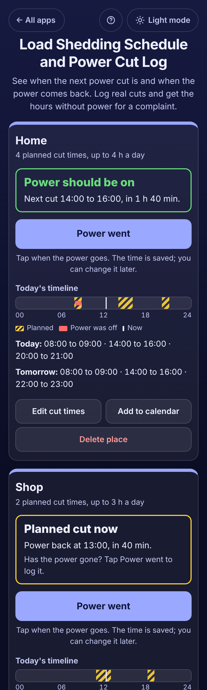

# Load Shedding Schedule and Power Cut Log

A free app for homes and small shops with **planned power cuts (load shedding)** in Pakistan, India, Nigeria, South Africa and anywhere else the power goes on a schedule. Type your area's cut times once, from your electricity company's schedule for your feeder, and the app answers in plain words: **"Power should be on. Next cut 14:00 to 16:00, in 1 h 40 min"** or **"Planned cut now. Power back at 16:00, in 35 min"**. When the power really goes, tap **Power went**, and **Power is back** when it returns. The app adds up the real cuts and compares them with the plan: **"9 h without power in 4 cuts"**, **"6 h 25 min outside the planned times, including 2 unplanned cuts"**, with a list ready to copy, email or print for a complaint. No sign-up, no ads, private on your device, works offline (even when the internet goes with the power).

**Live demo:** [umar8092.github.io/apps/load-shedding-schedule-and-power-cut-log](https://umar8092.github.io/apps/load-shedding-schedule-and-power-cut-log/)

| Desktop | On a phone |
|---|---|
| ![Load Shedding Schedule and Power Cut Log on a laptop: on the left the Home box says Power should be on, next cut 14:00 to 16:00 in 1 h 40 min, with a Power went button, today's timeline with the planned cuts striped and today's and tomorrow's cut times, and a Shop box with a planned cut now, power back at 13:00 in 40 min; on the right the Power cut log for this month shows 112 h 44 min without power in 71 cuts, 113 h planned, 27 h 9 min outside the planned times including 3 unplanned cuts, and the longest cut of 3 h 8 min](screenshots/desktop.png) |  |

## The situation it solves

Ayesha lives in Lahore. Her feeder's load shedding is **08:00 to 09:00, 14:00 to 16:00 and 20:00 to 21:00** every day, except Friday, when the evening cut is **22:00 to 23:00**. She keeps asking "when is the next cut?" to plan cooking, ironing and charging the UPS, and lately the power has been going at times that are not on the schedule. She wants a clear record to complain to the electricity company. It is Thursday 29 October, 12:20.

She typed **Home** and pasted the times from the company's message (`08:00-09:00, 14:00 to 16:00`, `8pm - 9pm`), unticked Friday on the evening cut and added a **22:00 to 23:00** cut on Friday only. The box now says:

- **Power should be on. Next cut 14:00 to 16:00, in 1 h 40 min.**
- **Today:** 08:00 to 09:00 · 14:00 to 16:00 · 20:00 to 21:00. **Tomorrow (Friday):** 08:00 to 09:00 · 14:00 to 16:00 · 22:00 to 23:00.

At 15:25 the box says **"Planned cut now. Power back at 16:00, in 35 min."** The power does go, so she taps **Power went**. It comes back at 16:35 and she taps **Power is back**: **"Power back at 16:35 after 1 h 10 min."** She also adds three cuts she forgot to log: **Sun 25 Oct 13:50 to 18:00**, **Tue 27 Oct 03:00 to 05:30** and **Tue 27 Oct 23:30 to Wed 28 Oct 00:40**. For the **last 7 days** the log says:

- **Without power: 9 h**, 4 cuts.
- **Planned load shedding: 19 h**, 10 h less than planned.
- **Outside the planned times: 6 h 25 min**, including 2 unplanned cuts.
- **Longest cut: 4 h 10 min**, Sun 25 Oct, 13:50 to 18:00.

**Copy for a complaint** gives her the totals and every cut, oldest first, such as `Tue 27 Oct  23:30 to Wed 28 Oct 00:40  1 h 10 min  (not planned)`.

Worked examples from the tests (all checked by hand):

- Cuts of 250 + 150 + 70 + 70 min = **540 min = 9 h**. Planned from 25 Oct (her earliest logged cut): 4 days × 4 h = 16 h, plus 08:00 to 09:00 and 14:00 to 16:00 on 29 Oct = **19 h**.
- Outside the plan: 13:50 to 18:00 against 14:00 to 16:00 is **2 h 10 min**; 03:00 to 05:30 is **2 h 30 min**; 23:30 to 00:40 is **1 h 10 min**; 15:25 to 16:35 against 14:00 to 16:00 is **35 min**. Total **6 h 25 min**; the 2 cuts with no planned cut at all are **unplanned**.
- A day only counts **the part of a cut inside it**: on 28 Oct the 23:30 to 00:40 cut counts **40 min**.
- **23:00 to 00:00** plus **00:00 to 01:30** is one cut: at 23:30 the box says power back **tomorrow at 01:30**.
- Pasted text: `2-4pm` is **14:00 to 16:00**, `11-1pm` is **11:00 to 13:00**, `10pm to 1am` is **22:00 to 01:00 (next day)**, `1400-1600` and `22:00-24:00` also work; lines like `Call 118` are reported as not read.
- A cut entered **in the future**, one that **ends before it starts**, one longer than **31 days**, or one that **overlaps** a logged cut each get a clear message.
- Planned time counts **from when you started** (or the day of the earliest cut you logged), so on your first evening the app never says you had "2 h less than planned".
- **Changing the cut times** applies from today: earlier days keep the old times in the totals.
- In London, on the day the clocks go back (25 Oct 2026), a **01:00 to 03:00** cut is **3 real hours**.

## Features

- **Help button** at the top with a how-to for this app, **All apps** to go back to the list, and a **Light / Dark** switch.
- **Each place in its own box** (Home, Shop, Office or any name), each with **its own cut times**: **Power goes** and **Power comes back** for each cut, the **days** it happens on (every day, or tap days off), cuts that end **the next day**, as many cut times as you need, and **+ Paste the times from a message (optional)**.
- **The answer at a glance**: Power should be on with the next cut and the countdown, Planned cut now with when the power comes back, or Power is off since a time you logged, plus **today's timeline** (planned cuts striped, real cuts in red, a line for now) and the cut times for **today and tomorrow**. It updates by itself.
- **Power went / Power is back** in one tap; **+ Add a cut you forgot to log** with dates and times (the back date moves to the next day by itself), **Still off**, and **+ Add a note (optional)**.
- **Power cut log** for **this month, the last 7 days, last month, this year or your own dates**: hours without power, number of cuts and the average a day, planned load shedding and the difference, time outside the planned times and unplanned cuts, the longest cut, and each cut marked **Planned**, **outside planned times** or **Not planned**. **Edit** and **Delete** with **Undo**.
- **Copy for a complaint**, **Email** (no address needed), **Print** and **Save CSV**.
- **Add to calendar**: a calendar file with each cut time as a repeating event and a reminder 5 minutes to 1 hour before.
- **Edit cut times** (from today on), **Delete place** with Undo, **Save a backup file** and **Restore a backup** (checked, with Undo), **Delete everything** with Undo.
- Private: no account and your data is never sent anywhere. Works offline once loaded, and can be installed on the home screen.

## Run it yourself

```
git clone https://github.com/umar8092/apps.git
```

Then open `load-shedding-schedule-and-power-cut-log/index.html` in a browser. No build step and no dependencies.

Tests: `TZ=Asia/Karachi node load-shedding-schedule-and-power-cut-log/tests.js` checks the maths and the wording (also try `TZ=Europe/London` for the clock change, or open `test.html`), and `node load-shedding-schedule-and-power-cut-log/ui-test.js` drives the page in headless Chromium with a fixed clock, then checks 11 screen widths in dark and light (needs Playwright).

## How it works

Plain HTML, CSS and JavaScript. The maths lives in `core.js`. Cut times are minutes after midnight; a cut whose end is earlier than its start ends the next day. For any stretch of time the app lists the planned cuts of each day (using the schedule that applied on that day), merges the ones that touch, and compares them with the logged cuts, which are kept as exact timestamps; durations are only rounded to whole minutes for display. Days are built with the device's own clock, so time zones and summer time are handled by the browser. Everything is saved in this browser's `localStorage` and checked when loaded or restored; a network-first service worker keeps the app working offline.

## License

MIT, see [LICENSE](LICENSE).
