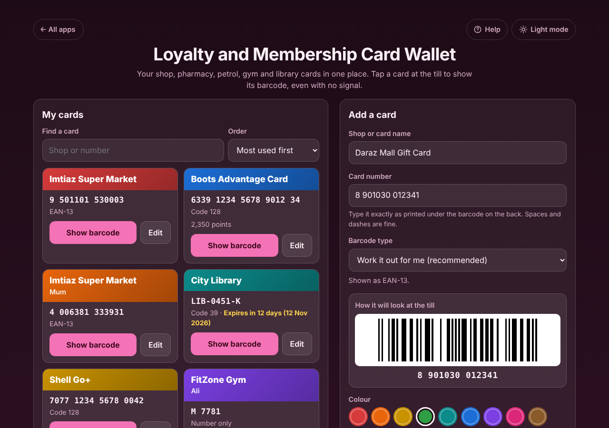
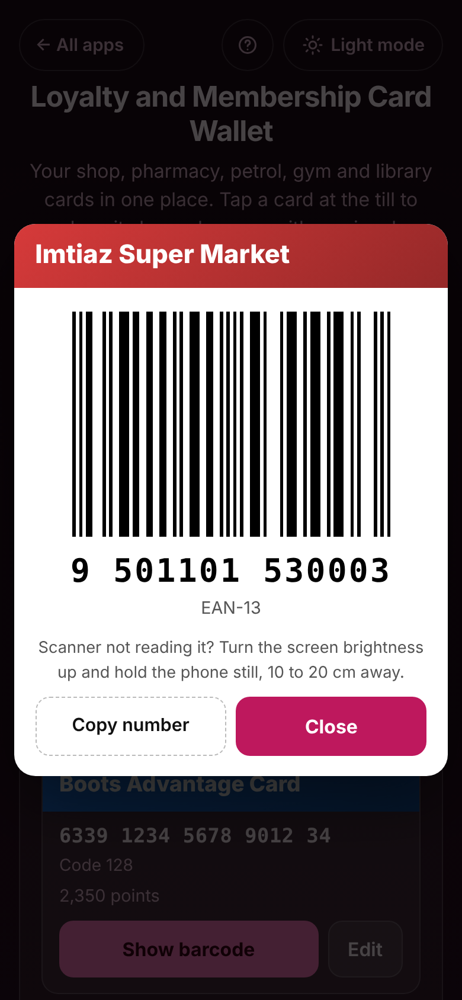

# Loyalty and Membership Card Wallet

A free **wallet for your loyalty and membership cards**: supermarket, pharmacy, petrol station, coffee shop, gym, library and club cards. Type the number on the back of each card once, and at the till tap **Show barcode** for a big, bright barcode on a white background with the number in large digits underneath, even in a shop basement with no signal. It draws EAN-13, EAN-8, UPC-A, Code 128, Code 39 and QR codes, catches typing mistakes with the check digit, and keeps the cards you use most at the top. No account, no adverts, works offline.

**Live demo:** [umar8092.github.io/apps/loyalty-and-membership-card-wallet](https://umar8092.github.io/apps/loyalty-and-membership-card-wallet/)

| Desktop | On a phone |
|---|---|
|  |  |

## The situation it solves

Sana does the weekly shop at Imtiaz, buys medicine at Boots, fills up at Shell and takes the children to the library. Each place gave her a plastic card, and at the till the cashier always asks "Do you have our card?". The cards are in a drawer at home, the shop apps each want an account and send adverts, and Stocard, which many people used, has closed and moved its users to a payments app that needs a sign-up.

With this app she types each card once:

| Card | Number typed | The app shows |
|---|---|---|
| Imtiaz Super Market | `9 501101 530003` | **EAN-13** barcode, number shown as 9 501101 530003 |
| Imtiaz Super Market, whose card: Mum | `4006381333931` | a second EAN-13 card, labelled **Mum** |
| Boots Advantage Card | `6339 1234 5678 9012 34` | **Code 128** barcode (18 digits), number in fours |
| City Library | `lib-0451-k`, type Code 39 | **Code 39** in capitals, LIB-0451-K, "Expires in 12 days" |
| FitZone Gym | `M 7781`, type No barcode | the number only, in large letters for the desk |

At the till she taps **Show barcode** and the phone shows the barcode full width on white, with the number in big digits for the cashier to type if the scanner will not read it. In the checks, every barcode drawn on the screen is photographed and read back with a barcode reader, and must give exactly the number typed.

If she mistypes the Imtiaz number as `9501101530004`, the app says **"The last digit does not match an EAN-13 shop barcode, so it will be shown as Code 128. Check the number on your card."** EAN and UPC numbers end with a check digit, so a typo shows up straight away. If she chooses EAN-13 herself it says **"The last digit should be 3 for EAN-13."**

## Features

- **Help button.** Tap **Help** at the top for a short how-to written for this app, and tap **All apps** to go back to the list.
- **Every card in its own coloured box** with the shop name, whose card it is, the number, the barcode type, notes and the expiry date, and big **Show barcode** and **Edit** buttons.
- **Barcode screen for the till:** white background, the barcode across the whole width, the number in large digits, notes such as a gift card balance, **Copy number** and **Close** (or Escape). The screen stays on while it is showing, where the browser allows it.
- **Work it out for me:** 13 digits with a correct check digit become EAN-13, 12 digits UPC-A, 8 digits EAN-8, anything else Code 128, and non-English letters a QR code. You can also pick EAN-13, EAN-8, UPC-A, Code 128, Code 39, QR code or **No barcode, number only**.
- **Live preview** ("How it will look at the till") while you type, so you can compare it with the plastic card.
- **Read the barcode from a photo** on browsers that can read barcodes (Chrome on Android, for example). Elsewhere you type the number.
- **Spaces, dashes and pasted text are fine:** "9 501101 530003" and "1234-5678" are cleaned up; Code 39 is shown in capitals.
- **Optional details** behind **+ Add whose card, notes or expiry date (optional)**: Whose card (two people's cards for the same shop), Notes (points, PIN, gift card balance) and Expires on, with "Expires in 12 days" and red **Expired** labels.
- **Most used first**, or A to Z or Newest first, and **Find a card** by shop, person, notes or number once you have four or more cards.
- **A warning for a card you already saved**, edit any card, **Delete card** and **Delete all cards** with **Undo**.
- **Backup and a new phone:** **Save a backup file**, **Restore from a backup file** (cards already in the app are not added twice) and **Copy all card numbers**.
- **Saved as you type.** A half-typed card is still there after the page is closed. Damaged saved data is set aside and the app starts fresh; a browser that blocks saving shows a warning.
- **Private.** Cards stay on this device and your data is never sent anywhere. No account. **Works offline and installable.**
- **Back to all apps.** A "← All apps" button at the top of the page.
- **Light and dark mode switch.** It follows your device until you choose, and remembers your choice in every app. The barcode screen is always white so scanners can read it.

## Run it yourself

No build step and no dependencies.

```bash
git clone https://github.com/umar8092/apps.git
```

Then open `loyalty-and-membership-card-wallet/index.html` in your browser.

Offline mode and install need the files served over `https` or `localhost` (for example `python3 -m http.server`).

## How it works

- `core.js` has no page code. It cleans the typed number, checks EAN/UPC check digits (weights 3 and 1 from the right), works out the barcode type and draws each barcode as a row of black and white modules: EAN-13 and UPC-A with the left/right digit sets and the first-digit parity, EAN-8, Code 128 (set C for runs of digits, so long numbers stay short and easy to scan, set B for text, with the modulo 103 check symbol) and Code 39 (wide bars three times the narrow ones). It also sorts, searches, checks expiry dates and checks every card read from storage or a backup file.
- QR codes are drawn by the [QR Code generator library by Project Nayuki](https://www.nayuki.io/page/qr-code-generator-library) (MIT, `qrcodegen.js`, licence in `qrcodegen-LICENSE.txt`).
- `script.js` draws the barcodes as SVG with crisp edges, so they stay sharp at any size, and saves cards in `localStorage` under keys starting with `loyalty-and-membership-card-wallet.`.
- `sw.js` is a network-first service worker: online you always get the newest version, offline the saved copy.
- Tests: `node loyalty-and-membership-card-wallet/tests.js` (or open `test.html`) checks the logic against hand-worked check digits and Code 128 checksums; `ui-test.js` drives the page in headless Chromium, reads every barcode on the screen back with a barcode reader, and checks the layout at 11 screen widths in light and dark.

## License

MIT, see [LICENSE](LICENSE). `qrcodegen.js` is MIT licensed by Project Nayuki.
