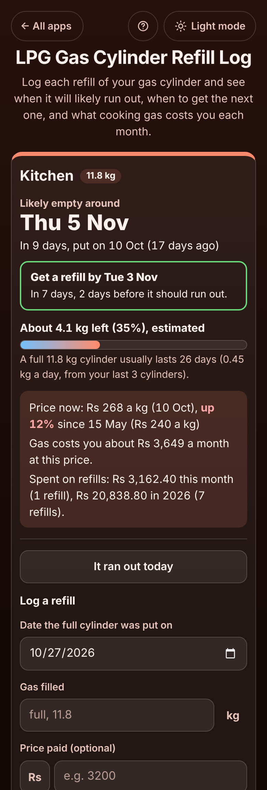

# LPG Gas Cylinder Refill Log

A free log for households and small eateries that cook on **LPG gas cylinders** and never know when the gas will run out. Add each cylinder once (its size, such as 11.8 kg or 14.2 kg), then log each refill with the date it was put on and, if you like, the price. The app learns how long a cylinder lasts you and answers in plain words: **"Likely empty around Thu 5 Nov, in 9 days"**, **"Get a refill by Tue 3 Nov"**, **"About 4.1 kg left (35%)"**, **"A full 11.8 kg cylinder usually lasts 26 days"**, **"Price now: 268 a kg, up 12% since 15 May"** and **"Gas costs you about 3,649 a month"**. It flags a cylinder that ran out much sooner than usual, which can mean the shop under-filled it or there is a leak. No sign-up, no ads, private on your device, works offline.

**Live demo:** [umar8092.github.io/apps/lpg-gas-cylinder-refill-log](https://umar8092.github.io/apps/lpg-gas-cylinder-refill-log/)

| Desktop | On a phone |
|---|---|
|  |  |

## The situation it solves

Ayesha lives in Karachi and cooks on an **11.8 kg LPG cylinder**. It runs out every few weeks with no warning, usually in the middle of cooking, and the refill shop needs a day to deliver. Once a cylinder seemed to finish far too quickly and she wondered whether the shop had under-filled it. It is Tuesday 27 October.

She added the cylinder once (11.8 kg, get the refill 2 days before it runs out) and logged the days she put on a full cylinder with the price paid: **15 May 2,832**, **10 Jun 2,832**, **6 Jul 2,832**, **24 Jul 2,950**, **19 Aug 3,068**, **14 Sep 3,162.40** and **10 Oct 3,162.40**. The box now says:

- **Likely empty around Thu 5 Nov.** In 9 days, put on 10 Oct (17 days ago).
- **Get a refill by Tue 3 Nov.** In 7 days, 2 days before it should run out.
- **About 4.1 kg left (35%), estimated.** A full 11.8 kg cylinder usually lasts 26 days (0.45 kg a day, from your last 3 cylinders).
- **Price now: 268 a kg, up 12% since 15 May (240 a kg).** Gas costs you about **3,649 a month** at this price. Spent on refills: 3,162.40 this month, 20,838.80 in 2026 (7 refills).
- The 6 Jul refill: **"Ran out 8 days sooner than usual (usual 26 days): under-filled, a leak, or more cooking?"**

So she books the refill for 3 November and is not caught without gas.

Worked examples from the tests (all checked by hand):

- Last 3 cylinders: 24 Jul to 19 Aug, 19 Aug to 14 Sep, 14 Sep to 10 Oct = 26 + 26 + 26 = **78 days for 35.4 kg = 0.4538 kg a day**; 11.8 kg ÷ 0.4538 = **26 days**; 10 Oct + 26 days = **5 Nov**; minus 2 days = **3 Nov**.
- Gas left on 27 Oct: 11.8 − 17 × 0.4538 = **4.085 kg, shown as about 4.1 kg (35%)**.
- Price per kg: 3,162.40 ÷ 11.8 = **268**; 2,832 ÷ 11.8 = **240**; (268 − 240) ÷ 240 = 11.7%, shown as **up 12%**. A month: 268 × 0.4538 × 30 = **3,648.92, shown as about 3,649**.
- The 6 Jul cylinder lasted 18 days where the 2 before lasted 26 each: it used gas 44% faster, more than the 30% that gets flagged, so it says **8 days sooner than usual**.
- A partial refill of **6 kg** in an 11.8 kg cylinder that usually lasts 14 days is expected to last 6 × 14 ÷ 11.8 = **7 days**.
- A cylinder that **ran out on 4 Nov** and was replaced on 7 Nov counts as lasting **25 days**, with **3 days without gas**, which are not counted as use.
- Winter with a heater: cylinders that suddenly last 18 days instead of 26 are flagged once, and within 3 cylinders the usual becomes **18 days**. A cylinder that lasted **68 days** (a refill that was not logged, or time away) is flagged and left out of the average.
- A US **20 lb** BBQ tank: refills of 24.99 to 26.99 that lasted 44, 45 and 33 days: **122 days for 60 lb, so 41 days a tank**, 1.35 a lb.
- Amounts can be typed as `11.8`, `11,8`, `14.2 kg` or `20 lb`; prices as `3162.40`, `3,162.40`, `1,00,000` or `Rs 3162`. A minus sign, words, a future date, two refills on one day, more gas than the cylinder holds, or a ran-out day after the next refill each get a clear message.

## Features

- **Help button** at the top with a how-to for this app, **All apps** to go back to the list, and a **Light / Dark** switch.
- **Each cylinder in its own box**: quick picks for **Kitchen**, **Heater** and **Restaurant**, any name, the **Cylinder size** (11.8 kg and 45.4 kg as sold in Pakistan, 14.2 kg and 19 kg in India, 5 to 15 kg, 20 to 100 lb, or any other size in kg or lb), **When to get the refill** (on the day, or 1 to 7 days before) and **I keep a full spare cylinder** (then it says when to swap and refill the empty one).
- **+ How long does a full cylinder last? (optional)**: a rough number of days, used until your first cylinder runs out.
- **Log a refill** with the date it was put on, **Gas filled** (empty means full; type less for a partial refill) and **Price paid (optional)**. **It ran out today** marks the cylinder as empty so the days without gas are not counted.
- **The answers**: likely empty around, get a refill by, the gas left with a bar, how long a full cylinder usually lasts and the gas used per day, the price per kg now and the change over the last year, what gas costs a month at today's price, and what you spent this month and this year.
- **Warnings** on a cylinder that ran out at least 30% sooner than the ones before it (under-filled or a leak) and on one that lasted twice as long (a missed refill), which is then left out of the average.
- **Refills list** with the kg, price, price per kg and how long each lasted, **Edit** (including the day it ran out) and **Delete** with **Undo**.
- **Copy summary**, **Email** (no address needed) and **Add reminder to calendar** (a calendar file for the refill day).
- **Edit cylinder**, **Delete cylinder** with Undo, **Currency symbol** (none, Rs, ₹, $, €, £ and more, remembered), **Save a backup file** and **Restore a backup** (checked, with Undo), **Delete everything** with Undo.
- Private: no account and your data is never sent anywhere. Works offline once loaded, and can be installed on the home screen.

## Run it yourself

```
git clone https://github.com/umar8092/apps.git
```

Then open `lpg-gas-cylinder-refill-log/index.html` in a browser. No build step and no dependencies.

Tests: `node lpg-gas-cylinder-refill-log/tests.js` checks the maths and the wording (or open `test.html`), and `node lpg-gas-cylinder-refill-log/ui-test.js` drives the page in headless Chromium at 11 screen widths in dark and light (needs Playwright and a local server in the repo root, for example `python3 -m http.server 8765`).

## How it works

Plain HTML, CSS and JavaScript. The maths lives in `core.js`. Gas is kept in thousandths of a kg or lb (11.8 kg = 11800) and money in whole cents, so sums are exact. A refill lasts from the day it was put on until the day it ran out, or else until the next refill. The usual use is the gas of the last 3 finished cylinders divided by the days they lasted (leaving out any that lasted more than twice as long as usual); the current cylinder is expected to run out after its gas divided by that use, counted from the day it was put on. A finished cylinder is compared with the up to 3 before it: 30% faster is flagged as running out sooner than usual. The price per kg is the price divided by the gas filled, and the monthly cost is today's price per kg times the usual use for 30 days. Everything is saved in this browser's `localStorage` and checked when loaded or restored; a network-first service worker keeps the app working offline.

## License

MIT, see [LICENSE](LICENSE).
