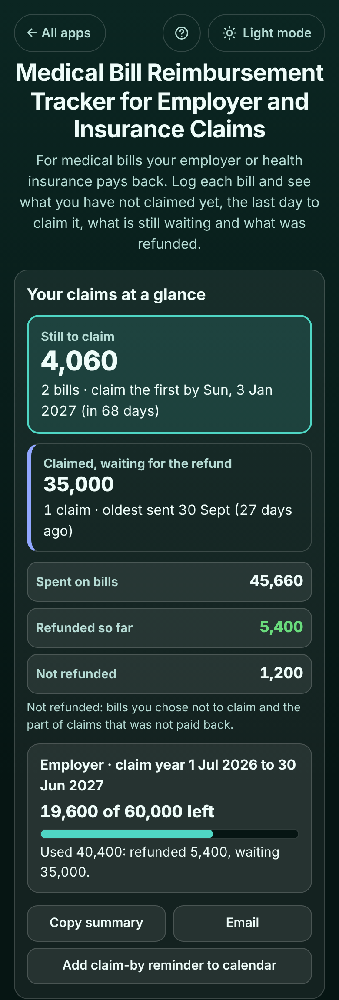

# Medical Bill Reimbursement Tracker for Employer and Insurance Claims

A free tracker for anyone whose **employer or health insurance pays back medical bills**: office workers with a medical allowance or OPD reimbursement (common in Pakistan and India), families with health insurance, and people with a US FSA or HSA. Log each bill when you pay it (the doctor's fee, a lab test, medicine, a hospital bill) for anyone in the family, and the app answers in plain words: **"Still to claim: 4,060, 2 bills, claim the first by Sun, 3 Jan 2027 (in 68 days)"**, **"Claimed, waiting for the refund: 35,000, oldest sent 30 Sept (27 days ago)"**, **"Refunded 5,400 of 6,600; 1,200 not refunded"** and **"Employer, claim year 1 Jul 2026 to 30 Jun 2027: 19,600 of 60,000 left"**. Rejected claims put their bills back on the list with the reason, so nothing is forgotten. No sign-up, no ads, private on your device, works offline.

**Live demo:** [umar8092.github.io/apps/medical-bill-reimbursement-tracker-for-employer-and-insurance-claims](https://umar8092.github.io/apps/medical-bill-reimbursement-tracker-for-employer-and-insurance-claims/)

| Desktop | On a phone |
|---|---|
|  |  |

## The situation it solves

Usman works at an office in Lahore. His company pays back medical bills for him and his family up to **60,000 a year (July to June)**, but only for bills sent to HR **within 90 days**. His mother needs regular lab tests, his son Ali sees the doctor, and his daughter Sara needs medicine. Receipts pile up in a drawer; some are claimed late and refused, a part refund goes unnoticed, and he never knows how much of the 60,000 is left. It is Tuesday 27 October.

He set **Where you claim** once (Employer, claim within 90 days, limit 60,000 for the whole family, claim year starts in July) and added the bills: **Mother, lab test 4,800 on 2 Aug**, **Ali, doctor 1,800 on 20 Aug**, **Mother, hospital 35,000 on 12 Sep**, **Sara, medicine 860 on 5 Oct** and **Mother, lab test 3,200 on 20 Oct**. He sent the first two in one claim on 25 Aug and got **5,400** back on 15 Sep; he sent the hospital bill on 30 Sep (claim HR-2231). The app now says:

- **Still to claim: 4,060.** 2 bills · claim the first by Sun, 3 Jan 2027 (in 68 days). Sara's medicine (5 Oct + 90 days = 3 Jan) comes first, then Mother's lab test (claim by 18 Jan).
- **Claimed, waiting for the refund: 35,000.** 1 claim · oldest sent 30 Sept (27 days ago).
- **Spent on bills 45,660 · Refunded so far 5,400 · Not refunded 1,200.**
- **Employer · claim year 1 Jul 2026 to 30 Jun 2027: 19,600 of 60,000 left.** Used 40,400: refunded 5,400, waiting 35,000.
- The August claim: **Refunded 5,400 of 6,600 on 15 Sept, 1,200 not refunded**, shared as **4,800, refunded 3,927.27** and **1,800, refunded 1,472.73**.

So he ticks both remaining bills, taps **Copy list for the claim form**, pastes it into the HR email, and taps **Mark as claimed**.

Worked examples from the tests (all checked by hand):

- Claim-by dates: 5 Oct + 90 days = **3 Jan 2027**, 68 days after 27 Oct (4 + 30 + 31 + 3); 20 Oct + 90 = **18 Jan 2027**. A bill from 1 Jul is **past the time limit** (29 Sep, 28 days ago) and is shown in red; one due within 14 days is marked **Claim soon**.
- A part refund of 5,400 for bills of 4,800 and 1,800 is shared in proportion, to the cent: 5,400 × 4,800 ÷ 6,600 = 3,927.2727…, 5,400 × 1,800 ÷ 6,600 = 1,472.7272…; the one leftover cent goes to the larger remainder, so **3,927.27 + 1,472.73 = 5,400.00** exactly.
- The four totals always add up: spent 45,660 = refunded 5,400 + waiting 35,000 + still to claim 4,060 + not refunded 1,200.
- The yearly limit counts by the **bill's date**: refunded 5,400 + waiting 35,000 = 40,400 used, **19,600 left**. A June bill is in last year's limit. With **25,000 for each person** instead, each person gets their own line and bar; Mother at 38,927.27 shows **over the limit**.
- **Claim the rest somewhere else** after that part refund puts 872.73 and 327.27 back in **Not claimed yet** (1,200 in all).
- A claim for 2,000 of a 3,200 bill leaves **1,200 still to claim of 3,200 (2,000 waiting)**. Claiming more than is left on a bill, a refund larger than the claim, a claim dated before its bill, or a rejected claim brought back after its bills were claimed again are all refused with a clear message.
- Amounts can be typed as `2500`, `1,350.50`, `Rs 1350.5`, `35 000`, `1,00,000` or `2500/-`. Blank, 0, a minus sign, words, 3 decimals, a future date or a huge amount each get a clear message.

## Features

- **Help button** at the top with a how-to for this app, **All apps** to go back to the list, and a **Light / Dark** switch.
- **Add a medical bill**: date, amount, **Who was it for?** (type a name or tap one used before), **What was it for?** (Doctor, Lab test or scan, Medicine, Hospital or surgery, Dentist, Eyes, Other), **Claim it from** (when you claim from more than one place), and **+ Add the doctor, lab or shop and a note (optional)**. The date and person stay filled in, so several bills from one visit are quick.
- **Where you claim**: each employer, insurer or FSA/HSA in its own box with its own **Claim within** (no limit, 30 to 365 days, or any number), optional **yearly limit** for the whole family or for each person, and the month the **claim year** starts.
- **Your claims at a glance**: still to claim with the earliest claim-by date, bills past the limit or due soon, claims waiting and for how long, spent / refunded / not refunded, and the limit left for each place with a bar.
- **Bills**: **Not claimed yet** (closest to the last day first) and **All bills**, each in its own box with its status; **Edit**, **Not claiming** / **Claim after all**, **Delete**, all with Undo.
- **New claim**: tick the bills you send together, change the amount claimed for any of them, add the date and claim number, **Copy list for the claim form**, **Mark as claimed**.
- **Claimed, waiting for the refund**: **Refund received** (full or part), **Rejected** with the reason (the bills go back to the list), **Edit claim** (amounts, date, number, take a bill out), **Delete claim**.
- **Refunded and rejected claims**: what came back and what did not, **Claim the rest somewhere else**, **Mark as waiting again**.
- **Each person**: spent, refunded, waiting, still to claim and not refunded for each family member.
- **Copy summary**, **Email** (no address needed), **Add claim-by reminder to calendar** (a calendar file with a reminder 2 days before), and **Save the list as a spreadsheet (CSV)** for HR or an accountant.
- **Currency symbol** (none, Rs, ₹, $, €, £ and more, remembered), **Save a backup file**, **Restore a backup** (checked, with Undo), **Delete everything** with Undo.
- Private: no account and your data is never sent anywhere. Works offline once loaded, and can be installed on the home screen.

## Run it yourself

```
git clone https://github.com/umar8092/apps.git
```

Then open `medical-bill-reimbursement-tracker-for-employer-and-insurance-claims/index.html` in a browser. No build step and no dependencies.

Tests: `node medical-bill-reimbursement-tracker-for-employer-and-insurance-claims/tests.js` checks the maths and the wording (or open `test.html`), and `node medical-bill-reimbursement-tracker-for-employer-and-insurance-claims/ui-test.js` drives the page in headless Chromium at 11 screen widths in dark and light (needs Playwright and a local server in the repo root, for example `python3 -m http.server 8765`).

## How it works

Plain HTML, CSS and JavaScript. The maths lives in `core.js`. Money is kept in whole cents, so sums are exact. Bills and claims are kept apart: a claim lists the bills in it and the amount claimed for each. A bill's amount still to claim is its price minus what is in waiting or refunded claims (a rejected claim gives its amount back). A refund is shared between the bills of its claim in proportion to the amount claimed for each, with leftover cents going to the largest remainders, so the shares always add up to the refund. The claim-by date is the bill date plus the days set for that place; the yearly limit adds refunded and waiting amounts of bills dated inside the claim year. Everything is saved in this browser's `localStorage` and checked when loaded or restored; a network-first service worker keeps the app working offline.

## License

MIT, see [LICENSE](LICENSE).
