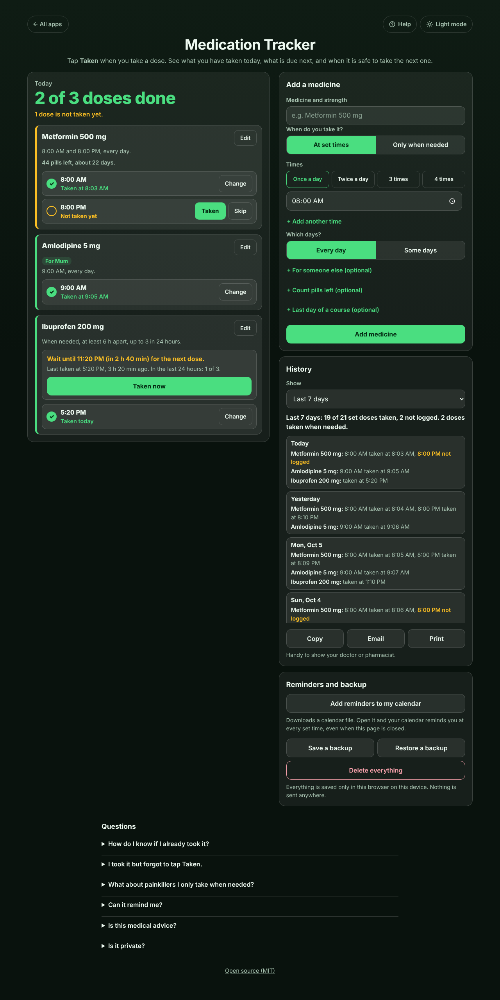

# Medication Tracker

A free **medication tracker and pill log** for anyone who takes tablets every day, or looks after someone who does, and keeps wondering **"did I take it?"**. Add each medicine with the times you take it, then tap **Taken** when you take a dose. The Today list shows every set time as **Taken at 8:03 AM** or **Not taken yet**, says what is due next, and stops you with a warning before a **double dose**. For painkillers taken only when needed it shows when you last took one and **from what time the next dose is allowed**. It also counts pills left, handles bedtime doses taken after midnight, weekly medicines and courses with a last day, keeps a history to show your doctor, and adds reminders to your calendar. Private on your device: no account, no ads. Works offline.

**Live demo:** [umar8092.github.io/apps/medication-tracker](https://umar8092.github.io/apps/medication-tracker/)

| Desktop | On a phone |
|---|---|
|  |  |

## The situation it solves

It is 9 pm. You take **Metformin 500 mg at 8:00 AM and 8:00 PM**, and you cannot remember whether you took the evening one. Taking it twice is bad, missing it is bad, and guessing is worse. With the tracker (it took 20 seconds to set up: name, tap **Twice a day**, **Add medicine**):

- In the morning you tapped **Taken** at 8:04. The app says **8:00 AM: Taken at 8:04 AM** and **Next: Metformin 500 mg at 8:00 PM (in 11 h 56 min)**.
- At 9 pm it says **1 of 2 doses done. 1 dose is not taken yet.** and **8:00 PM: Not taken yet, due 1 h ago**. You take it and tap **Taken**: **2 of 2 doses done. All done for today.**
- If at 8:30 AM you had tapped **Taken** on the evening dose by mistake, it would have stopped you: **"You already logged Metformin 500 mg at 8:04 AM, 26 min ago."** with **Cancel** and **Log it anyway**.

Twice a day means doses about 12 hours apart, so a second dose within 6 hours (half the gap) triggers the warning; once a day uses 12 hours.

**Ibuprofen 200 mg, only when needed, at least 6 hours apart, up to 3 in 24 hours.** You took one at 5:20 PM. At 8:40 PM the app says **Wait until 11:20 PM (in 2 h 40 min) for the next dose. Last taken at 5:20 PM, 3 h 20 min ago. In the last 24 hours: 1 of 3.** After three doses in 24 hours it tells you the time the oldest one drops out of the 24 hours (three doses at 4:00 AM, 10:15 AM and 4:30 PM: next from 4:00 AM tomorrow).

**Bedtime dose at 11:00 PM, taken at 12:30 AM.** After midnight, **Yesterday 11:00 PM** is still on the Today list (an unlogged time stays for up to 12 hours, until the next set time comes). Tapping **Taken** logs it for last night, and tonight's 11:00 PM dose is still **Due in 22 h 30 min**, so it is never mistaken for today's dose.

**Pills left:** 56 Metformin, 2 a day. After 12 doses: **44 pills left, about 22 days.** At 7 days or less it says **Time to get more.**

**History** for the last 7 days: **19 of 21 set doses taken, 2 not logged. 2 doses taken when needed.** Each day lists the time each dose was taken, skipped or not logged, ready to copy, email or print for a doctor's visit.

Other cases it handles: a medicine taken only on some days (Mondays only: "Nothing to take today." on other days), a course of antibiotics with a last day (after it: "Course finished on ..."), **Skip** for a dose you leave out on purpose, **Change** to set the real time of a dose you logged late, **Not taken** for a mistake, **Undo** after every change, changing the times (new times count from today, past days keep theirs, today's doses move to the nearest new time), a medicine added in the afternoon (its morning time can still be logged but is not counted as missed), half tablets (0.5 per dose), several people (**For Mum**), a name typed twice (refused), blank, 0, negative, word or huge numbers (refused with a plain message), very long names (cut at 60 characters and wrapped), and times that follow your phone's clock when you travel. Corrupt or edited saved data is cleaned up, and if the browser blocks storage the app still works and says it is not saving.

**Not medical advice.** The app records what you tell it and the limits you set. Always follow your doctor's or pharmacist's instructions and the leaflet.

## Features

- **Help button** at the top for a short how-to, **All apps** to go back to the list of apps, and a **Light mode / Dark mode** switch.
- **Each medicine in its own box**, each set time in its own row with **Taken** and **Skip**, then **Taken at** and the time with **Change**.
- **Today summary:** doses done, what is not taken yet, and the next dose with a countdown.
- **At set times** with quick picks (Once a day, Twice a day, 3 times, 4 times), any times you like (up to 8), every day or only some days.
- **Only when needed** with "Wait at least" (2 to 24 hours or any other) and "Most in 24 hours" (no limit, 1 to 8 or any other up to 24).
- **Double-dose warning** before a dose is logged too soon or over the 24-hour limit.
- **Optional extras** behind small buttons: **For someone else**, **Count pills left** (with pills per dose, halves allowed), **Last day of a course**.
- **History** for 7, 14 or 30 days with **Copy**, **Email** (opens your mail app, no address needed) and **Print**.
- **Add reminders to my calendar:** a calendar file with a repeating reminder at every set time, so your phone reminds you even when the page is closed.
- **Save a backup / Restore a backup** to move to a new phone, **Delete everything** with Undo.
- **Try an example** to see how it works first.
- **Private, works offline and installable.** Phone and desktop layouts. Works with a keyboard and a screen reader (every button says which medicine and dose it is for).

## Run it yourself

No build step and no dependencies.

```bash
git clone https://github.com/umar8092/apps.git
```

Then open `medication-tracker/index.html` in your browser. Offline mode and install need the files served over `https` or `localhost` (for example `python3 -m http.server`).

## How it works

- `core.js` is the logic, with no page code. Days are local dates, set times are `HH:MM`, and each logged dose is tied to its set time (`2026-10-07 20:00`), so a dose taken after midnight still counts for the evening before. Each medicine keeps a list of schedules with the day they started, so changing times never rewrites the past. Pill counts are whole hundredths.
- `script.js` builds the page. Everything you type is added as plain text, never as HTML. Data is saved in this browser's storage under `medication-tracker.state`.
- `sw.js` saves the app for offline use (network first, so updates always arrive).
- Checks: `node tests.js` for the logic (also `test.html` in a browser), `node ui-test.js` drives the real page in headless Chromium through every case above at 11 screen widths (add `--base https://umar8092.github.io/apps` to test the live site, `--shots` to redo the screenshots).

## License

[MIT](LICENSE). Free to use, copy, modify and share. Made by [Muhammad Umar](https://github.com/umar8092).
