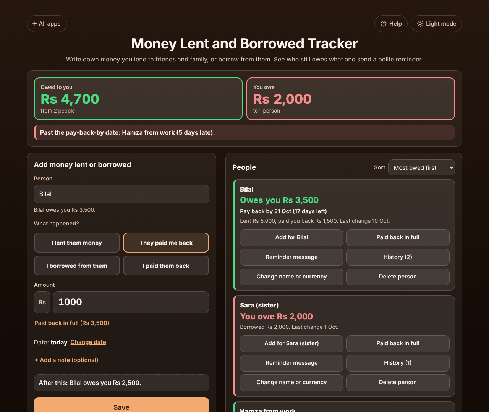

# Money Lent and Borrowed Tracker

A free **IOU tracker for money you lend to friends, family and colleagues, or borrow from them**. Each time money changes hands, type the person's name, what happened (*I lent them money*, *They paid me back*, *I borrowed from them*, *I paid them back*) and the amount. Each person gets their own box that says in plain words **"Owes you 3,500"** or **"You owe 2,000"**, with part repayments, an optional pay-back-by date (days left or days late) and a **polite reminder message** you can copy, share or email. The top of the page adds up everything owed to you and everything you owe. No sign-up, no ads, private on your device, works offline.

**Live demo:** [umar8092.github.io/apps/money-lent-and-borrowed-tracker](https://umar8092.github.io/apps/money-lent-and-borrowed-tracker/)

| Desktop | On a phone |
|---|---|
|  |  |

## The situation it solves

Ali lends his cousin **Bilal 5,000** for the rent on 3 October, and Bilal promises it back by the end of the month. A week later Bilal hands back **1,500**. Ali also borrowed **2,000** from his sister Sara for a car repair, and lent **Hamza from work** 400 for lunch and 800 for a taxi. A month later nobody remembers who owes what, and asking feels awkward.

With the app, Ali types each one as it happens. The page then answers:

- **Owed to you: Rs 4,700** from 2 people. **You owe: Rs 2,000** to 1 person.
- **Bilal: Owes you Rs 3,500**, pay back by 31 Oct (17 days left). Lent Rs 5,000, paid you back Rs 1,500.
- **Sara (sister): You owe Rs 2,000.**
- **Hamza from work: Owes you Rs 1,200**, pay back by 9 Oct (**5 days late**), also shown at the top.
- Uncle Tariq, who paid back all of a 10,000 loan, has moved to **Settled up**.

Ali taps **Reminder message** in Bilal's box and gets, ready to send on WhatsApp or by email:

> Hi Bilal, just a friendly reminder about the Rs 3,500 you still owe me (Rs 5,000 I lent you on 3 Oct (for the rent), Rs 1,500 you paid back on 10 Oct). Could you pay it back by 31 Oct? Thanks!

Worked examples from the tests (all checked by hand):

- Lent 5,000, paid back 1,500: 5,000 − 1,500 = **owes you 3,500**.
- Lent 5,000 and borrowed 1,000 from the same person: only the difference shows, **owes you 4,000**. Paying back that 1,000 makes it **owes you 5,000** again.
- Lent 1,000, they pay back 1,500: the box turns round to **You owe 500**, and the message says it was 500 more than they owed.
- Lent 100.00, three repayments of 33.33 leave exactly **0.01**; one more cent and they are **settled up**. Amounts are kept in whole cents so this is always exact.
- Amounts can be typed as `5000`, `5,000`, `5.000`, `5 000`, `1,00,000`, `12.50`, `12,50`, `$40` or `Rs 1500`. A minus sign, `0`, words, three decimals or anything over 9,999,999,999.99 gets a clear message.
- Different currencies (a person in dollars, the rest in rupees) are shown side by side, **Rs 8,500 + $50**, never added together.

## Features

- **Help button** at the top with a how-to for this app, **All apps** to go back to the list, and a **Light / Dark** switch.
- **Quick entry:** name (suggested from people you already have, with a line saying whether they are new), four big choices for what happened, the amount, and Enter saves. **After this:** shows the new balance before you save. **Change date** for an earlier day (future dates are refused); **+ Add a pay-back-by date (optional)** and **+ Add a note (optional)**.
- **Each person in their own box** with a coloured edge: green when they owe you, red when you owe them. Totals of what was lent and paid back, the last change, and the pay-back-by date with days left or days late.
- **Paid back in full** in one tap, or as a link in the form that fills in the whole amount.
- **Reminder message** written for you (polite, with the amounts and dates since you were last settled up); change it and **Copy**, **Share** (WhatsApp, SMS and more on phones) or **Email**.
- **History** with the balance after every entry; **Edit** (Escape cancels) and **Delete** with **Undo**; **Copy history**.
- **Change name or currency** per person (duplicate names are refused, so two Alis become "Ali" and "Ali (work)"); **Delete person** with Undo.
- **Settled up** people move to a folded group at the bottom. **Sort** by most owed, latest change or name; **Find a person** with many people.
- **Copy the list**, **Email the list** (no address needed), **Print or save as PDF** (everyone's balance and each person's history).
- **Currency symbol** (none, $, €, £, ₹, Rs and more), remembered. **Backup file** and **Restore** (checked, with Undo), **Delete everything** with Undo.
- Private: no account and your data is never sent anywhere. Works offline once loaded, and can be installed on the home screen.

## Run it yourself

```
git clone https://github.com/umar8092/apps.git
```

Then open `money-lent-and-borrowed-tracker/index.html` in a browser. No build step and no dependencies.

Tests: `node money-lent-and-borrowed-tracker/tests.js` checks the maths and the wording (or open `test.html`), and `node money-lent-and-borrowed-tracker/ui-test.js` drives the page in headless Chromium (needs Playwright).

## How it works

Plain HTML, CSS and JavaScript. The maths lives in `core.js`: every amount is a whole number of cents, and each person's balance is money lent plus money you paid back, minus money they paid back and money you borrowed. Dates are calendar days (`2026-10-14`), so time zones and summer time never move an entry. The pay-back-by date only counts while the money it belongs to is still owed: once a person is settled up, older dates are dropped. Everything is saved in this browser's `localStorage`; a network-first service worker keeps the app working offline.

## License

MIT, see [LICENSE](LICENSE).
