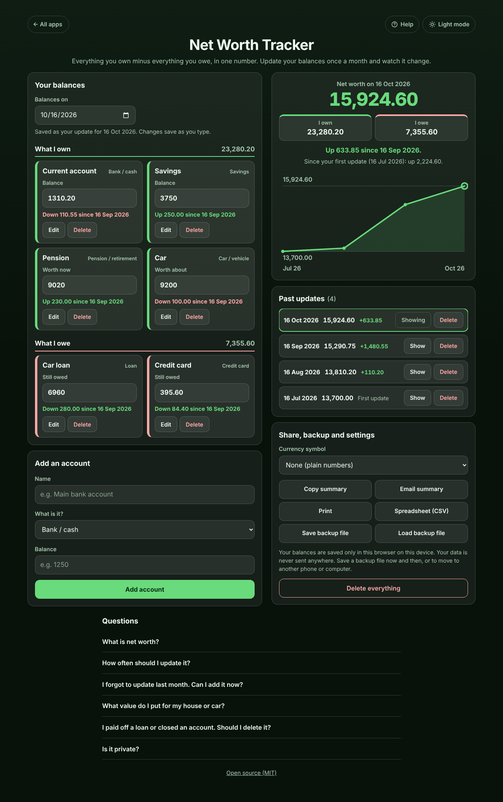

# Net Worth Tracker

A free **net worth tracker** for anyone paying off debt or building savings who wants one number that shows progress. List what you own (bank, savings, investments, pension, your home, your car) and what you owe (mortgage, loans, credit cards), each in its own box. Once a month change the balances that moved; the others carry over from last time, so an update takes a minute. The app shows your **net worth**, **how much it went up or down since your last update** and since your first, which accounts moved and a **line over time**. No bank login, no account, no ads. Private on your device, works offline.

**Live demo:** [umar8092.github.io/apps/net-worth-tracker](https://umar8092.github.io/apps/net-worth-tracker/)

| Desktop | On a phone |
|---|---|
|  |  |

## The situation it solves

Sara is paying off a car loan and a credit card while putting money into savings and a pension. Her bank app shows each account on its own, so she never knows whether she is actually getting ahead. On the 16th of each month (payday) she opens the app:

| Account | What it is | 16 Jul | 16 Aug | 16 Sep | 16 Oct |
|---|---|---:|---:|---:|---:|
| Current account | Bank / cash | 1,240.00 | 980.50 | 1,420.75 | 1,310.20 |
| Savings | Savings | 3,000.00 | 3,250.00 | 3,500.00 | 3,750.00 |
| Pension | Pension / retirement | 8,400.00 | 8,610.00 | 8,790.00 | 9,020.00 |
| Car | Car / vehicle | 9,500.00 | 9,400.00 | 9,300.00 | 9,200.00 |
| Car loan | Loan (owed) | 7,800.00 | 7,520.00 | 7,240.00 | 6,960.00 |
| Credit card | Credit card (owed) | 640.00 | 910.30 | 480.00 | 395.60 |

On 16 October the app says:

- **Net worth on 16 Oct 2026: 15,924.60.** I own **23,280.20** (1,310.20 + 3,750.00 + 9,020.00 + 9,200.00), I owe **7,355.60** (6,960.00 + 395.60).
- **Up 633.85 since 16 Sep 2026** (September was 23,010.75 - 7,720.00 = 15,290.75).
- **Since your first update (16 Jul 2026): up 2,224.60** (July was 13,700.00).
- Each box says what moved: Current account **Down 110.55** (red), Savings **Up 250.00**, Car loan **Down 280.00** (green, because owing less is good), Car **Down 100.00** (red).
- **Past updates**: 16 Oct 15,924.60 (+633.85), 16 Sep 15,290.75 (+1,480.55), 16 Aug 13,810.20 (+110.20), 16 Jul 13,700.00.

Then life happens:

- **Next month** she opens the app on 16 Nov. Every balance from 16 Oct is already there; she changes only the two that moved, and the update for 16 Nov is saved as she types. Opening the app without changing anything saves nothing.
- **She buys a flat** and adds it (300,000.00) with its mortgage (250,000.00). The app says **This includes +50,000.00 from Flat and Mortgage, added since 16 Oct 2026**, followed by the change without them, so a new account never looks like a sudden jump in savings.
- **She forgot September last year**: she picks that date in **Balances on**, types the balances, and the update slots in between the others.
- **A student who just graduated** owes 24,000.00 and has an overdrawn bank account (-45.50): **Net worth -24,045.50. You owe 24,045.50 more than you own.**
- **She paid off the card**: she sets it to 0 (deleting it would remove it from her history, and the app says so).
- **No update for two months** (she opens it on 20 Jan 2027): **Your last update was 16 Nov 2026, 65 days ago. Time to update your balances.**

Other cases it handles: amounts typed or pasted as `1,310.20`, `1.310,20 €` or `-45.50` (an overdrawn account); a minus on a debt (refused: "type what you owe without a minus"); words, `12-05`, numbers over 100,000,000,000 (each refused in that box, with the rest saved); a blank balance (counts as 0); a future date (refused); the same name twice (refused); names over 40 characters (cut); deleting an update or an account (with Undo; later updates keep the balances they showed); a new day while the page is open; corrupt saved data (starts fresh) and blocked storage (works, and says it is not saving).

## Features

- **Help button.** Tap **Help** at the top for a short how-to, and **All apps** to go back to the list of apps. **Light mode / Dark mode** switch.
- **What I own** and **What I owe**, each account in its own box with its type (Bank / cash, Savings, Investments, Pension / retirement, Home / property, Car / vehicle, Mortgage, Loan, Credit card and others) and a subtotal.
- **Balances on** a date: balances carry over from your last update, and every change is saved straight away as the update for that date. Pick an earlier date to fill in a month you missed.
- **Net worth** with **I own** and **I owe**, the change since the last update and since the first, and the part of the change that comes from newly added accounts.
- **Each account's change** since the update before, green when it helped your net worth (a debt going down is green).
- **Line over time** and **Past updates** with **Show** and **Delete** (with Undo).
- **Edit** an account's name or type (Escape cancels), **Delete** with Undo, **Delete everything** with Undo.
- **Currency symbol** (none, $, €, £, ₹, Rs, ¥, ₩, ₦, ₱, R, kr, CHF, AED, SAR, RM), remembered. Plain numbers by default.
- **Copy summary**, **Email summary** (opens your mail app with no address needed), **Print**, **Spreadsheet (CSV)** for Excel or Google Sheets.
- **Save backup file** and **Load backup file** to keep a copy or move to another phone or computer.
- **Try an example** to see how it works before typing anything.
- **Private, works offline and installable.** Phone and desktop layouts. Works with a keyboard and a screen reader.

## Run it yourself

No build step and no dependencies.

```bash
git clone https://github.com/umar8092/apps.git
```

Then open `net-worth-tracker/index.html` in your browser. Offline mode and install need the files served over `https` or `localhost` (for example `python3 -m http.server`).

## How it works

- `core.js` is the maths, with no page code. Money is whole cents and dates are calendar dates, so totals are exact and time zones never move an update. Each update stores the balance of every account on its date; an account missing from an update keeps its balance from the update before, and one with no earlier balance did not exist yet (that is how new accounts are spotted). Net worth is the sum of what you own minus the sum of what you owe.
- `script.js` builds the page. Everything you type is added as plain text, never as HTML. Your data is saved in this browser's storage under `net-worth-tracker.state`, and every saved or loaded value is checked before it is used.
- `sw.js` saves the app for offline use (network first, so updates always arrive).
- Checks: `node tests.js` for the maths (also `test.html` in a browser), `node ui-test.js` drives the real page in headless Chromium with the clock fixed at 16 October 2026 (add `--base https://umar8092.github.io/apps` to test the live site, `--shots` to redo the screenshots).

## License

[MIT](LICENSE). Free to use, copy, modify and share. Made by [Muhammad Umar](https://github.com/umar8092).
