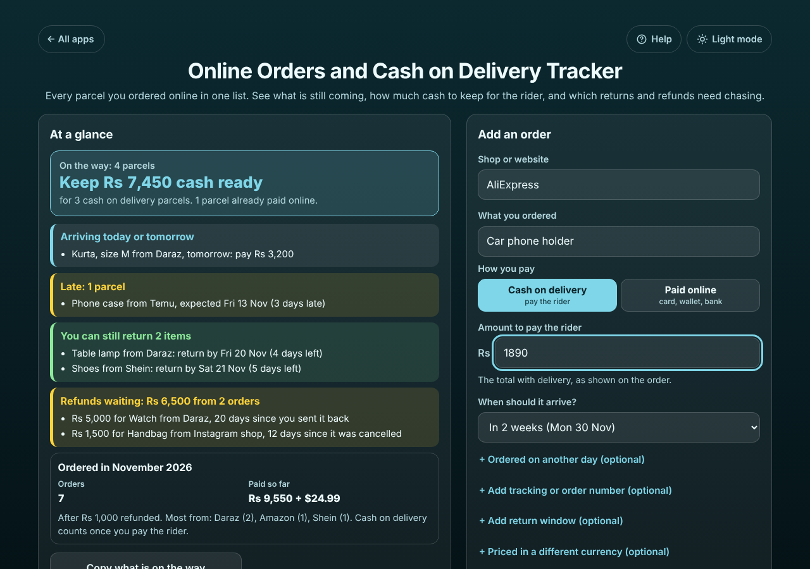
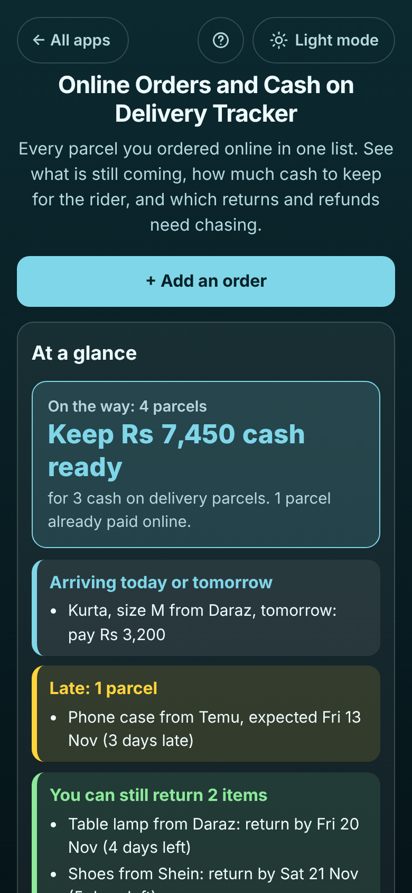

# Online Orders and Cash on Delivery Tracker

A free **list of everything you ordered online**, from Daraz, Amazon, Temu, Shein, AliExpress, Flipkart, Noon, an Instagram shop or anywhere else. Add each order with the shop, the amount and whether you pay online or cash on delivery. The app tells you which parcels are still coming and which are late, **how much cash to keep at home for the cash on delivery riders**, the last day to return each item that arrived, and which refunds the shops still owe you. Mark parcels as arrived, refused at the door, cancelled or sent back, record full or part refunds, keep tracking numbers to copy, and send the shop a ready-written "where is my parcel" or "where is my refund" message. No sign-up, no ads, private on your device, works offline.

**Live demo:** [umar8092.github.io/apps/online-orders-and-cash-on-delivery-tracker](https://umar8092.github.io/apps/online-orders-and-cash-on-delivery-tracker/)

| Desktop | On a phone |
|---|---|
|  |  |

## The situation it solves

Ayesha orders a few things a week from different shops. Riders turn up when she has no cash at home, she forgot to return a pair of shoes in time last month, and she cannot remember whether the shop ever refunded the handbag order it cancelled. It is Monday 16 November. Her list has:

| # | Shop | What | How paid | Amount | Where it is |
|---|---|---|---|---|---|
| 1 | Temu | Phone case | Cash on delivery | 1,250 | Expected Fri 13 Nov, not here yet |
| 2 | Daraz | Kurta | Cash on delivery | 3,200 | Expected tomorrow, Tue 17 Nov |
| 4 | Daraz | Kids' school shoes | Cash on delivery | 3,000 | Expected Thu 19 Nov |
| 3 | Amazon | Wireless earbuds | Paid online | $24.99 | Expected Fri 20 Nov |
| 5 | Shein | Shoes | Paid online | 4,800 | Arrived Sat 7 Nov, 14 days to return |
| 6 | Daraz | Table lamp | Cash on delivery | 2,150 | Arrived Fri 13 Nov, 7 days to return |
| 7 | Instagram shop | Handbag | Paid online | 2,500 | Cancelled Wed 4 Nov, 1,000 refunded so far |
| 8 | Daraz | Watch | Cash on delivery | 5,000 | Sent back Tue 27 Oct, no refund yet |
| 9 | Temu | Charger | Cash on delivery | 900 | Refused at the door |
| 10 | Daraz | Water bottle | Paid online | 1,100 | Arrived Mon 9 Nov |

The app answers:

- **On the way: 4 parcels. Keep Rs 7,450 cash ready** for 3 cash on delivery parcels (1,250 + 3,200 + 3,000). The earbuds are already paid, and in dollars, so they are not added in.
- **Arriving today or tomorrow:** Kurta from Daraz, tomorrow: pay Rs 3,200.
- **Late: 1 parcel.** Phone case from Temu, expected Fri 13 Nov (3 days late). **Ask the shop** writes the message with the order date and tracking number.
- **You can still return 2 items:** Table lamp, return by **Fri 20 Nov (4 days left)**; Shoes, return by **Sat 21 Nov (5 days left)**.
- **Refunds waiting: Rs 6,500 from 2 orders:** Rs 5,000 for the watch, 20 days since she sent it back, and Rs 1,500 still owed on the handbag (2,500 minus the 1,000 already refunded).
- **Ordered in November 2026: 7 orders, paid so far Rs 9,550 + $24.99** (4,800 + 2,150 + 1,500 + 1,100, after Rs 1,000 refunded). Cash on delivery counts once the rider is paid; the refused charger and the cancelled handbag are not counted as orders.

The message for the late phone case reads:

```
Hello, I am asking about my order: Phone case.
Order date: Mon 2 Nov 2026
Tracking number: TM123456789
It was expected on Fri 13 Nov 2026 (3 days ago) and has not arrived.
Please tell me where it is and when it will be delivered. Thank you.
```

## Features

- **Help button.** Tap **Help** at the top for a short how-to written for this app, and **← All apps** to go back to the list. A **Light mode / Dark mode** switch sits beside them and is remembered.
- **Quick order entry:** shop (popular shops and the ones you used before are offered as you type), what you ordered, **Cash on delivery** or **Paid online**, the amount, and when it should arrive ("Not sure yet", today, tomorrow, in 2 days up to 1 month, or any date). The order date, tracking number, courier, the shop's order number, the return window, a different currency and a note are optional and hidden until you tap **+ Add**.
- **At a glance:** parcels on the way and the cash to keep ready, what arrives today or tomorrow, late parcels, items you can still return with the last day, refunds waiting with the days since, and this month's orders, money paid after refunds and the shops you ordered from most.
- **Copy what is on the way**, for example for whoever is at home to pay the rider.
- **Each order in its own box** with a coloured edge: **It arrived** (the day and the cash paid to the rider, and the return window), **Cancelled or refused** (with the refund owed if you paid online), **Sending it back** (with the refund you expect), **Keeping it** (turns the return reminder off), **Refund received** (full or part), **No more refund coming**, **Ask the shop**, **Edit**, **Order again** and **Delete**, with **Undo** after every change and a button to move a parcel back one step if you tapped by mistake.
- **Tabs and search:** On the way, Arrived, Returns and refunds, All; search by shop, item, tracking number, courier or order number (#4).
- **Copy** beside a tracking number, to paste into the shop or courier app.
- **Orders in another currency** (for example a dollar order from Amazon) are shown side by side with your usual currency, never added together.
- **Currency symbol** (none, Rs, ₹, $, €, £, AED, SAR and more) and 1,000,000 or 10,00,000 (lakh) number style, remembered. Amounts are kept in whole cents so every total is exact.
- **Save as a spreadsheet (CSV)**, **Save a backup file**, **Restore a backup**, **Delete everything** (with Undo).
- **Private.** Your orders stay on your device; your data is never sent anywhere and the app does not connect to any shop. **Works offline** and can be installed to the home screen.
- Laid out side by side on laptops, one column on phones.

## Run it yourself

```bash
git clone https://github.com/umar8092/apps.git
cd apps/online-orders-and-cash-on-delivery-tracker
# open index.html in a browser (or serve the repo folder, so the shared Help and theme files load)
```

## How it works

Plain HTML, CSS and JavaScript with no libraries. `core.js` holds the logic (cash to keep, late parcels, return deadlines, refunds owed, month totals per currency, messages, CSV, checking saved data) and is tested by `tests.js` (`node tests.js`, or open `test.html`); `ui-test.js` drives the page with Playwright and `shots.js` makes the screenshots. Orders are saved in the browser's localStorage under `online-orders-and-cash-on-delivery-tracker.state`; a broken or edited save starts fresh instead of crashing. `sw.js` is a network-first service worker so the app opens offline and always shows the newest version when online.

- **Cash to keep** is the sum of the amounts of parcels still on the way that are cash on delivery, per currency.
- **Late** means the expected day has passed and the parcel is not marked as arrived.
- **Return by** is the day it arrived plus the return window (14 days from Sat 7 Nov is Sat 21 Nov). Shops count days differently, so check their rules when it is close.
- **Refund still owed** is the refund due minus the refunds received, until you mark "No more refund coming".
- **Paid so far** for a month counts orders by their order date: online orders when placed, cash on delivery once paid to the rider, minus refunds received.

## License

MIT, see [LICENSE](LICENSE).
