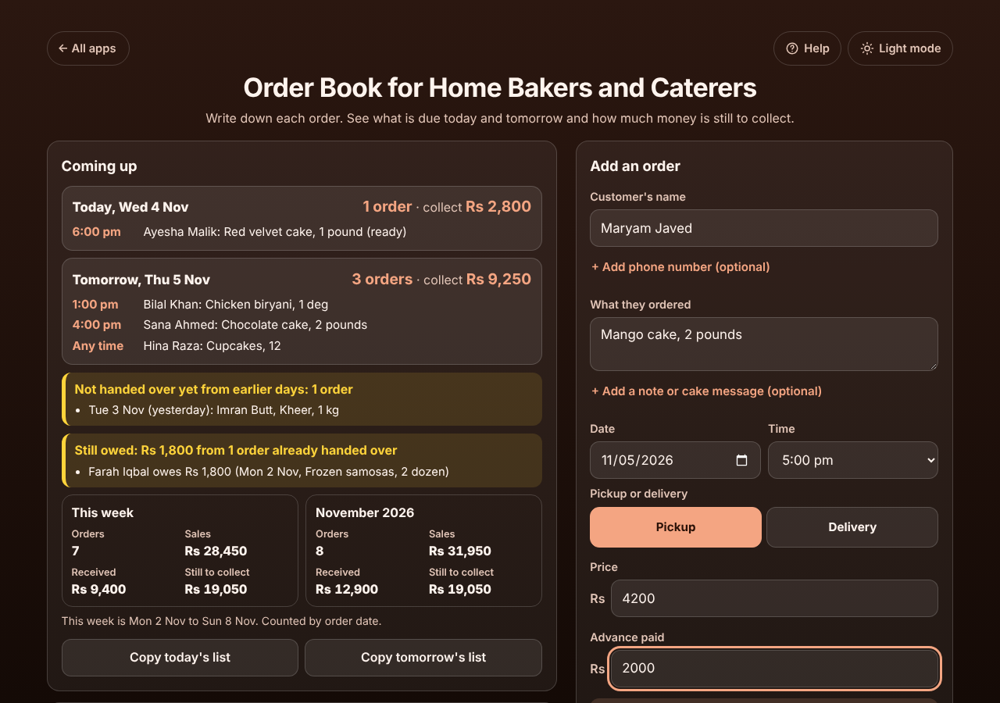
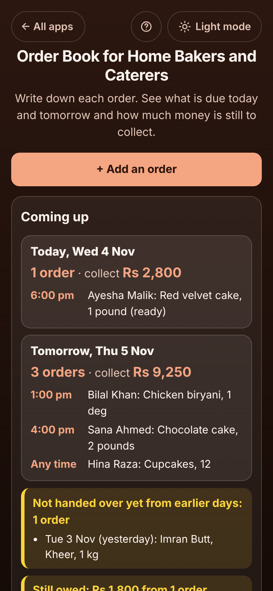

# Order Book for Home Bakers and Caterers

A free **order book for people who sell food from home**: cakes, biryani by the deg, frozen food, lunch boxes, catering trays. Write down each order as it comes in on WhatsApp or Instagram, with the pickup or delivery date and time, the price and the advance paid. The app tells you what is due today and tomorrow in time order, how much balance to collect, which orders from earlier days are not handed over yet, who still owes you, and this week's and this month's sales. Every order has a ready-written confirmation, reminder, "it's ready" or payment message to copy or open in WhatsApp. No sign-up, no ads, private on your device, works offline.

**Live demo:** [umar8092.github.io/apps/order-book-for-home-bakers-and-caterers](https://umar8092.github.io/apps/order-book-for-home-bakers-and-caterers/)

| Desktop | On a phone |
|---|---|
|  |  |

## The situation it solves

Sana bakes cakes at home and takes orders on WhatsApp. She used to write them in a notebook, and once forgot a birthday cake and once forgot that a customer still owed her the balance. It is Wednesday 4 November. Her book has:

| Order | Customer | What | When | Price | Advance |
|---|---|---|---|---|---|
| #4 | Ayesha Malik | Red velvet cake, 1 pound (made, marked ready) | Wed 4 Nov, 6:00 pm, pickup | 2,800 | 0 |
| #2 | Bilal Khan | Chicken biryani, 1 deg | Thu 5 Nov, 1:00 pm, delivery (+250) | 9,000 | 3,000 |
| #1 | Sana Ahmed | Chocolate cake, 2 pounds, "Happy Birthday Ayesha" | Thu 5 Nov, 4:00 pm, pickup | 4,500 | 1,500 |
| #3 | Hina Raza | Cupcakes, 12 | Thu 5 Nov, any time, pickup | 2,400 | 2,400 |
| #6 | Usman Ali | Lunch boxes x10 | Sat 7 Nov, 11:30 am, delivery | 6,000 | 2,000 |
| #9 | Imran Butt | Kheer, 1 kg | Tue 3 Nov (yesterday), not marked handed over | 1,200 | 0 |
| #5 | Farah Iqbal | Frozen samosas | Mon 2 Nov, handed over, pays later | 1,800 | 0 |
| #7 | Zara Shah | Brownies | Tue 3 Nov, cancelled, advance kept | 1,500 | 500 |

The app answers:

- **Today, Wed 4 Nov: 1 order · collect Rs 2,800** (Ayesha's red velvet cake at 6:00 pm, ready).
- **Tomorrow, Thu 5 Nov: 3 orders · collect Rs 9,250**, in time order: 1:00 pm Bilal's biryani (balance 9,000 + 250 delivery − 3,000 = **6,250**), 4:00 pm Sana's chocolate cake (4,500 − 1,500 = **3,000**), any time Hina's cupcakes (**paid in full**).
- **Not handed over yet from earlier days: 1 order** (Imran's kheer, yesterday), so nothing is forgotten.
- **Still owed: Rs 1,800** from Farah, who took the samosas and will pay later.
- **This week (Mon 2 to Sun 8 Nov): 7 orders, sales Rs 28,450, received Rs 9,400, still to collect Rs 19,050.** Sales include the 500 kept from Zara's cancelled order; 28,450 − 9,400 = 19,050.

With "Most orders I can take in a day" set to 4, adding a fourth order for Thursday shows "Already 3 orders on Thu 5 Nov (limit 4)", and a fifth shows that the day is full (you can still add it).

The confirmation for Sana's cake reads:

```
Hi Sana, your order is confirmed. Thank you!

Order #1: Chocolate cake, 2 pounds
Note: Happy Birthday Ayesha
Pickup: Thursday 5 November at 4:00 pm
Total: Rs 4,500
Paid: Rs 1,500
Balance to pay on pickup: Rs 3,000
Sana's Bakes
```

## Features

- **Help button.** Tap **Help** at the top for a short how-to written for this app, and **← All apps** to go back to the list. A **Light mode / Dark mode** switch sits beside them and is remembered.
- **Quick order entry.** Customer's name (past customers are offered as you type and their phone number is filled in), what they ordered, date, time (half-hour steps, "Any time", or "Other time..." for any exact time), pickup or delivery with optional address and delivery charge, price and optional advance. Phone number, note or cake message, address, delivery charge and advance are all optional and hidden until you tap **+ Add**.
- **Coming up:** today and tomorrow with the number of orders, the balance to collect and each order in time order; orders from past days not handed over yet; money still owed after handing over; this week and this month (orders, sales, received, still to collect).
- **Copy today's list / Copy tomorrow's list** to plan the baking or send to a helper.
- **Each order in its own box**, grouped by day: **Mark ready**, **Handed over and paid** (records the balance as paid today), **Handed over, pays later**, **Record a payment** (part payments), **Message**, **Edit**, **Cancel order** (kept the advance or gave it back), **Order again** for repeat customers, and **Delete**, with **Undo** after every change.
- **Tabs and search:** To make, Handed over, Cancelled, All; search by name, phone, item or order number.
- **Messages for the customer:** Confirm order, Reminder, It's ready, Ask for payment. Change the words, then **Copy text**, **Share**, or **Open WhatsApp** (straight to the chat when the number starts with + and the country code).
- **Daily order limit** warning, optional business name to sign messages.
- **Currency symbol** (none, Rs, ₹, $, €, £, AED, SAR and more) and 1,000,000 or 10,00,000 (lakh) number style, remembered. Amounts are kept in whole cents so every total is exact.
- **Save as a spreadsheet (CSV)**, **Save a backup file**, **Restore a backup**, **Delete everything** (with Undo).
- **Private.** Your orders stay on your device; your data is never sent anywhere. **Works offline** and can be installed to the home screen.
- Laid out side by side on laptops, one column on phones.

## Run it yourself

```bash
git clone https://github.com/umar8092/apps.git
cd apps/order-book-for-home-bakers-and-caterers
# open index.html in a browser (or serve the repo folder, so the shared Help and theme files load)
```

## How it works

Plain HTML, CSS and JavaScript with no libraries. `core.js` holds the sums (totals, balances, day lists, week and month figures, messages, CSV, checking saved data) and is tested by `tests.js` (`node tests.js`, or open `test.html`); `ui-test.js` drives the page with Playwright. Orders are saved in the browser's localStorage under `order-book-for-home-bakers-and-caterers.state`; a broken or edited save starts fresh instead of crashing. `sw.js` is a network-first service worker so the app opens offline and always shows the newest version when online.

The total of an order is the price plus the delivery charge (delivery orders only). The balance is the total minus the advance and later payments. Week and month figures count orders by their date: sales are the totals of orders not cancelled plus any advance kept from cancelled ones; received is what has been paid; still to collect is the unpaid balances.

## License

MIT, see [LICENSE](LICENSE).
