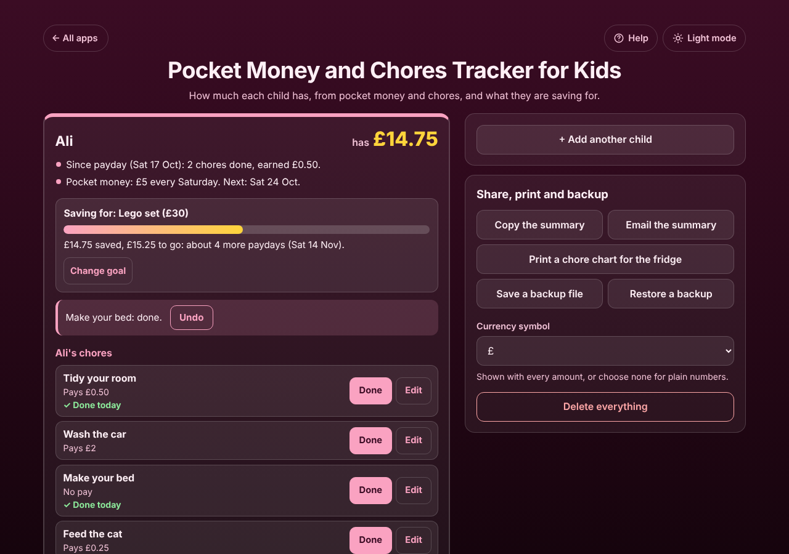
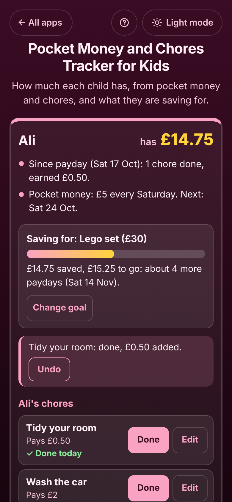

# Pocket Money and Chores Tracker for Kids

A free **pocket money and chores tracker for parents**. Each child gets their own box with their own pocket money and payday (every week, every 2 weeks or every month), their own list of chores with what each one pays, and a savings goal. See at a glance **how much each child has**, tap **Done** when a chore is done, take money out when they buy something, and print a chore chart for the fridge. Works offline, no sign-up, no ads.

**Live demo:** [umar8092.github.io/apps/pocket-money-and-chores-tracker-for-kids](https://umar8092.github.io/apps/pocket-money-and-chores-tracker-for-kids/)

| Desktop | On a phone |
|---|---|
|  |  |

## The situation it solves

Ali (9) gets **£5 pocket money every Saturday** and can earn more: tidying his room pays £0.50, washing the car £2, feeding the cat £0.25, and making his bed is expected with no pay. His sister Sara (12) gets **£20 on the 1st of every month** and earns £1 for the dishes. Nobody can remember who has how much, Ali keeps asking "can I buy the Lego yet?", and Sara is saving for a bike.

Their parent adds both children, each with their own pocket money and payday, and their own chores. On Saturday 17 October the app answers:

- **Ali has £14.75.** Pocket money £5 on 3, 10 and 17 Oct (£15), plus £3.25 from chores (including tidying his room today), minus £3.50 for football stickers. *Saving for: Lego set (£30). £14.75 saved, £15.25 to go: about 4 more paydays (Sat 14 Nov).*
- **Sara has £68.50.** £20 on 1 Sep and 1 Oct, £25 birthday money from Grandma, £3.50 from chores. *Saving for: New bike (£120). £51.50 to go: about 3 more paydays (Fri 1 Jan 2027).*

Payday adds the pocket money by itself. If nobody opened the app for three weeks, it says **"Payday! Added 3 paydays of £5 for Ali, £15 in all (Sat 3 Oct to Sat 17 Oct)"**, and **Undo** takes them back off if those weeks were not given. When Ali has enough for the Lego set, **Bought it** takes £30 out and clears the goal. Trying to take out more than a child has is refused: *"That is more than Ali has. The most you can take out is £14.75."*

## Features

- **Help button.** Tap **Help** at the top for a short how-to written for this app, and tap **All apps** to go back to the list.
- **Each child in their own box** with their own pocket money, payday, chores, history and savings goal. The balance is in big numbers at the top.
- **Paydays that run by themselves:** every week, every 2 weeks, or every month (the 29th, 30th and 31st move to the last day in shorter months). Missed paydays are caught up with one message and **Undo**. Changing the payday never pays the same day twice; a new amount counts from the next payday.
- **Chores with their own pay**, or with no pay for everyday jobs. **Done** adds the money and shows "Done today" (or "Done 2 times today"). Example chores to tap. "Since payday (Sat 17 Oct): 2 chores done, earned £0.50."
- **Add money** (gifts, bonuses) and **Take money out** (something they bought, a fine) with an optional note and an earlier date if needed. A child can never be taken below zero.
- **Savings goal** with a progress bar, what is left, about how many paydays that is and on which date, and **Bought it**.
- **History** with the balance after each line; **Edit** or delete any entry.
- **Undo** on every change.
- **Copy** or **Email the summary** (email works with no address typed), and **Print a chore chart for the fridge** with a box for every day of the week.
- **Currency symbol** of your choice (none, $, €, £, ₹, Rs and more), remembered.
- **Backup file and restore**, **Delete everything** with Undo. Damaged or blocked saved data is handled with a clear message.
- **Private.** Names and money stay in this browser on this device; your data is never sent anywhere.
- **Works offline and installable.**
- **Back to all apps.** A "← All apps" button at the top of the page.
- **Light and dark mode switch.** It follows your device until you choose, and remembers your choice in every app.

## Run it yourself

No build step and no dependencies.

```bash
git clone https://github.com/umar8092/apps.git
```

Then open `pocket-money-and-chores-tracker-for-kids/index.html` in your browser.

Offline mode and install need the files served over `https` or `localhost` (for example `python3 -m http.server`).

## How it works

- `core.js` is the logic, with no page code. Money is kept in whole cents, so nothing is ever off by a rounding error. Dates are calendar days, so time zones and summer time never move a payday.
- Each child remembers the last payday that was paid. When the app opens (or a new day starts while it is open), every payday after that up to today gets its pocket money, so a payday is never added twice.
- `script.js` builds the page. Names, chores and notes are added as plain text, never as HTML.
- `sw.js` saves the app on your device for offline use (network first, so updates show at once).
- Run the logic checks with `node tests.js` (or open `test.html`), and the full page test with `node ui-test.js` (needs Playwright).

## License

[MIT](LICENSE). Free to use, copy, modify and share. Made by [Muhammad Umar](https://github.com/umar8092).
