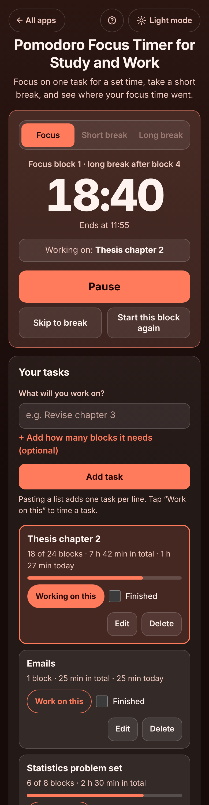

# Pomodoro Focus Timer for Study and Work

A free **Pomodoro focus timer with a task list** for students and anyone working from home who keeps drifting to their phone. Pick a task, press **Start focus**, and work on only that for 25 minutes (or your own length). A bell rings, you take a 5-minute break, and after every 4 blocks a longer one. The app keeps a log of real focus time per task, so at the end of the day you know where your time went: *1 h 52 min of focus, Thesis chapter 2: 1 h 27 min*. It keeps the right time when the phone locks, works offline, no sign-up, no ads.

**Live demo:** [umar8092.github.io/apps/pomodoro-focus-timer-for-study-and-work](https://umar8092.github.io/apps/pomodoro-focus-timer-for-study-and-work/)

| Desktop | On a phone |
|---|---|
|  |  |

## The situation it solves

Sara is writing her thesis at home on Saturday 17 October. She opens the app, types **Thesis chapter 2**, taps **+ Add how many blocks it needs** and types 4, and adds it. She also pastes a short list (`- Emails`, `2. Read paper`), which becomes two more tasks. The timer says **Working on: Thesis chapter 2**.

With the classic settings (25 min focus, 5 min short break, 15 min long break after 4 blocks):

- **09:00** she presses **Start focus**. The clock shows **25:00**, *Ends at 09:25*. At 09:25 the bell rings: *Focus block done and counted. Time for a short break.*
- She does blocks 2 and 3 on the thesis. During block 3 the doorbell rings at 10:10; she presses **Pause** for 3 minutes, so the block ends at **10:28** instead of 10:25, and the paused minutes do not count.
- Block 4 (10:33) is on **Emails**. After it the app says *Time for a long break* and shows **15:00**.
- At 11:13 she starts block 5 on the thesis but has to stop after 12 minutes. She presses **Start this block again**; the app asks *You focused 12 min on Thesis chapter 2. Count it in your focus time?* and she taps **Count 12 min**.

**Today** then shows:

- **1 h 52 min of focus · 4 blocks + 12 min** (4 × 25 + 12 = 112 minutes)
- **Thesis chapter 2: 1 h 27 min · 3 blocks + 12 min** (3 × 25 + 12 = 87)
- **Emails: 25 min · 1 block**
- The thesis task says **3 of 4 blocks**, and a log lists every block with its real start and end, like *10:00–10:28 Thesis chapter 2 25 min*.

**Copy this summary** gives:

```
Focus time, Sat 17 Oct 2026: 1 h 52 min (4 blocks + 12 min)
- Thesis chapter 2: 1 h 27 min (3 blocks + 12 min)
- Emails: 25 min (1 block)
```

If her phone locks during a block and she comes back 40 minutes later, the app says *Focus block done at 09:25 and counted*, and the break waits for her. A focus block never starts by itself while she is away, so the log only holds time she really focused.

## Features

- **Help button.** Tap **Help** at the top for a short how-to written for this app, and tap **All apps** to go back to the list.
- **Focus, Short break and Long break** with the block number shown ("Focus block 2 · long break after block 4"), the time the block ends, and a big clock. **Pause** and **Resume**, **Skip to break** / **Skip break**, and **Start this block again**.
- **Stopped early?** After a minute or more the app asks: **Count it** keeps the whole minutes you did, **Do not count it** or **Keep going**. Only full blocks count towards the long break and the daily goal.
- **Task list.** Add tasks one at a time or paste a list (one per line, bullets and numbers removed, repeats skipped). Each task in its own box with **Work on this**, its full blocks and focus time (in total and today), an optional number of blocks it needs with a bar ("3 of 4 blocks"), **Finished**, **Edit** and **Delete** (its time stays in the log), **Remove finished tasks**. Focusing without a task works too.
- **Today**: total focus time, a split per task, every block with start and end time, **Edit** (task or minutes) and **Delete** with Undo, **Copy this summary** and **Email this summary** (opens your mail app with no recipient filled in). **+ Add focus time I did without the timer** for time you forgot to log.
- **Last 7 days**: a bar per day, the week's total, full blocks and days in a row. Tap a bar to see that day's blocks.
- **Settings:** quick choices **25 + 5**, **50 + 10** and **90 + 20**, or each length yourself with **Other** (focus 1 to 180 min, short break 1 to 60, long break 1 to 90), the long break after 2 to 8 blocks or never, a **daily goal** in blocks, start breaks and focus blocks by themselves, **Bell**, **Beeps** or no sound with a **Play** test, vibration, keep the screen on, and a notification when time is up.
- **Keeps the right time** when the phone locks, the tab is in the background or the page reloads: it saves when the block ends, not a countdown. Two open tabs never count a block twice. The tab title shows the time left. The **Space** bar starts and pauses.
- **Save a backup file**, **Restore a backup**, **Download focus log (CSV)** and **Delete all tasks and focus time** with Undo. Damaged or blocked saved data is handled with a clear message.
- **Private.** Your tasks and focus time stay in this browser on this device; your data is never sent anywhere.
- **Works offline and installable.**
- **Back to all apps.** A "← All apps" button at the top of the page.
- **Light and dark mode switch.** It follows your device until you choose, and remembers your choice in every app.

## Run it yourself

No build step and no dependencies.

```bash
git clone https://github.com/umar8092/apps.git
```

Then open `pomodoro-focus-timer-for-study-and-work/index.html` in your browser.

Offline mode and install work best with the files served over `https` or `localhost` (for example `python3 -m http.server`).

## How it works

- `core.js` is the logic, with no page code. Times are whole milliseconds and focus time is saved as whole minutes, so every total adds up exactly. The timer stores the moment a phase ends; `advance()` moves it past every phase that ended while you were away (counting each full focus block once, starting breaks by themselves if you chose that, but never a focus block), and `stopEarly()` handles skipping and starting again. It also makes the per-task split, the 7-day bars, the streak, the summary text and the CSV, and checks every saved or restored value.
- `script.js` builds the page. Task names are added as plain text, never as HTML. Everything is saved in `localStorage` on the device. The bell is made with the Web Audio API, so there are no sound files.
- `sw.js` saves the app on your device for offline use (network first, so updates show at once).
- Run the logic checks with `node tests.js` (or open `test.html`), and the full page test with `node ui-test.js` (needs Playwright). The page test fixes the clock to Sat 17 Oct 2026, 09:00 and checks the exact answers above. `node shots.js` makes the screenshots.

## License

[MIT](LICENSE). Free to use, copy, modify and share. Made by [Muhammad Umar](https://github.com/umar8092).
