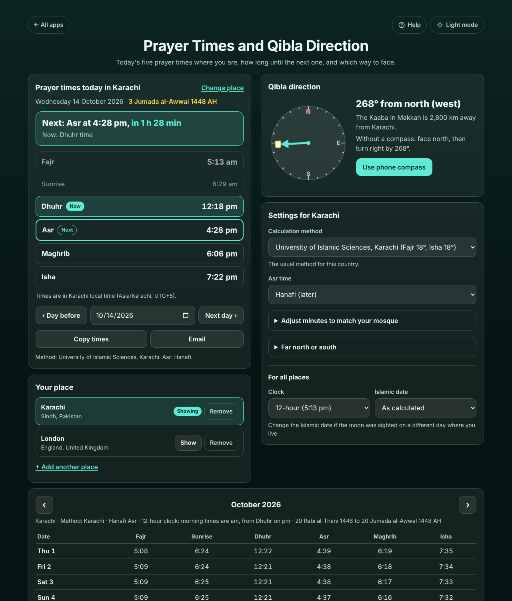

# Prayer Times and Qibla Direction

Free **prayer times and Qibla direction** for wherever you are. Search your city once (or tap *Use my location*) and the page shows today's **Fajr, Sunrise, Dhuhr, Asr, Maghrib and Isha**, a live line such as **"Next: Asr at 4:28 pm, in 1 h 28 min"**, the Islamic date, a **month timetable** to print, a **calendar file** with an alert at every prayer, and the **Qibla direction** with a dial that follows the phone's compass. Karachi, Muslim World League, ISNA, Umm al-Qura and 10 more methods, Hanafi or standard Asr, and minutes you can add or take away to match your mosque. Each saved place keeps its own settings. No ads, no sign-up, private on your device, and it works offline once a place is saved.

**Live demo:** [umar8092.github.io/apps/prayer-times-and-qibla-direction](https://umar8092.github.io/apps/prayer-times-and-qibla-direction/)

| Desktop | On a phone |
|---|---|
|  |  |

## The situation it solves

Ahmed lives in Karachi and prays at the mosque near his office. During the day he wants to know at a glance **how long until the next prayer**, without an app full of video ads that also sells his location. Next week he flies to London for work, where the times are completely different and his phone may still be on Pakistan time; in the hotel room he needs to know **which way to face**.

He types *Karachi*, taps **Karachi, Sindh, Pakistan**, and the app picks the method used in Pakistan (University of Islamic Sciences, Karachi) and Hanafi Asr. At 3:00 pm on Wednesday 14 October 2026 it answers:

- **Next: Asr at 4:28 pm, in 1 h 28 min.** Now: Dhuhr time.
- **Fajr 5:13 am · Sunrise 6:29 am · Dhuhr 12:18 pm · Asr 4:28 pm · Maghrib 6:06 pm · Isha 7:22 pm**
- **3 Jumada al-Awwal 1448 AH**
- **Qibla: 268° from north (west).** The Kaaba is 2,800 km away.

His mosque calls Maghrib two minutes after sunset, so he sets **Maghrib +2** under *Adjust minutes to match your mosque* and the list shows 6:08 pm. Before the trip he adds **London**; it gets Muslim World League and standard Asr by itself, and shows **Fajr 5:31 am · Sunrise 7:23 am · Dhuhr 12:46 pm · Asr 3:34 pm · Maghrib 6:09 pm · Isha 7:54 pm** in London time, with a note that his phone is on UTC+5 and the countdown already allows for it. The Qibla for London is **119° (east-south-east)**. Karachi keeps its own method, Hanafi Asr and +2.

Checked examples (from the tests):

- Every time for Karachi, London, New York, Makkah, Cairo, Jakarta, Dubai, Istanbul and Oslo agrees to within **1 minute** with the separately written [adhan](https://github.com/batoulapps/adhan-js) library, and over 33,000 more times (15 cities, 6 dates, 11 methods, both Asr rules, 3 far-north rules) were compared the same way before launch. Karachi on 1 September 2026 gives Fajr 04:55 and Dhuhr 12:32, the same as Aladhan's published timetable.
- Standard Asr in Karachi that day is **3:38 pm**, 50 minutes before Hanafi Asr.
- Umm al-Qura: Isha is exactly **90 minutes after Maghrib**.
- London on 28 and 29 March 2026: Dhuhr moves from 12:06 to 13:05 when summer time starts.
- Oslo on 21 June: the sky never gets fully dark, so Fajr and Isha follow the far-north rule (Isha **00:12, next day**). In Tromsø on 21 June the sun never sets: Sunrise and Maghrib show "--" with a plain message, Dhuhr is still shown.
- Qibla: Karachi 267.7°, London 119.0°, New York 58.5°, Jakarta 295.2°, Sydney 277.5°.

## Features

- **Help button** at the top with a how-to for this app, **All apps** to go back to the list, and a **Light / Dark** switch.
- **Find your city** (Open-Meteo place search, which shows the province and country so you pick the right Karachi), **Use my location**, or **Enter latitude and longitude** with a time zone when there is no connection.
- **Several places**, each in its own box with **Show** and **Remove** (with Undo), each with its own method, Asr, minute adjustments and far-north rule. Adding a place twice just switches to it.
- **Today:** the next prayer and how long until it, which prayer time it is now (Fajr "ends at sunrise", nothing between sunrise and Dhuhr), passed times dimmed, the Gregorian and Islamic date. It updates by itself and rolls over at midnight in the place's own time.
- **Other days:** Day before, Next day and a date box (1950 to 2150), with **Back to today**.
- **Copy times**, **Share** (on phones) and **Email** (no address needed).
- **Qibla direction:** degrees from north, compass direction in words, distance to the Kaaba, how to find it without a compass, and **Use phone compass**, which turns the dial and says "Turn right by 68°" until "You are facing the Qibla".
- **14 methods:** Karachi, Muslim World League, ISNA, Umm al-Qura, Egypt, Dubai, Gulf region, Kuwait, Qatar, Singapore/Malaysia/Indonesia, Diyanet (Turkey), France (12°), Russia, Tehran and Jafari, plus **My own angles** (or Isha a set number of minutes after Maghrib). The usual method and Asr are chosen from the country.
- **Adjust minutes to match your mosque** (-60 to +60 for each time, Set all to 0 with Undo), **Far north or south** rule (angle-based, one-seventh or middle of the night), **12 or 24-hour clock**, **Islamic date** one or two days earlier or later to match the local moon sighting.
- **Month timetable** with today highlighted, **Print or save as PDF**, **Copy the month**, and **Add to my calendar (.ics)** with the five prayers of every day and an alert at each one.
- Times are always in the place's own local time with summer time, also when the phone is set to another time zone.
- Private: your places and settings stay on the device and your data is never sent anywhere; searching sends only the city name you type to Open-Meteo. Works offline once a place is saved, and can be installed on the home screen.

## Run it yourself

```
git clone https://github.com/umar8092/apps.git
```

Then open `prayer-times-and-qibla-direction/index.html` in a browser. No build step and no dependencies.

Tests: `node prayer-times-and-qibla-direction/tests.js` checks the maths (or open `test.html`), and `node prayer-times-and-qibla-direction/ui-test.js` drives the page in headless Chromium with the city search mocked (needs Playwright).

## How it works

Plain HTML, CSS and JavaScript. `core.js` works out the sun's position for the day (declination and equation of time) and from it the standard prayer times: Fajr and Isha when the sun is the method's angle below the horizon, Sunrise and Maghrib at 0.833° (Shia methods use an angle for Maghrib), Dhuhr at solar noon, and Asr when a shadow equals the object's length plus the noon shadow (twice the length for Hanafi). Each time is refined three times so the sun's position is taken at that moment. Where Fajr or Isha would fall too deep into a short summer night, the chosen far-north rule keeps them within a share of the night. The place's time zone offset for that day comes from the browser's own time zone data, so summer time is right everywhere. The Qibla is the great-circle bearing to the Kaaba (21.4225° N, 39.8262° E). The Islamic date is the Umm al-Qura calendar from the browser. Places are saved in this browser's `localStorage`; a network-first service worker keeps the app working offline. Place search by [Open-Meteo](https://open-meteo.com/) (no key needed).

## License

MIT, see [LICENSE](LICENSE).
