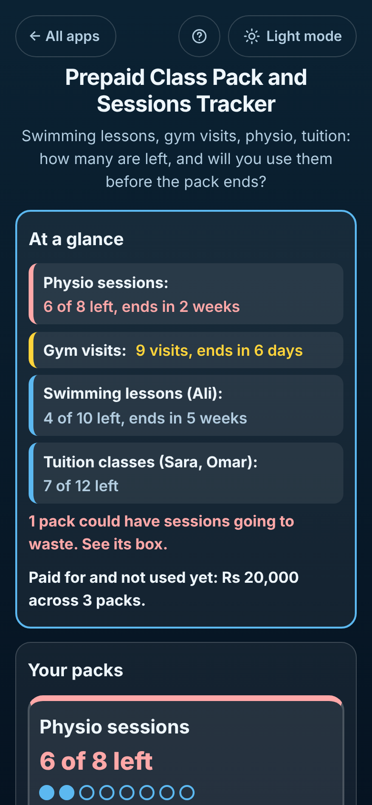

# Prepaid Class Pack and Sessions Tracker

A free **class pack and session card tracker** for anything you pay for in advance: **10 swimming lessons, a 20-visit gym card, 8 physio sessions, 12 tuition classes, yoga, dance, music or driving lessons**. Each pack sits in its **own box**. Tap **Went today** after each session and see **how many are left**, the **last day to use them**, **how often you need to go so none go to waste**, and the **cost per session**. Log **missed** classes the centre still counts and **cancelled** ones it does not, let **two children share one pack** with a button each, track **monthly passes** with unlimited visits, **renew** a pack (and carry over what was left), and **copy or email the dated log** when the centre's count does not match yours. Works offline, no sign-up, no ads.

**Live demo:** [umar8092.github.io/apps/prepaid-class-pack-and-sessions-tracker](https://umar8092.github.io/apps/prepaid-class-pack-and-sessions-tracker/)

| Desktop | On a phone |
|---|---|
| ![Prepaid Class Pack Tracker on a laptop: At a glance lists Physio sessions 6 of 8 left ends in 2 weeks in red, Gym visits 9 visits ends in 6 days, Swimming lessons (Ali) 4 of 10 left ends in 5 weeks, Tuition classes (Sara, Omar) 7 of 12 left, a warning that 1 pack could have sessions going to waste and Rs 20,000 paid for and not used yet; the Physio box below says 6 of 8 left, last day Fri 13 Nov, and warns that at the pace so far 5 sessions could go to waste, go 2 to 3 a week; settings, calendar and backup on the right](screenshots/desktop.png) |  |

## The situation it solves

Hina paid **Rs 6,000 for 10 swimming lessons** for her son **Ali**, valid from **Thu 1 Oct** to **Mon 30 Nov 2026**. She also bought **8 physio sessions for Rs 16,000** for her back (26 Sep to 13 Nov), a **Rs 5,000 gym pass** for October, and **12 tuition classes for Rs 9,600** shared by **Sara and Omar**. By late October she cannot say how many swimming lessons are left, whether the physio sessions will run out before the pack expires, or whether the tuition centre counted the class the teacher cancelled.

On **Sun 25 Oct 2026** the app answers:

- **Swimming lessons (Ali): 4 of 10 left.** Ali went on 1, 4, 8, 11, 15 and 18 Oct. **Last day to use it: Mon 30 Nov (in 5 weeks). To use them all, go about 1 every 9 days.** **Rs 6,000 for 10: Rs 600 per session, Rs 2,400 still unused.**
- **Physio sessions: 6 of 8 left**, last day **Fri 13 Nov**. She went on 1 Oct and missed 15 Oct (the clinic still counted it). **You have used 2 in the last 30 days. At that pace about 1 more fit before it ends, so 5 sessions could go to waste. Go 2 to 3 a week to use them all.**
- **Tuition classes (Sara, Omar): 7 of 12 left**, no expiry. **Used so far: Sara 3, Omar 2.** The class on 13 Oct the teacher cancelled is in the log but **not counted**.
- **Gym visits: 9 visits so far**, pass valid until **Sat 31 Oct (in 6 days)**: **Rs 5,000 paid: Rs 555.56 per visit so far.**
- **At a glance:** the packs sorted by what needs attention first, **1 pack could have sessions going to waste**, and **Paid for and not used yet: Rs 20,000 across 3 packs** (2,400 + 12,000 + 5,600).

She taps **Went today** for Ali's lesson: **Logged session 7 of 10 today. 3 sessions left.** A wrong tap? **Undo**.

**Copy log** gives the centre a dated list:

```
Swimming lessons (Ali)
10-session pack from Thu 1 Oct, last day Mon 30 Nov.
Paid Rs 6,000.
Used 6 of 10, 4 left.

1. Thu 1 Oct went
2. Sun 4 Oct went
3. Thu 8 Oct went
4. Sun 11 Oct went
5. Thu 15 Oct went
6. Sun 18 Oct went
```

How it counts: **Went** and **Missed (still counted)** use a session; **Cancelled or excused** does not. Days left include today and the last day, so 25 Oct to 30 Nov is 37 days, and 4 sessions in 37 days is 1 every 9 days. "3 months" from 1 Oct means the last day is 31 Dec. The "could go to waste" warning appears once a pack has run for 2 weeks with at least 2 sessions logged: sessions logged so far × days left ÷ days so far, rounded down, is how many more are likely to fit. Money is in whole cents: Rs 100 for 3 sessions is 33.33 each, and 2 unused are worth 66.67.

## Features

- **Help button.** Tap **Help** at the top for a short how-to written for this app, and tap **All apps** to go back to the list.
- **At a glance** at the top: every open pack, the most urgent first (expired with sessions unused, could go to waste, nearly used up, ending soon), with the money paid and not used yet.
- **Each pack in its own bordered box** with a big "4 of 10 left", one dot per session, the last day, how often to go, the cost per session, and its own **Log** with numbered, dated entries (each with **Edit**).
- **Add a pack** in seconds: suggestions (Swimming lessons, Gym visits, Physio sessions, Tuition classes, Yoga, Driving, Music, Dance) or your own name; 5, 8, 10, 12 or 20 sessions or any number up to 500; first day with Today, Yesterday or A week ago; last day with **1, 2, 3 or 6 months, 1 year, No expiry** or any date. A preview checks it before you save.
- **Optional, never forced:** who uses it (two to four people sharing one pack get a **"Name went today"** button each and their own counts), price paid, sessions **already used before you started the log**, and a note.
- **Went today**, or **Other day or missed** for a session you forgot to log, a **missed** class the centre still counts, or a **cancelled or excused** one that it does not. Undo after every change.
- **Warnings that matter:** "could go to waste" at your pace, "not enough days left even going every day", "only 2 left: think about renewing", and "expired with 2 sessions not used (worth Rs 1,000)".
- **Monthly or yearly passes** with unlimited visits: visits counted and the cost per visit so far.
- **Renew** a used-up or ended pack: same name, people, size, price and length, starting today, with an option to **carry over** the sessions still left. The old pack moves to **Finished packs** (log kept, **Bring back** any time).
- **Copy log** and **Email log** (no address needed first) to show the centre or a partner.
- **Add the end dates to my calendar:** a reminder at 9:00 one week before each pack's last day.
- Optional **currency symbol** (none, $, €, £, ₹, Rs, AED and more), remembered.
- **Save a backup file**, **Restore a backup**, **Delete everything** with Undo. Damaged or blocked saved data is handled with a clear message.
- **Private.** Everything stays in this browser on this device; your data is never sent anywhere.
- **Works offline and installable.** The days left update by themselves at midnight.
- **Back to all apps.** A "← All apps" button at the top of the page.
- **Light and dark mode switch.** It follows your device until you choose, and remembers your choice in every app.

## Run it yourself

No build step and no dependencies.

```bash
git clone https://github.com/umar8092/apps.git
```

Then open `prepaid-class-pack-and-sessions-tracker/index.html` in your browser.

Offline mode and install work best with the files served over `https` or `localhost` (for example `python3 -m http.server`).

## How it works

- `core.js` is the logic, with no page code. Dates are calendar dates (`2026-10-25`), so time zones and summer time never move a date. Money is kept in whole cents, so every total is exact. It works out sessions used and left, days left, how often to go, the pace warning, cost per session and unused value, the At a glance list, renewals, the log text and the calendar file, reads every form with plain error messages, and checks every saved or restored value (it never accepts more counted sessions than a pack holds).
- `script.js` builds the page. Names and notes are added as plain text, never as HTML. Everything is saved in `localStorage` on the device.
- `sw.js` saves the app on your device for offline use (network first, so updates show at once).
- Run the logic checks with `node tests.js` (or open `test.html`), and the full page test with `node ui-test.js` (needs Playwright). The page test fixes the time to Sun 25 Oct 2026, 9:00 am, and checks the exact answers above.

## License

[MIT](LICENSE). Free to use, copy, modify and share. Made by [Muhammad Umar](https://github.com/umar8092).
