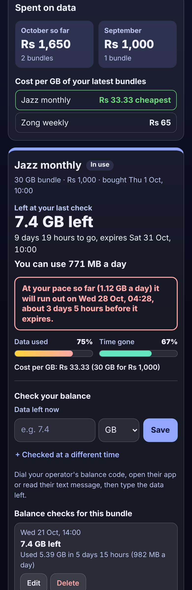

# Prepaid Mobile Data Bundle Tracker

A free tracker for anyone on a **prepaid mobile data bundle** (daily, weekly or monthly) who keeps running out days before it expires, or watches unused GB disappear. Add the bundle once (how much data, the price if you like, when you bought it and when it expires). Then, now and then, type the data left from your operator's balance code, app or text message. The app answers in plain words: **"7.4 GB left, 9 days 19 hours to go"**, **"You can use 771 MB a day"** and **"At your pace so far (1.12 GB a day) it will run out on Wed 28 Oct, about 3 days before it expires"**. It shows the **cost per GB** of every bundle, so you can tell whether weekly or monthly offers are cheaper, and what you **spend on data each month**. No sign-up, no ads, private on your device, works offline.

**Live demo:** [umar8092.github.io/apps/prepaid-mobile-data-bundle-tracker](https://umar8092.github.io/apps/prepaid-mobile-data-bundle-tracker/)

| Desktop | On a phone |
|---|---|
|  |  |

## The situation it solves

Ali is a student in Lahore. His main SIM has a **Jazz monthly bundle: 30 GB for Rs 1,000, bought on 1 October at 10:00 and valid for 30 days**. Last month he ran out three days early and paid expensive out-of-bundle rates. His second SIM has a **Zong weekly bundle: 10 GB for Rs 650**, bought on Sunday 18 October at 09:00. It is Wednesday 21 October, 14:05.

He logged September's bundle (2.1 GB left at 22:00 the night before it expired) and his October balance checks: **20.5 GB on 8 Oct at 21:30**, **13,100 MB on 15 Oct at 23:00** (his operator shows MB) and **7.4 GB on 21 Oct at 14:00**. The Zong box has one check: **6.2 GB on 21 Oct at 13:00**. The app says:

- **Jazz monthly: 7.4 GB left, 9 days 19 hours to go, expires Sat 31 Oct, 10:00. You can use 771 MB a day.**
- **At your pace so far (1.12 GB a day) it will run out on Wed 28 Oct, 04:28, about 3 days 5 hours before it expires.** The data used bar (75%) is ahead of the time gone bar (67%).
- **Zong weekly: about 6.15 GB left, you can use 1.62 GB a day. At your pace so far (1.2 GB a day) it will last. About 1.6 GB will be left unused when it expires, so you can use more.**
- **Cost per GB: Jazz monthly Rs 33.33 (cheapest), Zong weekly Rs 65.** Spent on data: **Rs 1,650 in October so far (2 bundles), Rs 1,000 in September.**
- September's bundle, under **Earlier bundles**: **used 27.9 GB, 2.1 GB expired unused, Rs 35.84 a GB used.**

So he moves video calls to the Zong SIM, keeps Jazz under 771 MB a day and makes it to the 31st.

Worked examples from the tests (all checked by hand; 1 GB = 1024 MB, as operators count it):

- Jazz: 30 − 7.4 = **22.6 GB used** between 1 Oct 10:00 and 21 Oct 14:00, which is **20 days 4 hours (29,040 minutes)**: 22.6 × 1440 ÷ 29,040 = **1.12 GB a day**.
- Allowance at 14:05: 7.4 GB ÷ 9 days 19 hours 55 minutes = 7,577.6 MB × 1440 ÷ 14,155 = **771 MB a day**.
- Run-out: 7.4 ÷ 1.12 = 6.6 days after 21 Oct 14:00 = **Wed 28 Oct 04:28**, which is **3 days 5 hours** before 31 Oct 10:00.
- Between the 15 Oct and 21 Oct checks: 13,100 − 7,577.6 = 5,522.4 MB = **5.39 GB in 5 days 15 hours, 982 MB a day**.
- Zong: 3.8 GB used in 3 days 4 hours = **1.2 GB a day**; an hour later about **6.15 GB** is left; with 3 days 18 hours 55 minutes to go it needs about 4.55 GB, so about **1.6 GB** will be left over.
- Cost per GB: 1,000 ÷ 30 = **33.33**; 650 ÷ 10 = **65**; September per GB used: 1,000 ÷ 27.9 = **35.84**.
- A **5 GB top-up** with 2 GB left after 4 days of 2 GB a day: 7 GB lasts **3.5 more days**. Renewing early with **7.2 GB left** and ticking carry-over makes the new 30 GB bundle **37.2 GB** (the cost per GB still counts only the 30 GB you paid for).
- A balance of `750 MB`, `13,100 MB`, `7,4` or `1.5 gb` is understood; more data than the bundle holds, data left going up without a top-up, a time in the future or after expiry, a minus sign or words each get a clear message.

## Features

- **Help button** at the top with a how-to for this app, **All apps** to go back to the list, and a **Light / Dark** switch.
- **Each SIM or bundle in its own box**: quick picks for **Monthly**, **Weekly** and **Daily**, any name, the data in GB or MB, an optional price, the time you bought it, **Valid for** 1 to 90 days or **Other** with the exact expiry from your operator's message.
- **Check your balance** in one box: save the data left now, or use **+ Checked at a different time** for a balance seen earlier (also for a bundle that has since expired). Edit and delete each check with Undo; each check shows the data used since the one before.
- **The answer**: data left (marked **About** when estimated from your pace since the last check), time to go, **You can use ... a day**, whether it will last at your pace or the day it will run out, and **Data used** and **Time gone** bars side by side. Ran out and expired bundles say so.
- **+ Add extra data** for top-ups that share the expiry, and **Bought a new bundle** for the next one, filled in like the last. Renewing early ends the old bundle then and can **carry over** the data left.
- **Earlier bundles** with their cost per GB, data used, data that expired unused and cost per GB actually used.
- **Spent on data** this month and last month, and the cost per GB of each box's latest bundle, cheapest first.
- **Copy summary**, **Email** (no address needed), **Expiry reminder** (a calendar file for the day before it expires), **Edit bundle**, **Delete** with Undo.
- **Currency symbol** (none, Rs, ₹, $, €, £ and more, remembered), **Save a backup file** and **Restore a backup** (checked, with Undo), **Delete everything** with Undo.
- Private: no account and your data is never sent anywhere. The app does not read your phone's data use; it works from the balances you type. Works offline once loaded, and can be installed on the home screen.

## Run it yourself

```
git clone https://github.com/umar8092/apps.git
```

Then open `prepaid-mobile-data-bundle-tracker/index.html` in a browser. No build step and no dependencies.

Tests: `node prepaid-mobile-data-bundle-tracker/tests.js` checks the maths and the wording (or open `test.html`), and `node prepaid-mobile-data-bundle-tracker/ui-test.js` drives the page in headless Chromium at 11 screen widths in dark and light (needs Playwright and a local server in the repo root, for example `python3 -m http.server 8765`).

## How it works

Plain HTML, CSS and JavaScript. The maths lives in `core.js`. Data is kept in thousandths of a MB (1 GB = 1024 MB), money in whole cents and times as whole minutes of local clock time, so sums are exact. Your pace is the data used from the time you bought the bundle to your last balance check, divided by the time between them (it needs at least 3 hours). The allowance is the data left divided by the time left until expiry. The run-out time counts forward from the last check at your pace, including any top-ups. A top-up saved in the same minute as a check counts as after it. Everything is saved in this browser's `localStorage` and checked when loaded or restored; a network-first service worker keeps the app working offline.

## License

MIT, see [LICENSE](LICENSE).
