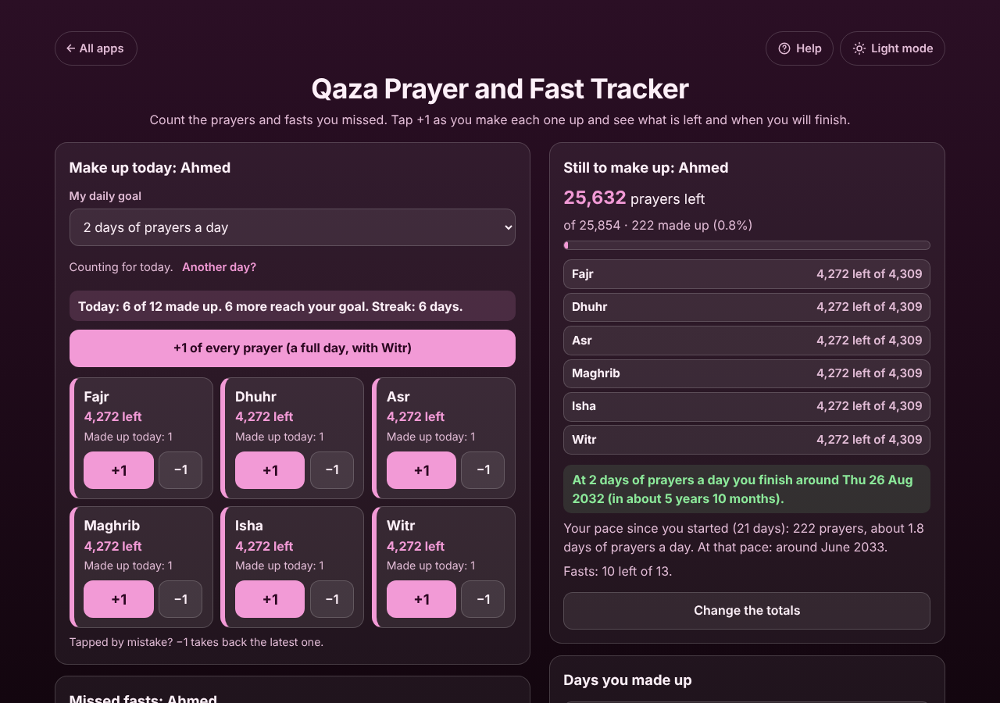

# Qaza Prayer and Fast Tracker

A free **qaza (missed) prayer and fast tracker**. Work out how many prayers you owe from the first and the last day you missed (or type the number for each prayer), then tap **+1** under Fajr, Dhuhr, Asr, Maghrib, Isha and Witr each time you make one up. It shows how many are left in all and for each prayer, the day you will finish at your daily goal, your real pace and your streak. Missed Ramadan fasts have their own count, each Ramadan in its own box. Several people can count on one phone, each with their own totals. The app only counts what you enter; it gives no religious rulings. No sign-up, no ads, private on your device, works offline.

**Live demo:** [umar8092.github.io/apps/qaza-prayer-and-fast-tracker](https://umar8092.github.io/apps/qaza-prayer-and-fast-tracker/)

| Desktop | On a phone |
|---|---|
|  |  |

## The situation it solves

Ahmed is 30. He did not pray regularly from the age of 12 until the end of 2019 and wants to make up every prayer, but has no idea how many that is or how long it will take.

He picks **From dates**, taps **+ Work out the first day from a birth date and an age**, types his birth date (15 Mar 1996) and the age 12, so the **First day missed** becomes **Sat 15 Mar 2008**. He sets the **Last day missed** to **31 Dec 2019**. The app says:

- **4,309 days: 4,309 of each prayer, 25,854 prayers in all with Witr.** (15 Mar 2008 to 15 Mar 2019 is 11 years = 4,017 days with the leap days of 2012 and 2016; then 291 days to 31 Dec 2019; plus the first day itself = 4,309.)

He sets **My daily goal** to **2 days of prayers a day** and starts on 1 Oct 2026. He keeps it up every day except the 7th and the 14th, and on Wed 21 Oct has prayed one of each so far. The app shows:

- **25,632 prayers left**, of 25,854 · 222 made up (0.8%). Each prayer: **4,272 left of 4,309** (18 days × 2 + 1 today = 37 made up).
- **Today: 6 of 12 made up. 6 more reach your goal. Streak: 6 days.** (15 to 20 Oct in a row; the 14th was missed.)
- **At 2 days of prayers a day you finish around Thu 26 Aug 2032 (in about 5 years 10 months).** (4,272 left + 1 already today = 4,273 ÷ 2 = 2,136.5, so 2,137 days counting today.)
- *Your pace since you started (21 days): 222 prayers, about 1.8 days of prayers a day. At that pace: around June 2033.*

He also missed 6 fasts in Ramadan 2017 and 7 in 2018 (travel). He adds each Ramadan, has made up 3 fasts, and picks **2 a week**: **10 left of 13. At 2 a week you finish around Tue 24 Nov 2026 (in 35 days).** (10 × 7 ÷ 2 = 35 days.)

His mother counts her own qaza on the same phone: **+ Add another person**, *Ammi*, **Type the numbers**, 300 of each, Witr unticked. Each person has their own box, totals, goal and days.

Tapped by mistake? **−1** takes back the latest one. A prayer that reaches 0 shows **Done ✓** and its +1 stops.

## Features

- **Help button.** Tap **Help** at the top for a short how-to written for this app, and tap **All apps** to go back to the list.
- **Work out the total from dates** (both days counted, leap years exact), with an optional birth date and age helper and optional **days to leave out** that you choose (days you did pray, days of periods). Or **type the numbers** for each prayer, with **Use for all**.
- **Witr is your choice** (Count Witr too).
- **+1 under each prayer**, **+1 of every prayer (a full day)** with Undo, and **−1** that takes back the latest one (from an earlier day if today has none).
- **Daily goal** of 1, 2, 3, 5 or any number from 1 to 50 days of prayers a day, the **finish date** at that goal, your **real pace** and a **streak**.
- **Another day?** counts prayers for a day you forgot.
- **Change the totals** at any time without losing what you made up (it never lets a total drop below what is already made up), and **Clear everything this person has made up** with Undo.
- **Missed fasts:** each Ramadan in its own box (year optional, 1 to 30 days), +1 and −1, and a finish date at 1, 2, 3 or 7 fasts a week.
- **Days you made up:** every day with its prayers and fasts.
- **Several people on one phone**, each in their own box, with Open, Rename and Remove (Undo).
- **Copy my progress** and **Email my progress** (works with no address typed), **Save a backup file**, **Restore a backup**, **Delete everything** with Undo.
- **Private.** Your data is never sent anywhere; it stays in this browser on this device. No rulings: it only counts.
- **Works offline and installable.** Phone friendly, with a two-column layout on laptops.
- **Back to all apps.** A "← All apps" button at the top of the page.
- **Light and dark mode switch.** It follows your device until you choose, and remembers your choice in every app.

## Run it yourself

No build step and no dependencies.

```bash
git clone https://github.com/umar8092/apps.git
```

Then open `qaza-prayer-and-fast-tracker/index.html` in your browser.

Offline mode and install need the files served over `https` or `localhost` (for example `python3 -m http.server`).

## How it works

- `core.js` is the logic, with no page code. Every count is a whole number. Days owed = days from the first to the last day, both counted, less the days left out. Each day's made-up prayers are kept per prayer, so "left" is the total less everything made up. The finish date counts today as day 1: the prayer with the most left, plus what was already made up today, divided by the goal, rounded up.
- `script.js` builds the page. Names are added as plain text, never as HTML.
- `sw.js` saves the app on your device for offline use (network first, so you always get the newest version when online).
- Run the logic checks with `node tests.js` (or open `test.html`), and the full page test with `node ui-test.js` (needs Playwright).

## License

[MIT](LICENSE). Free to use, copy, modify and share. Made by [Muhammad Umar](https://github.com/umar8092).
