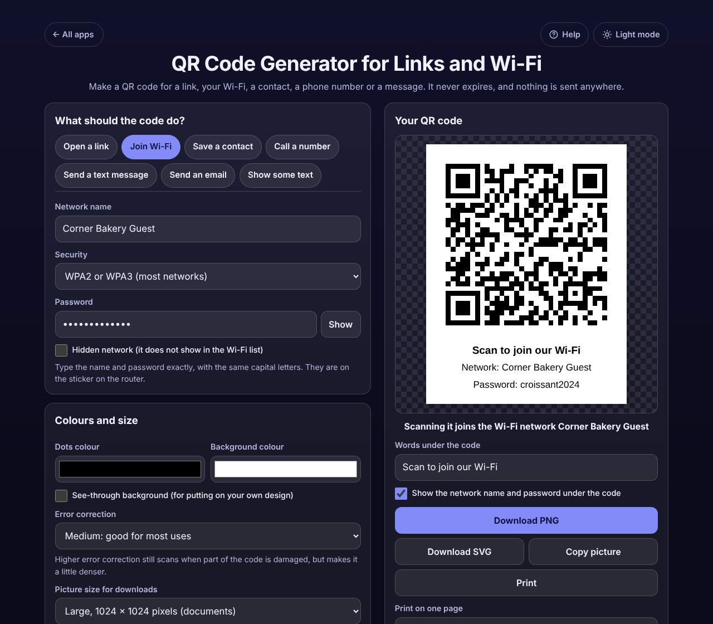

# QR Code Generator for Links and Wi-Fi

A free **QR code generator that never expires**. Make a code for a link, your guest Wi-Fi, a contact card, a phone number, a text message, an email or plain text. The code appears as you type. Download it as PNG or SVG, copy it, share it, or print a card with the Wi-Fi name and password under it. What you type is written straight into the code, with no short link through a website, so there is no trial to run out and no scan limit. No sign-up, no ads, nothing is uploaded, works offline.

**Live demo:** [umar8092.github.io/apps/qr-code-generator-for-links-and-wi-fi](https://umar8092.github.io/apps/qr-code-generator-for-links-and-wi-fi/)

| Desktop | On a phone |
|---|---|
|  |  |

## The situation it solves

A bakery owner is tired of spelling out the Wi-Fi password, and wants a code on each table and another one for the menu link. Many "free" QR sites hand out codes that go through their own short link and stop working when a trial ends. This app answers straight away:

- **Join Wi-Fi:** network name *Corner Bakery Guest*, password *croissant2024*, security WPA2 or WPA3. The code holds exactly `WIFI:T:WPA;S:Corner Bakery Guest;P:croissant2024;;`, and the page says *Scanning it joins the Wi-Fi network Corner Bakery Guest*. The printed card says **Scan to join our Wi-Fi**, then *Network: Corner Bakery Guest* and *Password: croissant2024*, so a guest whose phone cannot scan can still type it. Print 1 large code, or 4 or 6 to cut out for the tables.
- **Open a link:** typing `bakery.example.com/menu` gives a code for `https://bakery.example.com/menu` (the https:// is added for you), with *Print it at least 2 cm (0.8 in) wide*.
- A password with special characters, such as `beans;2024:"x"`, is escaped the way phones expect: `P:beans\;2024\:\"x\";`.
- A contact card for *Sara Khan, +92 300 1234567* becomes a vCard that offers to save her in the phone's contacts.
- Text too long for one code says how long it is, the most a code holds (2,331 at Medium) and that Low error correction holds 2,953.

Every downloaded picture in the checks is scanned back with a QR reader and must give exactly the text above.

## Features

- **Seven kinds of code:** Open a link, Join Wi-Fi (WPA2/WPA3, WEP, open, hidden network), Save a contact (vCard), Call a number, Send a text message, Send an email (with optional subject and message), Show some text (any language and emoji).
- **Clear checks:** a red line under a box that needs fixing (letters in a phone number, an email without a domain); yellow notes for things to check (Wi-Fi password under 8 characters or with a space at the end, a link with no .com).
- **Download PNG** at 256, 512, 1024 or 2048 pixels or any size from 64 to 4096, with sharp whole-pixel squares, and **Download SVG** that stays sharp at any size. Copy picture, Share on phones.
- **Print** only the code: 1 large or 4 or 6 to cut out, with your own words under it and, for Wi-Fi, the network name and password (can be turned off).
- **Colours** for the dots and background, or a see-through background, with a warning when phones may not read them (light dots on dark, too little contrast).
- **Error correction** Low, Medium, Quartile or High, and a minimum print size for each code.
- **My QR codes:** save codes with a name, open them later to reprint, Save changes or Save as a new code, delete with Undo. **Start over** with Undo.
- **What is inside the code** shows the exact text a phone reads.
- **Help button.** Tap **Help** at the top for a short how-to written for this app, and tap **All apps** to go back to the list.
- **Light and dark mode switch.** It follows your device until you choose, and remembers your choice in every app.
- **Private.** Everything is made on your device and saved only in this browser. Your data is never sent anywhere.
- **Works offline and installable.**

## Run it yourself

No build step and no dependencies.

```bash
git clone https://github.com/umar8092/apps.git
```

Then open `qr-code-generator-for-links-and-wi-fi/index.html` in your browser.

Offline mode and install need the files served over `https` or `localhost` (for example `python3 -m http.server`).

## How it works

- `core.js` holds the rules with no page code: `buildPayload()` turns what you typed into the exact text inside the code (Wi-Fi escaping, vCard, `tel:`, `SMSTO:`, `mailto:`), `encode()` makes the squares and explains when text is too long, and `layout()` and `svgFile()` build the pictures.
- `qrcodegen.js` is the [QR Code generator library by Project Nayuki](https://www.nayuki.io/page/qr-code-generator-library) (MIT, see `qrcodegen-LICENSE.txt`), copied here so the app works offline.
- `script.js` builds the page. Everything you type is shown as plain text, never as HTML.
- `sw.js` saves the app on your device for offline use (network first, so updates arrive straight away).
- Run the logic checks with `node tests.js` (or open `test.html`), and the page checks with `node qr-code-generator-for-links-and-wi-fi/ui-test.js` from the repo root (needs `playwright`, `jsqr` and `pngjs`); they scan every downloaded picture back.

## License

[MIT](LICENSE). Free to use, copy, modify and share. Made by [Muhammad Umar](https://github.com/umar8092). The QR library is MIT licensed by Project Nayuki.
